# MorphOpt UI 快速开始

[脚本快速开始](scriptguide.md) · [UI 模块与接口参考](UIreference.md) · [脚本模块与接口参考](scriptreference.md)

本文从主定义页建立一个圆柱内腔加压算例，完成几何、载荷、材料、目标和优化器定义，再检查优化历史与有限元结果。配套文件为 [bending_actuator.morph](../examples/bending_actuator/bending_actuator.morph) 和 [bending_actuator.py](../examples/bending_actuator/bending_actuator.py)，两者描述同一问题。MorphOpt 使用 TorchFEA 求解，无需安装 Abaqus。

本页定义截图来自当前算例；优化历史截图来自该脚本在 CPU 上完成的两轮计算，展示实际输出。其余事后有限元截图保留已有独立分析记录，用于说明场量选择与导出操作，不作为当前算例的收敛结果。

## 目录

<!-- docs:toc depth=1 -->

- [1 运行已有定义](#start-existing)
- [2 算例定义](#section-算例定义)
- [3 程序启动与基本操作](#section-程序启动与基本操作)
- [4 定义几何：部件、曲面和实例](#geometry)
- [5 定义载荷、参考点、连接与工况](#loads)
- [6 定义材料](#materials)
- [7 定义目标与指标](#objectives)
- [8 设置求解器和运行配置](#section-设置求解器和运行配置)
- [9 设置几何优化器](#updaters)
- [10 检查与保存](#section-检查与保存)
- [11 启动优化与观察结果](#optimization)
- [12 事后有限元分析](#finite-element)
- [13 外观与运行环境](#section-外观与运行环境)

<!-- /docs:toc -->

<a id="start-existing"></a>

## 1 运行已有定义

1. 在 Python 3.12 或更新版本的环境中执行 `python -m pip install morphopt`，随后执行 `morphopt-ui`。从源码使用时，在仓库根目录执行 `python -m pip install -e .`。
2. 选择 **文件 → 打开 .morph…**，打开 `examples/bending_actuator/bending_actuator.morph`。
3. 检查 `part1`、实例 `part1-1`、内腔压力 0.06、底端固定与顶部参考点 `RP_1`。右侧工况选择 `load_case_1`。
4. 在控制器中选择可写结果根目录；运行设备、求解器进程设备和优化器设备均保留 CPU，求解进程数为 1。
5. 通过 **另存为…** 保存独立副本，再点击 **开始优化**。首轮完整保存后，优化过程页显示历史数据与设计视图。

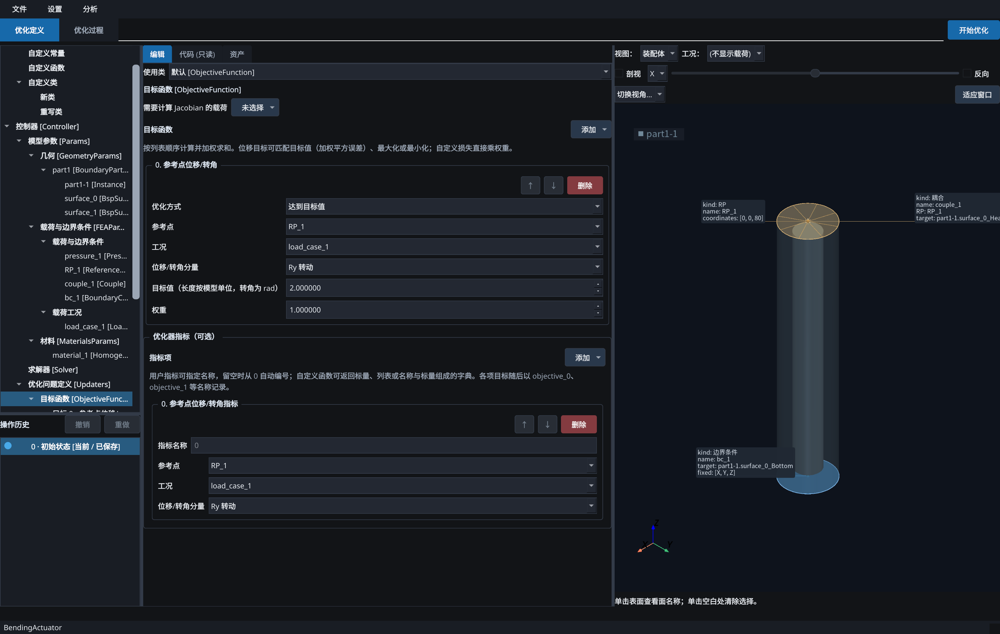

首轮保存表示建模、有限元求解、灵敏度、设计更新与归档已完成一次；目标与几何约束的收敛情况需结合后续历史判断。

<a id="section-算例定义"></a>

## 2 算例定义

| 项目 | 设置 |
|---|---|
| 部件 / 实例 | `part1` / `part1-1` |
| 外边界 | 初始半径 8，长度 80，起点 `(0,0,0)` |
| 内腔 | 初始半径 4，长度 74，起点 `(0,0,3)` |
| 固定位置 | `surface_0_Bottom`，固定 X/Y/Z 平移 |
| 顶部参考点 | `RP_1`，坐标 `(0,0,80)`，耦合至 `surface_0_Head` |
| 载荷 | `load_case_1` 中的 `pressure_1=0.06`，作用于 `surface_1_All` |
| 材料 | `NeoHookeanLnJ`，`mu=0.482`，`kappa=4.8` |
| 主目标 | 最小化 `(ry - 2) ** 2`，匹配旋转向量 Y 分量 2 rad |
| 记录指标 | 用户指标 `0` 记录 `ry`；自动指标 `objective_0` 记录目标贡献 |
| 几何更新 | 两个曲面均更新；xz 镜面对称、曲率正则化、最小距离和圆柱包络 |

模型采用 mm–N–MPa 一致单位制，压力 0.06 MPa 对应 60 kPa。MorphOpt 不执行自动单位换算。旋转向量采用 rad。

<a id="section-程序启动与基本操作"></a>

## 3 程序启动与基本操作

在同一个 Python 环境中安装和启动：

```bash
python -m pip install morphopt
morphopt-ui
```

模块入口为 `python -m morphopt.ui`。虚拟环境的安装与激活步骤见 [README](../README.md#run-the-ui-in-a-virtual-environment)。

主界面左侧为模型树和操作历史，中间为“编辑 / 代码（只读）/ 资产”页，右侧为定义预览。模型树选择对象后，中间定位其卡片；同组卡片的 **↑ / ↓ / 删除** 调整顺序或移除条目。编辑阶段允许列表为空，完整性在开始优化前校验。

坐标、平移、转动和其他列表参数拆为有名称的分量输入框。数值输入通过 Enter 或离开输入框提交；下拉框选择后提交。鼠标滚轮用于滚动页面，不改变所指输入框、下拉框或滑条的数值。支持常量引用的字段仍可引用“辅助代码”中定义的常量。

右侧切换 **部件 / 装配体**：部件视图采用局部坐标，装配体视图应用实例位姿。单击表面显示其集合名称，单击空白清除选择。剖视滑条改变显示范围；**切换视角…** 提供 ±X、±Y、±Z 和正等轴测，**适应窗口** 保持方向并调整可见范围。定义预览显示初始几何，优化结果在优化过程页查看。

<a id="geometry"></a>

## 4 定义几何：部件、曲面和实例

<a id="section-创建边界部件"></a>

### 4.1 创建边界部件

选择 **文件 → 新建**，在 **几何 → 添加** 中创建 `BoundaryPart`，名称为 `part1`。部件参数如下。

| 字段 | 值 |
|---|---|
| FEA 网格种子尺寸 | `1.0` |
| 网格阶次 | 下拉选择 `1`；可选 `1` 或 `2` |
| 外表面集合 | `surface_0_All` |

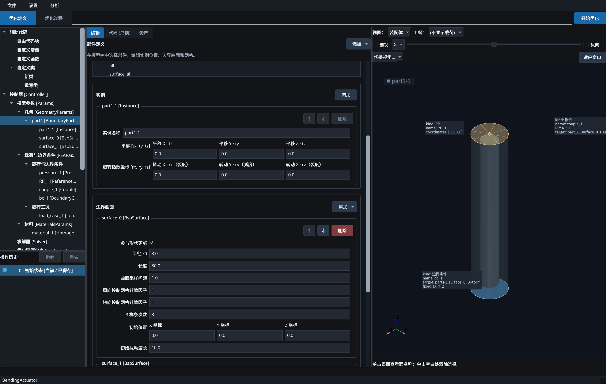

部件名称与实例名称分别定义。无需再输入一个独立的装配体 Part 别名。

<a id="section-定义外边界与内腔"></a>

### 4.2 定义外边界与内腔

在部件的 **边界曲面 → 添加** 中创建两个 **B 样条圆柱面**，顺序为外边界 `surface_0`、内腔 `surface_1`。

| 参数 | 外边界 | 内腔 |
|---|---|---|
| 参与形状更新 | 启用 | 启用 |
| 半径 | `8.0` | `4.0` |
| 长度 | `80.0` | `74.0` |
| 曲面采样间距 | `1.0` | `1.0` |
| 周向 / 轴向控制网格计数因子 | `1 / 1` | `1 / 1` |
| B 样条次数 | `3` | `3` |
| 初始位置 X/Y/Z | `0 / 0 / 0` | `0 / 0 / 3` |
| 初始扰动波长 | `10.0` | `10.0` |

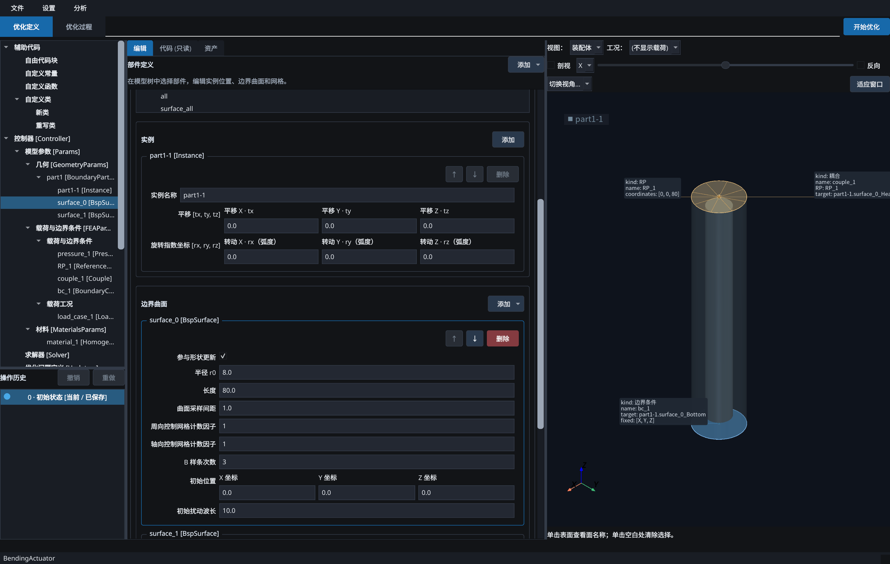

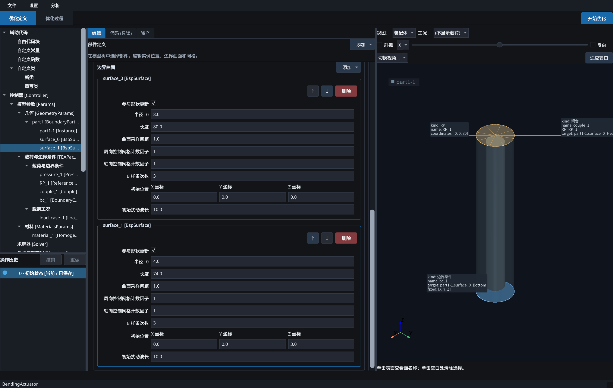

第 0 个曲面形成外边界，后续曲面形成内腔；法向由顺序自动确定，不单独输入 `flip`。`seed_size` 控制曲面采样与控制网格，部件网格种子尺寸控制有限元网格。曲率阈值在优化器的 `Fairness` 中设置。

初始外边界位于 Z=0～80，内腔位于 Z=3～77，两端名义间距均为 3。`perturbation_L` 会引入初始扰动，实际曲面与无扰动圆柱略有差异。

<a id="section-定义实例"></a>

### 4.3 定义实例

选择 `part1-1 [Instance]`，平移 X/Y/Z 和转动 X/Y/Z 均填写 0。转动采用指数坐标，单位为 rad。已有默认实例时直接修改。

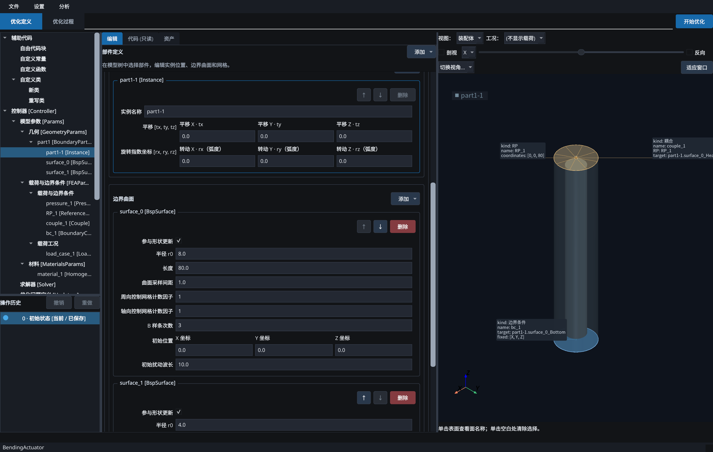

<a id="loads"></a>

## 5 定义载荷、参考点、连接与工况

在 **载荷与边界条件 → 添加** 中分别创建以下接口。

| 接口 | 名称 | 参数 |
|---|---|---|
| Pressure | `pressure_1` | 实例 `part1-1`，表面 `surface_1_All` |
| ReferencePoint | `RP_1` | X=0，Y=0，Z=80 |
| Couple | `couple_1` | 参考点 `RP_1`，实例 `part1-1`，节点集 `surface_0_Head` |
| BoundaryCondition | `bc_1` | 实例 `part1-1`，节点集 `surface_0_Bottom`，勾选 X/Y/Z |

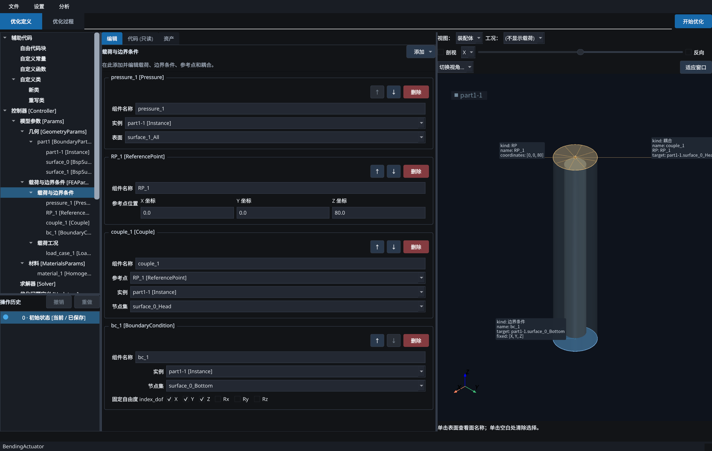

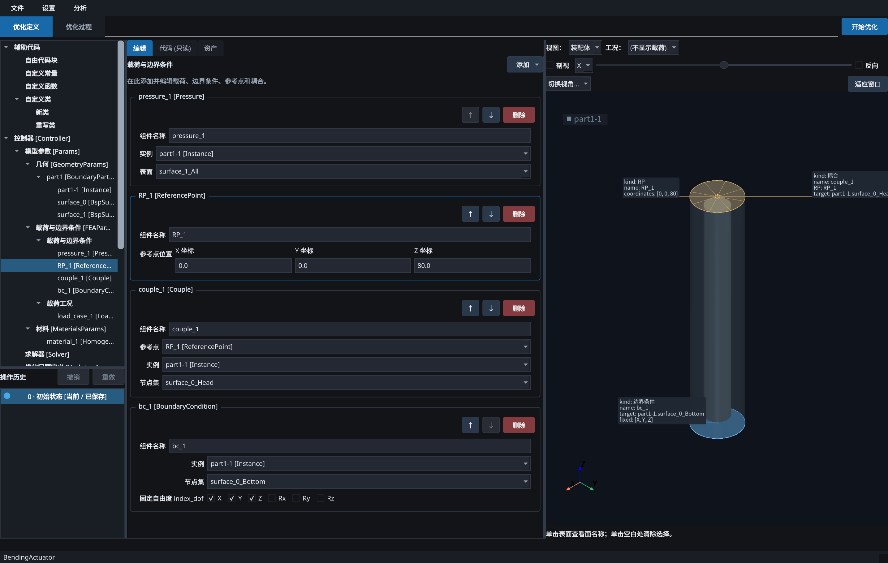

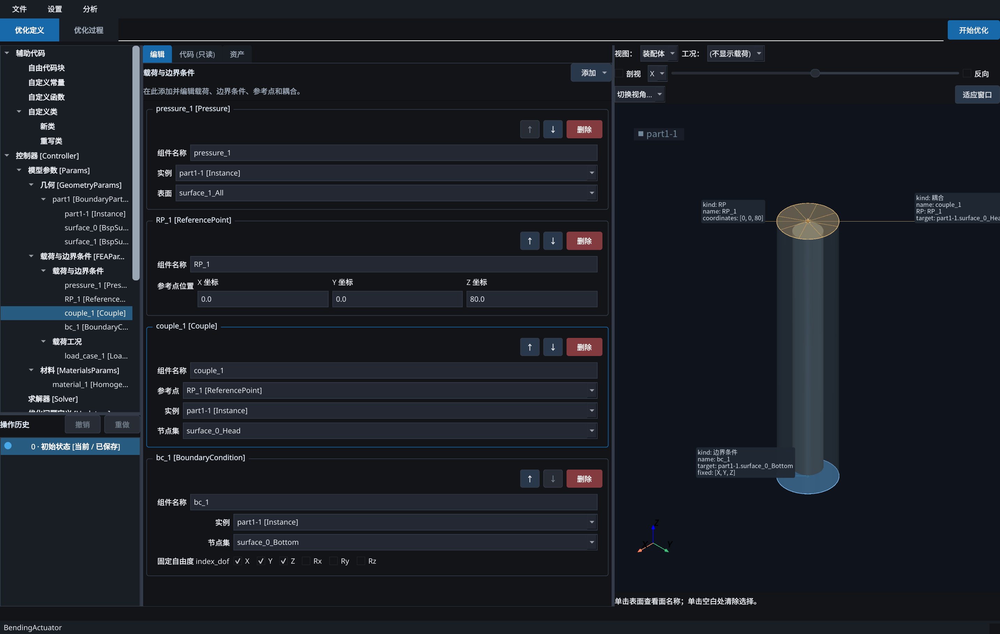

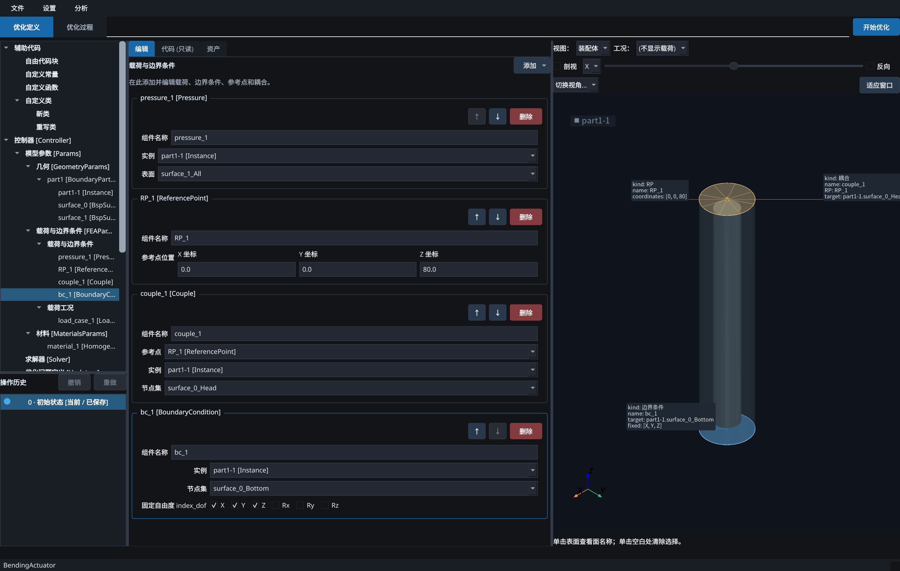

载荷接口定义作用对象；数值幅值在载荷工况中定义。参考点本身不自动连接实体，顶部运动通过 `Couple` 传递。

在 **载荷工况 → 添加** 创建 `load_case_1`。工况以模型树节点和接口卡片显示，卡片中的 `pressure_1 · 压力` 填写 `0.06`。工况名称为字符串，**↑ / ↓** 调整注册顺序。

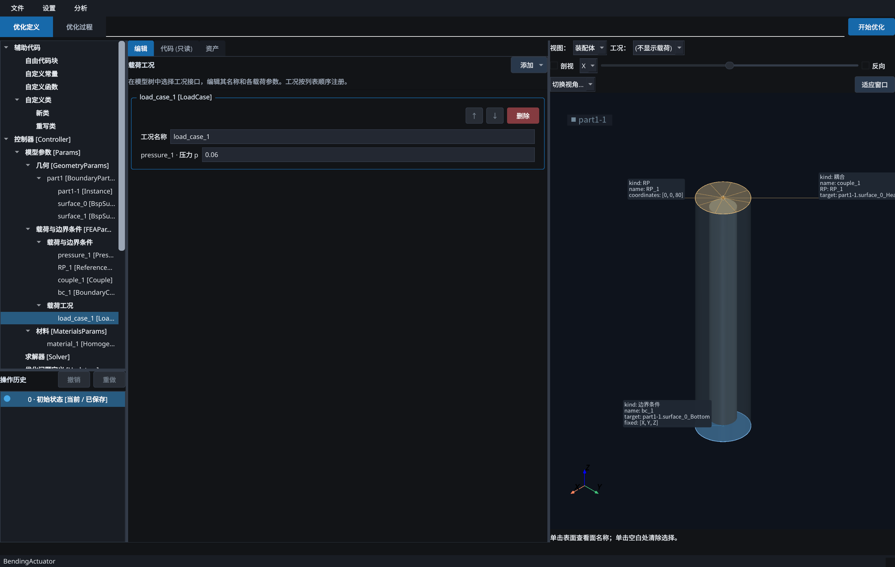

同一卡片逐项列出所有有参数的载荷。弹簧等多参数接口按刚度、原长、固定端坐标分别显示；其他载荷的参数定义见 [载荷工况参考](UIreference.md#steps)。

<a id="materials"></a>

## 6 定义材料

在 **材料 → 添加** 中创建均匀材料 `material_1`，所属部件选 `part1`，本构选 `NeoHookeanLnJ`，设置 `mu=0.482`、`kappa=4.8`、密度 `1.08e-9`。本例不使用 SIMP 材料场。

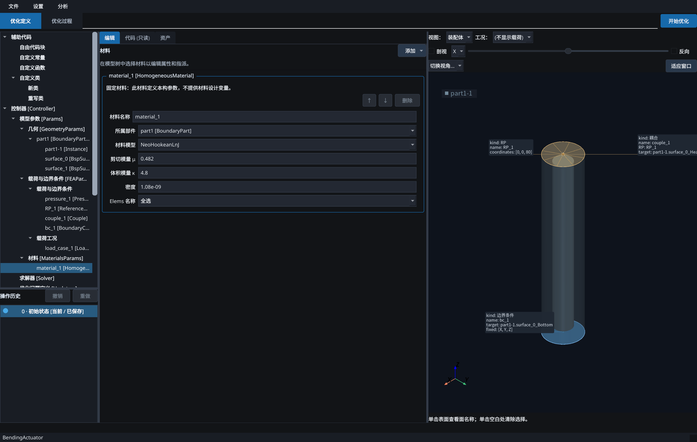

<a id="objectives"></a>

## 7 定义目标与指标

选择 **优化问题定义 → 目标函数**，添加参考点位移/转角目标，设置：参考点 `RP_1`，工况 `load_case_1`，分量 **Ry 转动**，方式 **匹配目标值**，目标值 `2.0`，权重 `1.0`。

在用户指标区添加参考点位移/转角指标，使用同一参考点、工况和分量。名称留空时自动编号为 `0`。目标和指标均从 0 开始编号。


总损失为 `(ry - 2) ** 2`；指标 `0` 保留原始转角，自动指标 `objective_0` 记录该目标的加权误差。自动目标指标追加在用户指标之后，不需要再手工登记。

<a id="section-设置求解器和运行配置"></a>

## 8 设置求解器和运行配置

求解器保留一个进程，**进程设备分配**中选择 CPU。新增进程也默认使用 CPU。下方 **工况进程分组**以进程组为一行，右侧为依次求解的工况序列；本例保留单独的 `load_case_1`。

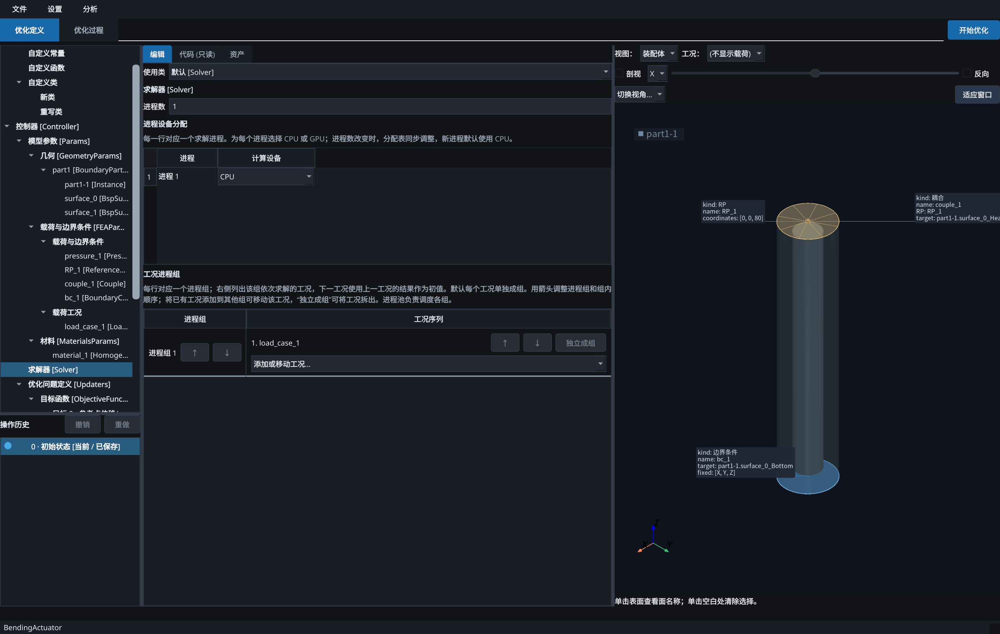

多工况时，默认一工况一组。组内箭头调整求解顺序，“添加或移动工况”改变所属组，“独立成组”拆出工况。同组后续工况使用前一工况的结果作为初值。进程组是调度任务，不固定绑定同编号的工作进程。

在 **控制器** 中设置任务名 `BendingActuator`、结果根目录 `.results/`、运行设备 `cpu`、重启周期 `20`。相对目录以任务执行目录为基准；重启周期不定义优化总轮数。

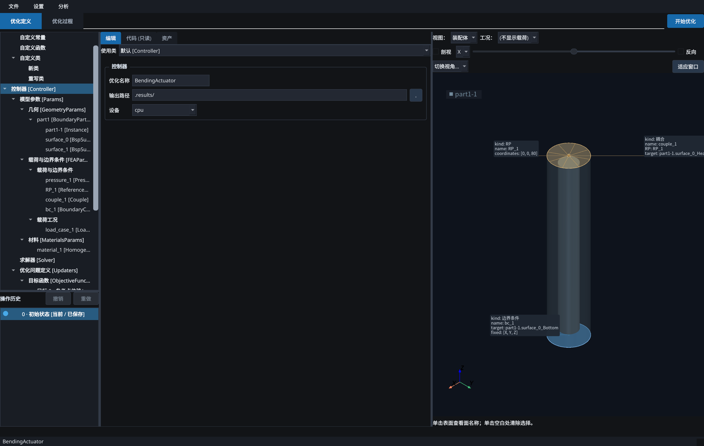

<a id="updaters"></a>

## 9 设置几何优化器

<a id="section-更新范围与策略"></a>

### 9.1 更新范围与策略

在 `part1` 上创建优化器，最大子优化迭代数设为 `50`，最大更新步长设为 `0.5`，优化器设备设为 CPU。曲面是否更新由各曲面的“参与形状更新”决定。

步长策略选择 `FixedStepLength`，罚项策略选择 `AdaptiveShapeWeights`，参数如下。

| 参数 | 值 |
|---|---|
| 初始 / 最终距离放宽比例 | `0.05 / 0.0` |
| 目标相对变化阈值 | `0.01` |
| 每次距离收紧量 | `0.001` |
| 罚值增长触发倍数 | `2.0` |

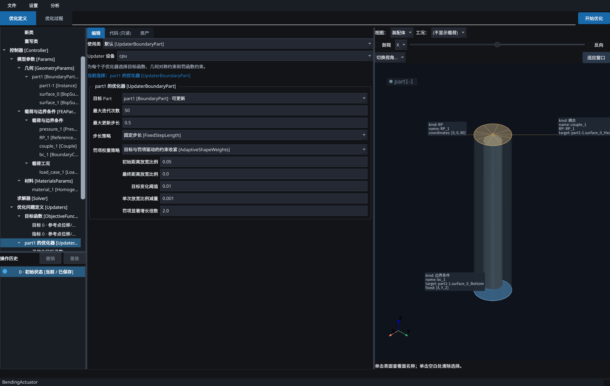

策略在目标变化较小或约束明显恶化时收紧距离要求。已标定且未恶化的系数保持稳定；单次子优化内，步长、距离要求和系数均固定。算法含义和日志字段见 [策略参考](scriptreference.md#section-几何权重策略与障碍积分)。

<a id="section-子优化目标与对称关系"></a>

### 9.2 子优化目标与对称关系

将默认 `ShapeDerivative` 替换为 **二阶形状灵敏度 [QuadraticShapeDerivative]**，历史长度为 `10`。本例仅保留这一项物理代理，避免与一阶项重复计算。

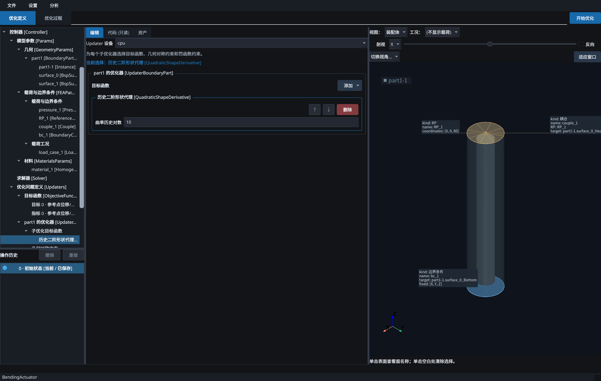

在 **几何对称约束**中，为 `surface_0` 和 `surface_1` 分别添加 xz 镜面对称，偏移均为 0。xz 平面对应 Y=0。

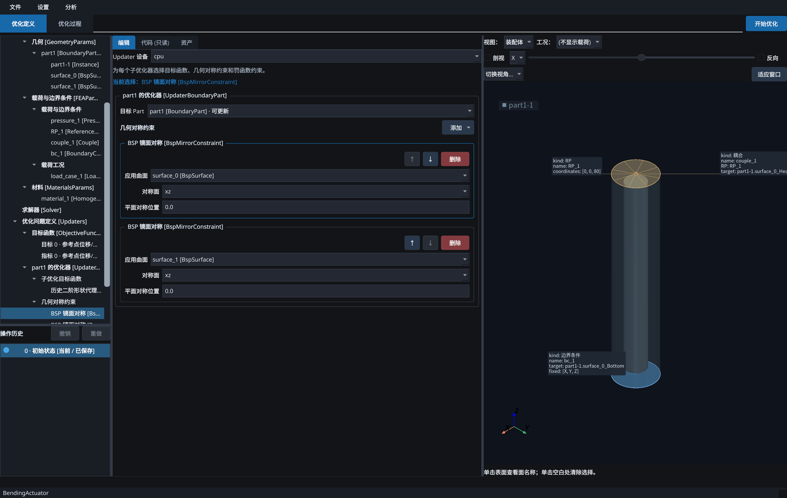

<a id="section-几何罚项"></a>

### 9.3 几何罚项

添加或修改以下罚项。

| 罚项 | 参数 |
|---|---|
| Fairness | `max_curvature=1.0`，共同作用于可更新的 BSP/CPGEO 曲面 |
| Distance | 2×2 最小距离矩阵，每个单元格均为 `2.5` |
| Cylinder | 半径 `10`，高度 `80`，底端 `0` |

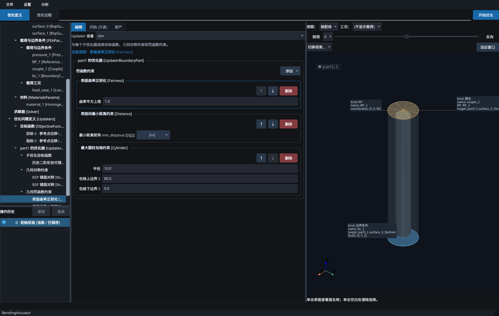

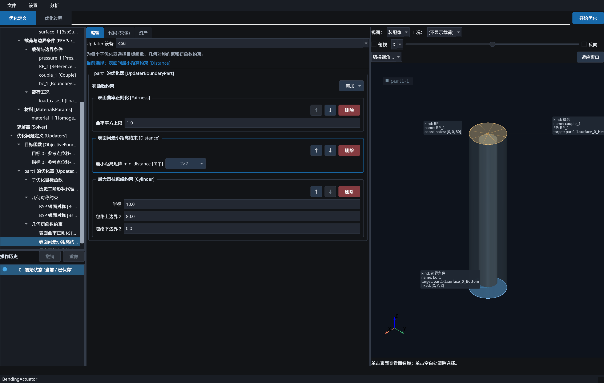

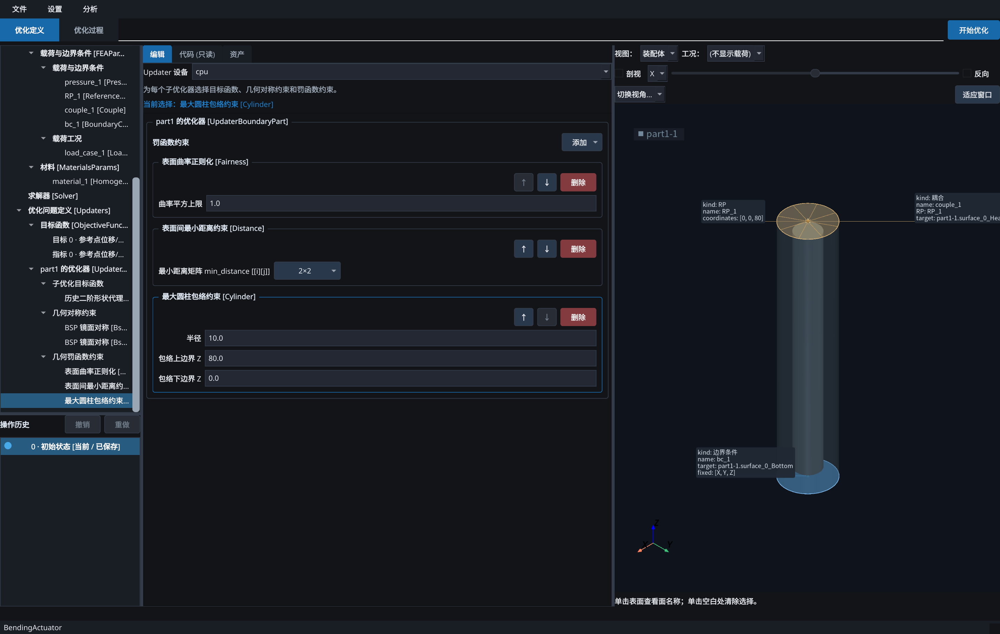

最小距离是几何要求，有限罚函数不等同于严格可行域。默认初始放宽比例 0.05 下，2.5 的要求暂按 2.375 处理，并保留障碍过渡区；随后按触发条件逐步恢复原始要求。

<a id="section-检查与保存"></a>

## 10 检查与保存

模型树中的浅红节点表示静态校验发现错误，悬停显示原因。检查部件和实例、集合引用、工况幅值、材料分配、目标、更新器绑定及设备。修正后标色随定义刷新。

**保存 .morph**保留可编辑定义和嵌入资产。**导出运行脚本…**选择的是目标目录名称：目录内包含同名 `.py` 和 `morphopt_assets/`；STEP、STL、INP 及 BREP 元数据在导出时还原到资产目录。执行时应共同移动整个目录。中央“资产”页可预览几何资产，“代码”页与运行、导出共用同一生成逻辑。

文件中支持的字段正常导入，缺失项使用当前默认值，额外字段或不支持条目被忽略并汇总警告；该提示不替代几何有效性检查。修改并核查后另存新副本。

<a id="optimization"></a>

## 11 启动优化与观察结果

点击 **开始优化**进入优化过程。左侧平铺列出优化指标、优化日志、各可更新组件及各工况变形。

<a id="section-指标与日志"></a>

### 11.1 指标与日志

**优化指标**显示目标、具名指标、阶段耗时（s）、节点数和单元数。表格按内容分档确定列宽，允许横向滚动，隔行底色区分记录；下方选择器切换目标或单独指标的曲线。此页不显示几何迭代滑条。

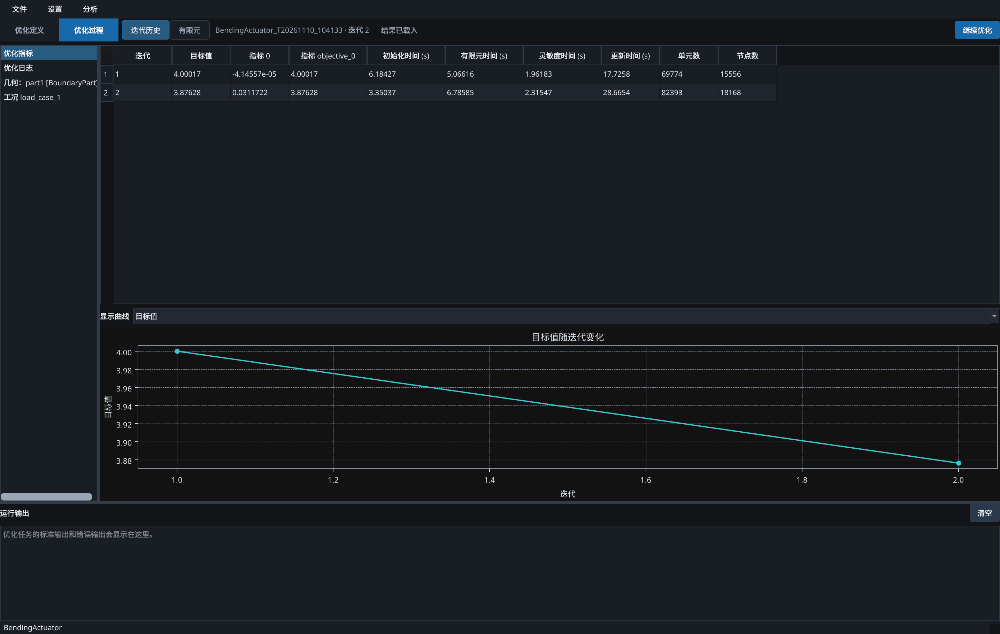

**优化日志**可切换保存的 `.log` 文件。向上滚动、选择文本或拖动滚动条时保持阅读位置；返回底部或勾选跟随可继续查看最新输出。日志页也不显示几何迭代滑条。

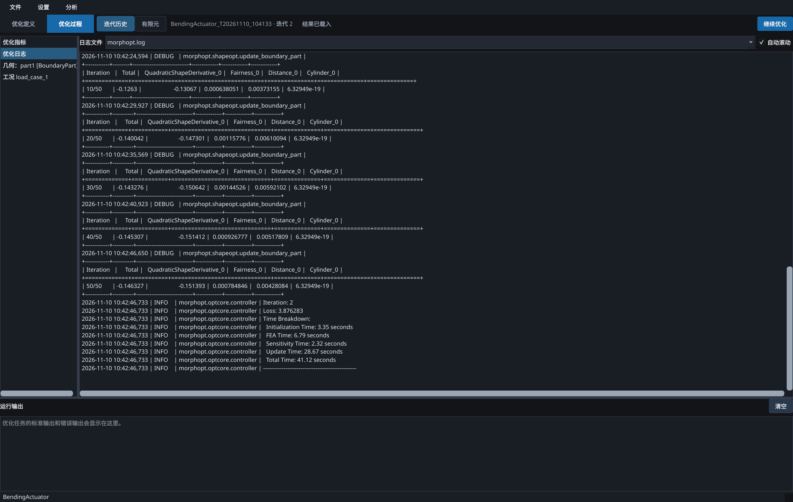

<a id="section-设计单曲面与工况变形"></a>

### 11.2 设计、单曲面与工况变形

选择左侧 **几何：part1**，在显示视图中选择全部曲面、单个 `surface_N` 或控制点网格。BSP/CPGEO 的控制网格与曲面一起显示。上方迭代滑条、前后按钮和自动跟踪仅在三维结果页出现。

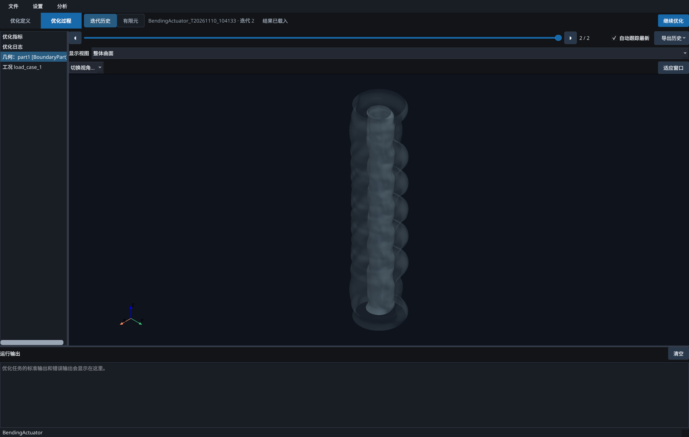

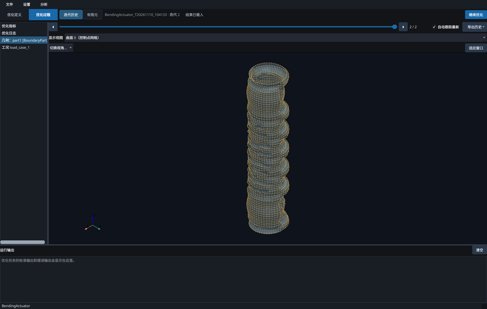

选择 **工况 load_case_1**查看该轮受压变形。几何页是设计边界，工况页是有限元响应，两者含义不同。

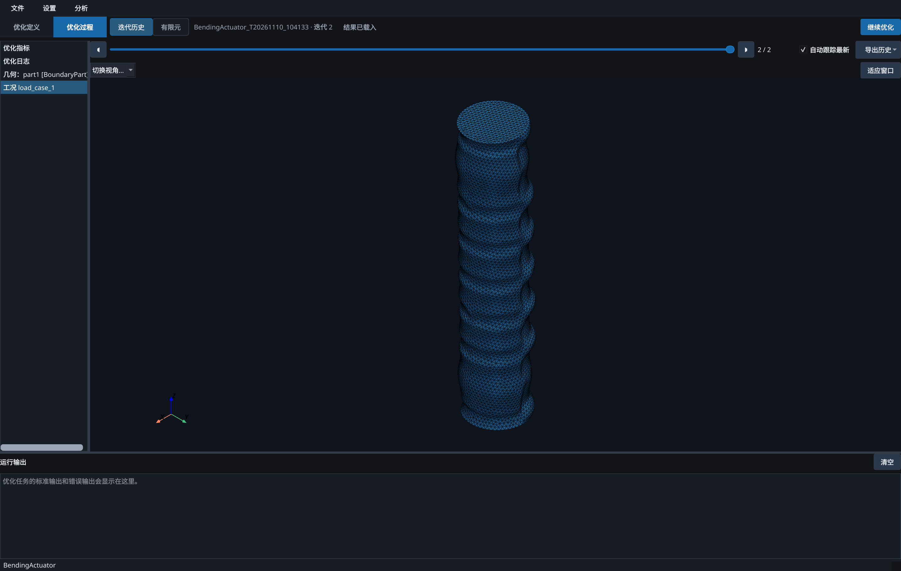

<a id="section-导出与继续计算"></a>

### 11.3 导出与继续计算

在三维结果页的 **导出历史**菜单中导出当前视图曲面，或导出历史设计、历史变形 GIF。曲面导出的组件、曲面和轮次直接取自界面选择，格式按曲面能力优先 STEP、否则 STL。GIF 窗口选择组件或工况、轮次范围和帧率，使用最近三维视口的相机与材质；设计 GIF 绘制组件的完整设计，不沿用单曲面或控制网格筛选。

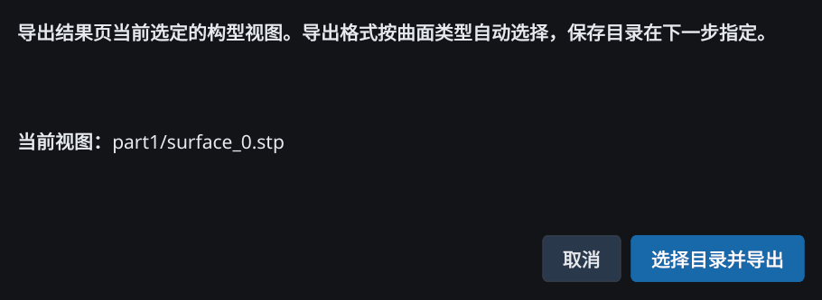

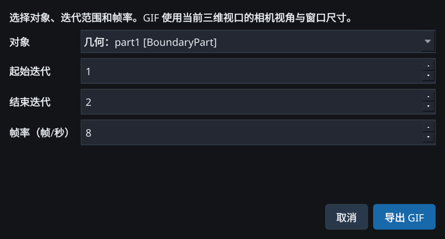

**停止优化**终止当前任务。修改参数后再次开始会创建新任务；继续原任务使用 **文件 → 继续优化…**并选择其结果目录及完整检查点。首轮完整保存前失败的任务直接退出并报告异常；已有完整检查点时保留现有恢复流程。Python 优化异常同时写入优化日志。

<a id="finite-element"></a>

## 12 事后有限元分析

进入 **优化过程 → 有限元**，选择已保存迭代与工况。有限元分析固定所选设计，可修改载荷幅值并重新求解，不更新优化变量。

| 操作 | 结果 |
|---|---|
| 选择设计迭代、原工况与已有结果 | 读取对应归档模型和解 |
| 切换位移、Mises 应力、应变等场量 | 在同一模型上显示不同物理量 |
| 切换变形显示 | 改变网格位置，场值仍来自所选解 |
| 修改压力并求解 | 建立独立结果，可与原工况比较 |
| 导出节点、积分点、参考点或完整模型 | 按选定位置和格式输出数据 |

以下图片为已有事后分析记录，展示 0.06 压力工况与修改为 0.05 后的独立求解操作。

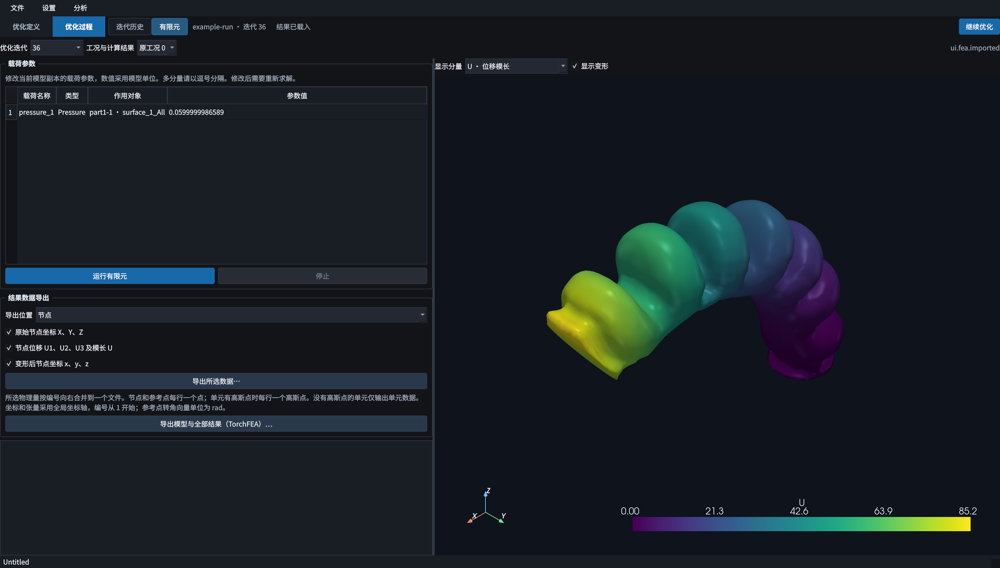

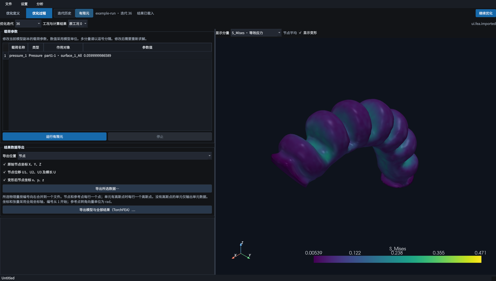

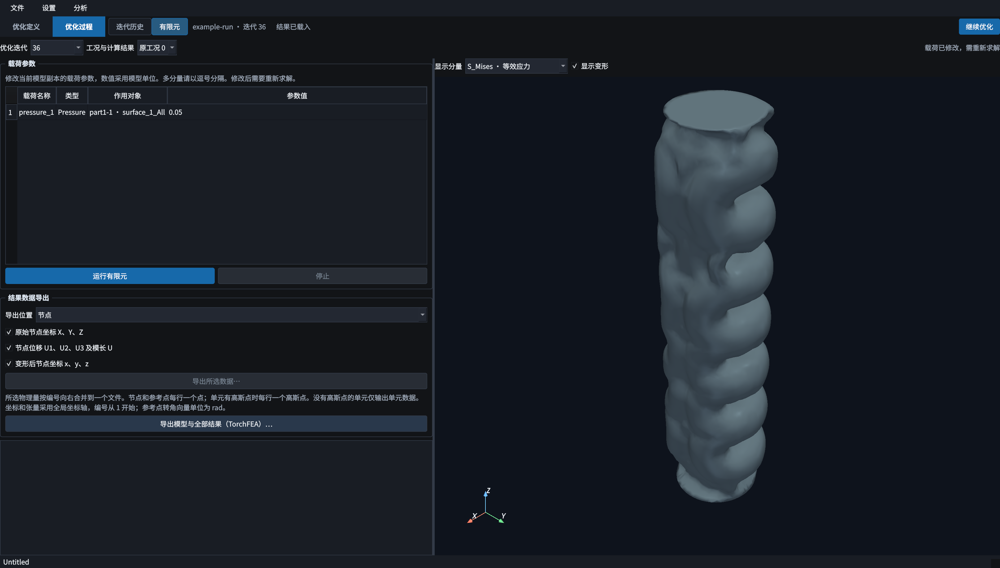

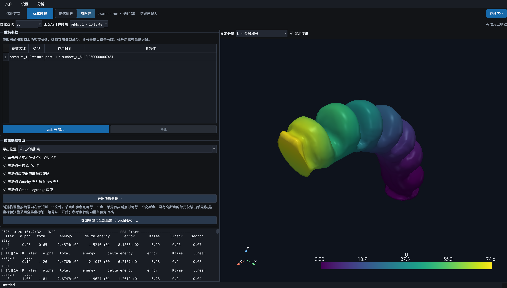

节点平均场与原始积分点数据的采样位置不同，统计时按导出位置及编号对应。新结果未求解或求解失败时，不将其解释为当前载荷的平衡解。完整操作见 [有限元与导出参考](UIreference.md#results)。

<a id="section-外观与运行环境"></a>

## 13 外观与运行环境

**设置 → 外观 → 字体设置…**按界面正文、左侧模型树、编辑区标题、代码和图表分类设置。每类分别选择中文、西文字体，共用字号；修改先在窗口内预览，**应用**保存并生效但不关闭，**确认**保存并关闭，**取消**放弃尚未应用的修改。默认使用系统字体。

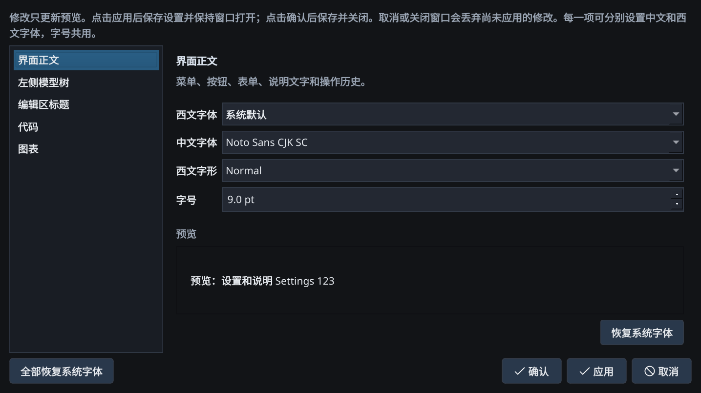

外观中的可视化设置统一控制平行投影、光照和表面材质；各三维窗口复用视角控件。

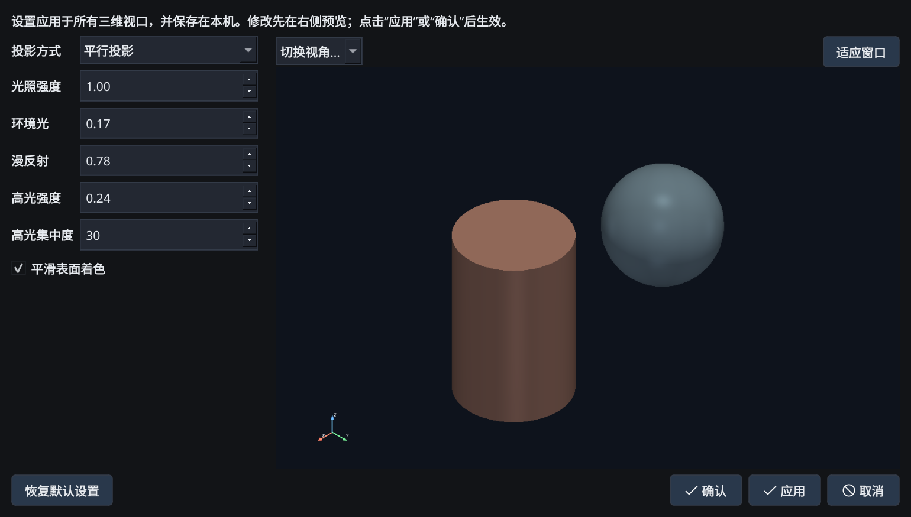

SSH 转发使用 X11 时，先执行 `ssh -X user@remote-host`，远端运行 `QT_QPA_PLATFORM=xcb morphopt-ui`，保留 SSH 设置的 `DISPLAY`。Windows 与 Linux 使用相同的定义和结果操作，图形驱动及依赖需在目标系统安装。
