# MorphOpt UI 快速开始

[脚本快速开始](scriptguide.md) · [脚本模块与接口参考](scriptreference.md) · [UI 模块与接口参考](UIreference.md)

本文以随文档提供的 [`test.morph`](examples/test.morph) 为例，说明通过图形界面启动优化、从空白定义建立同一模型，以及查看优化与有限元结果的完整流程。首次运行可直接采用已定义的算例；从空白建模时，按几何、载荷工况、材料、目标和优化器的顺序定义。

脚本与 UI 算例采用相同的几何、载荷、材料和目标。各模块的参数含义与其他类型见 [UI 模块与接口参考](UIreference.md)，同一模型的 Python 定义见[脚本快速开始](scriptguide.md)。

定义页截图使用该示例的实际参数。优化与有限元截图来自已有运行记录，展示截至第 **36** 轮的状态，并包含压力由 **0.06 调整为 0.05** 后的独立有限元结果。新运行的迭代数量、耗时和收敛过程以实际计算为准。截图保留桌面原始分辨率，原图支持放大查看。

跳转：[直接启动算例](#start-existing) · [几何](#geometry) · [载荷与工况](#loads) · [材料](#materials) · [目标](#objectives) · [优化器](#updaters) · [优化进程](#optimization) · [事后有限元](#finite-element)

## 目录

<!-- docs:toc depth=1 -->

- [1 运行已有定义](#start-existing)
- [2 算例定义](#section-算例定义)
- [3 程序启动与界面操作](#section-程序启动与界面操作)
- [4 定义几何：部件、曲面和实例](#geometry)
- [5 定义载荷、参考点、耦合和固定约束](#loads)
- [6 定义材料并分配给部件](#materials)
- [7 定义优化目标和记录指标](#objectives)
- [8 设置求解器和运行信息](#section-设置求解器和运行信息)
- [9 设置几何优化器](#updaters)
- [10 检查、保存与其他编辑入口](#section-检查保存与其他编辑入口)
- [11 启动优化并检查迭代结果](#optimization)
- [12 对已保存设计进行事后有限元分析](#finite-element)
- [13 常见问题与核查项目](#section-常见问题与核查项目)
- [14 文档与术语参考](#section-文档与术语参考)

<!-- /docs:toc -->

<a id="start-existing"></a>

## 1 运行已有定义

1. 在 Python 3.12 或更新版本的环境中执行 `python -m pip install morphopt`，随后执行 `morphopt-ui`。
2. 选择 **文件 → 打开 .morph…**，打开 [test.morph](examples/test.morph)。仓库内路径为 `docs/examples/test.morph`；独立使用时可先下载该文件。
3. 在主定义页检查 `part1`、`part1-1`、内腔压力 `0.06`、底部固定和末端 `RP_1`。选择装配体与工况 0，确认右侧显示几何、载荷与约束。
4. 在控制器任务设置中指定可写的结果目录；计算设备选择 CPU，求解进程数为 1，GPU 列表留空。通过 **另存为…** 保存当前任务副本。
5. 点击右上角 **开始优化**。在运行输出中观察网格生成、有限元求解、灵敏度与更新信息，首轮完整保存后查看历史曲线。
6. 在 **优化过程** 中选择已保存迭代，查看设计边界和工况变形；进入 **工况与计算结果**，查看位移、应力和应变。


首轮保存完成表示建模、求解、灵敏度、更新与归档流程已完成一次，不表示优化或有限元精度已经充分收敛。本文后续章节说明从空白定义建立同一算例；模块参数与扩展类型集中见 [UI 模块与接口参考](UIreference.md)。

<a id="section-算例定义"></a>

## 2 算例定义

结构沿全局 Z 轴布置，底部固定，内部气腔承受压力，顶部参考点记录末端运动。优化以外表面和内腔表面的形状为设计变量，以顶部参考点旋转向量的 Y 分量最大化为目标。

| 项目 | 本算例的设置 |
|---|---|
| 部件 / 实例 | `part1` / `part1-1` |
| 外边界 | 初始半径 8，长度 80，起点 `(0, 0, 0)` |
| 内腔边界 | 初始半径 4，长度 74，起点 `(0, 0, 3)` |
| 固定位置 | 外表面的底端节点集 `surface_0_Bottom` |
| 压力 | 内腔表面 `surface_1_All`，幅值 `0.06` |
| 材料 | `NeoHookeanLnJ`，`mu=0.482`，`kappa=4.8` |
| 优化目标 | 最大化参考点 `RP_1` 的 `ry` |
| 可更新表面 | 外表面和内腔表面都允许更新 |
| 几何控制 | 两个表面的 xz 镜面对称、曲率正则化、距离约束和圆柱包络 |

**模型采用一致单位制。** 本例采用长度 mm、力 N、应力和模量 MPa。压力 `0.06 MPa = 60 kPa`，载荷表中填写 **0.06**。参考点的旋转向量以 rad 记录。

<a id="section-程序启动与界面操作"></a>

## 3 程序启动与界面操作

<a id="section-启动或打开现有定义"></a>

### 3.1 启动或打开现有定义

运行环境要求 Python 3.12 或更新版本，并具备图形桌面。

在符合版本要求的 Python 环境中安装并启动：

```bash
python -m pip install morphopt
morphopt-ui
```

安装与启动应使用同一 Python 环境；模块入口 `python -m morphopt.ui` 与 `morphopt-ui` 等效。从源码安装时，在仓库根目录执行 `python -m pip install -e .`。MorphOpt 使用自身的模型格式和 TorchFEA 求解，无需安装 Abaqus。

通过 SSH 显示远端窗口时，在本地执行 `ssh -X user@remote-host`，进入远端 Python 环境后执行 `QT_QPA_PLATFORM=xcb morphopt-ui`。本地为 Wayland 桌面时，需要可用的 XWayland；SSH 的 X11 转发仍使用 X11 协议。远端 `DISPLAY` 由 SSH 设置，不应手动改为 `:0`。参见 [OpenSSH 的 X11 转发说明](https://man.openbsd.org/ssh.1)。

程序保留显式设置的 `QT_QPA_PLATFORM`。未指定该变量时，检测到 SSH 会话且存在 `DISPLAY` 则优先选择 `xcb`；本地启动仍按桌面会话选择后端。Qt 的后端选择规则见 [Qt Platform Abstraction](https://doc.qt.io/qt-6/qpa.html)。若窗口能够出现而三维视口存在 OpenGL 错误，可尝试 `LIBGL_ALWAYS_SOFTWARE=1 QT_QPA_PLATFORM=xcb morphopt-ui`，软件渲染的显示性能通常较低。

Windows 和 Linux 使用相同的菜单与按钮。优化任务在 Windows 上通过 PID 终止进程树，在 Linux 上通过独立进程组终止。事后有限元、CAD 转换和曲面导出的单次计算由 Qt `QProcess` 管理；各 Python 后台进程统一输出 UTF-8，中文输出采用连续解码。保存、打开、剪贴板及文件选择使用 Qt 接口，撤销和重做使用系统标准快捷键。

任务显示名称与结果目录名称分别保存。结果目录及导出资产名称自动处理 Windows 非法字符和保留名称，中文与普通空格可保留；结果查找使用相同命名规则。作为归档标识的部件、实例、载荷、材料和工况名称需符合 Windows/Linux 文件名要求，同组名称不得仅以大小写区分；非法或重复名称在模型树中提示，并在启动前检查。导出资产遇到仅大小写不同的同名文件时，按内容共用文件或追加摘要区分。

跨系统部署后，应在目标系统依次核查：中文路径下打开和保存 `.morph`、导出脚本目录、导入 STEP、CAD 转换、开始与停止优化、打开结果、事后有限元求解与停止、数据导出、曲面导出与取消。图形后端、显卡驱动及求解依赖仍需在对应系统实测；代码检查不能替代目标系统的运行验证。

- **从空白定义建模**：选择 **文件 → 新建**，从空白模型树开始。
- **对照检查或直接运行**：选择 **文件 → 打开 .morph…**，打开文档示例 `docs/examples/test.morph`。修改示例前可通过 **另存为…** 保存独立副本。

“快速开始”提供预设模型生成入口。本教程在主定义页建立 `test.morph` 的各项配置。

<a id="section-主定义页的主要区域"></a>

### 3.2 主定义页的主要区域

| 界面区域 | 功能 |
|---|---|
| 左侧模型树 | 选择几何、实例、载荷、工况、材料、目标和优化器 |
| 中央“编辑”页 | 填写所选对象的参数；长表单在此区域内滚动 |
| 右侧三维预览 | 检查初始结构、实例位置、载荷与约束作用对象 |
| 左下操作历史 | 撤销、重做，以及回到已有编辑步骤 |

模型树的当前节点决定中央编辑区的内容。字段修改通过 Enter 或焦点切换提交；表格修改在结束单元格编辑后提交。卡片中的 **↑ / ↓** 调整同组条目的顺序，**删除** 移除所选条目。

右侧预览可以切换 **部件 / 装配体** 和 **工况**。查看实例位置和载荷时使用装配体视图；鼠标拖动可旋转视角、滚轮可缩放，恢复默认视角时点击 **重置视角**。预览用于检查定义，优化后的设计在“优化过程”中查看。

<a id="geometry"></a>

## 4 定义几何：部件、曲面和实例

<a id="section-添加一个可更新的边界部件"></a>

### 4.1 添加一个可更新的边界部件

1. 在模型树展开 **控制器 → 模型参数**，选中 **几何**。
2. 点击中央编辑区右上角 **添加**。
3. 选择 **边界曲面部件 [BoundaryPart] · 可更新**。
4. 将部件名称设为 `part1`。

部件定义几何与网格，实例定义部件在装配体中的放置。材料分配对象为 **部件 `part1`**；压力与固定约束的作用对象为 **实例 `part1-1`**。

部件卡片仅设置部件名称；实例名称在其下方的 Instance 卡片中定义。创建时程序提供默认实例名，后续修改部件名称不改变已有实例名称。

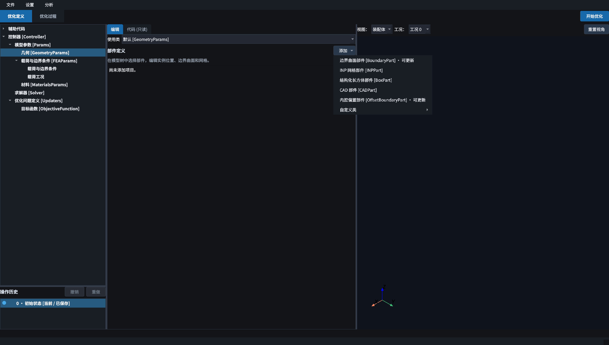

添加菜单还提供 INP 网格、结构化长方体、CAD 和内腔偏置等部件类型。本例选择 BoundaryPart，其参数化边界参与形状优化。CADPart 的“导出 STEP…”提供几何文件保存入口，支持选择目录、自定义名称和覆盖确认，操作说明见[导出 STEP 几何](UIreference.md#cad-step-export)。

<a id="section-填写部件与有限元网格设置"></a>

### 4.2 填写部件与有限元网格设置

选中 `part1 [BoundaryPart]`，在中央表单顶部填写：

| 字段 | 填写值 | 含义 |
|---|---|---|
| 部件名称 | `part1` | 后续材料和优化器引用的部件名 |
| 有限元网格尺寸 `fea_seed_size` | `1.0` | 控制有限元网格疏密 |
| 网格阶次 `mesh_order` | `1` | 本例使用一阶有限元网格 |
| 显示表面集合 `exterior_surface` | `surface_0_All` | 指定部件网格和变形结果可视化时默认绘制的表面集合 |

较小的网格尺寸通常对应较多单元。本例取 `1.0`。增大网格尺寸可降低流程检查的计算规模，但可能改变场值与优化路径。


曲面尚未定义时，右侧预览可能不显示完整实体。后续两节分别定义外边界与内腔。

<a id="section-定义外边界-surface_0"></a>

### 4.3 定义外边界 `surface_0`

在 `part1` 编辑区向下找到 **边界曲面**，点击它右侧的 **添加**，选择 **B 样条圆柱面 [BspSurface]**。如果该处已有默认曲面，直接修改它，避免重复添加。

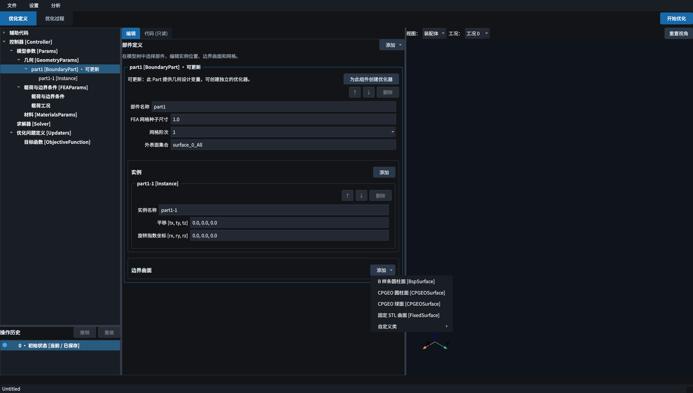

第一个曲面是外边界，树中显示为 `surface_0 [BspSurface]`。填写：

| 字段 | 外边界 `surface_0` |
|---|---|
| 参与形状更新 `is_updatable` | 启用 |
| 半径 `r0` | `8.0` |
| 长度 `length` | `80.0` |
| 曲面采样间距 `seed_size` | `1.0` |
| 周向控制网格计数因子 `num_U_ratio` | `1` |
| 轴向控制网格计数因子 `num_V_ratio` | `1` |
| B 样条次数 `degree` | `3` |
| 初始位置 `init_location` | `0.0, 0.0, 0.0` |
| 参数度量变化惩罚阈值 `maxR` | `0.2` |
| 曲率平方和惩罚阈值 `maxC` | `1.0` |
| 参数方向非正交惩罚阈值 `maxFF` | `0.2` |
| 初始扰动波长 `perturbation_L` | `10.0` |

本例采用表中参数。`r0` 定义初始圆柱半径，`maxR` 定义几何正则化相关阈值。B 样条次数控制几何表示，有限元网格阶次控制单元插值。


**核查条件**：右侧应出现沿 Z 轴放置的外边界。`perturbation_L=10` 引入初始几何扰动，该初始曲面不等同于无扰动圆柱。

<a id="section-定义内腔-surface_1"></a>

### 4.4 定义内腔 `surface_1`

继续在同一部件的 **边界曲面 → 添加** 中增加第二个 B 样条圆柱面。它应位于外边界之后，编号为 `surface_1`。

| 字段 | 内腔 `surface_1` |
|---|---|
| 半径 `r0` | `4.0` |
| 长度 `length` | `74.0` |
| 初始位置 `init_location` | `0.0, 0.0, 3.0` |
| 其余曲面参数 | 与外边界相同：`seed_size=1`，两个计数因子为 `1`，`degree=3`，`maxR=0.2`，`maxC=1`，`maxFF=0.2`，`perturbation_L=10` |

MorphOpt 按部件内的曲面顺序识别边界：**第 0 个为外表面，后续曲面为内腔**。`test.morph` 中内腔的 `flip=True` 对应内边界法向约定；界面按曲面顺序管理这一关系，外表面应保持首位。

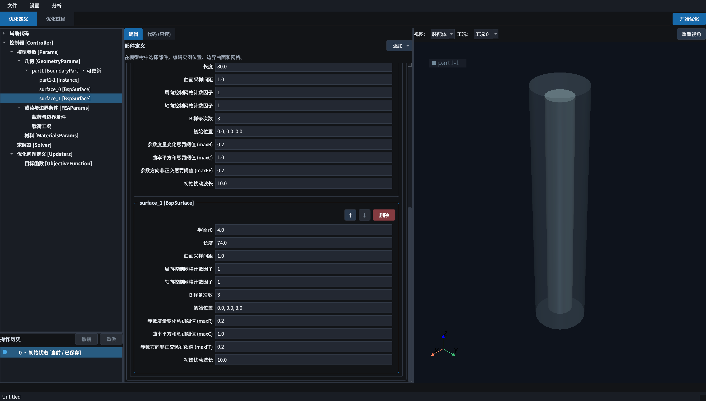

**核查条件**：外边界范围为 Z=0～80，内腔范围为 Z=3～77，名义上两端各留 3 mm，初始径向壁厚为 4 mm。后续优化会改变曲面，实际最小距离由优化器中的距离约束控制。

<a id="section-检查实例-part1-1"></a>

### 4.5 检查实例 `part1-1`

展开 `part1`，选中实例 `part1-1 [Instance]`。新部件通常已有默认实例；只有缺少实例时才在 **实例** 栏添加。

| 字段 | 填写值 |
|---|---|
| 实例名称 | `part1-1` |
| 平移 `[tx, ty, tz]` | `0.0, 0.0, 0.0` |
| 旋转指数坐标 `[rx, ry, rz]` | `0.0, 0.0, 0.0` |


本例实例采用零平移和零旋转。旋转字段遵循旋转向量的指数坐标约定，非零分量不表示依次施加的三个欧拉角。

<a id="loads"></a>

## 5 定义载荷、参考点、耦合和固定约束

在模型树展开 **载荷与边界条件 [FEAParams]**，选中其子节点 **载荷与边界条件**。中央 **添加** 菜单可创建不同类型的组件。


本例依次创建四个组件。作用对象在各组件中指定，压力幅值在[载荷工况](#section-定义载荷工况与压力幅值)中定义。

<a id="section-压力-pressure_1"></a>

### 5.1 压力 `pressure_1`

添加 **压力 [Pressure]**，填写：

| 字段 | 填写值 |
|---|---|
| 组件名称 | `pressure_1` |
| 实例 | `part1-1` |
| 表面 | `surface_1_All` |


`surface_1_All` 是内腔的完整表面集合。选择 `surface_0_All` 会把压力施加到外边界。此时尚未设置工况幅值，预览中的压力值可能为 0；完成[载荷工况定义](#section-定义载荷工况与压力幅值)后再核对数值。

<a id="section-末端参考点-rp_1"></a>

### 5.2 末端参考点 `RP_1`

添加 **参考点 [ReferencePoint]**，将组件名称改为 `RP_1`，参考点位置设为：

```text
0.0, 0.0, 80.0
```


参考点记录末端整体运动。参考点与实体之间的运动联系由[耦合](#section-耦合-couple_1)定义。

<a id="section-耦合-couple_1"></a>

### 5.3 耦合 `couple_1`

添加 **耦合 [Couple]**，填写：

| 字段 | 填写值 |
|---|---|
| 组件名称 | `couple_1` |
| 参考点 | `RP_1` |
| 实例 | `part1-1` |
| 节点集 | `surface_0_Head` |


`Head` 对应该外表面的顶部。耦合建立后，装配体预览在顶部显示参考点与耦合标记，`RP_1` 的运动响应与该末端节点集关联。

<a id="section-底部固定-bc_1"></a>

### 5.4 底部固定 `bc_1`

添加 **边界条件 [BoundaryCondition]**，填写：

| 字段 | 填写值 |
|---|---|
| 组件名称 | `bc_1` |
| 实例 | `part1-1` |
| 节点集 | `surface_0_Bottom` |
| 固定自由度 | 勾选 `X`、`Y`、`Z` |


`test.morph` 保存的自由度索引是 `[0, 1, 2]`。本例实体底部固定三个平移自由度，保留界面其他选项的未选状态。

**核查条件**：预览顶部有参考点和耦合，底部有固定标记，压力作用在内腔。标记位置与预期不符时，核对所选实例与集合名称。

<a id="section-定义载荷工况与压力幅值"></a>

### 5.5 定义载荷工况与压力幅值

1. 在模型树选择 **载荷工况**。
2. 点击“添加”新建工况，名称设为 `load_case_1`；已有同名工况时直接编辑。
3. 卡片逐行列出有参数的载荷，在 `pressure_1` 一行填写 `0.06`。
4. 需要多个工况时继续添加，通过上移、下移调整顺序，删除已被引用的工况时，可同时删除引用目标，或保留目标并清空其工况引用。

后续目标按名称选择 `load_case_1`。工况名称不随排序变化，与优化轮次、有限元求解迭代分别定义。

<a id="materials"></a>

## 6 定义材料并分配给部件

1. 在模型树选中 **材料 [MaterialsParams]**。
2. 点击 **添加 → 均匀材料 [HomogeneousMaterial]**。
3. 将名称设为 `material_1`。

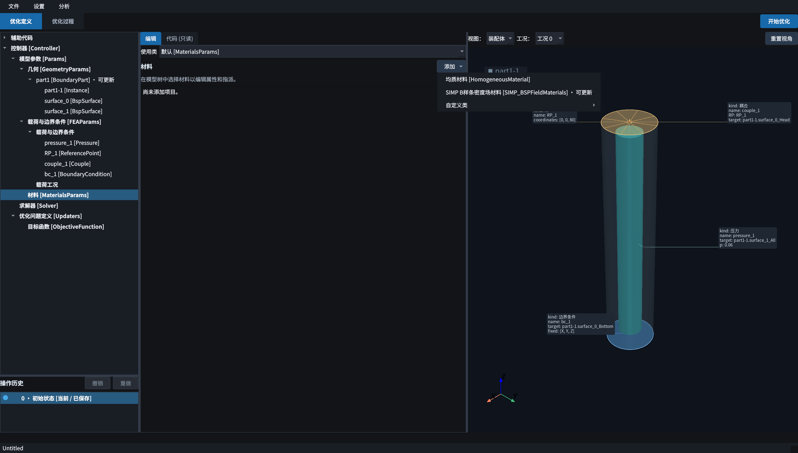

材料参数如下：

| 字段 | 填写值 |
|---|---|
| 材料名称 | `material_1` |
| Part / 部件 | `part1` |
| 材料模型 | `NeoHookeanLnJ` |
| 剪切模量 `mu` | `0.482` |
| 体积模量 `kappa` | `4.8` |
| 密度 `density` | `1.08e-9` |
| Elems 名称 `elementname` | 保留“全部”或空值，分配给该 Part 的全部单元 |


本例采用超弹性材料，由所选本构模型的 `mu` 与 `kappa` 定义材料参数。切换材料模型后，表单显示相应的本构参数。密度 `1.08e-9` 对应 mm–N–s 一致单位下的 tonne/mm³。

**核查条件**：材料分配对象是部件 `part1`，而非实例 `part1-1`；该部件的全部实体单元都有材料。SIMP 材料用于材料分布优化，本例采用均匀材料。

<a id="objectives"></a>

## 7 定义优化目标和记录指标

选中 **优化问题定义 → 目标函数**。在目标项的 **添加** 菜单中选择 **参考点位移/转角**，按下表填写：

| 字段 | 主目标 |
|---|---|
| 参考点 | `RP_1` |
| 工况 | `0` |
| 分量 | `ry`，界面显示为 **Ry 转动** |
| 优化方式 | **最大化** |
| 权重 | `1.0` |
| 目标值 | 本例选择“最大化”后不显示，无需填写 |

再在 **指标** 区添加一个参考点位移/转角指标，选择同一个 `RP_1`、工况 `0` 和分量 `ry`。


**目标项参与优化损失计算，指标项记录响应量。** 本例最大化 `ry`，软件通过最小化其负值实现该目标。因此，优化历史中的 **目标值约为 `-ry`**，**指标 0 记录 `ry`**，两列的符号相反。

`ry` 是参考点旋转向量的 Y 分量，单位为 rad。若改成 `x/y/z` 位移分量，其长度单位随模型一致。参考点与工况共同确定目标响应，二者的选择应与模型定义一致。

本例的自定义损失代码与雅可比载荷区域采用默认设置。

<a id="section-设置求解器和运行信息"></a>

## 8 设置求解器和运行信息

<a id="section-求解器"></a>

### 8.1 求解器

选中模型树中的 **求解器 [Solver]**：

- 使用 CPU 时选择 `cpu`，进程数填写 `1`。
- 本例只有一个工况，任务分组采用默认分配。
- 多工况时可以在表格中设置进程组；同组工况在同一进程内顺序求解。并行配置的调整以单工况计算有效为前提。


<a id="section-控制器中的任务设置"></a>

### 8.2 控制器中的任务设置

选中树顶部的 **控制器 [Controller]**，检查：

| 字段 | 本例设置 / 操作 |
|---|---|
| 任务名称 | `Untitled`；独立副本可设置其他任务名称 |
| 结果根目录 | 可写目录，例如相对路径 `./results/` |
| 运行设备 | 当前 `test.morph` 为 `cpu` |
| 重启周期 `restart_per_iteration` | `10` |


随文档提供的 `test.morph` 使用相对结果路径 `./results/`，以启动程序时的工作目录为基准。结果根目录也可在界面中指定为其他可写目录。重启周期控制计算进程的定期重启，不定义优化总轮数。

运行设备、求解器中的工况设备和优化器设备分别有各自设置。初次运行可统一设置为 CPU。本文已有结果的运行脚本使用 `cuda:0`，而当前定义文件使用 CPU；其几何、载荷、材料与目标相同，计算耗时和数值细节可能随设备而变化。

<a id="updaters"></a>

## 9 设置几何优化器

<a id="section-创建并选择-part1-的优化器"></a>

### 9.1 创建并选择 `part1` 的优化器

返回 `part1` 的编辑区，点击 **创建优化器**，或使用模型树对应的添加优化器入口。创建后，展开 **优化问题定义 → part1 的优化器 [UpdaterBoundaryPart]**。

新建几何优化器通常已经包含 `ShapeDerivative`、`Fairness`、`Distance` 和 `Cylinder`。各默认条目的设置见[结构灵敏度](#section-子优化目标结构灵敏度)、[曲率正则化](#section-曲率正则化-fairness)、[最小距离](#section-最小距离-distance)和[圆柱包络](#section-圆柱包络-cylinder)；缺失条目需补充，已有条目直接修改。

| 字段 | 填写值 |
|---|---|
| 目标 Part | `part1` |
| 最大迭代次数 `max_step_iter` | `50` |
| 最大更新步长 `max_step_length` | `0.5` |
| 曲面属性 `is_updatable` | 在 `surface_0` 和 `surface_1` 的编辑页均启用“参与形状更新” |
| 优化器设备 | 本例跟随 CPU；需要 GPU 时明确选择可用设备 |


`max_step_iter=50` 定义每次几何更新内部的子优化迭代上限，外层优化轮数由运行控制。运行期间可通过 **停止优化** 结束任务。

仅启用更新的曲面参与形状变化。单独优化内腔时可关闭外表面更新；本例同时启用两个曲面。

<a id="section-子优化目标结构灵敏度"></a>

### 9.2 子优化目标：结构灵敏度

选中优化器下的 **子优化目标函数**，确认已有 **结构灵敏度 [ShapeDerivative]**，缺少时再添加。本例保留它的默认设置。


[主目标](#objectives)定义优化损失。`ShapeDerivative` 将该损失对应的结构灵敏度传入形状更新子问题，主目标与灵敏度项需分别配置。

<a id="section-两个表面的-xz-镜面对称"></a>

### 9.3 两个表面的 xz 镜面对称

选中 **几何对称约束**，添加两项 **BSP 镜面对称**：

| 项目 | 目标表面 | 平面 | 偏移 |
|---|---|---|---|
| 第 1 项 | `surface_0` | `xz` | `0.0` |
| 第 2 项 | `surface_1` | `xz` | `0.0` |


`xz` 平面对应 Y=0。两项条目在树中的类型名称相同，要在表单中分别核对目标表面，避免两次都约束到同一个表面。

<a id="section-曲率正则化-fairness"></a>

### 9.4 曲率正则化 `Fairness`

在 **几何罚函数约束** 中选中 **表面曲率正则化 [Fairness]**，保留本例默认设置，缺少时再添加。该正则项抑制曲面不平顺。


<a id="section-最小距离-distance"></a>

### 9.5 最小距离 `Distance`

选中 **表面间最小距离约束 [Distance]**，缺少时再添加，将两个表面对应的距离矩阵填写为：

|  | `surface_0` | `surface_1` |
|---|---|---|
| `surface_0` | `2.5` | `2.5` |
| `surface_1` | `2.5` | `2.5` |


矩阵行、列与部件内的曲面顺序对应，数值采用模型长度单位。按 `test.morph` 保留对角项和非对角项，避免仅填写两个表面之间的一项。这是优化中的距离罚函数设置，最终几何仍应检查实际最小壁厚和网格质量。

<a id="section-圆柱包络-cylinder"></a>

### 9.6 圆柱包络 `Cylinder`

选中 **最大圆柱包络约束 [Cylinder]**，缺少时再添加，填写：

| 字段 | 填写值 |
|---|---|
| 半径 `radius` | `10.0` |
| 高度 `height` | `80.0` |
| 底部位置 `bottom` | `0.0` |


圆柱包络定义优化几何的允许范围，不对应额外的刚性外壳。至此，`test.morph` 的主定义配置完成。

<a id="section-检查保存与其他编辑入口"></a>

## 10 检查、保存与其他编辑入口

模型树中的浅红色节点表示定义存在静态校验错误。悬停于节点可查看具体原因，父节点汇总子节点错误。修改并提交后，标色随定义刷新。启动优化前应处理已提示的错误；运行阶段仍会检查几何、网格与求解条件。

<a id="section-运行前核对"></a>

### 10.1 运行前核对

开始优化前，在模型树中依次检查：

1. `part1` 有外表面和内腔，曲面顺序正确，存在实例 `part1-1`。
2. 压力作用于 `part1-1.surface_1_All`，第一工况幅值为 `0.06`。
3. `RP_1` 位于 `(0,0,80)`，已耦合到顶部；底部 X/Y/Z 已固定。
4. `material_1` 已分配给 `part1` 的全部单元。
5. 目标和指标均选择 `RP_1`、工况 0、`ry`，主目标方式是最大化。
6. `part1` 有几何优化器，两个表面启用更新，灵敏度和约束项齐全。
7. 结果根目录在本机可写，设备选择有效。

<a id="section-查看代码并保存定义"></a>

### 10.2 查看代码并保存定义

中央的 **代码（只读）** 页展示根据当前表单生成的 Python 代码，可用于检查部件、载荷和目标是否按预期生成。STL、INP 和 STEP 均以相对资源文件的方式显示；导出 `.py` 时，资源文件写入脚本旁的 `morphopt_assets` 目录。常规参数修改在 **编辑** 页完成。


中央的 **资产** 页列出当前定义引用的 STEP、STL 和 INP 文件。选择条目可检查文件来源、引用位置、导出路径及几何预览。STEP 显示导入文件中的原始几何，STL 显示曲面，INP 显示网格。该页采用文件局部坐标；模型的后续特征和装配位置在右侧模型视图中核查。

选择 **文件 → 保存** 或 **另存为…**，将定义保存为 `.morph`。如果要在终端运行同一份模型，使用 **文件 → 导出运行脚本目录…**，并在弹窗中输入目录名称。导出目录中包含同名 `.py` 脚本和 `morphopt_assets` 资源目录；STL、INP 文件会复制到资源目录，STEP 数据会还原为 STEP 文件。运行时应整体移动或分发该目录。`.morph` 仍保存原有定义与 STEP Base64 数据。也可以从文件菜单打开已有脚本开始优化。


`.morph` 保存模型定义，运行结果另存于任务目录。保存后重新载入副本，可核查字段的持久化结果。

<a id="section-辅助代码与自定义类"></a>

### 10.3 辅助代码与自定义类

辅助代码与自定义类提供 Python 扩展入口。本例两项均为空。

**辅助代码** 下的自由代码块、自定义常量和自定义函数可以为生成脚本提供额外定义。自定义常量在脚本加载时求值，优化过程中不会作为设计变量更新。支持 Python 表达式的数值输入项，例如几何尺寸、材料参数和载荷数值，可以填写常量名或表达式。函数定义与代码生成的接口约定见[脚本模块与接口参考](scriptreference.md)。

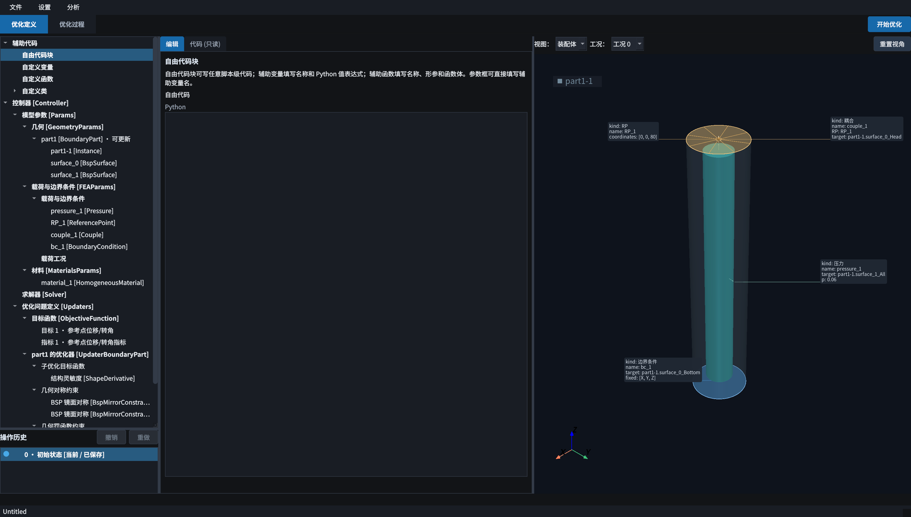

**自定义类** 下可添加新类或重写框架类，再通过相应节点的“使用类”选择应用到模型。`test.morph` 没有自定义类，采用默认实现。

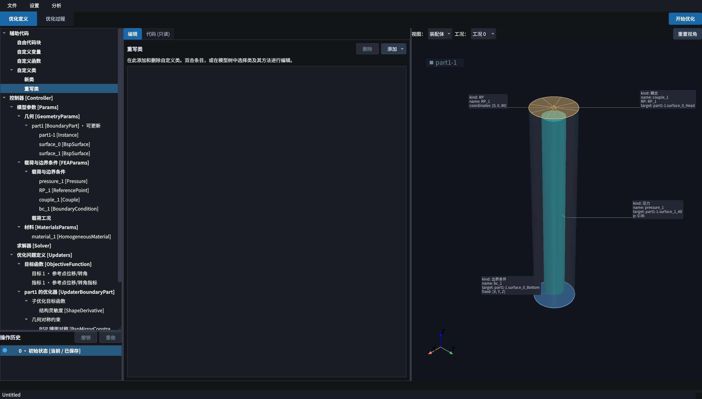

**设置 → 语言 / 外观** 可以切换界面语言与主题；它们改变界面呈现。本文截图使用中文和深色主题。

<a id="optimization"></a>

## 11 启动优化并检查迭代结果

<a id="section-启动与观察运行输出"></a>

### 11.1 启动与观察运行输出

在 **优化定义** 页右上角点击 **开始优化**。程序会启动计算并进入 **优化过程 → 迭代历史**。

一轮优化需要建立有限元模型、计算工况、计算灵敏度并更新形状。首轮网格生成和求解可能需要等待；下方 **运行输出** 用于查看进度和错误信息。出现已完整保存的迭代后，历史表和曲线会更新。


运行过程截图来源于同一已保存算例的临时副本续算。截图后已停止该副本任务，原始运行目录保持不变。

<a id="section-优化历史与曲线"></a>

### 11.2 优化历史与曲线

左侧 **优化指标** 页面显示各轮目标值、指标、阶段耗时、单元数与节点数。


本例最大化 `ry`，因此目标值下降、指标 0 上升是相互对应的。已保存的第 36 轮中，目标值约为 `-2.1168`，指标约为 `2.1168`。上述数值对应本次保存的运行记录。设计收敛性需结合停止准则、设计变化及约束满足情况评价。

顶部控制条提供：

- **◀ / ▶ 和滑块**：切换已有轮次。
- **当前轮 / 已保存总轮数**：确认正在查看哪一轮。
- **自动跟踪最新**：运行时跟随最新结果；回看早期步骤时取消勾选。

表格内容较多时可在表格内滚动；需要更多空间时拖动面板之间的分隔条。

<a id="section-设计边界变化"></a>

### 11.3 设计边界变化

左侧选择 **可更新结构展示**，在 **显示组件** 中选择 `part1`。先将滑块移到第 1 轮，再移到第 36 轮，可以比较已保存的边界外形。

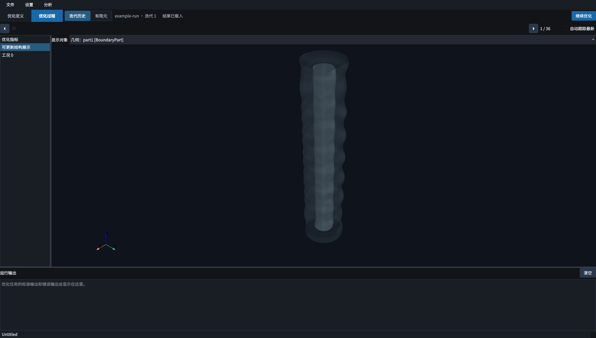


该页面显示设计结构。外表面透明显示时可同时观察内腔。若模型有多个可更新组件，应在顶部组件选择框中逐个检查。

在迭代历史顶部点击 **导出曲面…**，选择需要导出的已保存轮次。对话框默认使用当前滑块轮次，并勾选各 BoundaryPart 的全部曲面；可逐行取消勾选或调整格式。BSP、BREP 曲面支持 STEP（`.stp`）与 STL，CPGEO、MeshSurface 支持 STL。点击 **导出** 后选择输出文件夹，文件按部件分类保存，例如 `iteration_36_surfaces/part1/surface_0.stp`。

输出为所选轮次保存的设计边界，采用部件局部坐标。BSP 的 STL 输出包含封闭边界的端盖；BREP 的 STEP 输出保留原几何，有面名称映射时同时保存 `.brep.json`。导出在独立工作进程中执行，优化任务可继续运行。同名文件覆盖前需要确认。

<a id="section-工况变形"></a>

### 11.4 工况变形

左侧选择 **工况 0**，显示该轮已保存的工况变形网格。


该视图显示变形方向与整体形态。需要读取位移、应力或应变数值时，进入下一节的 **有限元** 页。

<a id="section-停止打开旧结果和继续优化"></a>

### 11.5 停止、打开旧结果和继续优化

运行时点击 **停止优化** 可停止当前任务。已完整写入的步骤可以保留和查看；正在计算但尚未保存的步骤可能不在历史中。

尚未完整保存第一轮迭代时，工作进程报错将结束当前任务，界面显示失败状态，不反复创建新任务目录。已有完整迭代结果时，保留自动重启逻辑，从已保存结果继续。Windows 使用任务进程的 PID 终止对应进程树；停止失败时保留运行状态并显示错误信息。

返回“优化定义”不会停止当前任务。运行期间，该页的启动按钮显示“优化正在运行”并禁用，分析菜单的启动入口同步禁用。修改定义后启动新任务，应先返回“优化过程”停止当前任务，待停止完成后再开始优化。

再次打开时，选择 **文件 → 打开优化结果目录…**，选中具体的任务文件夹，例如：

```text
results/<任务名称>_T<时间戳>/
```

应选择含有 `scripts/MAIN_SCRIPT_FOR_RESTART.py` 和 `log/` 的任务文件夹。点击 **继续优化** 后，可选择从最后一步或某个已保存步骤继续。

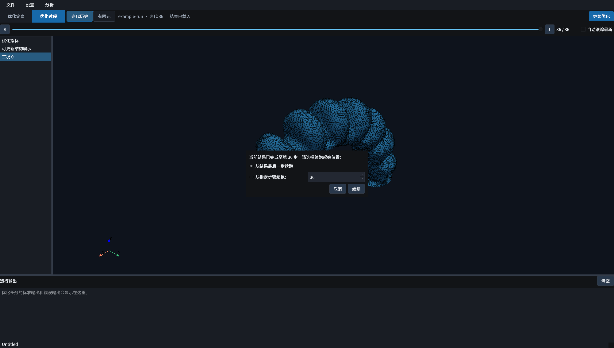

续跑使用该任务保存的脚本和历史。基于修改后的定义重新计算时，应在定义页启动新任务。保留整个结果目录，避免只拷贝单张图片或单个日志文件。

<a id="finite-element"></a>

## 12 对已保存设计进行事后有限元分析

优化后的设计可固定为独立有限元分析的几何，支持查看已有工况场值及修改载荷后重新求解。**事后有限元使用选中迭代的模型副本；改变这里的载荷不会修改优化定义或已保存的原工况。**

<a id="section-选择迭代和原工况"></a>

### 12.1 选择迭代和原工况

1. 先打开结果目录，并在优化过程页选中要检查的轮次。
2. 点击顶部 **有限元**，也可选择 **分析 → 查看当前迭代有限元**。
3. 在 **优化迭代** 中选择 `36`。
4. 在 **工况与计算结果** 中选择 **原工况 0**。


左侧显示该工况的载荷参数和导出选项；右侧显示模型及场值。原工况已有有效解时，可以直接查看结果；只有模型或修改后没有有效结果时，需要点击 **运行有限元**。


列表只包含已保存有限元模型的轮次。展开后可滚动选择，编号应完整可读；某轮只留下历史记录而未保存对应模型时，不能在此加载它。

<a id="section-切换位移应力应变和变形显示"></a>

### 12.2 切换位移、应力、应变和变形显示

右侧 **显示分量** 可选择当前模型和结果支持的场：

| 显示项 | 物理量定义 |
|---|---|
| `U` | 位移模长，本例单位 mm |
| `U1 / U2 / U3` | 全局 X / Y / Z 位移分量 |
| `S_Mises` | 等效 Mises 应力，本例单位 MPa |
| `S11` 等应力分量 | 全局坐标轴下的 Cauchy 应力分量 |
| `E11` 等应变分量 | Green–Lagrange 应变分量 |
| 应变能密度 | 按参考体积定义的应变能密度 |

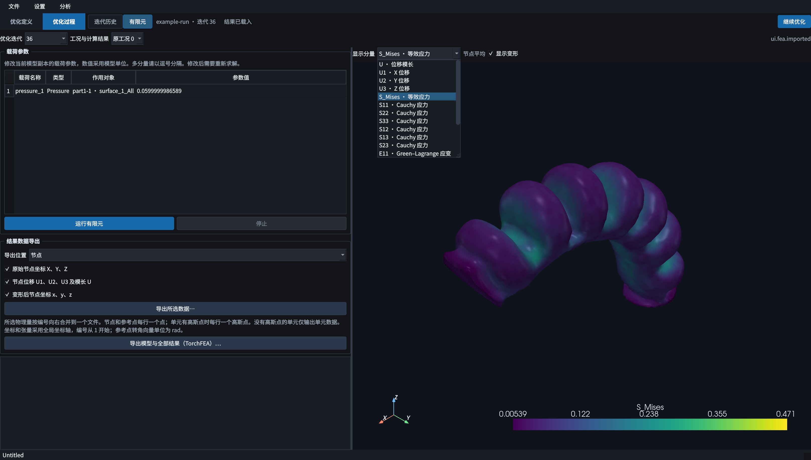

选择 `S_Mises` 后，场值由结构颜色与色标数值共同表示。切换不同结果时色标范围可能自动变化，不能只凭颜色深浅比较数值大小。


应力、应变和能量场的界面云图标有 **节点平均**：先按参考积分体积得到单元平均，再对相邻单元做节点平均，用于显示。这与原始积分点数据不同。检查局部峰值时，还应查看积分点导出数据，并比较网格加密后的结果。

勾选 **显示变形** 时在变形构型上着色；取消勾选后，在原构型上显示同一个结果场。

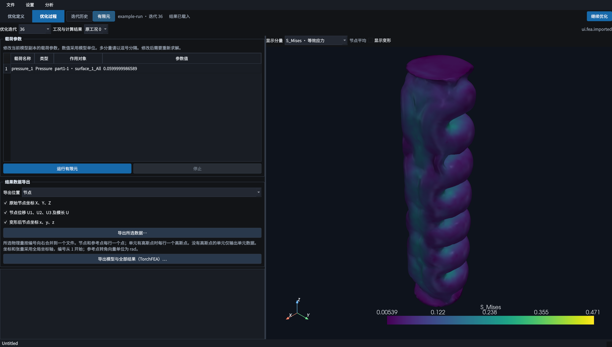

<a id="section-修改压力固定几何重新求解"></a>

### 12.3 修改压力，固定几何重新求解

以第 36 轮为例：

1. 保持 **优化迭代 36 / 原工况 0**。
2. 在左侧载荷参数表中找到 `pressure_1`。
3. 将 **参数值** 从 `0.06` 改为 `0.05`，离开单元格。
4. 点击 **运行有限元**。


参数值沿用模型单位，此处 `0.05 MPa = 50 kPa`。向量型载荷的多个分量按表格提示用逗号分隔。本例只修改压力，不进行新的形状优化。

载荷修改后原解失效，界面提示重新求解。新压力对应的结果以重算完成后的有效解为准。

<a id="section-观察有限元求解并检查收敛"></a>

### 12.4 观察有限元求解并检查收敛

求解期间，左下输出区显示求解进度。此时迭代和结果选择等控件会锁定，避免计算对象在求解中途改变；需要取消时点击 **停止**。

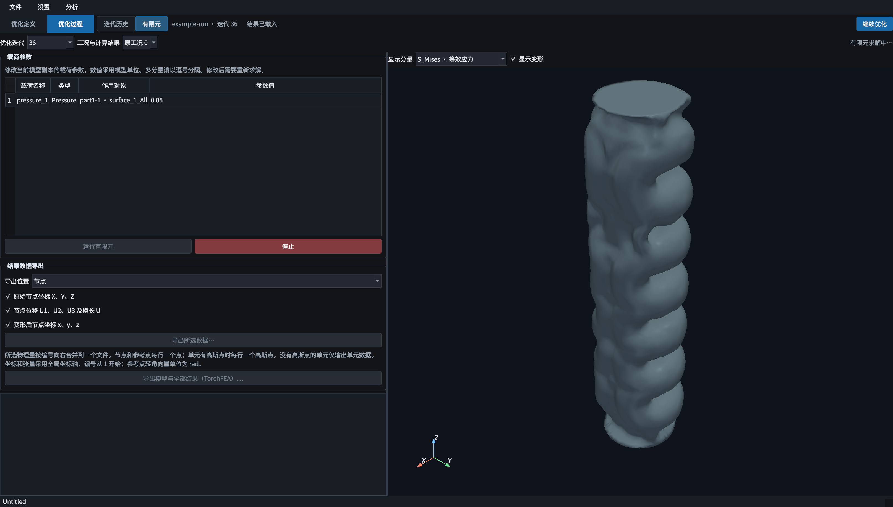

本次截图对应的重算包含 49 次求解器迭代，日志报告求解结束，最大误差约 `1.28e-11`。计算完成后，界面状态变为 **有限元已收敛**，并加入新的 **有限元 1** 结果。


界面可能将 `0.05` 显示成 `0.0500000007451` 等近似数，这是底层浮点表示造成的尾数差异。输入值的核查以有效位数和单位为依据。

<a id="section-比较原工况与新的有限元结果"></a>

### 12.5 比较原工况与新的有限元结果

展开 **工况与计算结果**，可以分别选择：

- **原工况 0**：优化时保存的 `0.06` 压力工况。
- **有限元 1 · 时间**：本次以 `0.05` 压力重新计算得到的独立结果。

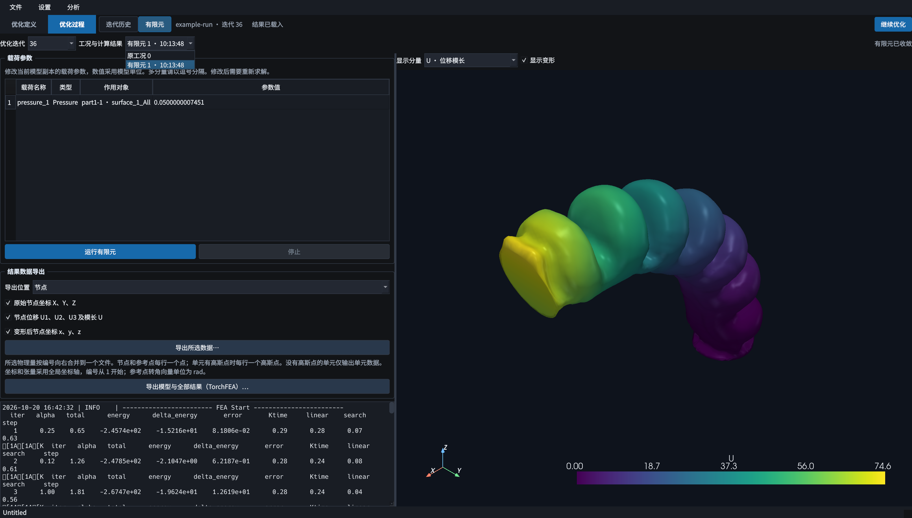

切换时同时核对左侧载荷值和右上状态，再查看相同分量的云图。不同优化迭代拥有各自的原工况和重算结果，先确认迭代编号再比较。

<a id="section-导出数据和完整模型"></a>

### 12.6 导出数据和完整模型

**导出所选数据** 用于把当前有效解中的物理量保存为 CSV 或 NPZ。先选择 **导出位置**，勾选需要的物理量，再点击 **导出所选数据…**。


| 导出位置 | 数据内容 | 单行对应对象 |
|---|---|---|
| 节点 | 原始坐标、位移分量与模长、变形后坐标 | 一个节点 |
| 单元／高斯点 | 单元位置、积分点位置、应力、应变、能量等受支持数据 | 有积分点时按积分点输出，否则仅输出单元数据 |
| 参考点 | 原始坐标、平移、旋转向量及模长、变形后坐标 | 一个参考点 |


应力导出保留积分点上的 Cauchy 应力；应变使用 Green–Lagrange 张量应变，剪切分量为张量剪切分量。所选物理量按编号合并到同一个文件中，坐标和张量采用全局坐标轴，导出编号从 1 开始。


本例的末端转角响应对应参考点导出数据中 `RP_1` 的 `UR2`。转角向量单位为 rad，遵循轴角表示，与欧拉角定义不同。

**导出模型与全部结果（TorchFEA）…** 用于保存当前迭代的一份模型、全部原工况及本会话已完成的独立有限元结果。选择目录和文件名前缀后，文件名形如：

```text
actuator_femodel.npz
actuator_case0.npz
actuator_analysis1.npz
```

完整模型与结果导出保留各结果对应的载荷参数。独立有限元重算结果先保存在当前会话的工作区；本次 `有限元 1` 的持久保存通过关闭界面前的完整导出完成。

<a id="section-常见问题与核查项目"></a>

## 13 常见问题与核查项目

| 现象 | 优先检查 |
|---|---|
| 定义页没有几何 | Part 下是否已有曲面、实例；外表面是否排第一；点击“重置视角” |
| 内腔尺寸或壁厚与预期不符 | `surface_1` 的半径、长度和 Z 偏移；是否重复添加了曲面 |
| 压力标注为 0 | 载荷工况是否已填入幅值；预览是否选择了正确工况 |
| 作用表面或节点集无法选择 | 是否先选择了 `part1-1`；当前实例是否属于预期 Part |
| 结构整体漂移或有限元不收敛 | 底部固定是否作用于正确节点集；压力单位、材料参数和网格是否合理 |
| 目标值不变或优化方向与定义不符 | `RP_1` 是否已耦合；工况、`ry` 分量和最大化方式是否与定义一致 |
| 某个曲面不更新 | 该 Part 是否有优化器；对应曲面更新开关是否启用；约束是否限制了变化 |
| 点击开始后暂时没有曲线 | 查看运行输出；等待首轮网格生成、求解和完整保存 |
| 优化轮数超过 50 | `max_step_iter=50` 约束的是单次更新内部的子优化，不能作为总轮数上限 |
| 有历史记录但有限元页缺少某轮 | 该轮是否保存了对应 `femodel`；应选择实际有模型的轮次 |
| 修改压力后不能导出新场值 | 修改使旧解失效，先重新运行有限元并确认收敛 |
| 应力色块相近但数值不同 | 核对色标范围、显示分量、迭代和所选结果 |
| 结果目录无法打开 | 选择包含 `scripts/` 与 `log/` 的具体任务目录，而非其父目录 |
| 内存不足 | 减少计算规模或使用较粗网格检查流程，正式计算再做网格精度比较 |

<a id="section-文档与术语参考"></a>

## 14 文档与术语参考

本文采用“选择对象 → 填参数 → 检查 → 提交 → 查看结果”的操作编排。Abaqus 文档中的 [主窗口与 Model Tree](https://docs.software.vt.edu/abaqusv2025/English/SIMACAEGSARefMap/simagsa-c-absmaincaewindow.htm) 和 [创建、提交及监控 Job](https://docs.software.vt.edu/abaqusv2025/English/SIMACAEGSARefMap/simagsa-t-caehingejob.htm) 可作为有限元软件通用操作流程的参考。

| 操作 | MorphOpt 中的位置 | Abaqus/CAE 中相近的概念 |
|---|---|---|
| 建立模型 | 优化定义页的模型树与编辑区 | Model Tree 与建模模块 |
| 提交计算 | 开始优化 | Job Submit |
| 监控任务 | 运行输出与迭代历史 | Job Monitor |
| 查看场值 | 优化过程中的有限元页 | Visualization |

上述对应关系仅描述操作层面的相近概念，各软件的模型格式、结果格式及求解流程分别定义。更详细的脚本接口见[脚本模块与接口参考](scriptreference.md)。本次截图来源见 [截图清单](images/ui/capture-manifest.json)，统一简体中文字体与桌面缩放说明见 [配图说明](images/ui-reference/README.md)。
