# MorphOpt UI 模块与接口参考

[UI 快速开始](UIguide.md) · [脚本快速开始](scriptguide.md) · [脚本模块与接口参考](scriptreference.md)

UI 快速开始以 `test.morph` 为例，介绍建模、优化和结果分析的完整流程。本篇为模块与接口参考，系统说明**模块职责、对象定义、参数含义、引用关系及适用条件**。本文适用于无 Abaqus 使用经验的读者。

本篇的“接口”指添加菜单中的部件、曲面、载荷、材料、优化目标和约束对象，以及目标编辑器和自定义代码的输入接口。覆盖当前注册的 **59 类对象、8 种材料本构模型和 12 个有限元数据代码模板**。`BasePart` 由自定义类实现，两类偏置约束属于普通添加菜单中隐藏的高级接口，相关章节均注明其使用条件。

本文参考 Abaqus/CAE User's Guide 的模块化组织方式，按模块职责、对象定义和参数说明展开。MorphOpt 的字段和行为以本仓库实现为准。[参考：Abaqus/CAE 模块定义](https://docs.software.vt.edu/abaqusv2025/English/SIMACAECAERefMap/simacae-c-topwhatismodule.htm)

截图来自 MorphOpt 图形界面，采用统一的简体中文字体。圆柱算例与结果图沿用UI 快速开始；Box、CAD、弹簧、接触和 SIMP 等新增截图用于说明表单与预览，**不代表这些演示配置已经完成优化或通过收敛验证**。截图保留桌面原始像素，原图支持放大查看。

## 目录

<!-- docs:toc depth=1 -->

- [1 模块分工与对象关系](#modules)
- [2 通用填写规则](#conventions)
- [3 几何：部件、曲面与实例](#geometry)
- [4 CAD：十五种建模操作](#cad)
- [5 载荷、连接、边界与接触](#loads)
- [6 工况：接口参数与幅值](#steps)
- [7 材料与八种本构模型](#materials)
- [8 目标、指标与有限元数据接口](#objectives)
- [9 求解器与运行设置](#solver)
- [10 优化器：更新目标、对称与约束](#updaters)
- [11 辅助代码与自定义类](#custom-code)
- [12 可视化、优化记录与事后有限元](#results)
- [13 配置核查与接口索引](#index)

<!-- /docs:toc -->

<a id="modules"></a>

## 1 模块分工与对象关系

主定义页包含左侧模型树、中央参数编辑区和右侧三维预览区，分别用于对象选择、参数定义及几何与装配检查。“生成代码”页显示当前定义对应的 Python 脚本。运行时，程序根据该定义创建求解与优化对象。

| 模块 / 界面位置 | 定义内容 | 输入对象与前置条件 | 核查项目 |
|---|---|---|---|
| 几何 / Part | 实体来源、体网格、设计边界 | 文件或几何参数 | 尺寸、内外边界、网格阶次 |
| 几何 / Instance | 部件实例在装配体中的位置和姿态 | 已定义的 Part | 实例名、相互位置 |
| 载荷与边界 | 载荷作用区域、固定条件、连接关系与接触表面 | 实例、集合、参考点 | 引用对象与方向 |
| 工况 | 每个工况中各接口的幅值 | 已定义的载荷接口 | 分量顺序和工况编号 |
| 材料 | 应力与变形的关系、密度及材料设计场 | Part 与单元块 | 分配范围、本构参数 |
| 目标函数 | 参与优化的目标响应与独立记录的指标 | 工况与响应对象 | 方向、单位、权重 |
| 求解器 | 工况分组、并行策略与 GPU 分配 | 工况列表和计算资源 | 任务覆盖及显存占用 |
| 优化器 | 设计变量、更新方法及约束条件 | 设计 Part 或 SIMP 材料、目标梯度 | 更新开关、约束适用性 |
| 辅助代码 / 自定义类 | 复用参数、表达式、扩展框架行为 | Python 与框架接口 | 是否实际引用或绑定 |
| 优化过程 | 选择运行，检查历史、设计和工况变形 | 已保存的运行结果 | 当前轮次、指标趋势、日志 |
| 工况与计算结果 / 事后有限元 | 指定轮次的 FE 场显示与载荷调整后的独立求解 | 该轮模型和结果归档 | 所选工况、结果来源和单位 |

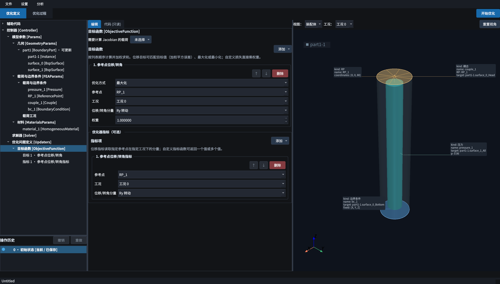

*主定义页：模型树、参数编辑区和装配预览。*

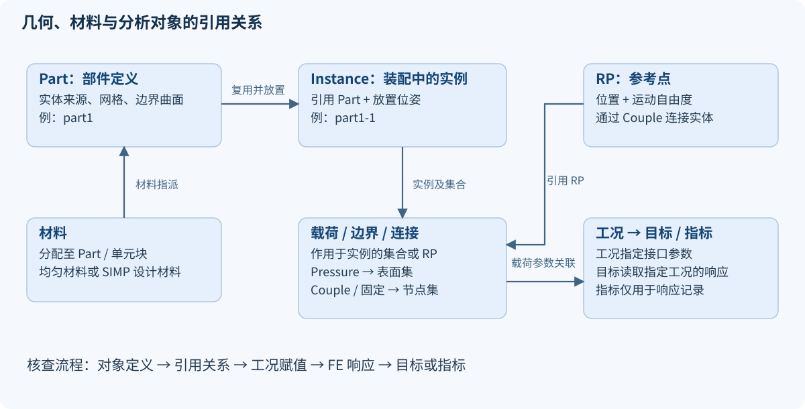

*部件、实例、材料、载荷与工况之间的引用关系。*

对象引用关系遵循以下规则：**材料分配给 Part，载荷作用于 Instance 的集合或 RP，工况为载荷接口指定参数值。** 参考点坐标仅定义其位置，参考点与实体之间的连接由 Couple 等接口单独定义。

<a id="section-文件设置和分析菜单"></a>

### 1.1 文件、设置和分析菜单

| 入口 | 功能与适用场景 |
|---|---|
| 文件 → 新建 / 打开 .morph | 建立空白定义，或继续编辑结构化定义 |
| 文件 → 快速开始 | 用预设流程生成起始定义；生成后各模块仍在主定义页编辑 |
| 文件 → 打开优化结果 | 选择单个运行目录，查看已有历史和该运行的 FE 结果 |
| 文件 → 打开 Python 优化脚本 | 直接运行脚本并进入优化观察；不会把任意 Python 脚本反向转换为可编辑模型树 |
| 文件 → 保存 / 另存为 | 保存当前定义；另存为适合创建练习副本 |
| 文件 → 导出运行脚本 .py | 输出可运行 Python，便于脚本执行与扩展 |
| 设置 → 语言 / 主题 | 改变界面显示语言与配色，不改变模型物理参数 |
| 分析 → 开始优化 | 从当前定义启动优化任务，作用同右上角开始按钮 |
| 分析 → 查看当前迭代有限元 | 从已载入的结果进入该轮 FE 分析页 |

卡片中的“添加”“删除”和“↑ / ↓”用于管理条目及其顺序。曲面顺序决定曲面索引，CAD 操作顺序决定构造历史，顺序调整后的相关引用应重新核查。左下操作历史记录定义编辑，支持撤销与重做；“优化过程”记录优化计算中的设计历史。

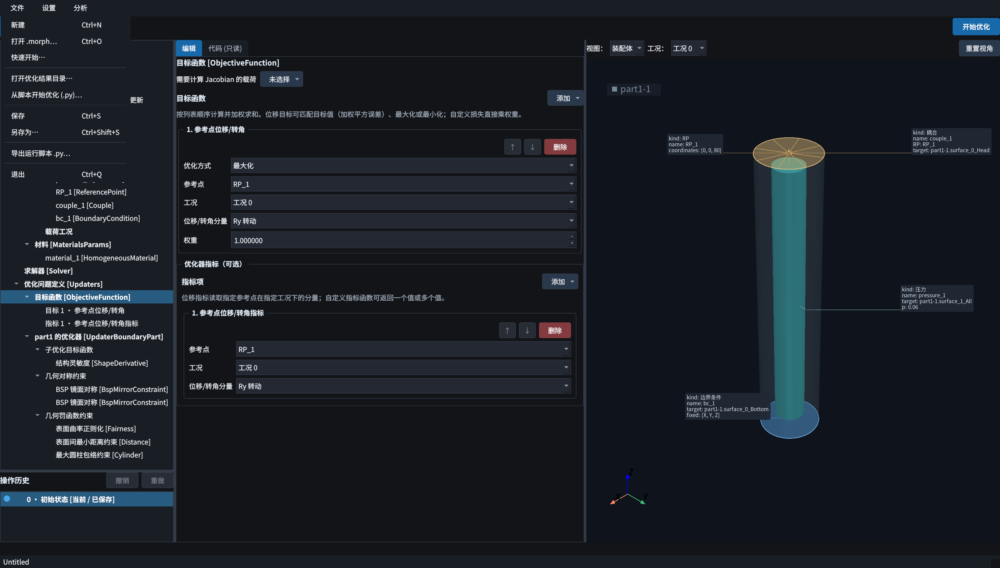

<a id="conventions"></a>

## 2 通用填写规则

<a id="section-名称编号与集合"></a>

### 2.1 名称、编号与集合

| 名称或编号 | 含义 | 示例 |
|---|---|---|
| 部件名称 | Part 的唯一名称，材料分配与几何优化器引用该对象 | `part1` |
| Instance 名称 | 某个部件在装配体中的一次放置 | `part1-1` |
| 接口名称 | 载荷、RP、边界条件等对象的唯一引用名 | `pressure_1`、`RP_1` |
| 曲面索引 | 在一个 BoundaryPart 内从 0 编号 | 0 外边界、1 第一个内腔 |
| `step_index` | 目标、模板和任务分组使用的工况索引，从 0 编号 | 表中第 1 个工况对应 0 |
| 节点集 | 一组节点，用于固定、耦合等 | `surface_0_Bottom` |
| 表面集 | 带面片与方向的集合，用于压力、接触等 | `surface_1_All` |
| 单元块 / `Part.elems` | Part 中按名称保存的单元对象 | BoxPart 的 `design` |

名称区分大小写。下拉框提供模型中已有的集合，手动输入名称不创建新集合。`C3D4` 等单元公式名称与 `design` 等单元块名称属于不同概念；要求填写 `Part.elems` 键名的字段，以导入信息或候选列表中的实际名称为准。

部件名称与实例名称分别在各自卡片中定义。程序在创建部件时提供默认实例名，部件后续改名不修改已有实例名称。材料和几何优化器通过对象引用跟随部件改名，实例载荷通过对象引用跟随实例改名。

INPPart 的 `inp_part_name` 用于选择源文件中的部件，属于导入参数。材料卡片中的 `part_name` 用于选择分配对象，属于部件引用。这些字段与部件名称、实例名称具有不同作用。

旧定义中已指定的装配体 Part 名称在载入时统一为部件名称，原实例名称保持不变；重新保存的定义不包含重复的部件别名称段。

<a id="section-数值列表与表达式"></a>

### 2.2 数值、列表与表达式

- 标量字段接受 `0.06`、`1e-7` 等数值。
- 坐标采用三分量列表，如 `[0, 0, 80]`；位姿采用六分量列表；距离矩阵采用嵌套列表，如 `[[2.5, 2.5], [2.5, 2.5]]`。
- 支持表达式的数值字段接受辅助变量和函数引用。例如，长度字段可使用 `tube_length`，压力字段可使用 `pressure_schedule(0.8)`。预览要求相关表达式能够完成求值。
- 代码编辑区接受 **函数体**，函数签名由编辑器提供；辅助自由代码区域接受模块级代码。函数体中不包含额外的外层 `def` 声明。
- 按 Enter 或结束单元格编辑后提交修改。长表单支持滚动，模型树中的对象选择用于定位相应表单。

字段表达式保留为生成脚本中的 Python 表达式。共用参数可集中定义为辅助变量，由多个字段引用，以保持参数一致。

<a id="section-单位与默认值"></a>

### 2.3 单位与默认值

MorphOpt 使用一致单位制，不执行自动单位换算。长度、力、应力和密度应采用相互匹配的单位。例如，mm–N–MPa 单位制下，60 kPa 压力的输入值为 `0.06`，密度采用相应质量单位。转角及旋转向量的角度单位为 rad。

参数表中的“初始值”为 UI 创建对象时的默认值，实际参数应根据材料标定、几何尺寸及载荷条件确定。对象名称和 SIMP 包围盒等字段应补充有效值；六个分量均为零的包围盒不构成有效设计域。

<a id="geometry"></a>

## 3 几何：部件、曲面与实例

**入口：主定义 → 参数 → 几何。** 在几何中添加 Part，在 Part 下添加实例；BoundaryPart 还可添加边界曲面，CADPart 可添加建模操作。

<a id="section-part-类型与适用场景"></a>

### 3.1 Part 类型与适用场景

| 几何来源与设计方式 | 对应 Part 类型 |
|---|---|
| 由圆柱、球或 STL 边界组合构造的外表面与内腔形状设计 | BoundaryPart |
| 在设计边界附近生成有厚度的偏置层 | OffsetBoundaryPart |
| 长方体建模或 SIMP 材料分布设计 | BoxPart |
| 基本体、布尔运算，或 STEP 实体 | CADPart |
| 已有 Abaqus 网格文件 | INPPart |
| 通过自定义建模逻辑构造实体 | BasePart + 自定义类 |

Box、CAD 及导入部件支持有限元分析与材料设计场定义，普通 UI 不为这些部件自动创建 BSP/CPGEO 边界形状变量。

<a id="part_types-boundarypart"></a>

#### 3.1.1 BoundaryPart：边界曲面部件

`BoundaryPart` 根据若干闭合边界生成实体体网格，并将参数化边界作为形状设计对象。定义内容包括外边界、内腔边界、网格参数及部件实例。

曲面 0 定义外边界，后续曲面定义内腔。内腔的 `flip` 设置应与法向约定一致。`fea_seed_size` 控制体有限元网格，曲面的 `seed_size` 控制曲面控制网格，两项参数独立设置。

| 界面字段 / 保存键 | 初始值 | 参数定义与输入格式 |
|---|---|---|
| FEA 网格种子尺寸 / `fea_seed_size` | `2.5` | 全局 Gmsh 网格种子尺寸。 |
| 网格阶次 / `mesh_order` | `1` | 网格阶次。可选：`1`、`2`。 |
| 外表面集合 / `exterior_surface` | `"surface_0_All"` | 作为 Part 外表面的表面集合名称。 |

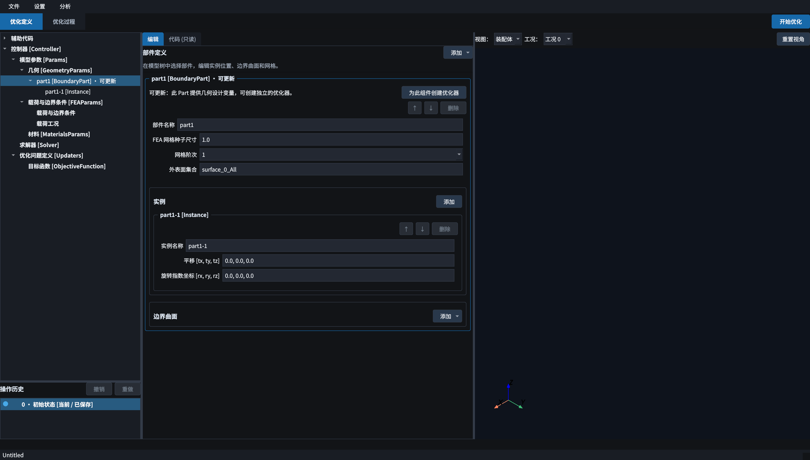

*BoundaryPart 的部件参数与体网格设置。*

<a id="part_types-offsetboundarypart"></a>

#### 3.1.2 OffsetBoundaryPart：内腔偏置部件

`OffsetBoundaryPart` 在内腔边界（曲面 1 起）沿法向建立有厚度的实体偏置层。它继承 BoundaryPart 的边界和体网格参数，并增加偏置厚度与层数。

偏置层的有效性受边界法向、局部曲率和腔壁间距影响。偏置厚度超过局部可用空间时可能产生相交，相关高级约束见[几何约束与辅助目标](#section-几何约束与辅助目标)。程序沿内腔曲面法向生成 C3D6 楔形层，因此部件至少包含一个内腔。偏置方向由边界法向确定，STL 显示颜色不作为方向判据。

| 界面字段 / 保存键 | 初始值 | 参数定义与输入格式 |
|---|---|---|
| FEA 网格种子尺寸 / `fea_seed_size` | `2.5` | 全局 Gmsh 网格种子尺寸。 |
| 网格阶次 / `mesh_order` | `1` | 网格阶次。可选：`1`、`2`。 |
| 外表面集合 / `exterior_surface` | `"surface_0_All"` | 作为 Part 外表面的表面集合名称。 |
| 偏置层厚度 / `shell_thickness` | `0.5` | 由设计边界向材料侧生成的偏置层厚度，使用模型长度单位。 |
| 偏置层数 / `num_layers` | `1` | 偏置层厚度方向的离散层数；增加层数不等于增大总厚度。 |

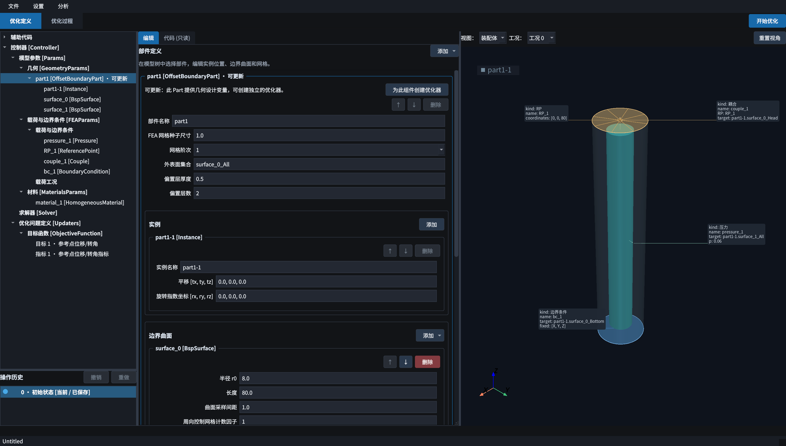

*偏置部件的厚度、层数及边界列表。*

<a id="part_types-boxpart"></a>

#### 3.1.3 BoxPart：结构化长方体部件

`BoxPart` 建立轴对齐长方体实体。 X、Y、Z 方向尺寸分别由 length、height、depth 定义。初始长方体从原点沿三个坐标轴正方向延伸，其装配位置由 Instance 设置。

内置单元块名是 `design`；常用固定面节点集为 `nodes_xmin` 等，常用受力表面为 `surface_xmax` 等。该部件适用于基础 FE 建模与材料分布优化。

| 界面字段 / 保存键 | 初始值 | 参数定义与输入格式 |
|---|---|---|
| 长度 / `length` | `40.0` | Box 的 X 方向尺寸 length。 |
| 高度 / `height` | `16.0` | Box 的 Y 方向尺寸 height。 |
| 厚度 / `depth` | `8.0` | Box 的 Z 方向尺寸 depth。 |
| 网格尺寸 / `mesh_size` | `2.0` | 体有限元网格的目标尺寸；越小通常单元越多。 |
| 网格阶次 / `mesh_order` | `2` | 网格阶次。可选：`1`、`2`。 |
| 外表面集合 / `exterior_surface` | `"extern"` | 作为 Part 外表面的表面集合名称。 |

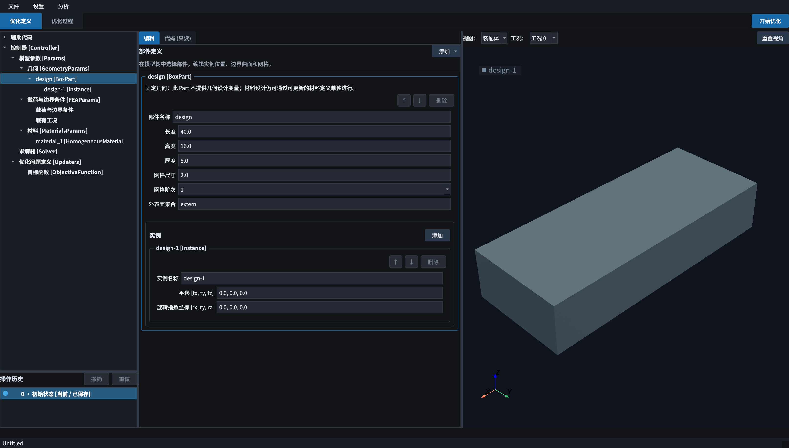

*BoxPart 的实体尺寸与装配预览。*

<a id="part_types-cadpart"></a>

#### 3.1.4 CADPart：CAD 部件

`CADPart` 按 CAD 操作历史构造实体并生成有限元网格。定义内容包括部件网格参数，以及基本体、导入、布尔运算和几何变换等操作。各操作通过有效 ID 建立顺序引用关系。

UI 支持直接编辑 CAD 操作列表，十五种操作见[CAD 建模操作](#cad)。布尔历史修改可能改变面编号，原分配至 `face_N` 的压力和接触应重新核查。

| 界面字段 / 保存键 | 初始值 | 参数定义与输入格式 |
|---|---|---|
| 网格尺寸 / `mesh_size` | `2.0` | 体有限元网格的目标尺寸；越小通常单元越多。 |
| 网格阶次 / `mesh_order` | `1` | 网格阶次。可选：`1`、`2`。 |
| 外表面集合 / `exterior_surface` | `"extern"` | 作为 Part 外表面的表面集合名称。 |

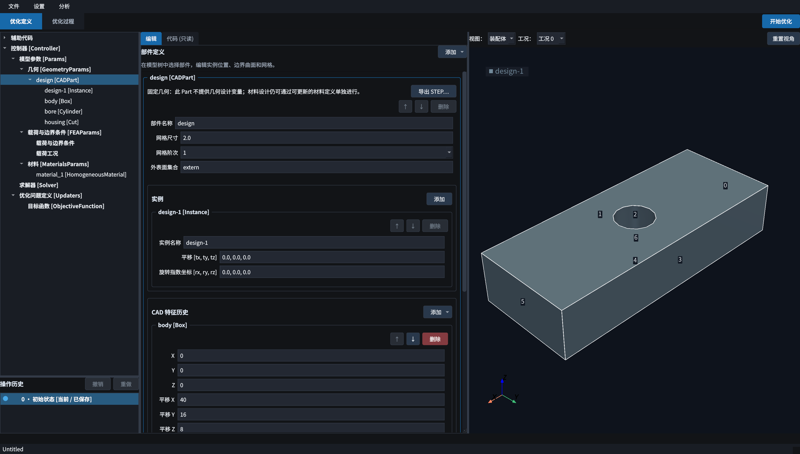

*CADPart：长方体减去圆柱后的实体预览。*

<a id="cad-step-export"></a>

##### 3.1.4.1 导出 STEP 几何

**入口：几何 → CADPart 部件卡片 → 导出 STEP…。** 部件已包含 CAD 特征时，可直接导出操作历史的最终实体，无需预先划分有限元网格或运行优化。

1. 在模型树中选中需要导出的 CADPart，点击部件卡片顶部的“导出 STEP…”。
2. 在保存对话框中进入目标文件夹，并填写文件名。默认名称为部件名称，例如 `design.stp`。
3. 在“文件类型”中选择 `STEP 几何 (*.stp)` 或 `STEP 几何 (*.step)`。文件列表保留文件夹，并显示所选扩展名的文件；输出扩展名随文件类型确定。
4. 点击“保存”。目标文件已存在时，确认覆盖后执行导出；取消覆盖则保留原文件。导出成功后，提示窗口显示完整保存路径。

| 项目 | 导出规则 |
|---|---|
| 几何范围 | 当前 CADPart 操作历史中仍有效的最终实体，包含布尔运算和 CAD 变换的结果 |
| 坐标系 | 部件局部坐标系；Instance 的平移与旋转仍由装配定义管理 |
| 网格设置 | 导出直接使用 CAD 历史，与有限元网格尺寸和阶次独立 |
| 定义保存 | 继续编辑优化任务使用 `.morph`；STEP 用于保存及交换 CAD 几何 |

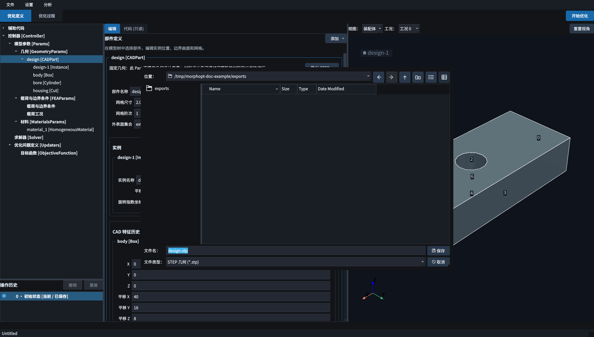

*保存对话框支持选择目录、修改文件名和切换 STP / STEP 筛选；覆盖已有文件时显示确认提示。*

<a id="part_types-inppart"></a>

#### 3.1.5 INPPart：INP 网格部件

`INPPart` 读取 `.inp` 文件中的部件网格与集合。导入参数包括文件路径和源 Part 名称；文件仅包含一个 Part 时，源 Part 名称允许留空。导入后的节点集、单元块和表面集用于后续载荷与材料定义。

当前导入过程同时构造源文件中的材料与截面，源文件应包含导入器支持的材料定义及有效分配。随文档的示例使用显式 Elset、带 `** Section:` 标记的截面和 Neo-Hookean 占位材料；其他 Abaqus 本构或仅包含节点与单元的文件是否可导入，由当前导入器的支持范围决定。

INPPart 仅处理 MorphOpt/TorchFEA 支持的输入内容，不执行完整的 Abaqus 分析步、求解器选项及全部关键字。正式分析使用当前定义中的材料、连接与工况配置。

| 界面字段 / 保存键 | 初始值 | 参数定义与输入格式 |
|---|---|---|
| INP 网格文件 / `mesh_file` | `空` | 包含网格的 Abaqus .inp 文件。 |
| INP 中的 Part / `inp_part_name` | `空` | INP 文件内的 Part 名称；留空时取唯一 Part。 |
| 外表面集合 / `exterior_surface` | `空` | 作为 Part 外表面的表面集合名称。 |

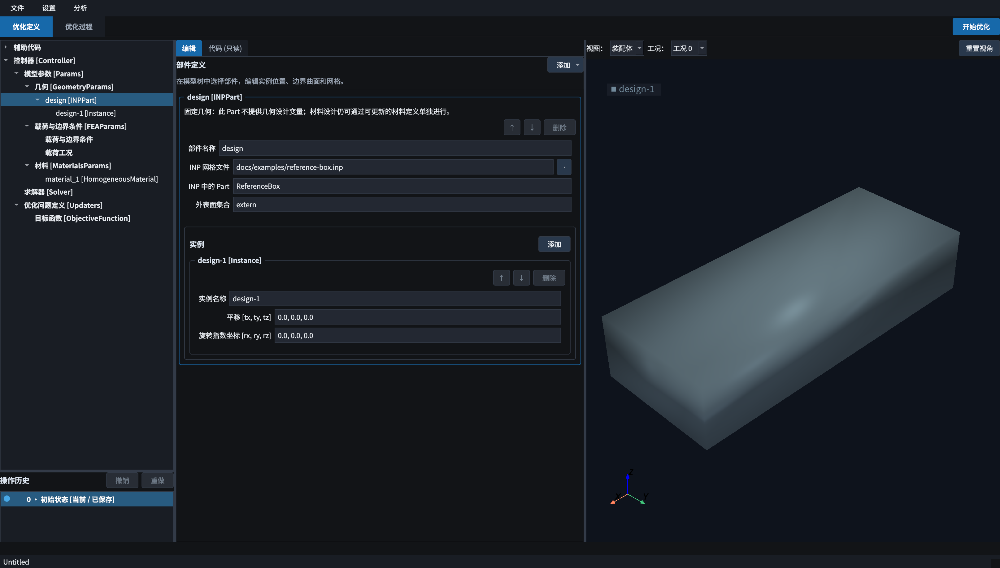

*INPPart 导入 [随文档提供的网格示例](examples/reference-box.inp)：包含几何、集合及用于导入的占位超弹性材料；正式材料与载荷在主定义中复核设置。*

<a id="part_types-basepart"></a>

#### 3.1.6 BasePart：自定义部件

`BasePart` 提供自定义部件的基础接口。 BasePart 用于编程扩展，不属于普通 Part 菜单中的现成建模类型。其建模逻辑由已绑定的自定义类实现。

自定义类按框架方法签名实现节点、单元和集合的构建逻辑。基类及可重写方法由自定义类目录提供，生成代码显示其注册位置。部件名称和外表面集合仅定义对象标识与集合引用，不包含实体构建逻辑。

| 界面字段 / 保存键 | 初始值 | 参数定义与输入格式 |
|---|---|---|
| 外表面集合 / `exterior_surface` | `空` | 作为 Part 外表面的表面集合名称。 |

<a id="section-四种边界曲面"></a>

### 3.2 四种边界曲面

**入口：BoundaryPart / OffsetBoundaryPart → 边界曲面 → 添加。** 曲面的局部参数定义初始边界，随后由所属 Part 生成体网格。

四类曲面均提供 `flip` 方向反转开关。该开关仅改变曲面方向，不改变几何位置或曲面在部件中的内外边界身份。闭合实体的定义应同时满足曲面顺序、闭合性及法向约定。默认名称按顺序生成为 `surface_0`、`surface_1` 等。

<a id="surface_types-bsp-cylinder"></a>

#### 3.2.1 bsp_cylinder：B 样条圆柱面

`bsp_cylinder` 建立由 B 样条控制点连续描述的圆柱状闭合边界。初始几何由半径、Z 向长度及起点定义，离散参数用于设置曲面采样和控制网格。`degree=3` 表示三次 B 样条，与有限元网格阶次分别定义。

优化中曲面能偏离初始圆柱。`maxR`、`maxC`、`maxFF` 是供 Fairness 使用的惩罚阈值，只有在相应几何优化器加入 Fairness 后才参与优化。**maxR 表示参数度量变化惩罚阈值**，径向外包络由 Cylinder 约束定义。

| 界面字段 / 保存键 | 初始值 | 参数定义与输入格式 |
|---|---|---|
| 半径 r0 / `r0` | `4.0` | 初始构型的内/外半径。 |
| 长度 / `length` | `74.0` | 圆柱沿 Z 轴的长度。 |
| 曲面采样间距 / `seed_size` | `1.0` | 用于初始控制网格和曲面预采样的间距，对应 seed_size / init_size。体有限元网格由 Part 的 fea_seed_size 单独控制。 |
| 周向控制网格计数因子 / `num_U_ratio` | `1` | 对应 num_U_ratio：周向控制网格数量按 lcm(12, num_U_ratio) 的倍数取整。 |
| 轴向控制网格计数因子 / `num_V_ratio` | `1` | 对应 num_V_ratio：轴向控制网格数量按此因子取整，然后进行对称布局的奇偶调整；BSP 控制点行数为奇数，CPGEO 轴向分段数为偶数。 |
| B 样条次数 / `degree` | `3` | B 样条多项式次数 degree，例如 3 表示三次 B 样条。 |
| 初始位置 / `init_location` | `[0.0, 0.0, 0.0]` | 表面的初始偏移位置。 |
| 参数度量变化惩罚阈值 (maxR) / `maxR` | `0.2` | 对应 BspSurface.MaxR：对第一基本形式 E、G 的相对导数平方进行补偿后施加惩罚。仅添加 Fairness 时生效，超过阈值的 80% 后开始惩罚。 |
| 曲率平方和惩罚阈值 (maxC) / `maxC` | `1.0` | 对应曲面的 MaxC：限制 κ₁² + κ₂² = 4H² − 2K，量纲为长度的负二次方。仅添加 Fairness 时生效，超过阈值的 80% 后开始惩罚。 |
| 参数方向非正交惩罚阈值 (maxFF) / `maxFF` | `0.2` | 对应 BspSurface.MaxFF：限制 F²/(E·G)，即两条参数切向量夹角的余弦平方。仅添加 Fairness 时生效，超过阈值的 80% 后开始惩罚。 |
| 初始扰动波长 / `perturbation_L` | `-1.0` | 初始缺陷波长；小于等于 0 表示不添加缺陷。 |

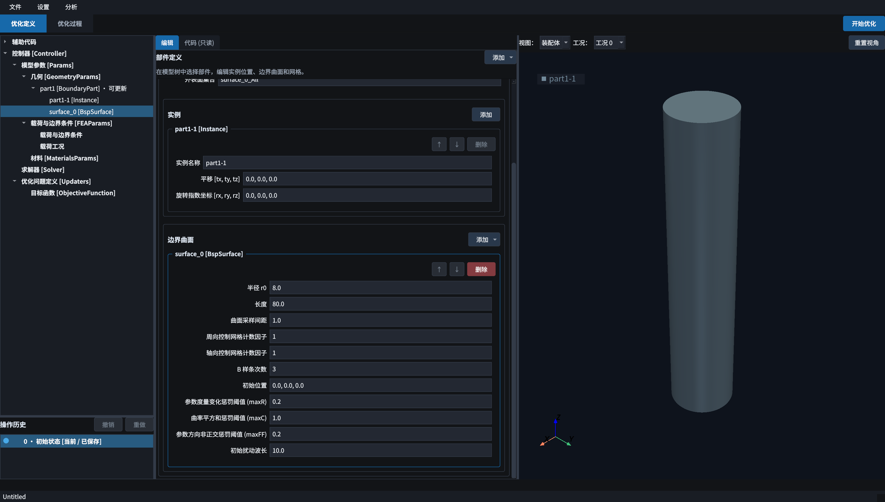

*BSP 圆柱边界的初始形状与设计控制参数。*

<a id="surface_types-cpgeo-cylinder"></a>

#### 3.2.2 cpgeo_cylinder：CPGEO 圆柱面

`cpgeo_cylinder` 通过 CPGEO 控制网格建立可更新的圆柱边界。半径、长度和初始位置定义初始几何，采样参数定义控制网格。CPGEO 曲面使用对应的镜像、旋转对称及关联接口，BspMirror 仅适用于 BSP 曲面。

本接口不提供 BSP 的 degree、maxR 和 maxFF 字段；曲率阈值 `maxC` 配合 Fairness 使用。

| 界面字段 / 保存键 | 初始值 | 参数定义与输入格式 |
|---|---|---|
| 半径 r0 / `r0` | `4.0` | 初始构型的内/外半径。 |
| 长度 / `length` | `74.0` | 圆柱沿 Z 轴的长度。 |
| 曲面采样间距 / `seed_size` | `1.0` | 用于初始控制网格和曲面预采样的间距，对应 seed_size / init_size。体有限元网格由 Part 的 fea_seed_size 单独控制。 |
| 周向控制网格计数因子 / `num_U_ratio` | `1` | 对应 num_U_ratio：周向控制网格数量按 lcm(12, num_U_ratio) 的倍数取整。 |
| 轴向控制网格计数因子 / `num_V_ratio` | `1` | 对应 num_V_ratio：轴向控制网格数量按此因子取整，然后进行对称布局的奇偶调整；BSP 控制点行数为奇数，CPGEO 轴向分段数为偶数。 |
| 初始位置 / `init_location` | `[0.0, 0.0, 0.0]` | 表面的初始偏移位置。 |
| 曲率平方和惩罚阈值 (maxC) / `maxC` | `1.0` | 对应曲面的 MaxC：限制 κ₁² + κ₂² = 4H² − 2K，量纲为长度的负二次方。仅添加 Fairness 时生效，超过阈值的 80% 后开始惩罚。 |
| 初始扰动波长 / `perturbation_L` | `-1.0` | 初始缺陷波长；小于等于 0 表示不添加缺陷。 |

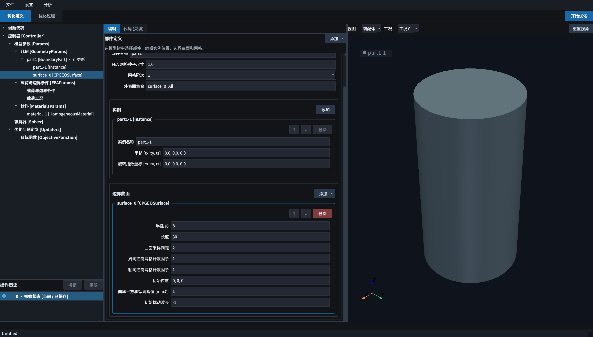

*CPGEO 圆柱边界及其控制网格参数。*

<a id="surface_types-cpgeo-sphere"></a>

#### 3.2.3 cpgeo_sphere：CPGEO 球面

`cpgeo_sphere` 建立球形初始边界，例如球形腔体。`init_location` 定义球心，`r0` 定义初始半径。种子尺寸控制曲面控制网格与采样，体有限元网格尺寸由部件参数单独设置。

球面参数的保存键为 `MaxC`，与圆柱参数 `maxC` 的大小写不同。UI 自动使用对应键名，直接编辑 `.morph` 时应保持键名一致。

| 界面字段 / 保存键 | 初始值 | 参数定义与输入格式 |
|---|---|---|
| 半径 r0 / `r0` | `7.0` | 初始构型的内/外半径。 |
| 曲面采样间距 / `seed_size` | `1.5` | 用于初始控制网格和曲面预采样的间距，对应 seed_size / init_size。体有限元网格由 Part 的 fea_seed_size 单独控制。 |
| 初始位置 / `init_location` | `[0.0, 0.0, 0.0]` | 球心坐标 init_location。 |
| 曲率平方和惩罚阈值 (maxC) / `MaxC` | `1.0` | 对应曲面的 MaxC：限制 κ₁² + κ₂² = 4H² − 2K，量纲为长度的负二次方。仅添加 Fairness 时生效，超过阈值的 80% 后开始惩罚。 |

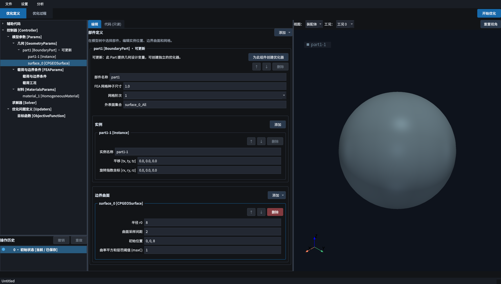

*CPGEO 球形边界：半径、球心与采样。*

<a id="surface_types-fixed-stl"></a>

#### 3.2.4 fixed_stl：固定 STL 曲面

`fixed_stl` 以现有 STL 作为固定边界。输入文件应包含闭合且方向符合约定的曲面。该接口不产生可更新控制点，支持与可变 BSP/CPGEO 边界组合使用。

STL 不包含物理单位声明，导入尺寸应与模型单位制一致。变形后的表面 STL 可作为显示对象或固定几何输入，其内容不包含原模型的材料、载荷及集合定义。

| 界面字段 / 保存键 | 初始值 | 参数定义与输入格式 |
|---|---|---|
| STL 文件 / `path_stl` | `空` | STL 曲面文件路径。 |

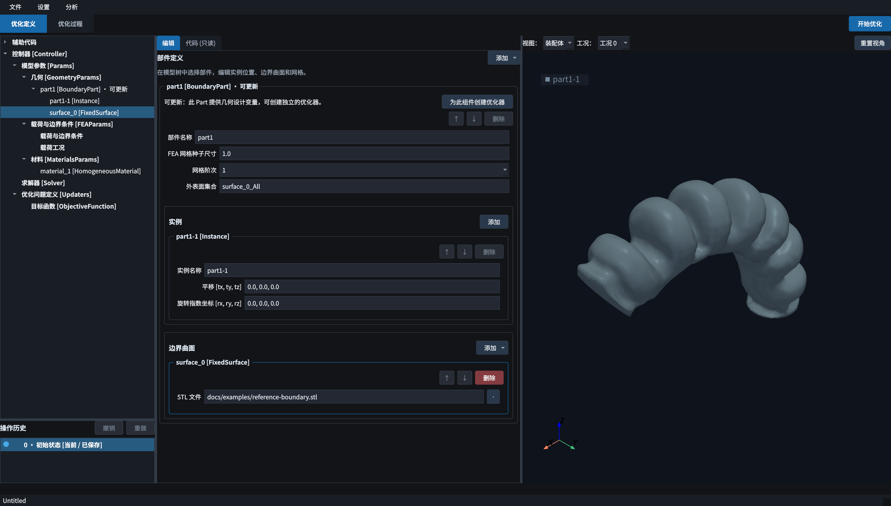

*固定 STL 边界：文件路径与曲面预览。配图采用随文档提供的[STL 示例](examples/reference-boundary.stl)。*

<a id="section-instance装配位置接口"></a>

### 3.3 Instance：装配位置接口

`fixed_stl` 定义 Part 在装配体中的实例及其位姿。同一 Part 可以有多个实例，材料随 Part 复用；各实例可有独立的载荷和接触关系。

| 字段 | 定义 | 填写示例 |
|---|---|---|
| 名称 | 载荷引用的实例名，保持唯一 | `part1-1` |
| `translation` | 三维平移向量 | `[0,0,0]` |
| `rotation` | 三维旋转向量，方向是旋转轴，模长是转角，单位 rad | `[0,0,1.57079632679]` 绕 Z 轴 90° |

三个旋转分量采用旋转向量表示，不采用依次执行的欧拉角表示。部件视图显示原始几何，装配预览显示实例位姿；载荷引用装配体中的实例。

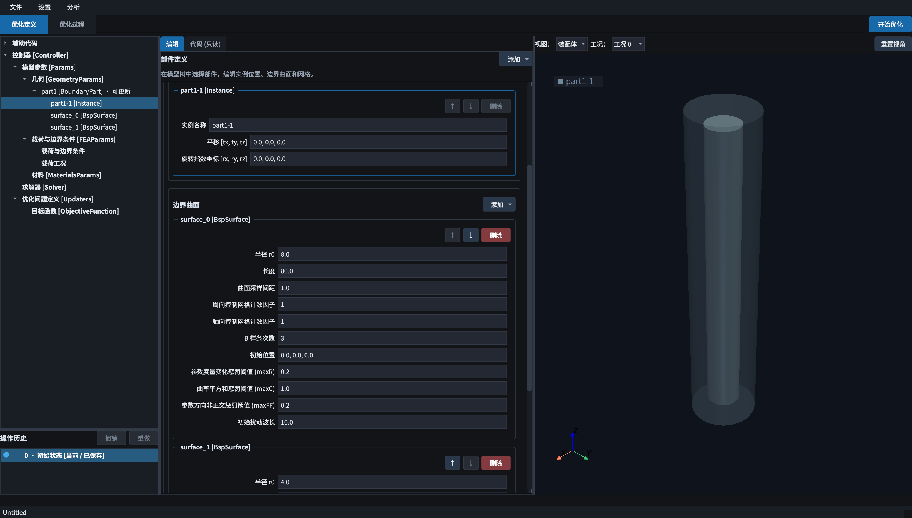

*实例的平移、旋转向量与装配位置。*

<a id="section-常用自动集合"></a>

### 3.4 常用自动集合

| 部件 | 节点集 | 表面集 | 使用提示 |
|---|---|---|---|
| BoundaryPart | `surface_i_All`，圆柱端部有 `surface_0_Bottom` / `surface_0_Head` | `surface_i_All` | 同名节点集与表面集对应不同的接口参数 |
| OffsetBoundaryPart | 在边界集合外还有偏置相关集合 | 包括 `surface_i_offset`（内腔相关） | 以实际候选列表为准 |
| BoxPart | `all`、`nodes_xmin/xmax/ymin/ymax/zmin/zmax` | `extern`、`surface_xmin/xmax/ymin/ymax/zmin/zmax` | 单元块 `design` |
| CADPart | `all`、`surface_all`、`face_N_nodes` | `extern`、`face_N` | 改 CAD 历史后重查面编号 |
| INPPart | 来自导入模型 | 来自导入模型 | 集合名称以源文件或导入信息为准 |

<a id="cad"></a>

## 4 CAD：十五种建模操作

**入口：CADPart → CAD 操作 → 添加。** 每项操作具有唯一的 `operation_id`，例如 body、bore、housing。操作列表自上而下执行。布尔运算和几何变换引用前序操作中仍有效的实体 ID；已被消耗的输入不再作为独立实体参与后续操作。

示例顺序：`Box(body)` → `Cylinder(bore)` → `Cut(housing, object_id=body, tool_id=bore)`。操作列表记录构造历史，其最终实体用于体网格划分。

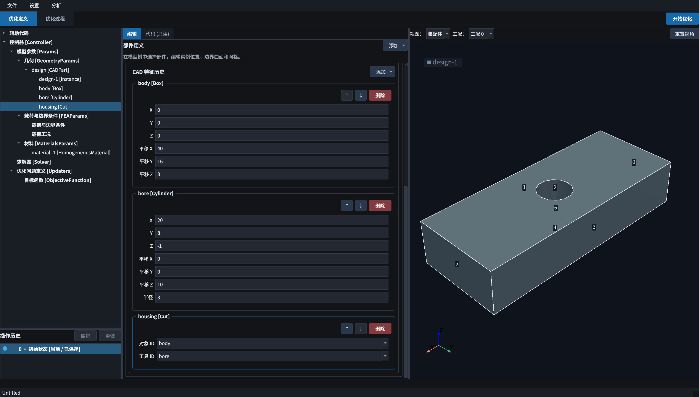

*CAD Cut：从已有主体中减去工具实体。*

<a id="cad_operation_types-box"></a>

### 4.1 Box：长方体

`Box` 建立长方体。`x,y,z` 是一个角点；`dx,dy,dz` 是三条边长。Box 操作的通用字段标签显示为“平移 X/Y/Z”，其实际含义为实体尺寸。

| 界面字段 / 保存键 | 初始值 | 参数定义与输入格式 |
|---|---|---|
| X / `x` | `0.0` | 基准点的全局 X 坐标。 |
| Y / `y` | `0.0` | 基准点的全局 Y 坐标。 |
| Z / `z` | `0.0` | 基准点的全局 Z 坐标。 |
| 平移 X / `dx` | `20.0` | 长方体 X 边长。 |
| 平移 Y / `dy` | `10.0` | 长方体 Y 边长。 |
| 平移 Z / `dz` | `5.0` | 长方体 Z 边长。 |

<a id="cad_operation_types-wedge"></a>

### 4.2 Wedge：楔体

`Wedge` 建立楔形实体。基准点和三个跨度与 Box 类似，`ltx` 控制楔形顶边的 X 向尺寸。适合斜面、楔块等初始几何。

| 界面字段 / 保存键 | 初始值 | 参数定义与输入格式 |
|---|---|---|
| X / `x` | `0.0` | 基准点的全局 X 坐标。 |
| Y / `y` | `0.0` | 基准点的全局 Y 坐标。 |
| Z / `z` | `0.0` | 基准点的全局 Z 坐标。 |
| 平移 X / `dx` | `20.0` | 楔体 X 向跨度。 |
| 平移 Y / `dy` | `10.0` | 楔体 Y 向跨度。 |
| 平移 Z / `dz` | `5.0` | 楔体 Z 向跨度。 |
| 顶部偏移 X / `ltx` | `0.0` | Gmsh addWedge 接口中的顶边 X 向长度 ltx。 |

<a id="cad_operation_types-cylinder"></a>

### 4.3 Cylinder：圆柱

`Cylinder` 建立圆柱实体。起点为 `(x,y,z)`，轴向量为 `(dx,dy,dz)`，圆柱长度等于该向量的模；轴不必沿 Z。

| 界面字段 / 保存键 | 初始值 | 参数定义与输入格式 |
|---|---|---|
| X / `x` | `0.0` | 基准点的全局 X 坐标。 |
| Y / `y` | `0.0` | 基准点的全局 Y 坐标。 |
| Z / `z` | `0.0` | 基准点的全局 Z 坐标。 |
| 平移 X / `dx` | `0.0` | 轴向量 X 分量。 |
| 平移 Y / `dy` | `0.0` | 轴向量 Y 分量。 |
| 平移 Z / `dz` | `20.0` | 轴向量 Z 分量；三分量不能全为 0。 |
| 半径 / `radius` | `5.0` | 圆柱或半径约束的半径。 |

<a id="cad_operation_types-sphere"></a>

### 4.4 Sphere：球体

`Sphere` 建立球实体。`x,y,z` 是球心，`radius` 是半径。该操作生成 CAD 实体，不建立 cpgeo_sphere 接口所提供的 CPGEO 形状变量。

| 界面字段 / 保存键 | 初始值 | 参数定义与输入格式 |
|---|---|---|
| X / `x` | `0.0` | 基准点的全局 X 坐标。 |
| Y / `y` | `0.0` | 基准点的全局 Y 坐标。 |
| Z / `z` | `0.0` | 基准点的全局 Z 坐标。 |
| 半径 / `radius` | `5.0` | 圆柱或半径约束的半径。 |

<a id="cad_operation_types-cone"></a>

### 4.5 Cone：圆锥

`Cone` 建立圆锥或截锥。起点、轴向量与 Cylinder 相同，两个半径分别对应轴两端。

| 界面字段 / 保存键 | 初始值 | 参数定义与输入格式 |
|---|---|---|
| X / `x` | `0.0` | 基准点的全局 X 坐标。 |
| Y / `y` | `0.0` | 基准点的全局 Y 坐标。 |
| Z / `z` | `0.0` | 基准点的全局 Z 坐标。 |
| 平移 X / `dx` | `0.0` | 轴向量 X 分量。 |
| 平移 Y / `dy` | `0.0` | 轴向量 Y 分量。 |
| 平移 Z / `dz` | `20.0` | 轴向量 Z 分量。 |
| 底部半径 / `radius1` | `5.0` | 轴起点处半径。 |
| 顶部半径 / `radius2` | `1.0` | 轴终点处半径；可取 0 构成尖锥。 |

<a id="cad_operation_types-torus"></a>

### 4.6 Torus：圆环体

`Torus` 建立圆环实体。中心在 `(x,y,z)`，默认环轴沿 Z，其他轴向由后续 Rotate 操作定义。主半径定义圆环中心线，管半径定义截面。

| 界面字段 / 保存键 | 初始值 | 参数定义与输入格式 |
|---|---|---|
| X / `x` | `0.0` | 基准点的全局 X 坐标。 |
| Y / `y` | `0.0` | 基准点的全局 Y 坐标。 |
| Z / `z` | `0.0` | 基准点的全局 Z 坐标。 |
| 主半径 / `major_radius` | `8.0` | 圆环中心到管截面中心的距离。 |
| 管半径 / `minor_radius` | `2.0` | 管截面半径。 |

<a id="cad_operation_types-stepimport"></a>

### 4.7 StepImport：导入 STEP

`StepImport` 导入 STEP 实体作为 CAD 历史的一步。文件选择器将导入内容嵌入定义，导入实体支持后续布尔运算与几何变换。导入结果的核查项目包括单位、实体数量及几何有效性。

| 界面字段 / 保存键 | 初始值 | 参数定义与输入格式 |
|---|---|---|
| STEP 文件 / `filename` | `空` | STEP 几何以文件内容嵌入模型。 |
| STEP 几何数据 / `data` | `空` | 导入后保存的 STEP 文件内容编码；通过文件选择器生成，无需手写。 |

<a id="cad_operation_types-fuse"></a>

### 4.8 Fuse：融合

`Fuse` 取两个输入实体的并集，用于合并相接或重叠的实体。输入参数为主体 ID 和工具 ID，预览显示合并后的实体。

| 界面字段 / 保存键 | 初始值 | 参数定义与输入格式 |
|---|---|---|
| 对象 ID / `object_id` | `空` | 选择此前仍有效的主体操作 ID。 |
| 工具 ID / `tool_id` | `空` | 选择此前仍有效的工具操作 ID。 |

<a id="cad_operation_types-cut"></a>

### 4.9 Cut：切除

`Cut` 取主体减去工具的差集，例如在实体中切出通孔或气腔。主体和工具的顺序决定结果。

| 界面字段 / 保存键 | 初始值 | 参数定义与输入格式 |
|---|---|---|
| 对象 ID / `object_id` | `空` | 选择此前仍有效的主体操作 ID。 |
| 工具 ID / `tool_id` | `空` | 选择此前仍有效的工具操作 ID。 |

<a id="cad_operation_types-intersect"></a>

### 4.10 Intersect：相交

`Intersect` 只保留两个输入实体的公共体积。两个实体没有体积交集时不能得到预期实体。

| 界面字段 / 保存键 | 初始值 | 参数定义与输入格式 |
|---|---|---|
| 对象 ID / `object_id` | `空` | 选择此前仍有效的主体操作 ID。 |
| 工具 ID / `tool_id` | `空` | 选择此前仍有效的工具操作 ID。 |

<a id="cad_operation_types-fragment"></a>

### 4.11 Fragment：碎片分割

`Fragment` 在相交位置对输入实体进行一致分割，建立共形的几何分区。该操作适用于保留几何分区的模型，分割后的体与面数量应符合建模要求。

| 界面字段 / 保存键 | 初始值 | 参数定义与输入格式 |
|---|---|---|
| 对象 ID / `object_id` | `空` | 选择此前仍有效的主体操作 ID。 |
| 工具 ID / `tool_id` | `空` | 选择此前仍有效的工具操作 ID。 |

<a id="cad_operation_types-translate"></a>

### 4.12 Translate：平移

`Translate` 将输入实体平移。`dx,dy,dz` 定义平移向量。CAD 平移会改变 Part 本身的坐标；Instance 平移改变它在装配体中的放置。

| 界面字段 / 保存键 | 初始值 | 参数定义与输入格式 |
|---|---|---|
| 输入 ID / `input_id` | `空` | 选择此前仍有效的输入实体 ID。 |
| 平移 X / `dx` | `5.0` | 平移向量 X 分量。 |
| 平移 Y / `dy` | `0.0` | 平移向量 Y 分量。 |
| 平移 Z / `dz` | `0.0` | 平移向量 Z 分量。 |

<a id="cad_operation_types-rotate"></a>

### 4.13 Rotate：旋转

`Rotate` 绕通过 `(x,y,z)`、方向为 `(ax,ay,az)` 的轴旋转输入实体。角度用 rad。

| 界面字段 / 保存键 | 初始值 | 参数定义与输入格式 |
|---|---|---|
| 输入 ID / `input_id` | `空` | 选择此前仍有效的输入实体 ID。 |
| X / `x` | `0.0` | 基准点的全局 X 坐标。 |
| Y / `y` | `0.0` | 基准点的全局 Y 坐标。 |
| Z / `z` | `0.0` | 基准点的全局 Z 坐标。 |
| 轴向 X / `ax` | `0.0` | 旋转轴方向向量的 X 分量。 |
| 轴向 Y / `ay` | `0.0` | 旋转轴方向向量的 Y 分量。 |
| 轴向 Z / `az` | `1.0` | 旋转轴方向向量的 Z 分量；轴向量不能为零。 |
| 角度（弧度） / `angle` | `1.5707963267948966` | 绕给定轴的旋转量，单位为 rad；90° 对应 `1.57079632679`。 |

<a id="cad_operation_types-dilate"></a>

### 4.14 Dilate：缩放

`Dilate` 以 `(x,y,z)` 为中心对输入实体进行方向缩放。三个方向的比例分别定义几何缩放量，该操作不改变材料的各向同性或各向异性属性。

| 界面字段 / 保存键 | 初始值 | 参数定义与输入格式 |
|---|---|---|
| 输入 ID / `input_id` | `空` | 选择此前仍有效的输入实体 ID。 |
| X / `x` | `0.0` | 基准点的全局 X 坐标。 |
| Y / `y` | `0.0` | 基准点的全局 Y 坐标。 |
| Z / `z` | `0.0` | 基准点的全局 Z 坐标。 |
| 缩放 X / `sx` | `1.0` | 相对缩放中心的 X 比例，1 表示不变。 |
| 缩放 Y / `sy` | `1.0` | 相对缩放中心的 Y 比例。 |
| 缩放 Z / `sz` | `1.0` | 相对缩放中心的 Z 比例。 |

<a id="cad_operation_types-mirror"></a>

### 4.15 Mirror：镜像

`Mirror` 将输入实体关于平面 `a*x+b*y+c*z+d=0` 镜像。例如 `[a,b,c,d]=[0,1,0,0]` 是关于 xz 平面镜像。此操作改变 CAD 实体，不会建立优化过程中持续施加的曲面对称约束。

| 界面字段 / 保存键 | 初始值 | 参数定义与输入格式 |
|---|---|---|
| 输入 ID / `input_id` | `空` | 选择此前仍有效的输入实体 ID。 |
| 平面法向 X / `a` | `1.0` | 镜面方程 ax+by+cz+d=0 中的 a。 |
| 平面法向 Y / `b` | `0.0` | 镜面方程中的 b。 |
| 平面法向 Z / `c` | `0.0` | 镜面方程中的 c；a、b、c 不能同时为零。 |
| 平面偏移 / `d` | `0.0` | 镜面方程中的 d；不是无条件等于镜面到原点的距离。 |

**CAD 核查项目：** 操作预览、历史引用关系及最终面集。布尔历史变更后的 `face_N` 应重新核查，网格尺寸和阶次由 CADPart 卡片统一设置。

<a id="loads"></a>

## 5 载荷、连接、边界与接触

**入口：主定义 → 载荷与边界条件 → 添加载荷接口。** 本模块定义接口的作用对象、位置与连接关系，具有工况参数的接口在工况表中单独赋值。

| 功能 | 对应接口 | 工况分量 |
|---|---|---|
| 表面压力加载 | Pressure | `[p]` |
| 在参考点施力 / 力矩 | ConcentratedForce / ConcentratedMoment | `[Fx,Fy,Fz]` / `[Mx,My,Mz]` |
| 按体积分布力 | Bodyforce | `[fx,fy,fz]` |
| RP 与固定地面点之间的轴向弹簧 | SpringToGround | `[k,L0,Px,Py,Pz]` |
| 两个 RP 之间的轴向弹簧 | SpringBetweenRPs | `[k,L0]` |
| 广义自由度的目标值罚约束 | PenaltyDoF | `[k,target]` |
| 固定实体节点 / RP 自由度 | BoundaryCondition / BoundaryConditionRP | 无 |
| 将一组节点连接到 RP | Couple | 无 |
| 创建运动或载荷的参考位置 | ReferencePoint | 无 |
| 实例之间 / 单实例自身的接触 | Contact / ContactSelf | 无 |

“无”表示该接口没有工况幅值列，其位置、集合或连接定义仍参与建模。零载荷幅值不改变已有参考点、耦合或固定条件的定义。

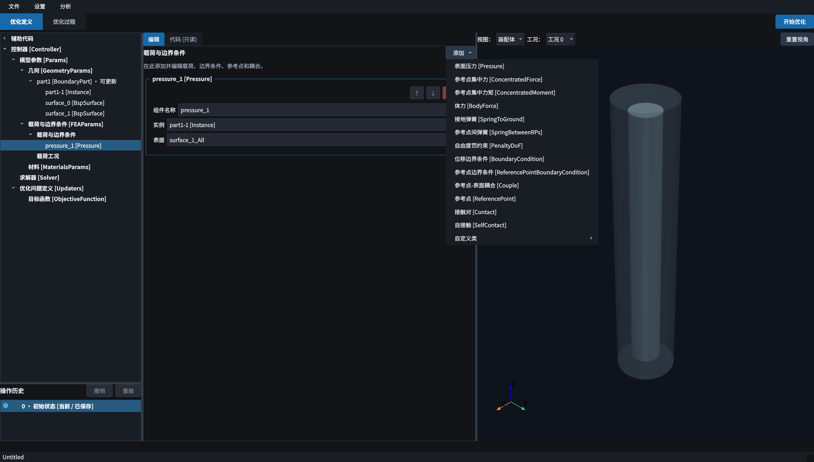

*载荷接口添加菜单。*

<a id="load_types-pressure"></a>

### 5.1 Pressure：表面压力

`Pressure` 对实例的表面集施加法向压力。实例与表面集确定受压区域，工况参数采用 `[p]` 格式。例如 `part1-1 / surface_1_All`、`p=0.06`。

压力方向由表面方向和求解器约定共同确定，内腔加载应核查 flip、表面法向及变形方向。预览箭头表示法向压力方向，本接口仅接受单分量压力参数。

| 界面字段 / 保存键 | 初始值 | 参数定义与输入格式 |
|---|---|---|
| 实例 / `instance_name` | `空` | 对应的 TorchFEA Instance 名称。 |
| 表面 / `surface_name` | `空` | 实例上的表面集名称。 |

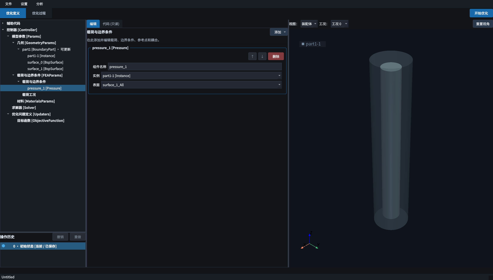

*Pressure 的对象与作用范围设置。*

<a id="load_types-concentratedforce"></a>

### 5.2 ConcentratedForce：参考点集中力

`ConcentratedForce` 在 RP 上施加全局三分量集中力。 ReferencePoint 定义加载参考点，Couple 建立 RP 与实体目标节点集的连接。工况参数为 `[Fx,Fy,Fz]`，单位为力。

例：`[0,-1,0]` 表示全局 −Y 方向力。未与实体连接的 RP 不向附近实体传递载荷。

| 界面字段 / 保存键 | 初始值 | 参数定义与输入格式 |
|---|---|---|
| 参考点 / `rp_name` | `空` | 已定义的 ReferencePoint 名称。 |


*ConcentratedForce 的对象与作用范围设置。*

<a id="load_types-concentratedmoment"></a>

### 5.3 ConcentratedMoment：参考点集中力矩

`ConcentratedMoment` 在 RP 上施加三分量集中力矩。工况参数为 `[Mx,My,Mz]`，单位为力×长度。力矩通过 RP 与实体之间的连接传递。

力矩与转角目标是两种量：力矩是输入，`rx/ry/rz` 是运动响应。

| 界面字段 / 保存键 | 初始值 | 参数定义与输入格式 |
|---|---|---|
| 参考点 / `rp_name` | `空` | 已定义的 ReferencePoint 名称。 |

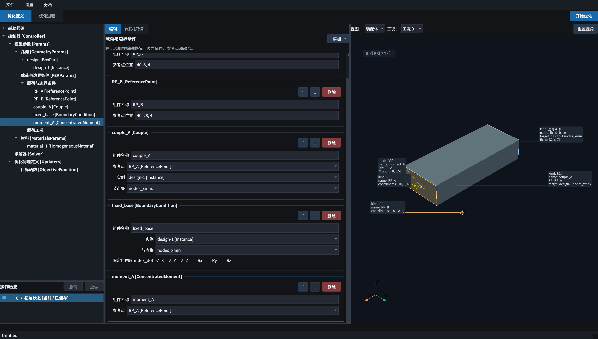

*ConcentratedMoment 的对象与作用范围设置。*

<a id="load_types-bodyforce"></a>

### 5.4 Bodyforce：体力

`Bodyforce` 向指定实例的单元块施加单位体积力。实例名称和单元块名称确定作用区域，工况参数为 `[fx,fy,fz]`，量纲为力/体积。

重力体积力按一致单位制下的 `密度×加速度` 计算。本接口直接使用输入的力密度，不执行加速度解释或额外的密度乘法。UI 类型保存为 `Bodyforce`，后端类名为 `BodyForce`。

| 界面字段 / 保存键 | 初始值 | 参数定义与输入格式 |
|---|---|---|
| 单元类型 / `element_name` | `空` | 实例中承受体积力的单元块键名；以 Part.elems 的实际名称为准。 |
| 实例 / `instance_name` | `空` | 对应的 TorchFEA Instance 名称。 |

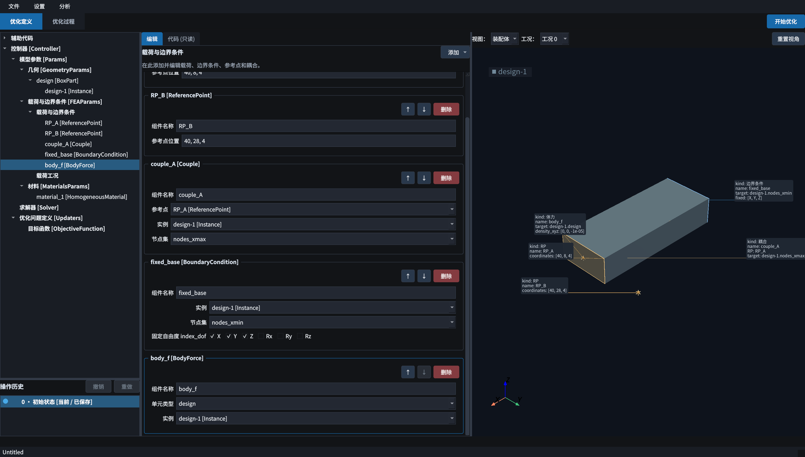

*Bodyforce 的对象与作用范围设置。*

<a id="load_types-springtoground"></a>

### 5.5 SpringToGround：接地弹簧

`SpringToGround` 用轴向弹簧将 RP 连接到一个固定空间点。对象定义指定 RP，工况参数顺序为 **`[k,L0,Px,Py,Pz]`**：刚度、自然长度、地面端全局坐标。

例：RP 在 `[40,8,4]`，固定端 `[40,28,4]`，自然长度 20，刚度 1，对应参数为 `[1,20,40,28,4]`。弹簧沿两端连线作用，仅提供轴向刚度；预拉伸由实际长度与 L0 的差确定。

| 界面字段 / 保存键 | 初始值 | 参数定义与输入格式 |
|---|---|---|
| 参考点 / `rp_name` | `空` | 已定义的 ReferencePoint 名称。 |

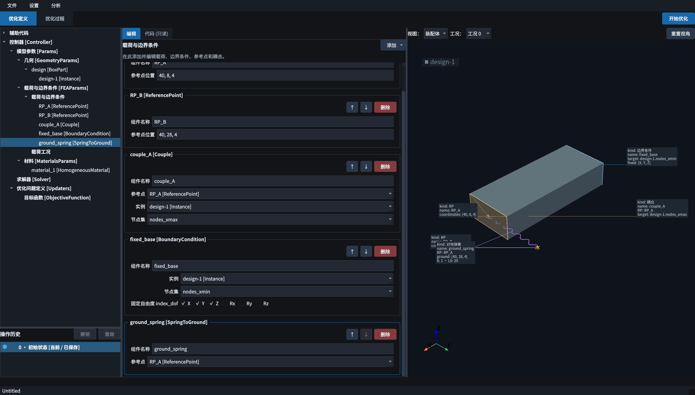

*SpringToGround 的对象与作用范围设置。*

<a id="load_types-springbetweenrps"></a>

### 5.6 SpringBetweenRPs：参考点间弹簧

`SpringBetweenRPs` 在两个 RP 之间连接轴向弹簧。两个 RP 分别定义弹簧端点，并通过连接接口关联各自结构。工况参数为 `[k,L0]`。

本接口的方向随两端位置改变；它没有独立的转动刚度分量。弹簧端点的固定条件由对应 RP 的 BoundaryConditionRP 定义。

| 界面字段 / 保存键 | 初始值 | 参数定义与输入格式 |
|---|---|---|
| 参考点 1 / `rp_name1` | `空` | 第一个参考点名称。 |
| 参考点 2 / `rp_name2` | `空` | 第二个参考点名称。 |

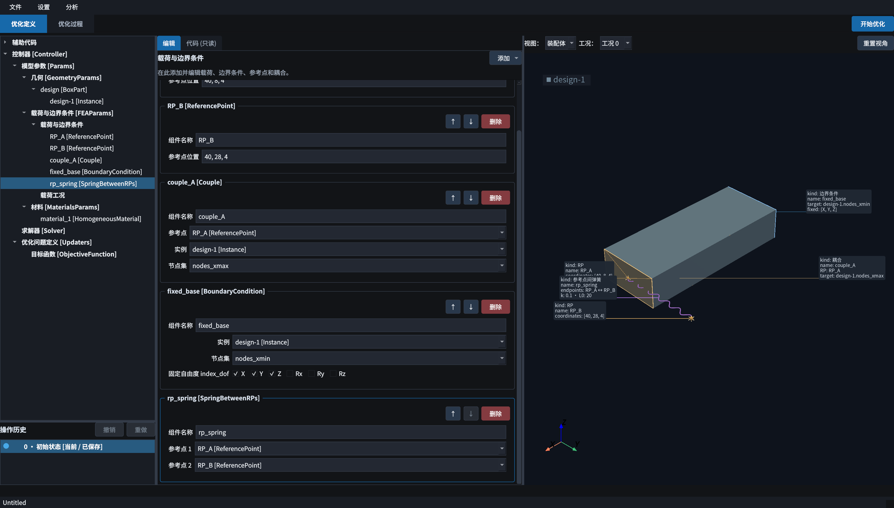

*SpringBetweenRPs 的对象与作用范围设置。*

<a id="load_types-penaltydof"></a>

### 5.7 PenaltyDoF：自由度罚约束

`PenaltyDoF` 通过罚刚度约束对象的指定广义自由度，使其接近目标值。对象名、对象类型和编号 `s` 确定受约束自由度，工况参数为 `[k,target]`。

RP 的 s=0…5 对应 X、Y、Z、Rx、Ry、Rz；实体对象使用其自身的广义自由度展开方式，Instance 的 s=3 不统一表示整体 Rx。目标对象应提供所选自由度。

罚约束采用有限刚度，允许响应与目标值之间存在偏差。过大的 k 可能恶化数值条件，零值固定条件由边界条件接口定义。

| 界面字段 / 保存键 | 初始值 | 参数定义与输入格式 |
|---|---|---|
| 对象 / `obj_name` | `空` | 被约束对象的名称。 |
| 自由度 / `s` | `0` | 自由度编号。 |
| 对象类型 / `obj_type` | `"auto"` | 对应 Assembly.get_object 的对象类型：auto、instance、rp、load、constraint、boundary。对象必须提供所选的广义自由度。可选：`auto`、`instance`、`rp`、`load`、`constraint`、`boundary`。 |

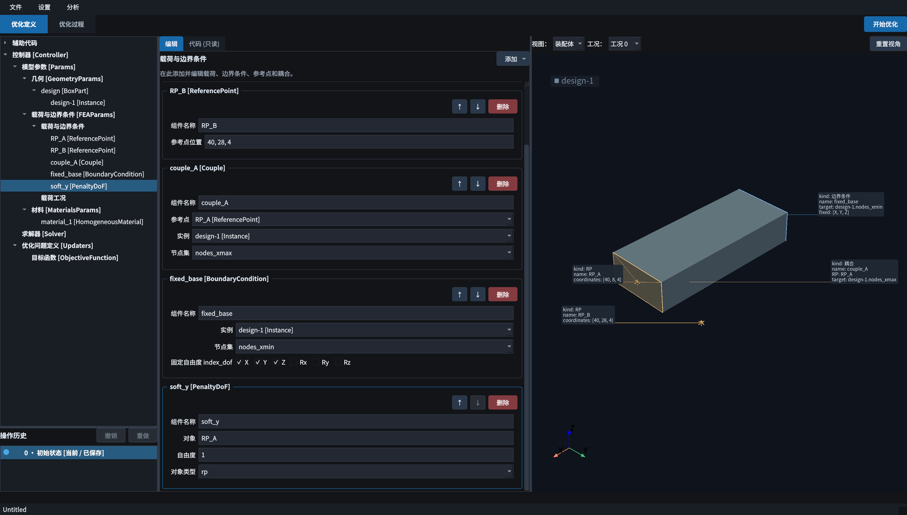

*PenaltyDoF 的对象与作用范围设置。*

<a id="load_types-boundarycondition"></a>

### 5.8 BoundaryCondition：位移边界条件

`BoundaryCondition` 固定指定实例节点集的选定自由度。对普通三维实体节点通常选择 X、Y、Z，即 `[0,1,2]`；普通三维实体节点不具有独立转动自由度，UI 中的转动选项不改变单元自由度定义。

例：`part1-1 / surface_0_Bottom / [0,1,2]` 固定底端平移。本接口没有用于输入非零位移的工况列。

| 界面字段 / 保存键 | 初始值 | 参数定义与输入格式 |
|---|---|---|
| 实例 / `instance_name` | `空` | 对应的 TorchFEA Instance 名称。 |
| 节点集 / `set_nodes_name` | `空` | 实例上的节点集名称。 |
| 固定自由度 index_dof / `index_dof` | `[0, 1, 2]` | 固定自由度的索引列表；0…5 分别对应 X、Y、Z、Rx、Ry、Rz，实际可用分量由目标对象的自由度定义确定。 |

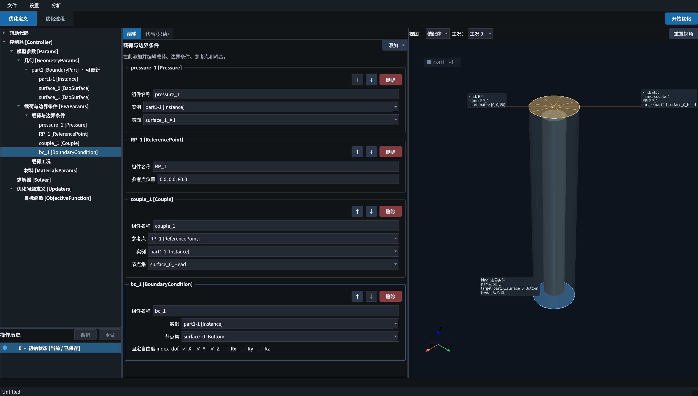

*BoundaryCondition 的对象与作用范围设置。*

<a id="load_types-boundaryconditionrp"></a>

### 5.9 BoundaryConditionRP：参考点边界条件

`BoundaryConditionRP` 固定 RP 的选定平移或转动自由度。编号 `[0,1,2,3,4,5]` 分别为 X、Y、Z、Rx、Ry、Rz。

例如，固定分量 `[0,2,3,4,5]` 后，参考点仅保留 Y 向运动自由度。该运动关系通过 RP 的 Couple 连接传递至实体。

| 界面字段 / 保存键 | 初始值 | 参数定义与输入格式 |
|---|---|---|
| 参考点 / `rp_name` | `空` | 已定义的 ReferencePoint 名称。 |
| 固定自由度 index_dof / `index_dof` | `[0, 1, 2]` | 固定自由度的索引列表；0…5 分别对应 X、Y、Z、Rx、Ry、Rz，实际可用分量由目标对象的自由度定义确定。 |

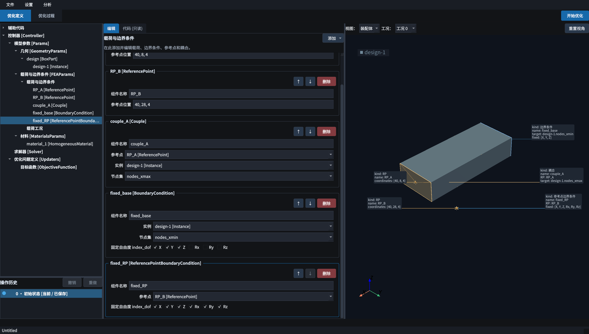

*BoundaryConditionRP 的对象与作用范围设置。*

<a id="load_types-couple"></a>

### 5.10 Couple：参考点-表面耦合

`Couple` 将一个实例的节点集与 RP 建立运动学耦合。节点组的运动由 RP 的平移与转动控制，可用于端面加载、固定或读取末端整体运动。

Couple 对节点组施加刚性运动关系，作用区域通常为保持刚性的端面或连接区域。对整个柔性部件施加耦合将改变其变形能力。该接口不设置工况幅值。

| 界面字段 / 保存键 | 初始值 | 参数定义与输入格式 |
|---|---|---|
| 参考点 / `rp_name` | `空` | 已定义的 ReferencePoint 名称。 |
| 实例 / `instance_name` | `空` | 对应的 TorchFEA Instance 名称。 |
| 节点集 / `set_nodes_name` | `空` | 实例上的节点集名称。 |

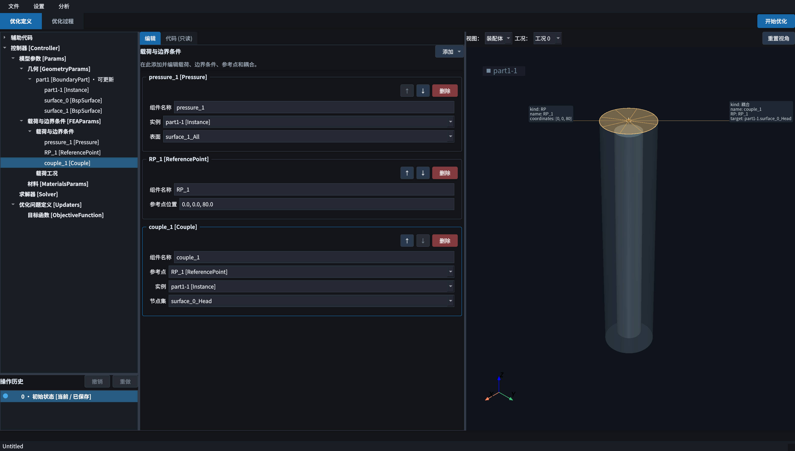

*Couple 的对象与作用范围设置。*

<a id="load_types-referencepoint"></a>

### 5.11 ReferencePoint：参考点

`ReferencePoint` 建立一个具有位置、平移与旋转响应的参考点。全局坐标 `[x,y,z]` 定义参考点位置，集中力、力矩、弹簧、耦合、RP 边界及目标函数通过名称引用该对象。

RP 仅定义参考位置及其运动自由度，不创建实体材料或自动连接邻近节点。与实体相关的加载和响应提取要求建立相应的 Couple 等连接。

| 界面字段 / 保存键 | 初始值 | 参数定义与输入格式 |
|---|---|---|
| 参考点位置 / `rp_location` | `[0.0, 0.0, 0.0]` | 参考点坐标。 |

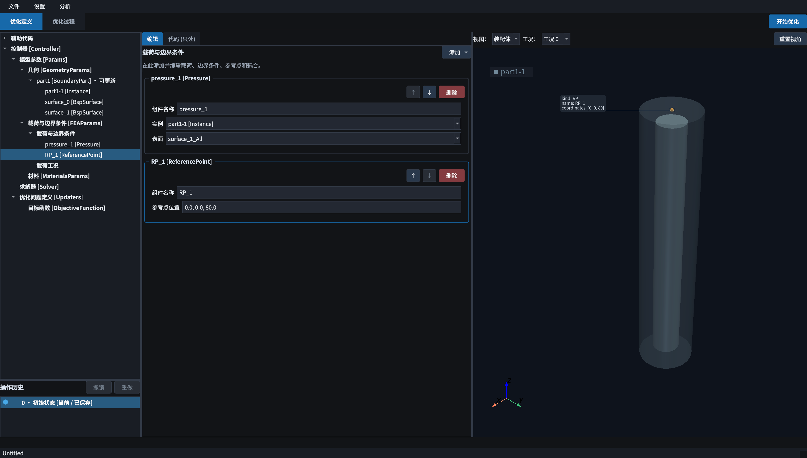

*ReferencePoint 的对象与作用范围设置。*

<a id="load_types-contact"></a>

### 5.12 Contact：接触对

`Contact` 在两组实例表面之间建立罚函数接触。两侧实例及表面集定义接触区域，法向和初始间距为主要核查项目。`penalty_threshold_h` 是接触距离阈值，使用长度单位，控制接触作用的起始范围。

当前接口不提供摩擦系数和摩擦定律字段。接触关系由 Contact 显式定义，表面在几何上的邻近状态本身不建立接触作用。

| 界面字段 / 保存键 | 初始值 | 参数定义与输入格式 |
|---|---|---|
| 实例 1 / `instance_name1` | `空` | 第一个实例名称。 |
| 表面 1 / `surface_name1` | `空` | 可下拉选择或手输另一部件的表面集。 |
| 实例 2 / `instance_name2` | `空` | 第二个实例名称。 |
| 表面 2 / `surface_name2` | `空` | 可下拉选择或手输表面集。 |
| 罚函数阈值 h / `penalty_threshold_h` | `3.0` | 罚函数阈值。 |

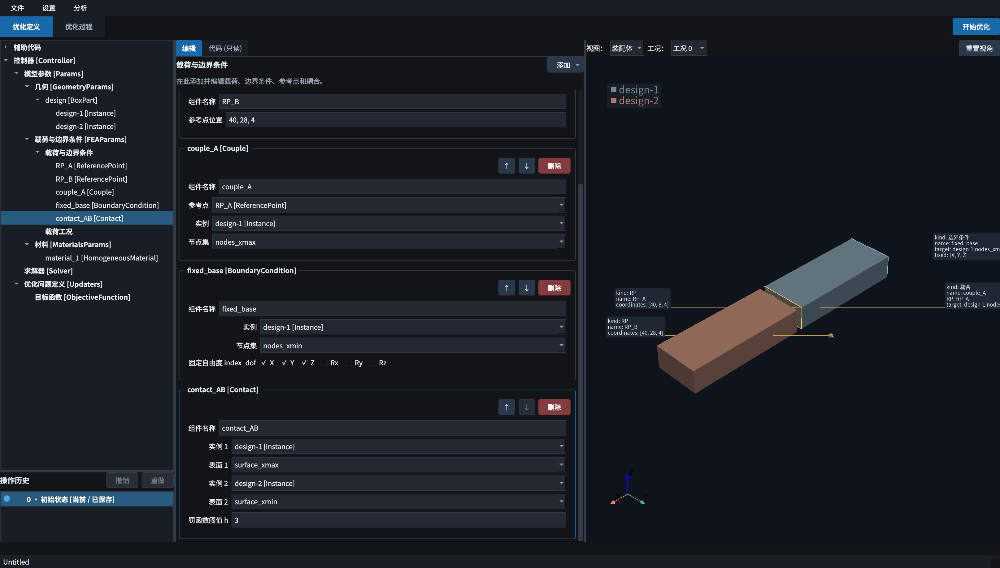

*Contact 的对象与作用范围设置。*

<a id="load_types-contactself"></a>

### 5.13 ContactSelf：自接触

`ContactSelf` 为一个实例的指定表面建立自接触，处理同一结构不同区域靠近的情况。实例与表面集确定自接触区域；当前 UI 不提供独立接触阈值、摩擦参数或逐工况幅值。

自接触与不同实例之间的 Contact 分别定义。表面离散密度影响计算开销，自接触范围应与实际接触区域相符。后端类名是 `SelfContact`。

| 界面字段 / 保存键 | 初始值 | 参数定义与输入格式 |
|---|---|---|
| 实例 / `instance_name` | `空` | 对应的 TorchFEA Instance 名称。 |
| 表面 / `surface_name` | `空` | 可下拉选择或手输表面集。 |

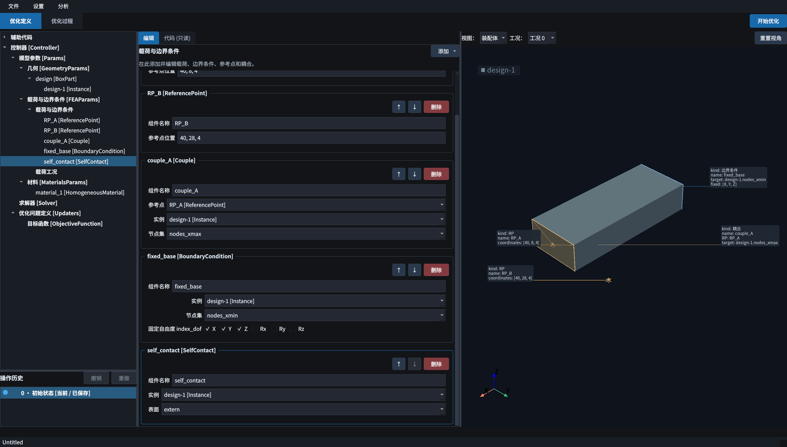

*ContactSelf 的对象与作用范围设置。*

<a id="steps"></a>

## 6 工况：接口参数与幅值

**入口：载荷与边界 → 工况。** `num_steps` 定义工况数量，`step_values` 保存各工况的接口参数。已注册的载荷接口决定工况表中的分量列。

| 操作 | 设置方式 | 作用 |
|---|---|---|
| 增加工况 | 工况数量及各行参数值 | 为目标或任务分组增加可选索引 |
| 指定工况载荷 | 所选行中各接口分量的参数值 | 只改变该工况的参数 |
| 多分量接口 | 按列名及规定分量顺序定义完整向量 | 各分量按接口规定解释其物理含义 |
| 暂时取消某个外载 | 对应工况幅值填 0 | 不删除连接与固定边界 |
| 修改接口名称 | 工况、目标及 Jacobian 引用的同步核查 | 避免留下失效引用 |

例如，pressure_1 在第一行和第二行的幅值分别为 0.06 和 0.03，目标中的 step_index=0、1 分别对应这两个工况。**工况编号、优化轮次及 FE 非线性求解迭代分别表示不同层级的计算索引。**

多个工况支持在求解任务中分组，以共享计算过程或初值。工况表的每一行分别保存该工况的载荷参数，不采用 Abaqus 的载荷自动继承规则。各行参数应完整定义。

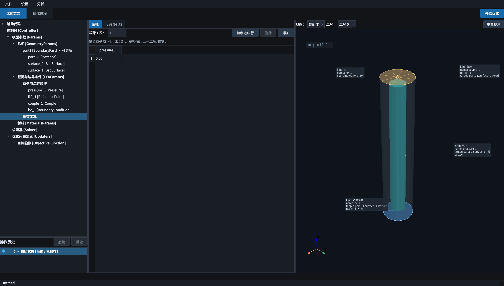

*单分量压力接口的工况表。*

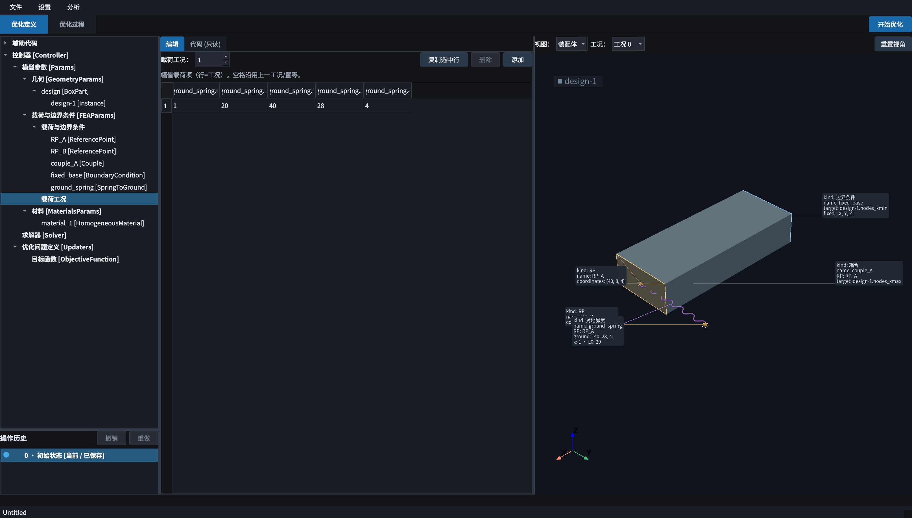

*弹簧接口在工况表中展开为五个参数列。*

<a id="materials"></a>

## 7 材料与八种本构模型

**入口：主定义 → 材料 → 添加。** 材料定义包含目标 Part、单元块、本构模型及材料参数。材料分配至 Part，引用该 Part 的实例共用对应材料定义。

<a id="section-均匀材料与空间设计材料"></a>

### 7.1 均匀材料与空间设计材料

<a id="material_types-homogeneousmaterial"></a>

#### 7.1.1 HomogeneousMaterial：均质材料

`HomogeneousMaterial` 向目标单元范围分配空间均匀的材料。`part_name` 指定目标部件，`material_model` 指定本构模型；模型对应的材料常数和 density 定义材料性质。

`elementname` 留空表示选该 Part 的全部单元块；若同一部件有多个材料区域，应明确各块的分配范围，避免重叠。下表列出全部可保存的本构参数，但 UI **只显示当前本构需要的参数**；八个模型的参数对应关系见 7.2。

| 界面字段 / 保存键 | 初始值 | 参数定义与输入格式 |
|---|---|---|
| 所属部件 / `part_name` | `空` | 材料分配的部件，必须选择已定义的 Part。 |
| 材料模型 / `material_model` | `"NeoHookeanLnJ"` | 对应 MaterialModels 中的本构参数类及 TorchFEA 材料模型。可选：`LinearElastic`、`NeoHookean`、`NeoHookeanLnJ`、`MooneyRivlin`、`Yeoh`、`Gent`、`ArrudaBoyce`、`Ogden`。 |
| 杨氏模量 E / `E` | `1.0` | 杨氏模量，使用模型应力单位。 |
| 泊松比 ν / `nu` | `0.45` | 泊松比，无量纲；线弹性各向同性稳定范围为 −1<ν<0.5。 |
| 剪切模量 μ / `mu` | `0.482` | 剪切模量。 |
| 体积模量 κ / `kappa` | `4.8` | 体积模量。 |
| Mooney-Rivlin c10 / `c10` | `0.241` | Mooney–Rivlin 的第一项系数，使用应力单位。 |
| Mooney-Rivlin c01 / `c01` | `0.241` | Mooney–Rivlin 的第二项系数，使用应力单位。 |
| Yeoh c1 / `c1` | `0.482` | Yeoh 的一阶系数，使用应力单位。 |
| Yeoh c2 / `c2` | `0.0` | Yeoh 的二阶系数，使用应力单位。 |
| Yeoh c3 / `c3` | `0.0` | Yeoh 的三阶系数，使用应力单位。 |
| Gent Jm / `Jm` | `100.0` | Gent 的有限链伸长参数，无量纲，需为正。 |
| Arruda-Boyce N / `N` | `10.0` | Arruda–Boyce 的链段参数，无量纲，需为正。 |
| Ogden alpha / `alpha` | `[2.0]` | Ogden 指数，无量纲且不能为 0；当前普通 UI 配合标量 μ 使用单项列表，例如 `[2.0]`。 |
| 密度 / `density` | `1.08e-09` | 质量密度。 |
| Elems 名称 / `elementname` | `空` | 材料要赋予的 Part.elems 名称；为空时选择全部 elems。 |

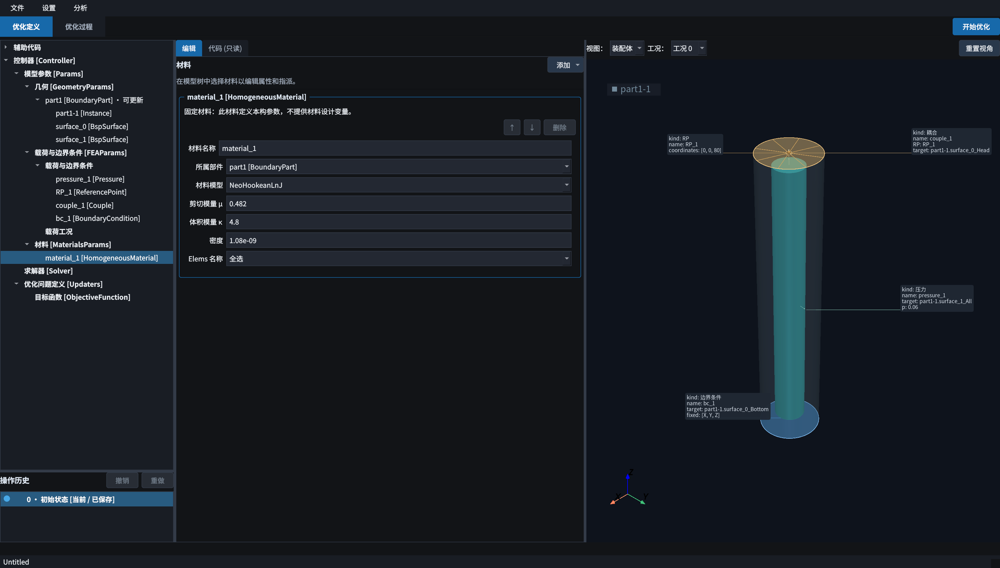

*均匀 NeoHookeanLnJ 材料分配。*

<a id="material_types-simp-bspfieldmaterials"></a>

#### 7.1.2 SIMP_BSPFieldMaterials：SIMP B样条密度场材料

`SIMP_BSPFieldMaterials` 在一个有限元部件内建立可优化的 B 样条材料设计场。材料设计变量描述空间刚度比例，体网格可保持固定。以该材料为目标的材料优化器执行设计场更新。

目标 Part 和单元块确定材料分配范围，`bounding_box` 定义覆盖设计区域的包围盒，其三个方向均应具有正跨度。例如，BoxPart 的 40×16×8 设计域可使用 `[0,40,0,16,0,8]`，目标单元块为 `design`。较小的分辨率通常对应较多设计变量。

NeoHookean 与 NeoHookeanLnJ 在此使用 `mumax/kappamax` 表示实体材料模量；其他本构使用对应的普通参数字段。材料计算仅使用当前本构对应的有效参数，其他本构的隐藏字段不同时生效。

| 界面字段 / 保存键 | 初始值 | 参数定义与输入格式 |
|---|---|---|
| 设计部件 / `part_name` | `空` | 承载 SIMP 设计场的部件，必须选择已定义的 Part。 |
| 材料模型 / `material_model` | `"NeoHookeanLnJ"` | 对应 MaterialModels 中的本构参数类及 TorchFEA 材料模型。可选：`LinearElastic`、`NeoHookean`、`NeoHookeanLnJ`、`MooneyRivlin`、`Yeoh`、`Gent`、`ArrudaBoyce`、`Ogden`。 |
| 最大剪切模量 / `mumax` | `10.0` | 最大剪切模量。 |
| 最大体积模量 / `kappamax` | `100.0` | 最大体积模量。 |
| 杨氏模量 E / `E` | `1.0` | 杨氏模量，使用模型应力单位。 |
| 泊松比 ν / `nu` | `0.45` | 泊松比，无量纲；线弹性各向同性稳定范围为 −1<ν<0.5。 |
| 剪切模量 μ / `mu` | `0.482` | 剪切模量。 |
| 体积模量 κ / `kappa` | `4.8` | 体积模量。 |
| Mooney-Rivlin c10 / `c10` | `0.241` | Mooney–Rivlin 的第一项系数，使用应力单位。 |
| Mooney-Rivlin c01 / `c01` | `0.241` | Mooney–Rivlin 的第二项系数，使用应力单位。 |
| Yeoh c1 / `c1` | `0.482` | Yeoh 的一阶系数，使用应力单位。 |
| Yeoh c2 / `c2` | `0.0` | Yeoh 的二阶系数，使用应力单位。 |
| Yeoh c3 / `c3` | `0.0` | Yeoh 的三阶系数，使用应力单位。 |
| Gent Jm / `Jm` | `100.0` | Gent 的有限链伸长参数，无量纲，需为正。 |
| Arruda-Boyce N / `N` | `10.0` | Arruda–Boyce 的链段参数，无量纲，需为正。 |
| Ogden alpha / `alpha` | `[2.0]` | Ogden 指数，无量纲且不能为 0；当前普通 UI 配合标量 μ 使用单项列表，例如 `[2.0]`。 |
| 最小材料刚度比例 / `simp_ratio_min` | `1e-07` | 材料刚度比例下限 simp_ratio_min；实际比例为 simp_ratio_min + (1 − simp_ratio_min) × RAMP(sigmoid(设计场))。 |
| 设计域边界框 / `bounding_box` | `[0.0, 0.0, 0.0, 0.0, 0.0, 0.0]` | 设计域边界框 [xmin, xmax, ymin, ymax, zmin, zmax]。 |
| 密度场分辨率 / `simp_field_resolution` | `0.5` | 密度场分辨率。 |
| B 样条次数 / `degree` | `2` | 密度设计场 B 样条基函数的多项式次数 degree。 |
| 密度 / `density` | `1.08e-09` | 质量密度。 |
| 初始设计场值 / `initial_ratio` | `0.5` | initial_ratio 直接作为设计场控制点初值；其值经 sigmoid 和 RAMP 插值后得到初始材料比例。 |
| 空域惩罚因子 / `voidpenalfactor` | `0.01` | 空域惩罚因子。 |
| RAMP 插值惩罚参数 / `materialpenalty` | `8` | 对应整数 materialpenalty = p；插值公式为 ρ / (1 + p(1 − ρ))，其中 ρ = sigmoid(设计场)。 |
| Elems 名称 / `elementname` | `空` | 材料要赋予的 Part.elems 名称；为空时选择全部 elems。 |

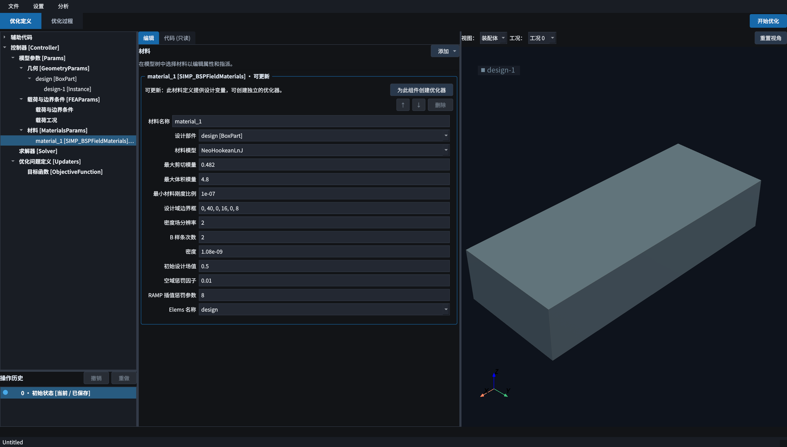

*SIMP 材料的目标与本构参数。*

<a id="section-材料模型及参数对应关系"></a>

### 7.2 材料模型及参数对应关系

下表列出 UI 中各材料模型的参数定义，具体数值由实验拟合或材料标定确定。不同本构中的同名或近似命名参数应按各模型定义分别核定。

| 模型 | 实际参数 | 定义与功能 |
|---|---|---|
| `LinearElastic` | `E, nu` | 各向同性线弹性；用于材料关系可按线性近似的分析。若要描述橡胶的大应变响应，应选合适的超弹性模型并标定 |
| `NeoHookean` | `mu, kappa` | 可压缩 Neo-Hookean；等容项为 μ/2·(J^(-2/3)I₁−3)，体积项为 κ/2·(J−1)² |
| `NeoHookeanLnJ` | `mu, kappa` | 等容项同上，体积项采用 κ/2·(ln J)²；有限体积变形下与上一模型不同 |
| `MooneyRivlin` | `c10, c01, kappa` | 用两个偏应变不变量项描述超弹性，并用 κ 控制体积响应 |
| `Yeoh` | `c1, c2, c3, kappa` | 用第一偏应变不变量的多项式描述非线性；系数应由材料数据拟合 |
| `Gent` | `mu, Jm, kappa` | 具有有限链伸长限制的超弹性；Jm 控制伸长极限相关响应 |
| `ArrudaBoyce` | `mu, N, kappa` | 链网络形式的超弹性；N 控制链伸长相关行为 |
| `Ogden` | `mu, alpha, kappa` | 用主伸长幂次描述超弹性；当前普通 UI 的 μ 是标量，alpha 应使用一个非零指数，例如 `[2.0]` |

E、μ、κ、c10、c01、c1、c2、c3 使用应力单位；ν、Jm、N、alpha 无量纲。后端 Ogden 支持成对的多项 μ/alpha，但当前普通 UI 不提供与多项 alpha 配对的 μ 列表编辑，因此普通 UI 中的 alpha 项数应与标量 μ 配套。

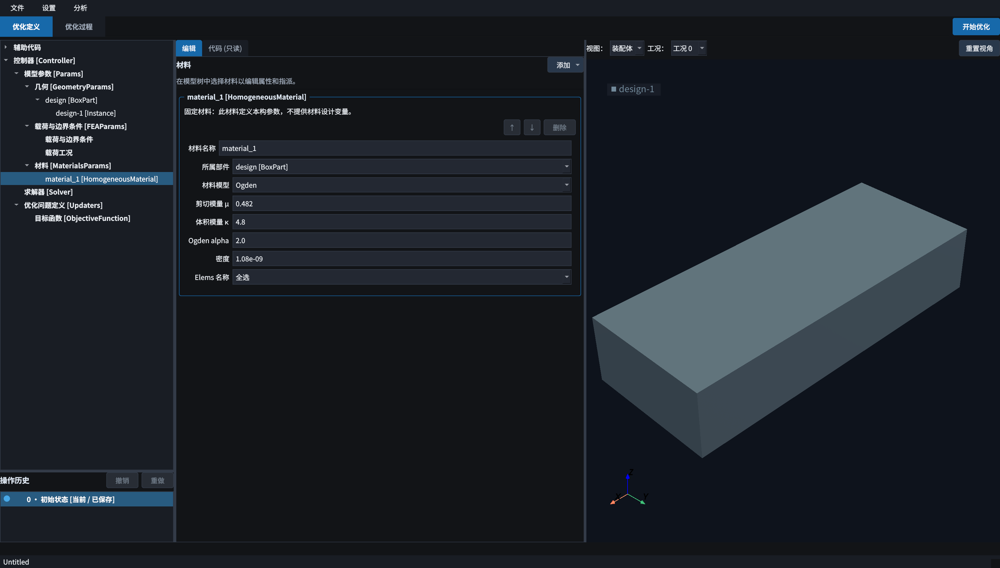

*切换为 Ogden 后显示 μ、κ 和 alpha。*

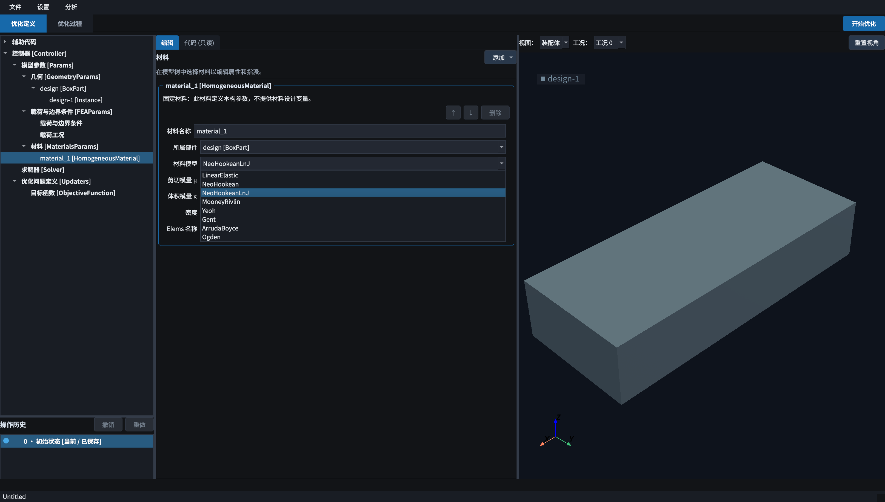

*材料模型选择入口；参数表随选择切换。*

<a id="section-simp-控制变量材料占比与刚度比例"></a>

### 7.3 SIMP 控制变量、材料占比与刚度比例

当前实现依次对控制场执行 sigmoid 映射和 RAMP 插值：

```text
f = B 样条插值得到的设计场
ρ = sigmoid(f) = 1 / (1 + exp(-f))
RAMP(ρ) = ρ / (1 + p * (1 - ρ))
r = r_min + (1 - r_min) * RAMP(ρ)
```

- `initial_ratio` 直接赋给控制点的初始 **f**，不是初始材料体积分数。
- `materialpenalty` 是上式 p，`simp_ratio_min` 是刚度比例下限 r_min。
- `VolFrac` 检查体积加权的 **ρ**，不是 RAMP 后的刚度比例 r。
- `MinValue/MaxValue` 约束的是设计控制变量 **f**。

例如 initial_ratio=0.5、p=8 时，初始 ρ≈0.6225，而 r≈0.1548（r_min 较小时）。该初始控制值对应的材料占比约为 62.25%，并非 50%。

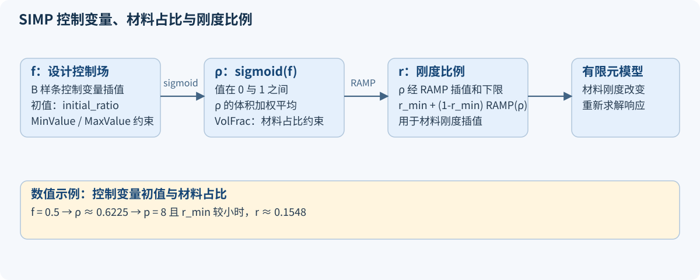

*SIMP 中控制变量、材料体积分数和刚度比例的对应关系。*

<a id="objectives"></a>

## 8 目标、指标与有限元数据接口

**入口：主定义 → 目标函数。** 目标函数定义参与设计更新的评价量，指标定义独立记录的响应量。两者支持读取同一响应，仅设置指标不产生优化驱动。

<a id="section-参考点位移--转角目标"></a>

### 8.1 参考点位移 / 转角目标

| 字段 | 定义与作用 |
|---|---|
| 类型 / `type` | 选参考点位移项 `displacement`，或自定义目标 `custom_loss` |
| 权重 / `weight` | 目标项贡献的比例；应结合量纲和典型响应量级选择，至少有一项为正 |
| RP / `reference_point_name` | 取哪个参考点的运动 |
| 工况 / `step_index` | 取哪一个载荷工况，从 0 开始 |
| 分量 / `component` | x/y/z 是平移，rx/ry/rz 是旋转向量分量；转角用 rad |
| 方向 / `direction` | maximize 最大化、minimize 最小化、target 接近目标值 |
| 目标值 / `target` | 仅 target 方向使用，和所选分量单位一致 |

程序对各目标项加权求和，构成标量损失 L，并执行最小化：

```text
minimize： L_i = weight * response
maximize： L_i = -weight * response
target：   L_i = weight * (response - target)^2
总损失：   L = 所有 L_i 的和
```

例如，最大化 `RP_1.ry` 和使 `RP_1.x` 接近 0 可分别定义为两个目标项。位移和转角具有不同单位及量级，各项权重应据此缩放。总损失下降表示加权目标改善，不要求所有响应同时减小。


*位移 / 转角目标与独立记录的指标项。*

<a id="section-指标接口"></a>

### 8.2 指标接口

- **参考点指标 `displacement`：** 填 RP、工况与分量，直接记录该响应；没有目标方向、目标值或优化权重。
- **自定义指标 `custom_metric`：** 代码体返回需要记录的标量或一组标量。多个返回值分别对应多个指标分量。

末端 ry 等物理指标用于解释实际响应变化，损失曲线用于评价加权目标的变化。两类记录结合后，可用于分析多个目标之间的相互影响。

<a id="section-自定义目标--指标代码"></a>

### 8.3 自定义目标 / 指标代码

`body` 定义自定义目标函数体，返回值为可微 Torch 标量。编辑器提供函数签名，`self` 指向 ObjectiveFunction，`self.fe` 和 `self.fe_results` 提供当前有限元模型及工况响应。

例如读取第一个工况的 RP_1.ry 并最大化，代码体可写：

```python
self.set_step(0)
assembly = self.fe.assembly
state = assembly._GC2RGC(self.fe_results[0].GC.to(assembly.device))
rp = assembly.get_reference_point('RP_1')
return -state[rp._RGC_index].reshape(-1)[4]
```

示例通过返回响应的负值实现最大化，外层仅执行目标项权重乘法，不应重复取负。内部以下划线开头的数据接口可能随版本变化，编辑器“插入模板”提供与当前版本匹配的数据访问代码。模板插入后，目标函数体仍应包含响应组合及 `return` 语句。

**可微目标的中间计算应保留 Torch 计算图。** 对响应调用 `.item()`、转换为 NumPy 或重新构造与计算图分离的张量，会中断相应梯度传播；此类操作适用于最终数值导出。

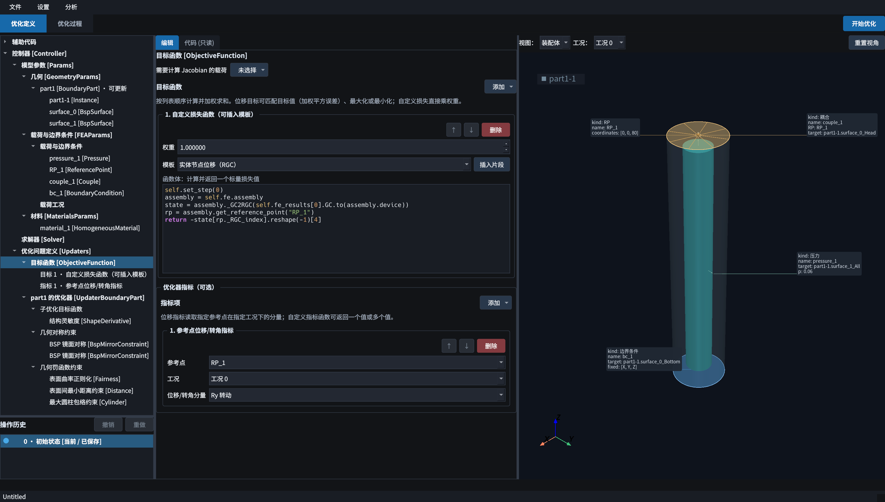

*自定义目标函数体与插入有限元模板的入口。*

<a id="section-十二个有限元数据代码模板"></a>

### 8.4 十二个有限元数据代码模板

**入口：自定义目标或指标的代码编辑区 → 插入模板。** 模板参数包括工况、实例、参考点、单元块和载荷名称。下表中的数组形状表示模板返回的数据结构，无需手动构造这些数组。

| 模板保存键 / 数据 | 输入对象 | 返回数据及其含义 |
|---|---|---|
| `instance_displacement` / 实例位移 | 工况、实例 | `node_displacement[nnode,3]`，节点三向位移 |
| `reference_point_motion` / RP 运动 | 工况、RP | 六分量 `[Ux,Uy,Uz,Rx,Ry,Rz]` |
| `end_effector_translation` / 末端平移 | 工况、RP、轴 0/1/2 | 一个平移分量，可作为目标或指标 |
| `end_effector_rotation` / 末端转角 | 工况、RP、轴 3/4/5 | 一个转角分量，单位 rad |
| `instance_force` / 实例广义力片段 | 工况、实例、轴 | 装配残量中的节点力数组 `[nnode,3]`，需结合约束和符号解释 |
| `reference_point_force` / RP 广义力片段 | 工况、RP、分量 | 六分量广义残量 `[Fx,Fy,Fz,Mx,My,Mz]`；其物理含义应结合对象约束与符号约定核定 |
| `gaussian_energy_density` / 积分点能量密度 | 工况、实例、单元块 | `[ngauss,nelem]`，适合能量类指标或损失 |
| `gaussian_deformation_gradient` / 变形梯度 F | 工况、实例、单元块 | `[ngauss,nelem,3,3]`，可进一步算 J 等变形量 |
| `jacobian_6d_matrix` / 六维响应 Jacobian | 工况、RP、集中力名、集中力矩名 | 6×6 的运动对力 / 力矩参数导数矩阵 |
| `jacobian_translation_response` / 平移响应范数 | 同上 | 平移–力的 3×3 子块范数 |
| `jacobian_rotation_response` / 转动响应范数 | 同上 | 转动–力矩的 3×3 子块范数 |
| `jacobian_6d_response` / 六维响应范数 | 同上 | 完整 6×6 矩阵范数 |

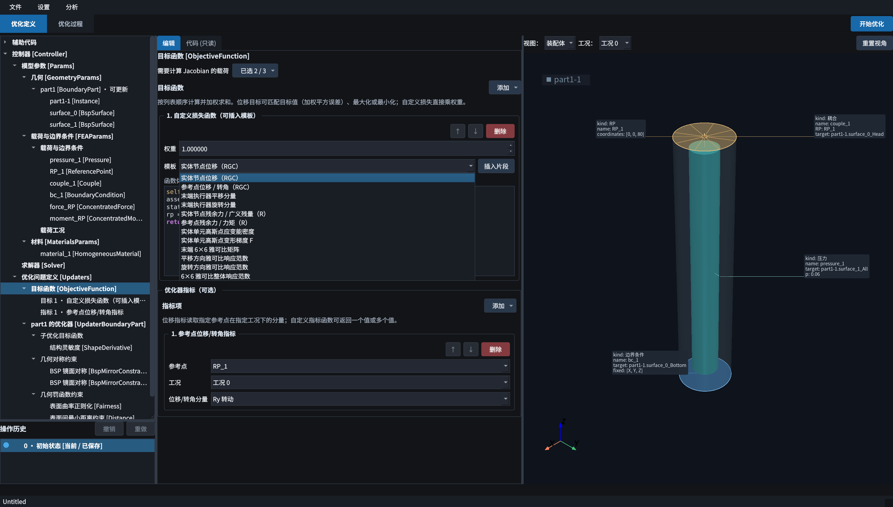

*有限元数据模板选择与返回值定义。*

<a id="section-jacobian-载荷选择"></a>

### 8.5 Jacobian 载荷选择

`jacobian_needed` 指定响应导数计算所采用的载荷参数。六维模板的配置步骤如下：

1. 先创建目标 RP，再创建作用在同一 RP 上的 ConcentratedForce 和 ConcentratedMoment。
2. 给相应工况填完整力与力矩分量。
3. 在目标页 Jacobian 载荷选择中勾选这两个接口。
4. 插入六维模板，选择同一 RP 和这对载荷，再定义需要的响应。

该 Jacobian 描述运动响应对载荷参数的导数，几何优化梯度描述主目标对几何控制点的导数。两者的求导对象和用途不同。Jacobian 的物理解释以刚度、连接及载荷对象配置有效为前提。

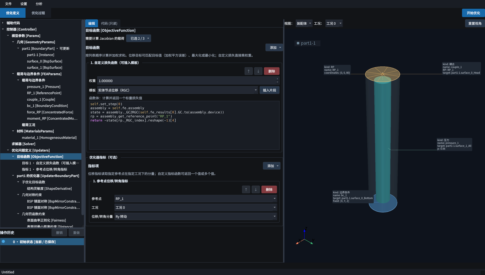

*参与 Jacobian 计算的集中力与集中力矩接口。*

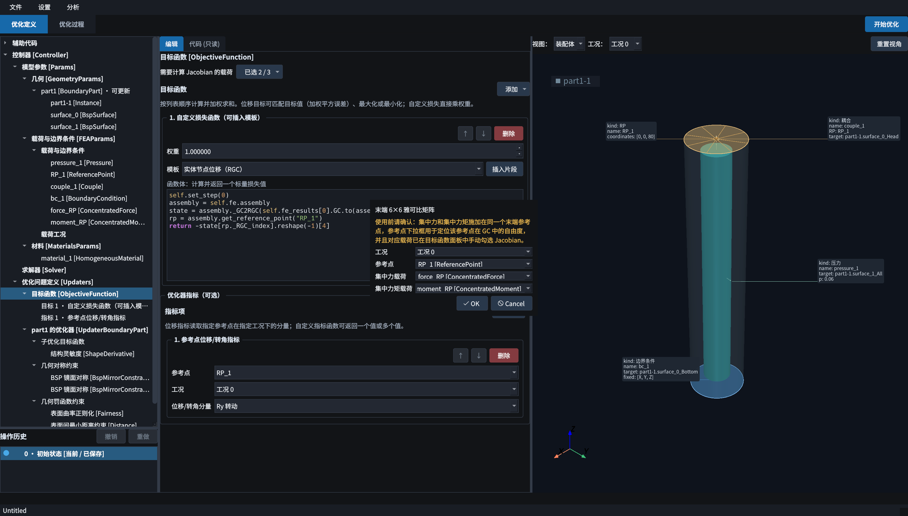

*模板参数窗口分别指定工况、RP、集中力和集中力矩，不能只凭名称相似选取。*

<a id="solver"></a>

## 9 求解器与运行设置

<a id="section-根节点任务结果目录与计算设备"></a>

### 9.1 根节点：任务、结果目录与计算设备

**入口：模型树根节点。**

| 字段 | 定义与作用 |
|---|---|
| `scheme` | 当前优化方案标识，决定生成的框架结构；普通算例沿用所选方案 |
| `label` | 任务名称，用于识别运行 |
| `result_folder` | 结果根目录；每次运行建立独立记录目录 |
| `device` | 主计算设备，例如 cpu 或 cuda:0；必须与实际环境匹配 |
| `updater_device` | 更新器的设备；留空跟随主设备，允许将几何 / 材料更新与 FE 设备分开安排 |
| `restart_per_iteration` | 运行进程周期性重启的轮次间隔，用于进程生命周期管理；不是总优化轮数 |

`.morph` 保存的是定义。运行归档还保存了当时的冻结定义、模型、状态与历史；修改当前 `.morph` 不会重写已有轮次的数据。

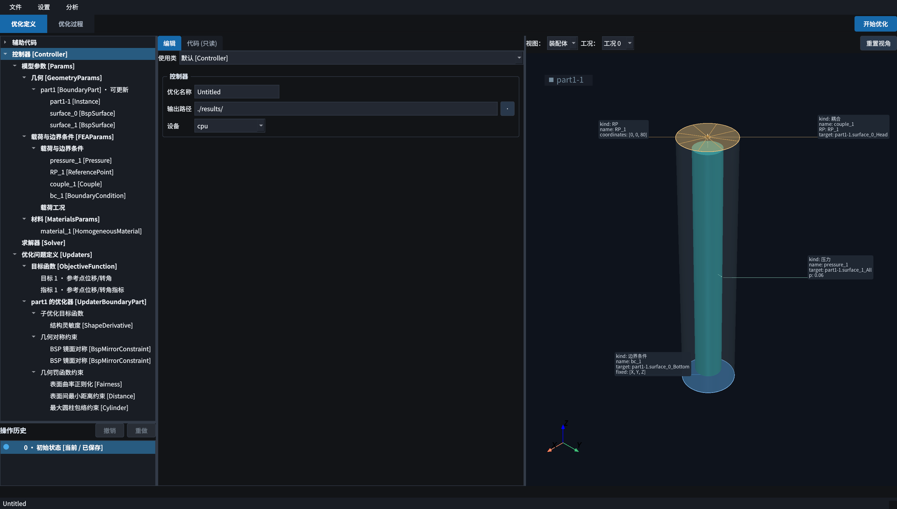

*任务名称、结果目录、设备与运行重启周期。*

<a id="section-solver工况任务的组织"></a>

### 9.2 Solver：工况任务的组织

**入口：模型树 → 求解器。**

| 字段 | 参数定义与输入格式 |
|---|---|
| `num_process` | FE 任务使用的工作进程数量，默认为 1；不是优化轮数或网格划分数量 |
| `gpus` | 可用 GPU 编号列表，默认为空列表并使用 CPU；GPU 编号应对应实际可用设备 |
| `task_index_list` | 工况索引的分组，例如 `[[0,1],[2]]`：0、1 在同一组依次求解，2 是另一组 |

未手动指定分组时，框架可将各工况分别作为任务。显式分组应覆盖准备求解的工况，避免遗漏或无意重复；最终结果仍按原工况索引访问。同组的后续工况可利用前一状态作为初值，跨优化轮复用初值还取决于几何是否固定等条件。

主设备、GPU 列表与更新器设备分别控制不同环节。进程数过多并不保证更快，多个任务共用内存与显存资源。当前普通 UI 未提供全部 Newton 容差、步长和线搜索参数，此类设置通过对应求解器的自定义类方法扩展。

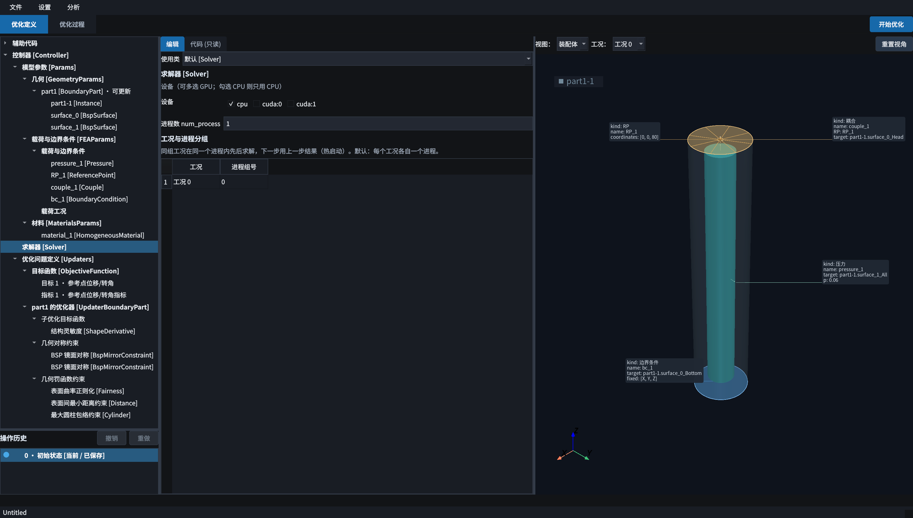

*求解器进程数、GPU 和工况任务分组。*

<a id="updaters"></a>

## 10 优化器：更新目标、对称与约束

**入口：模型树 → 优化器。** 每个优化器配置对应一个可更新的几何 Part 或 SIMP 材料，配置内容包括目标项、约束和曲面关系。一个模型支持多个更新对象及其对应配置。

<a id="section-优化计算流程与更新配置"></a>

### 10.1 优化计算流程与更新配置

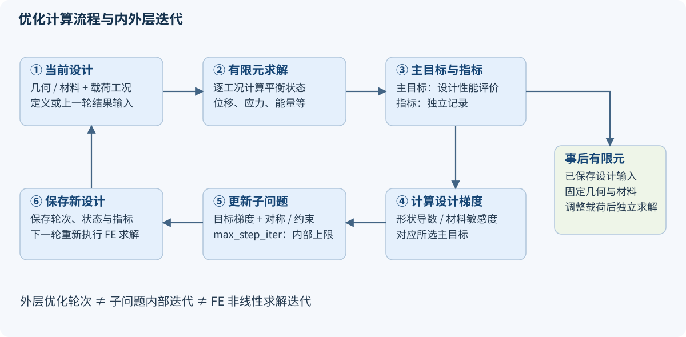

*有限元求解、主目标、梯度与设计更新之间的循环。*

| 配置字段 | 几何更新器 | 材料更新器 |
|---|---|---|
| 目标 | `part_name`：可更新的边界 Part | `material_name`：SIMP 设计材料 |
| `custom_class` | 默认使用边界或偏置边界 updater，也可选择兼容的重写类 | 默认使用 SIMP updater，也可选择兼容的重写类 |
| `max_step_iter` | 每一轮形状子问题的内部优化迭代上限 | 每一轮材料子问题的内部优化迭代上限 |
| `if_update` | 按曲面顺序填写开关，如 `[true,true]` | 控制材料场是否更新；按配置支持布尔值或开关列表 |
| `objective_functions` | 通常需要 ShapeDerivative | 通常需要 Sensitivity |
| `constraints` | 距离、包络、平滑等几何项 | 体积分数和控制量上下界等 |
| `symmetry_constraints` | 对指定曲面建立镜像、旋转、关联或自定义关系 | 不在材料更新器中使用 |

`max_step_iter=50` 表示每轮更新子问题的内部迭代上限为 50。外层每轮执行 FE 求解和目标梯度计算，内层根据梯度与约束求解更新子问题。该参数不定义外层优化总轮数，内部更新迭代、外层轮次及 FE 求解迭代分别记录。

新建几何更新配置默认包含 ShapeDerivative、Fairness、Distance 和 Cylinder，配置修改应以已有条目为基础。材料更新配置的目标和约束列表初始可为空，实际条目按优化任务设置。均匀材料不包含材料设计变量，因此不属于 SIMP 更新目标。

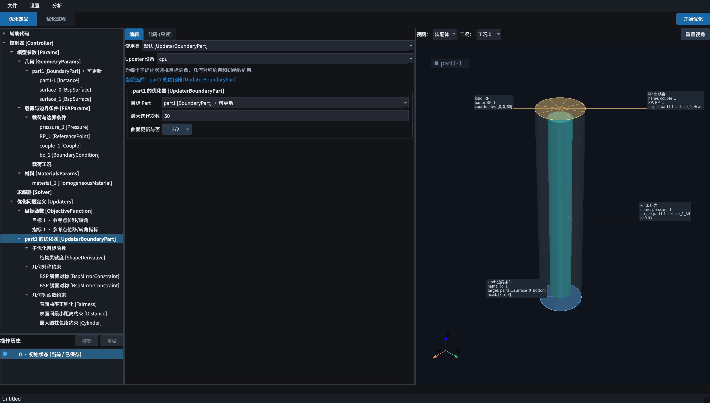

*几何优化器目标、曲面更新开关与内部迭代设置。*

**子优化器的类选择：** 选中模型树中某个部件或材料对应的优化器，编辑页顶部的“使用类”提供默认类及兼容的重写类。重写类分别继承 `morphopt.UpdaterBoundaryPart`、`morphopt.UpdaterOffsetBoundaryPart` 或 `morphopt.UpdaterSIMPMaterial`，在“辅助代码 → 自定义类 → 重写类”中定义。

每个子优化器独立保存所选类。同一类型的多个子优化器可以选择不同实现，选择默认类可恢复界面生成的实现。未重写的方法保留界面配置；显式重写 `define_objective` 时，该方法替代界面生成的目标与约束声明。子优化器构造阶段尚未绑定目标，目标数据应在框架规定的初始化或更新阶段访问。


*BoundaryPart 对应的子优化器选择 MyBoundaryUpdater。*

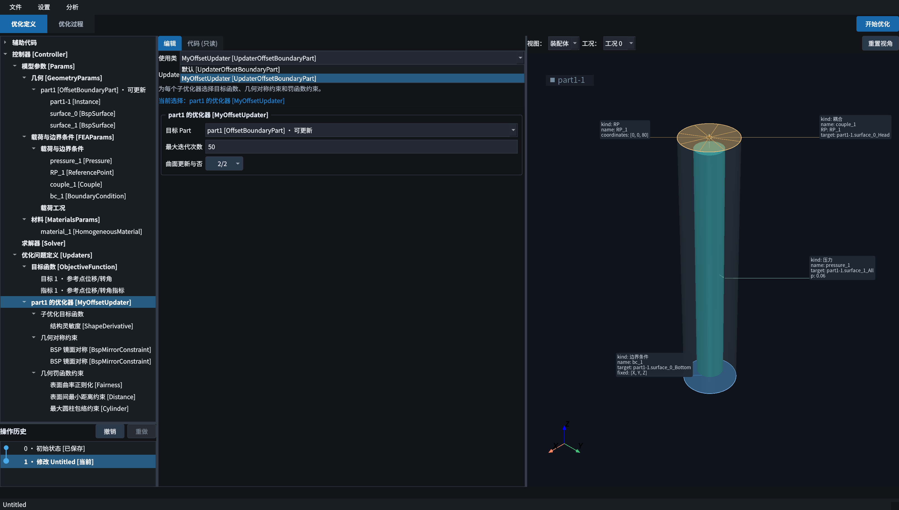

*OffsetBoundaryPart 对应的子优化器选择兼容的偏置边界 updater。*

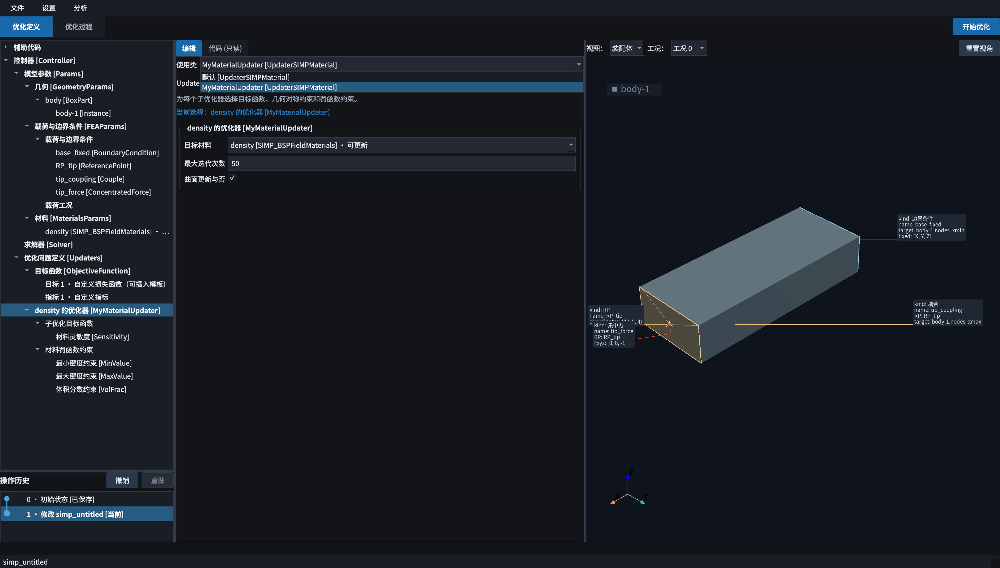

*SIMP 材料的子优化器独立选择材料 updater。*

<a id="section-三类更新目标项"></a>

### 10.2 三类更新目标项

**主目标**读取 FE 响应并评价设计性能；本节的**更新目标项**在子优化问题中接收该梯度或添加正则项。两者在 UI 中位于不同位置。

<a id="updater_objectives-shapederivative"></a>

#### 10.2.1 ShapeDerivative：结构灵敏度

`ShapeDerivative` 在几何子问题中使用主目标的形状导数。添加到几何优化器 → 目标项。无独立参数；是否更新某个曲面由 if_update 控制。

几何优化器中的包络、距离等约束仅控制几何条件，主目标对应的 FE 响应由目标梯度项驱动改善。

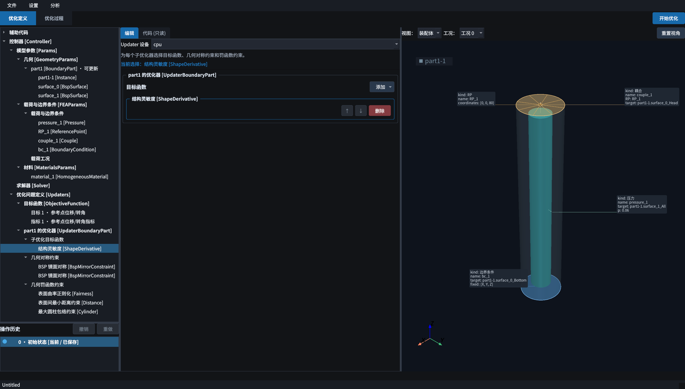

*ShapeDerivative 在几何更新中引入主目标梯度。*

<a id="updater_objectives-sensitivity"></a>

#### 10.2.2 Sensitivity：材料灵敏度

`Sensitivity` 在材料子问题中使用主目标对设计材料场的敏感度。添加到材料优化器 → 目标项。

normalize_gradient 开启后改变梯度缩放，可能影响它与约束罚项的相对权重。梯度缩放的效果应结合损失、材料占比及设计变化评价；归一化本身不构成稳定性保证。

| 界面字段 / 保存键 | 初始值 | 参数定义与输入格式 |
|---|---|---|
| 梯度归一化 / `normalize_gradient` | `false` | 是否对材料梯度进行归一化。 |

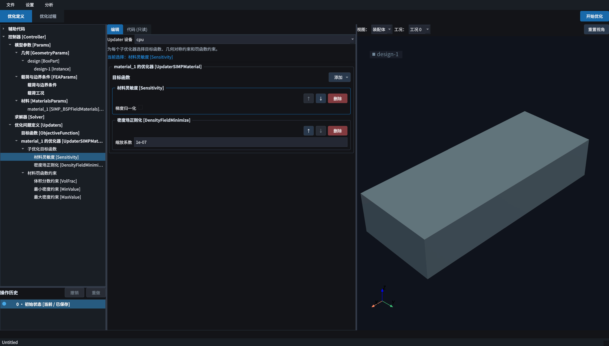

*SIMP 材料优化器中的 Sensitivity 目标项。*

<a id="updater_objectives-densityfieldminimize"></a>

#### 10.2.3 DensityFieldMinimize：密度场正则化

`DensityFieldMinimize` 添加一个针对设计控制量总和的弱正则项。当前实现精确形式为 `scale * (sum(cps) + 1)^2`，其中 cps 是材料场控制变量。

该项作用于控制变量总和，不计算设计场空间梯度的平滑能量，也不逐点约束密度为零。scale 定义其相对于敏感度项和体积分数项的权重。

| 界面字段 / 保存键 | 初始值 | 参数定义与输入格式 |
|---|---|---|
| 缩放系数 / `scale` | `1e-07` | 目标项的缩放系数。 |

<a id="section-六类曲面对称与关联"></a>

### 10.3 六类曲面对称与关联

**入口：几何优化器 → 曲面对称约束 → 添加。** 内置关系都必须指定一个有效的 `surface_index`；索引只在当前 Part 内有意义。关联接口同时要求指定 `related_surface_index`。

曲面对称和 CAD 镜像用途不同：前者在设计更新中持续维持控制点关系，后者只构造初始 CAD 实体。

<a id="surface_symmetry_constraints-bspmirror"></a>

#### 10.3.1 BspMirror：BSP 镜面对称

`BspMirror` 维持 BSP 曲面在更新过程中的镜面对称。选择当前 Part 内的 BSP 曲面索引。xz 表示 y=0，要求 offset=0；xy 表示 z=offset。

例如 test.morph 对曲面 0 和 1 分别添加 BspMirror(xz,0)。每个条目仅作用于指定曲面，各曲面的对称关系分别定义。

| 界面字段 / 保存键 | 初始值 | 参数定义与输入格式 |
|---|---|---|
| 对称面 / `plane` | `"xz"` | 支持 xz（y=0）和 xy（z=offset）。可选：`xz`、`xy`。 |
| 平面对称位置 / `offset` | `0.0` | 仅 xy 对称面使用；xz 对称面的偏移必须为 0。 |

<a id="surface_symmetry_constraints-cpgeomirror"></a>

#### 10.3.2 CPGEOMirror：CPGEO 镜面对称

`CPGEOMirror` 维持 CPGEO 曲面的镜面对称。支持 xy、xz、yz，offset 为平面的法向坐标：分别对应 z、y、x。

初始控制网格应满足目标对称布局。CPGEO 专用约束仅适用于 CPGEO 曲面。

| 界面字段 / 保存键 | 初始值 | 参数定义与输入格式 |
|---|---|---|
| 对称面 / `plane` | `"xz"` | 镜像平面沿法向坐标为 offset。可选：`xy`、`xz`、`yz`。 |
| 平面对称位置 / `offset` | `0.0` | 对称面的法向坐标，例如 xy 面的 z 坐标。 |

<a id="surface_symmetry_constraints-cpgeorotation"></a>

#### 10.3.3 CPGEORotation：CPGEO 旋转对称

`CPGEORotation` 维持 CPGEO 曲面的 n 重旋转对称。选曲面索引、轴方向、中心与阶数。例如 z、center=[0,0,0]、order=3 表示每 120° 重复。

控制网格应与对称阶数相容。旋转对称约束仅作用于曲面设计变量，不创建额外实体实例或复制载荷。

| 界面字段 / 保存键 | 初始值 | 参数定义与输入格式 |
|---|---|---|
| 旋转轴 / `axis` | `"z"` | 对称轴方向。可选：`x`、`y`、`z`。 |
| 对称阶数 / `order` | `2` | 一周重复的份数 n；相邻扇区相差 2π/n。 |
| 旋转中心 / `center` | `[0.0, 0.0, 0.0]` | 轴线上一点的全局坐标 `[x,y,z]`。 |

<a id="surface_symmetry_constraints-bsprelation"></a>

#### 10.3.4 BspRelation：BSP 曲面关系

`BspRelation` 用刚体位姿关联两张 BSP 曲面的控制网格。 surface_index 指定源曲面，related_surface_index 指定跟随曲面，六分量 pose 定义刚体映射。该接口用于维持重复气腔的形状关联。

当前实现从 surface_index 的控制点出发，经 pose 变换后写入 related_surface_index，并在重建时同步相关拓扑数据。例如源曲面 1 在 x=−5，跟随曲面 2 在 x=5，可填 pose=[10,0,0,0,0,0]。关联曲面应使用相容的网格参数，并核查映射后的初始位置。

| 界面字段 / 保存键 | 初始值 | 参数定义与输入格式 |
|---|---|---|
| 位姿 [tx, ty, tz, rx, ry, rz] / `pose` | `[0.0, 0.0, 0.0, 0.0, 0.0, 0.0]` | 刚体关系位姿 `[tx,ty,tz,rx,ry,rz]`，前三项是平移，后三项是旋转向量，单位 rad。 |

<a id="surface_symmetry_constraints-cpgeorelation"></a>

#### 10.3.5 CPGEORelation：CPGEO 曲面关系

`CPGEORelation` 用六分量刚体位姿关联两张 CPGEO 曲面。字段与映射方向同 BSP 关联：源 surface_index 经 pose 变换，写入跟随 related_surface_index；两端都应为 CPGEO 曲面。

这类关联约束的是几何设计形状，不会自动耦合有限元节点，也不代替 Couple 或实体连接。

| 界面字段 / 保存键 | 初始值 | 参数定义与输入格式 |
|---|---|---|
| 位姿 [tx, ty, tz, rx, ry, rz] / `pose` | `[0.0, 0.0, 0.0, 0.0, 0.0, 0.0]` | 刚体关系位姿 `[tx,ty,tz,rx,ry,rz]`，前三项是平移，后三项是旋转向量，单位 rad。 |

<a id="surface_symmetry_constraints-custom"></a>

#### 10.3.6 Custom：自定义约束

`Custom` 填写普通表单无法表达的曲面约束注册代码。代码被放入所属 Part 的 `apply_surface_constraints(self)` 中，**self 指向所属 Part**。

函数体通过所属 Part 的曲面对象接口注册约束，该执行阶段尚无 FE 求解结果。基于 FE 响应的目标定义位于目标函数编辑器。多个自定义代码块合并至同一 Part 的对应方法。

| 界面字段 / 保存键 | 初始值 | 参数定义与输入格式 |
|---|---|---|
| 约束函数体 / `code` | `空` | 在 apply_surface_constraints 中执行的自定义代码。 |

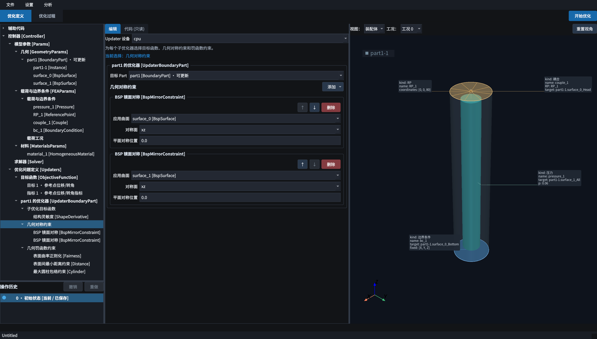

*BSP 镜面对称：分别指定曲面索引。*

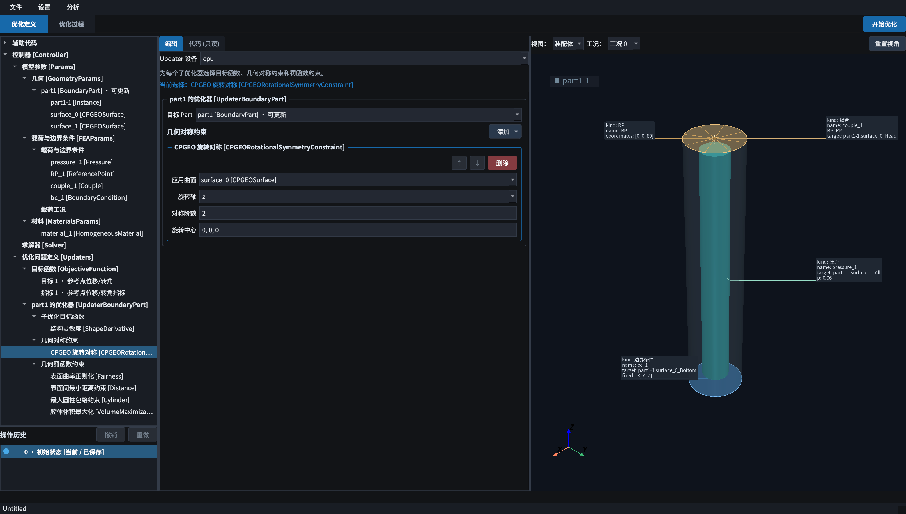

*CPGEO 旋转对称：轴、中心和重复阶数。*

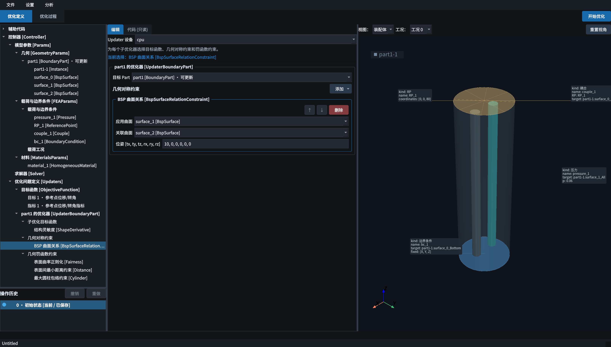

*曲面 1 经过 X 向平移 10，映射到跟随曲面 2；它们的形状在更新中保持关联。*

<a id="section-几何约束与辅助目标"></a>

### 10.4 几何约束与辅助目标

**入口：几何优化器 → 约束 → 添加。** 多数几何约束以惩罚项参与设计更新。输入阈值定义约束目标，更新结果的实际满足程度应通过保存几何与有限元状态核查。


*包络、径向下限、表面间距与曲率控制的区别。*

<a id="updater_constraints-fairness"></a>

#### 10.4.1 Fairness：表面曲率正则化

`Fairness` 控制曲面平滑程度与参数化质量。该接口无独立字段，采用曲面卡片中定义的曲率和参数化阈值。对 BSP 使用 maxC、maxR、maxFF，对 CPGEO 使用其支持的曲率阈值。

曲率项限制 κ₁²+κ₂²，单位是长度⁻²；参数非正交项衡量切向量夹角，maxR 项衡量参数度量变化。相应量超过阈值约 80% 后开始惩罚。曲面阈值仅在相应优化器已注册 Fairness 时参与计算。


*Fairness 的设置与对应几何。*

<a id="updater_constraints-distance"></a>

#### 10.4.2 Distance：表面间最小距离约束

`Distance` 对边界曲面之间及同一曲面的非邻近部分施加距离控制。输入 N×N 的 min_distance 矩阵，N 等于当前 Part 的曲面数。第 i 行、第 j 列对应曲面 i 与 j。

例如两个曲面都采用 2.5 的距离要求时填 `[[2.5,2.5],[2.5,2.5]]`。对角项控制同一曲面的非邻近部分，具有实际约束作用。曲面增删后的矩阵尺寸、索引对应关系和实际壁厚应重新核查。

| 界面字段 / 保存键 | 初始值 | 参数定义与输入格式 |
|---|---|---|
| 表面间最小距离矩阵 / `min_distance` | `[[2.5, 2.5], [2.5, 2.5]]` | 表面两两之间的最小距离矩阵。 |


*Distance 的设置与对应几何。*

<a id="updater_constraints-cylinder"></a>

#### 10.4.3 Cylinder：最大圆柱包络约束

`Cylinder` 限制设计位于以全局 Z 轴为中心的圆柱包络内。 radius 控制到 Z 轴的径向上限，bottom 和 height 分别是全局下、上 Z 边界。

例如，bottom=10、height=80 定义 z∈[10,80]，轴向跨度为 70。height 表示顶面 Z 坐标，不表示自 bottom 起算的长度。实例发生平移时，参数仍应按约束所作用的 Part 坐标核定。

| 界面字段 / 保存键 | 初始值 | 参数定义与输入格式 |
|---|---|---|
| 半径 / `radius` | `10.0` | 圆柱或半径约束的半径。 |
| 包络上边界 Z / `height` | `80.0` | 对应 Cylinder.height：包络顶面的全局 Z 坐标，惩罚 z > height 的位置。 |
| 包络下边界 Z / `bottom` | `0.0` | 对应 Cylinder.bottom：包络底面的全局 Z 坐标，惩罚 z < bottom 的位置。 |


*Cylinder 的设置与对应几何。*

<a id="updater_constraints-minradius"></a>

#### 10.4.4 MinRadius：最小半径约束

`MinRadius` 限制曲面点到全局 Z 轴的最小径向距离。 radius 是径向下限，用于避免边界靠近或穿过中心轴。

MinRadius 约束径向距离，不约束局部曲率半径。Fairness 控制曲面平滑性；InwardCurvatureRadius 控制偏置层相关的内向曲率。

| 界面字段 / 保存键 | 初始值 | 参数定义与输入格式 |
|---|---|---|
| 半径 / `radius` | `2.0` | 圆柱或半径约束的半径。 |


*MinRadius 的设置与对应几何。*

<a id="updater_constraints-volumemaximization"></a>

#### 10.4.5 VolumeMaximization：腔体体积最大化

`VolumeMaximization` 在几何子问题中增加某张 CPGEO 曲面的体积偏好。当前实现加入 `-weight * signed_volume`，因此方向与曲面取向有关。surf_idx 为当前 Part 内的曲面索引。

**当前实现只支持 CPGEOSurface；BSP 曲面不能使用。** 该接口位于约束列表，实际作为体积辅助目标参与计算，不定义给定体积的硬约束。

| 界面字段 / 保存键 | 初始值 | 参数定义与输入格式 |
|---|---|---|
| 表面索引 / `surf_idx` | `1` | 参与目标或约束的表面索引。 |
| 权重 / `weight` | `0.01` | 目标项权重。 |


*VolumeMaximization 的设置与对应几何。*

<a id="updater_constraints-inwardcurvatureradius"></a>

#### 10.4.6 InwardCurvatureRadius：内曲率半径约束

`InwardCurvatureRadius` 对 OffsetBoundaryPart 的内向主曲率施加约束，以限制可能导致偏置层相交的曲率。该接口在普通菜单中隐藏，通过高级定义或脚本配置。创建偏置部件时不自动注册该约束。

实现使用偏置厚度 t 与余量构造曲率阈值：`margin_abs=max(margin_ratio*t+margin, ε)`，`k_limit=1/(t+margin_abs)`，只惩罚内向曲率。普通 UI 注册了下表参数；更细的表面选择和屏障参数需查源码并按实际后端接口配置。

| 界面字段 / 保存键 | 初始值 | 参数定义与输入格式 |
|---|---|---|
| 边界余量 / `margin` | `0.4` | 曲率约束边界余量。 |
| 边界余量比例 / `margin_ratio` | `0.45` | 曲率约束边界余量比例。 |
| 惩罚指数 p / `p` | `8` | 惩罚指数。 |
| 惩罚缩放系数 / `penalty_scale` | `1000.0` | 惩罚项缩放系数。 |

<a id="updater_constraints-offsetsurfaceminthickness"></a>

#### 10.4.7 OffsetSurfaceMinThickness：偏置后表面最小厚度约束

`OffsetSurfaceMinThickness` 约束 OffsetBoundaryPart 偏置后表面的最小间距与可用厚度。该接口在普通菜单中隐藏，通过高级定义或脚本配置。创建偏置部件时不自动注册该约束。

本接口的 `min_distance` 为长度标量，普通 Distance 的同名参数为 N×N 矩阵。当前字段标签复用了“距离矩阵”的文字，实际定义以下表为准。

| 界面字段 / 保存键 | 初始值 | 参数定义与输入格式 |
|---|---|---|
| 表面间最小距离矩阵 / `min_distance` | `2.0` | 偏置表面最小间距，长度标量；不是 N×N 距离矩阵。 |

<a id="section-材料约束"></a>

### 10.5 材料约束

**入口：材料优化器 → 约束 → 添加。** 材料优化器指定 SIMP 材料目标，并对其设置体积分数与控制量边界。材料约束作用于材料设计场，不直接限制边界曲面的几何体积。

<a id="updater_constraints-volfrac"></a>

#### 10.5.1 VolFrac：体积分数约束

`VolFrac` 控制指定单元块内 SIMP 材料占比的允许区间。 elementname 指定目标单元块，BoxPart 通常使用 design。

当前占比是积分点 `sigmoid(f)` 的体积加权平均，不是 RAMP 后刚度比例。超出 `[volfrac_min,volfrac_max]` 后施加 penalty 倍的平方罚项。elementname 应明确指定，并与当前材料的目标单元块一致。

| 界面字段 / 保存键 | 初始值 | 参数定义与输入格式 |
|---|---|---|
| 最小体积分数 / `volfrac_min` | `0.0` | 允许的最小体积分数。 |
| 最大体积分数 / `volfrac_max` | `0.6` | 允许的最大体积分数。 |
| 惩罚系数 / `penalty` | `10000.0` | 体积分数偏差的惩罚系数。 |
| Elems 名称 / `elementname` | `空` | 必须明确选择目标 Part.elems 名称。 |

<a id="updater_constraints-minvalue"></a>

#### 10.5.2 MinValue：最小密度约束

`MinValue` 为材料场控制变量设下界。变量小于 `xmin+threshold` 时施加惩罚，p 控制惩罚幂次。

被限制的是 B 样条控制变量，不是 0 到 1 的材料体积分数。xmin=-15 是允许接近零的 sigmoid 输出，不是允许负材料占比。

| 界面字段 / 保存键 | 初始值 | 参数定义与输入格式 |
|---|---|---|
| 设计变量下界 / `xmin` | `-15.0` | 对设计场控制变量施加下界惩罚；变量经 sigmoid 和 RAMP 插值后才得到材料比例。 |
| 边界内移量 / `threshold` | `0.0` | MinValue 在变量 < xmin + threshold 时惩罚；MaxValue 在变量 > xmax − threshold 时惩罚。 |
| 惩罚指数 p / `p` | `2` | 惩罚指数。 |

<a id="updater_constraints-maxvalue"></a>

#### 10.5.3 MaxValue：最大密度约束

`MaxValue` 为材料场控制变量设上界。变量大于 `xmax-threshold` 时施加惩罚，p 控制惩罚幂次。

MinValue 与 MaxValue 可以配合使用，避免控制值过度进入 sigmoid 饱和区；两项阈值内移后的有效区间应保持合理。

| 界面字段 / 保存键 | 初始值 | 参数定义与输入格式 |
|---|---|---|
| 设计变量上界 / `xmax` | `15.0` | 对设计场控制变量施加上界惩罚；变量经 sigmoid 和 RAMP 插值后才得到材料比例。 |
| 边界内移量 / `threshold` | `0.0` | MinValue 在变量 < xmin + threshold 时惩罚；MaxValue 在变量 > xmax − threshold 时惩罚。 |
| 惩罚指数 p / `p` | `2` | 惩罚指数。 |


*材料体积分数约束：范围、罚系数和目标单元块。*


*材料设计控制变量的边界设置。*

<a id="custom-code"></a>

## 11 辅助代码与自定义类

<a id="section-代码入口与作用范围"></a>

### 11.1 代码入口与作用范围

| 入口 | 定义内容 | 适用场景 | 生成位置 |
|---|---|---|---|
| 辅助变量 | 名称、value 表达式 | 共用长度、压力、比例等参数 | 生成模块的命名变量 |
| 辅助函数 | 名称、parameters、body | 多处重复使用的数值关系 | 生成模块的函数 |
| 辅助自由代码 | helper_code | import、公共常量、通用辅助代码 | 生成模块级代码 |
| 自定义类 | 类名、基类、方法体、绑定 | 扩展框架对象的构造、求解、目标或更新逻辑 | 模块级类定义及其使用点绑定 |

**辅助变量示例：** `tube_length` 的 value 为 `80.0`，曲面的 length 字段通过 `tube_length` 引用该值。

**辅助函数示例：** `pressure_schedule` 的 parameters 为 `scale=1.0`，body 为 `return pressure_value * scale`。在辅助变量 pressure_value=0.06 已定义的条件下，工况表达式 `pressure_schedule(0.8)` 返回缩放后的压力。

辅助函数的 body 字段包含函数体，parameters 字段包含参数列表，均不包含额外的 def 声明。变量引用与函数调用遵循 Python 的名称解析及执行顺序。辅助代码作为 Python 模块代码执行。


*命名辅助变量与函数：参数列表和代码体。*

<a id="section-新建类与重写框架类"></a>

### 11.2 新建类与重写框架类

| 项目 | 定义与作用 |
|---|---|
| 类名 / `name` | 有效 Python 标识符；避免与框架和其他自定义类重名 |
| 类别 / `class_type` | `new` 定义独立类，`override` 定义框架类的扩展 |
| 基类 / `base_class` | 从当前目录选择，保持基类兼容；例如 `morphopt.FEAParams.Pressure` |
| 重写方法 | 从基类方法目录选择；框架提供真实签名，用户编辑 body |
| 新增函数 | 定义函数名、parameters 和 body；实例方法通常包含 self |
| 应用 / 绑定 | 对象级自定义类选择或框架路径绑定决定类的实际使用位置 |

自定义类配置包括基类选择、重写方法定义和使用点绑定。重写方法保留基类签名，按扩展逻辑调用 super()。基类方法列表由当前版本的实际接口生成，生成代码用于核查方法签名及绑定结果。


*自定义框架类与重写方法入口。*


*apply_fea_value(self, fe, name) 的签名由基类提供，函数体保留相应 super 调用。*

**ObjectiveFunction 的类选择：** 在“辅助代码 → 自定义类 → 重写类”中创建继承 `morphopt.ObjectiveFunction` 的类，并添加需要重写的方法。选中模型树中的“目标函数 [ObjectiveFunction]”后，编辑页顶部的“使用类”列出默认类与兼容的重写类。该选择随 `.morph` 保存，选择默认类可恢复界面定义的实现。

显式重写的 `objective_function` 或 `get_metrics` 替代对应的界面生成方法；未重写的方法保留界面生成实现。生成代码中的 `ObjectiveFunction(MyObjectiveFunction)` 表示已启用该重写类。


*目标函数与其他顶层组件使用相同的类选择控件，仅列出兼容的重写类。*

<a id="section-对象生命周期与方法执行阶段"></a>

### 11.3 对象生命周期与方法执行阶段

| 生命周期位置 | 主要操作 | 典型场景 |
|---|---|---|
| 构造 / define 阶段 | 声明参数与组件 | 增加几何、接口、材料、工况或更新项 |
| initialize | 在对象齐备后解析引用并准备数据 | 查找实例、RP、单元块，建立缓存 |
| build_part 等构建钩子 | 生成有限元部件的节点、单元、集合 | 自定义 Part |
| FE 求解 | 根据几何、材料及工况计算平衡状态 | 扩展求解策略，需遵守求解器接口 |
| objective / metrics | 从 FE 状态取响应 | 自定义可微目标与记录量 |
| updater | 用梯度和约束改变设计 | 自定义形状或材料更新项 |
| 保存 / 导出 | 记录状态与数据 | 保存额外诊断或可视化 |

对象构造阶段不保证几何、材料及求解结果全部可用。数据访问应符合方法签名与执行阶段。目标函数、自定义 Part 和更新目标中的 self 分别指向各自所属对象。

<a id="section-生成代码与持久化接口"></a>

### 11.4 生成代码与持久化接口

- **`.morph`：** 保存结构化定义、工况、更新器、自定义代码和绑定。它是继续编辑的主要文件。
- **生成代码页：** 查看当前定义对应的 Python，包括 Part、FEAParams、MaterialsParams、ObjectiveFunction、Solver 与 Updater 的构造和注册位置。
- **导出 Python：** 需要脚本运行或进一步编程时使用；若后续主要在 UI 编辑，应继续保存 `.morph` 并重新生成脚本，保持 UI 定义与脚本版本一致。

主要接口的注册位置如下，完整脚本见生成代码页：

```text
几何 Part → 注册 Instance / 边界曲面 / CAD 操作
FEAParams.define_interface → 按名称注册载荷、边界、RP、连接和接触
FEAParams.define_steps → 为各工况设置接口数值
MaterialsParams → 按 Part / 单元块指派材料
ObjectiveFunction → 计算主目标、记录指标、声明 Jacobian 载荷
Updater → 按目标注册更新项、约束与曲面关系
```


*生成代码页用于核对参数、注册位置与自定义类的实际使用。*

<a id="results"></a>

## 12 可视化、优化记录与事后有限元

<a id="section-定义预览检查输入模型"></a>

### 12.1 定义预览：检查输入模型

主定义页右侧显示当前定义的三维预览。“部件”视图显示所选 Part 的初始几何，“装配体”视图显示实例位姿及相对位置。工况选择用于切换载荷与边界的预览状态。视图支持鼠标拖动旋转和滚轮缩放，“重置视角”恢复默认观察位置。

预览不是非线性 FE 解。载荷箭头或参考点图标用于检查输入，不能据此判断收敛、应力或优化效果。部分导入模型需要源文件可访问才能完成预览。

<a id="section-优化过程历史记录与设计演化"></a>

### 12.2 优化过程：历史记录与设计演化

**入口：顶部“优化过程”。** “文件 → 打开优化结果…”用于载入指定运行目录的保存历史，外层轮次和工况选择用于定位结果。新优化任务启动后同样进入该页面。

| 控件 / 内容 | 功能 | 核查要点 |
|---|---|---|
| 运行选择 | 在多个任务记录间切换 | 名称相同的定义可能对应不同时间的运行 |
| 轮次列表 / 选择 | 切换保存的设计 | 只显示实际已有的轮次，不代表已达到收敛 |
| 目标与指标曲线 | 显示目标趋势与物理响应 | 损失含符号和权重，指标可保留物理方向 |
| 初始 / 当前几何 | 比较边界设计变化 | 使用一致视角，必要时检查尺寸与壁厚 |
| 工况变形 | 显示所选设计在指定工况下的 FE 响应 | 区分设计几何变化与加载后的实际变形 |
| 日志与状态 | 判断当前在求解、更新、保存还是发生异常 | 停止后的有效结果以最后完整保存轮次为准 |
| 继续已有运行 | 从保存的状态继续优化 | 核对冻结定义、设备与结果目录，不随意覆盖原记录 |


*优化记录：保存轮次、指标曲线和结果浏览。*


*第 36 轮保存设计的几何可视化。*


*选定设计在指定工况下的变形预览。*


*优化运行中的阶段信息与输出。*

以上结果来自UI 快速开始对应的示例运行记录，展示范围截至已保存第 36 轮。保存轮次仅表示记录进度，优化收敛与结果有效性应结合有限元残差、形状约束、网格及物理响应评价。

<a id="section-事后有限元固定设计的工况分析"></a>

### 12.3 事后有限元：固定设计的工况分析

**入口：工况与计算结果 / 有限元结果页。** 所选保存轮次和工况确定分析模型及结果来源。

| 控件 / 操作 | 定义与功能 |
|---|---|
| 优化迭代 | 指定取哪一轮设计和 FE 模型 |
| 工况 / 计算结果 | 选择原优化结果或独立重算结果，避免混淆来源 |
| 未变形 / 变形显示 | 检查原始网格和位移后的网格 |
| 场变量与分量 | 查看位移、应力或现有结果支持的场；标量 / 向量分量的意义以界面字段为准 |
| 等效应力 | 用一个标量显示偏应力强度；不直接等于材料失效判据 |
| 优化迭代选择列表 | 展开并选择已保存的外层优化轮次；FE 求解器内部迭代在计算日志中读取 |
| 修改载荷参数 | 在当前设计的独立分析副本中调整工况参数 |
| 开始计算 / 输出 | 对固定设计重新求解，查看过程和是否收敛 |
| 结果选择 | 切回原始结果，或选择独立计算结果对照 |

**当前场变量选择器的内容：**

| 数据 | 可选分量 | 含义与单位 |
|---|---|---|
| 位移 | U、U1、U2、U3 | U 为位移模长，1/2/3 为全局 X/Y/Z；长度单位 |
| Cauchy 应力 | S_Mises、S11、S22、S33、S12、S13、S23 | 应力单位；剪切分量按张量约定读取 |
| Green–Lagrange 应变 | E11、E22、E33、E12、E13、E23 | 无量纲；剪切为张量分量，不是工程剪切应变 |
| 应变能密度 | strain_energy_density | 单位参考体积的能量，量纲与应力一致 |

场变量列表仅包含当前模型与结果支持的物理量。取消“变形显示”只改变网格绘制位置；场值仍来自所选求解结果。当前有限元页没有独立的变形放大倍数输入框。

事后有限元在几何与材料固定的条件下，计算载荷调整后的结构响应。该过程独立于设计优化，不更新原始 `.morph` 定义。多个压力条件共同参与优化时，相应工况及目标项在主定义页中设置。


*已保存设计的有限元位移场。*


*等效应力场：结合图例、单位和选定工况读取。*


*事后有限元中选择已保存的优化轮次。*


*在固定设计上修改压力参数进行事后分析。*


*压力 0.05 的独立重算结果。*

UI 快速开始的事后分析采用第 36 轮设计，将压力从 0.06 调整为 0.05，并获得收敛结果。不同压力工况的响应比较应保持几何、单位和观察视角一致，并记录对应结果名称。

<a id="section-导出接口"></a>

### 12.4 导出接口

| 导出内容 | 数据位置与内容 | 使用时保留的信息 |
|---|---|---|
| 几何 / 表面文件 | 保存选定设计或变形后的外形 | 轮次、工况、原始 / 变形状态、单位 |
| 节点数据 | 节点位置、位移及界面支持的节点场 | 实例与节点编号，坐标系 |
| 积分点数据 | 单元积分点位置与能量、应变、应力等可用量 | 单元块、单元 / 积分点索引、分量约定 |
| 参考点数据 | 坐标、平移、旋转向量、变形后坐标 | RP 名、工况、旋转单位 rad |
| 模型与结果归档 | 用于重新加载与继续分析 | 模型文件和结果文件应配套 |

应力、应变和能量云图先按参考积分体积得到单元平均，再对相邻单元做节点平均。节点值与积分点值的采样位置不同；节点平均云图不等于原始积分点极值。后续统计应依据实际导出位置与编号建立对应关系，节点数组和积分点数组不按行号直接匹配。


*有限元结果导出入口。*


*积分点数据导出及位置选择。*


*参考点位置、位移和旋转向量导出。*

<a id="index"></a>

## 13 配置核查与接口索引

<a id="section-常见现象与配置核查"></a>

### 13.1 常见现象与配置核查

| 现象或配置需求 | 核查对象 |
|---|---|
| 参考点载荷未传递至实体 | Couple 中的 RP、实例及节点集引用，参考点与实体的连接状态 |
| 固定区域存在非预期运动或模型出现刚体运动 | BoundaryCondition 的节点集、固定平移分量及模型连接条件 |
| 腔体加压方向不符预期 | 曲面顺序、flip、Pressure 表面与法向、工况符号 |
| 材料分配对象不明确 | 材料的 part_name 和 elementname；目标为 Part 名称 |
| initial_ratio=0.5 与预期材料占比不一致 | 查看 sigmoid 与 RAMP，区分 f、ρ、r |
| 边界局部尖锐或参数化质量较低 | Fairness 注册状态、曲面阈值及控制网格设置 |
| 局部最小曲率半径控制 | Fairness、InwardCurvatureRadius 与径向下限 MinRadius 的适用范围 |
| CAD 历史修改后载荷表面发生变化 | 最终 face_N 及对应节点集的引用关系 |
| 材料优化未产生预期目标改善 | SIMP 更新目标、更新开关、Sensitivity 及主目标可微性 |
| 指标已记录但设计未更新 | 主目标、梯度项、更新开关及约束；指标本身仅用于记录 |
| max_step_iter=50 时外层优化超过 50 轮 | 该字段限定更新子问题的内部迭代次数，外层运行控制单独设置 |
| 固定设计下的不同压力响应比较 | 事后有限元；多压力条件参与优化时采用主定义中的多个工况 |
| 自定义类未在运行中生效 | 兼容对象的应用与绑定状态，生成代码中的实际类引用 |

<a id="section-全部注册对象索引"></a>

### 13.2 全部注册对象索引

表中包括普通添加入口、需要自定义实现的基础类，以及菜单隐藏的高级约束。完整字段清单随图保存在 [interface-catalog.json](images/ui-reference/interface-catalog.json)，便于对照版本。

| 组别 | 数量 | 本文接口 |
|---|---:|---|
| 部件 | 6 | [BoundaryPart](#part_types-boundarypart)、[INPPart](#part_types-inppart)、[BasePart](#part_types-basepart)（自定义）、[BoxPart](#part_types-boxpart)、[CADPart](#part_types-cadpart)、[OffsetBoundaryPart](#part_types-offsetboundarypart) |
| 边界曲面 | 4 | [bsp_cylinder](#surface_types-bsp-cylinder)、[cpgeo_cylinder](#surface_types-cpgeo-cylinder)、[cpgeo_sphere](#surface_types-cpgeo-sphere)、[fixed_stl](#surface_types-fixed-stl) |
| CAD 操作 | 15 | [Box](#cad_operation_types-box)、[Wedge](#cad_operation_types-wedge)、[Cylinder](#cad_operation_types-cylinder)、[Sphere](#cad_operation_types-sphere)、[Cone](#cad_operation_types-cone)、[Torus](#cad_operation_types-torus)、[StepImport](#cad_operation_types-stepimport)、[Fuse](#cad_operation_types-fuse)、[Cut](#cad_operation_types-cut)、[Intersect](#cad_operation_types-intersect)、[Fragment](#cad_operation_types-fragment)、[Translate](#cad_operation_types-translate)、[Rotate](#cad_operation_types-rotate)、[Dilate](#cad_operation_types-dilate)、[Mirror](#cad_operation_types-mirror) |
| 载荷 / 边界 / 连接 / 接触 | 13 | [Pressure](#load_types-pressure)、[ConcentratedForce](#load_types-concentratedforce)、[ConcentratedMoment](#load_types-concentratedmoment)、[Bodyforce](#load_types-bodyforce)、[SpringToGround](#load_types-springtoground)、[SpringBetweenRPs](#load_types-springbetweenrps)、[PenaltyDoF](#load_types-penaltydof)、[BoundaryCondition](#load_types-boundarycondition)、[BoundaryConditionRP](#load_types-boundaryconditionrp)、[Couple](#load_types-couple)、[ReferencePoint](#load_types-referencepoint)、[Contact](#load_types-contact)、[ContactSelf](#load_types-contactself) |
| 材料接口 | 2 | [HomogeneousMaterial](#material_types-homogeneousmaterial)、[SIMP_BSPFieldMaterials](#material_types-simp-bspfieldmaterials) |
| 更新目标 | 3 | [ShapeDerivative](#updater_objectives-shapederivative)、[Sensitivity](#updater_objectives-sensitivity)、[DensityFieldMinimize](#updater_objectives-densityfieldminimize) |
| 曲面对称与关联 | 6 | [BspMirror](#surface_symmetry_constraints-bspmirror)、[CPGEOMirror](#surface_symmetry_constraints-cpgeomirror)、[CPGEORotation](#surface_symmetry_constraints-cpgeorotation)、[BspRelation](#surface_symmetry_constraints-bsprelation)、[CPGEORelation](#surface_symmetry_constraints-cpgeorelation)、[Custom](#surface_symmetry_constraints-custom) |
| 几何与材料约束 | 10 | [Fairness](#updater_constraints-fairness)、[Distance](#updater_constraints-distance)、[Cylinder](#updater_constraints-cylinder)、[MinRadius](#updater_constraints-minradius)、[VolumeMaximization](#updater_constraints-volumemaximization)、[InwardCurvatureRadius](#updater_constraints-inwardcurvatureradius)（隐藏）、[OffsetSurfaceMinThickness](#updater_constraints-offsetsurfaceminthickness)（隐藏）、[VolFrac](#updater_constraints-volfrac)、[MinValue](#updater_constraints-minvalue)、[MaxValue](#updater_constraints-maxvalue) |

<a id="section-实现对照与截图来源"></a>

### 13.3 实现对照与截图来源

下表列出字段与注册入口的实现位置。软件版本更新后的接口定义以对应源文件及当前 UI 生成代码为准。

| 对照内容 | 源文件 |
|---|---|
| 注册对象与入口范围 | [registry.py](../src/morphopt/ui/model/registry.py) |
| 各接口字段与默认值 | [node_types](../src/morphopt/ui/model/node_types) |
| 本构参数对应关系 | [material_models.py](../src/morphopt/ui/model/material_models.py)、[models.py](../src/morphopt/optcore/modelparams/materials/models.py) |
| 按当前本构筛选显示字段 | [fields.py](../src/morphopt/ui/application/fields.py) |
| 工况、目标、几何与更新器的代码生成 | [generator.py](../src/morphopt/ui/codegen/generator.py) |
| 十二个 FE 数据模板 | [snippets.py](../src/morphopt/ui/schemes/snippets.py) |
| 自定义类签名与绑定 | [custom_classes.py](../src/morphopt/ui/codegen/custom_classes.py) |
| SIMP 插值与体积分数 | [simpmaterial.py](../src/morphopt/simp/simpmaterial.py)、[volfrac.py](../src/morphopt/simp/objectivefuncs/volfrac.py) |
| 偏置几何高级约束 | [constraints.py](../src/morphopt/codesign/constraints.py) |

新增截图的字体、分辨率与示例来源见 [图片说明](images/ui-reference/README.md)；UI 快速开始中的原始截图见 [UI 快速开始截图清单](images/ui/capture-manifest.json)。图示中的箭头和流程线用于解释对象关系，并非计算结果。
