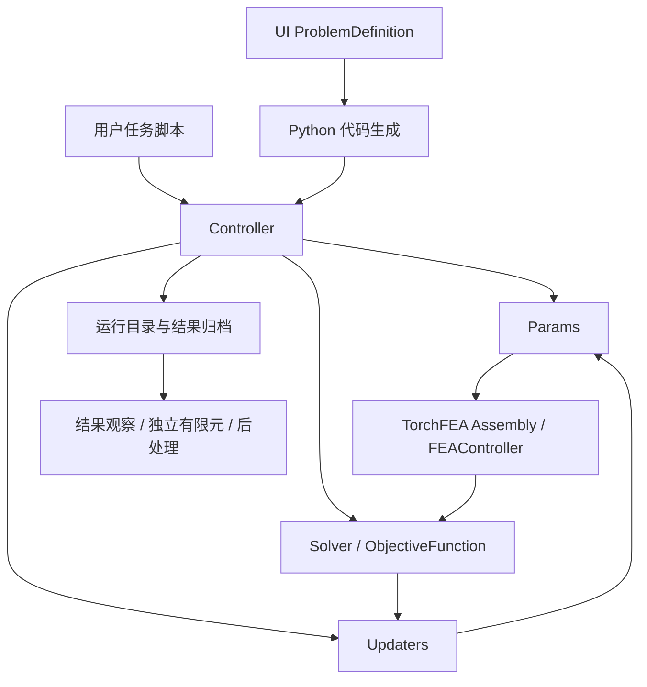

# 系统架构

[代码结构导览](README.md) · [运行时](runtime.md) · [UI 领域模型](ui-model.md)

## 目录

<!-- docs:toc depth=1 -->

- [1 系统边界](#section-系统边界)
- [2 包目录与公共入口](#section-包目录与公共入口)
- [3 内核对象组合](#section-内核对象组合)
- [4 UI 层次与依赖](#section-ui-层次与依赖)
- [5 状态所有权](#section-状态所有权)
- [6 三条主要数据流](#section-三条主要数据流)

<!-- /docs:toc -->

<a id="section-系统边界"></a>

## 1 系统边界

MorphOpt 通过任务脚本组合几何、载荷、材料、求解器、目标函数和更新器，调用 TorchFEA 完成有限元分析及灵敏度计算。UI 编辑声明式问题定义，再生成同一运行时使用的 Python 任务。脚本任务与 UI 任务共享数值内核。



`.morph` 是可编辑定义，Python 是任务执行入口，运行目录保存设计状态与求解归档。三者具有不同生命周期，不能相互替代。

<a id="section-包目录与公共入口"></a>

## 2 包目录与公共入口

| 路径 | 主要职责 |
|---|---|
| [`src/morphopt/__init__.py`](../../src/morphopt/__init__.py) | 公共类、启动函数、日志与工具入口 |
| [`opt_runner.py`](../../src/morphopt/opt_runner.py)、[`taskoptmization.py`](../../src/morphopt/taskoptmization.py) | 脚本任务的进程启动与分段继续计算 |
| [`optcore/`](../../src/morphopt/optcore) | 控制器、参数、求解、目标、更新器管理、历史与共享协议 |
| [`shapeopt/`](../../src/morphopt/shapeopt) | 边界曲面部件、曲面约束、体网格与形状更新 |
| [`simp/`](../../src/morphopt/simp) | 材料设计场、材料与单元缩放、密度场更新 |
| [`codesign/`](../../src/morphopt/codesign) | 内腔偏置实体层及其专用更新器和约束 |
| [`postprocess/`](../../src/morphopt/postprocess) | 无 Qt 的物理量提取与结果导出 |
| [`ui/`](../../src/morphopt/ui) | 编辑、生成、任务管理、预览与结果界面 |
| [`utils/`](../../src/morphopt/utils) | 历史控制器读取与灵敏度检查工具 |
| [`constants.py`](../../src/morphopt/constants.py) | 业务默认值、运行参数与数值配置 |

`morphopt.start_optimization()` 启动脚本任务，`morphopt.debug_optimization()` 提供调试入口。`morphopt-ui` 与 `python -m morphopt.ui` 进入图形应用。

公共通用基类由顶层 `morphopt` 导出；`shapeopt`、`simp`、`codesign` 提供具体设计对象与算法组件，不构成三套独立的控制器体系。共享协议保留源码拼写 `Protocal*`，见[模型协议](model.md#protocols)。

<a id="section-内核对象组合"></a>

## 3 内核对象组合

```text
Controller
├── Params
│   ├── GeometryParams.interfaces → BasePart → torchfea.Part + Instance
│   ├── FEAParams.interfaces      → BaseFEAComponent + 工况参数表
│   └── MaterialsParams.interfaces→ BaseMaterial
├── Solver                       → 各工况 StaticResult
├── ObjectiveFunction            → 标量损失、指标、分类梯度
├── Updaters                     → 一个或多个局部 BaseUpdater
└── History                      → 迭代记录
```

参数集合按名称登记模型对象。每个子优化器绑定一个设计接口，优化器管理器负责目标解析和梯度切片。控制器负责调用顺序，不在其内部按形状或材料任务编写不同主循环。

<a id="section-ui-层次与依赖"></a>

## 4 UI 层次与依赖

| 层 | 目录或入口 | 职责边界 |
|---|---|---|
| 领域 | `ui/model/` | 节点、字段、对象引用及跨节点不变量 |
| 应用 | `ui/application/` | 编辑、持久化、任务、结果与校验用例 |
| 生成与方案 | `ui/codegen/`、`ui/schemes/` | 定义到 Python 的投影、方案策略和模板片段 |
| 展示数据 | `ui/presentation/` | 导航树、标题、历史表格和操作历史的轻量投影 |
| 场景准备 | `ui/visualization/` | Part/Surface/Load 适配与场景数据 |
| Qt 展示 | 顶层窗口、`ui/widgets/`、`ui/refresh.py` | 控件、信号、统一刷新、视口及进程事件接入 |
| 外观与语言 | `ui/theme/`、`ui/i18n.py`、`ui/locales/` | 外观配置、本地化资源与变更通知 |

领域、应用、生成和场景准备代码不创建 Qt 页面。场景可以携带 PyVista 数据集，VTK actor 与 plotter 由视口管理。窗口调用应用服务，应用服务操作领域模型或运行基础设施；领域模型不反向访问窗口。

主题管理器在应用主题和保存 Qt 设置时接入 Qt；它不属于问题定义。`i18n.py` 提供资源查询和订阅，语言选择器及 Qt 设置持久化位于展示层。

<a id="section-状态所有权"></a>

## 5 状态所有权

| 状态 | 所有者 | 边界 |
|---|---|---|
| 可保存的定义内容 | `ProblemDefinition` | 节点树、辅助代码、自定义类及运行配置 |
| 当前定义与编辑历史 | `ProblemSession` | 持有当前定义引用及不可变编辑快照 |
| 活动优化任务 | `OptimizationRunSession` | 任务来源、子进程、输出与进度 |
| 优化结果读取 | `ResultSession` | 当前运行的控制器、历史与参数载入缓存 |
| 独立有限元模型与解 | `FiniteElementSession` | 从确切迭代载入的私有模型与分析快照 |
| 定义文件路径与结果选择协调 | `MainWindow` | 保存路径，以及观察/有限元共享的结果目录和迭代 |
| 定义预览资源 | `PreviewGeometry` | 当前预览的 Part、CAD 与曲面查询缓存 |
| VTK actor 与相机 | 所属 renderer 或 widget | 展示资源，不写入定义与优化状态 |
| 表单焦点、滚动与树展开状态 | 所属 widget | 刷新时可恢复的展示状态 |

`ProblemSession` 持有定义，但业务内容仍由 `ProblemDefinition` 表达；二者不维护两份可独立修改的字段值。运行定义通过快照与编辑定义分离，独立有限元不共享优化中的可修改后端对象。

<a id="section-三条主要数据流"></a>

## 6 三条主要数据流

| 流程 | 路径 | 详细说明 |
|---|---|---|
| 编辑 | 控件 → 应用/领域操作 → 同步与编辑快照 → 统一刷新 | [UI 应用服务](ui-application.md)、[展示与刷新](ui-presentation.md) |
| 优化 | Python → 控制器 → 模型生成 → 求解 → 梯度 → 更新 → 归档 | [运行时](runtime.md)、[设计更新](optimization.md) |
| 分析 | 归档 → 结果会话 → 展示或独立有限元 → 场量/原生文件导出 | [结果分析与导出](results.md) |

正文各专题分别描述这些流程的内部实现。操作参数、界面字段和完整算例由[四篇使用文档](../README.md)提供。
