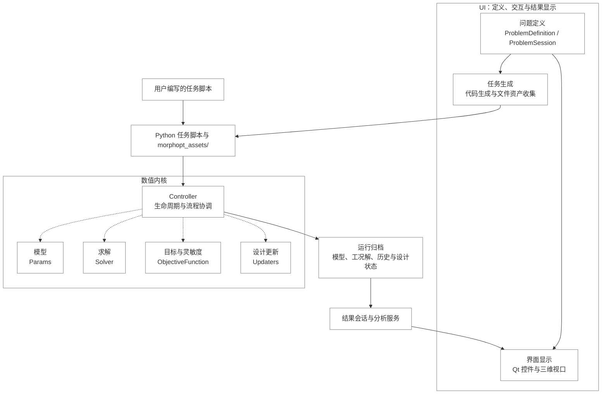
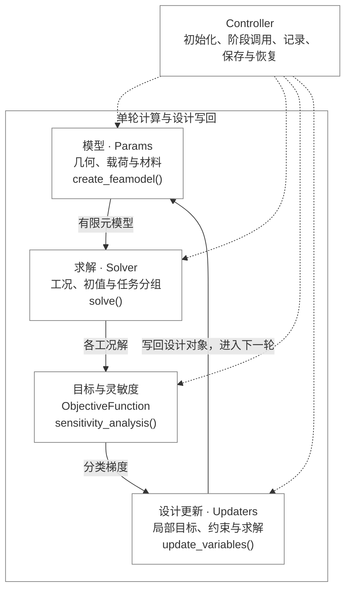
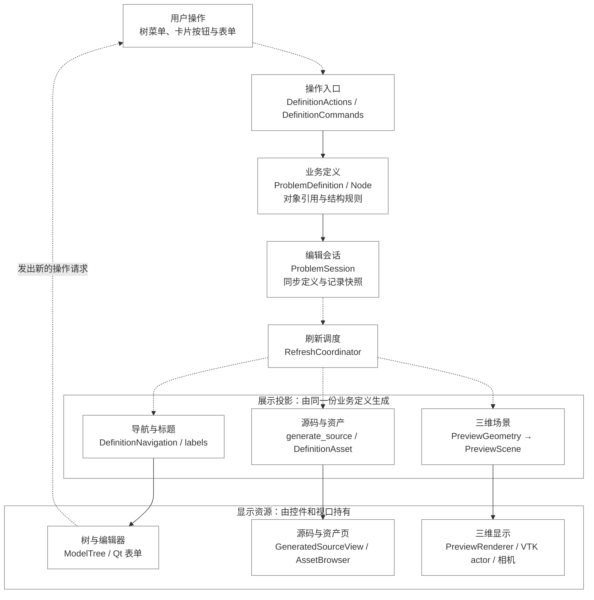

# 系统架构

[代码结构导览](README.md) · [运行时](runtime.md) · [UI 领域模型](ui-model.md)

## 目录

<!-- docs:toc depth=1 -->

- [1 模块化设计理念](#modularity)
- [2 系统边界](#section-系统边界)
- [3 包目录与公共入口](#section-包目录与公共入口)
- [4 内核对象组合](#section-内核对象组合)
- [5 UI 层次与依赖](#section-ui-层次与依赖)
- [6 状态所有权](#section-状态所有权)
- [7 三条主要数据流](#section-三条主要数据流)
- [8 模块边界与扩展位置](#section-模块边界与扩展位置)

<!-- /docs:toc -->

<a id="modularity"></a>

## 1 模块化设计理念

MorphOpt 的代码设计以职责分离和对象组合为基础。模块根据业务职责划分，通过约定的数据和接口协作；任务类型由模型组件与算法组件的组合表达。模块边界同时规定状态归属、调用方向和扩展位置。

这一设计贯穿软件整体、数值内核和 UI 内部：UI 与内核分别承担交互和计算，内核按模型、求解、灵敏度和更新组织流程，UI 按业务数据、展示投影和显示资源组织交互。

| 原则 | 在代码中的体现 | 对扩展的约束 |
|---|---|---|
| 单一职责 | `Params` 构建模型，`Solver` 求解，`ObjectiveFunction` 定义目标并组织灵敏度，`Updaters` 管理设计更新 | 新算法进入对应组件，主循环保持统一 |
| 接口协作 | 模型对象、工况结果、分类梯度、设计变量和场景描述连接各阶段 | 调用方遵循类型、顺序和生命周期约定 |
| 状态有明确归属 | 定义、运行、分析和显示分别由领域对象、会话与视口持有 | 同一业务字段保持单一来源，缓存和视图按所属阶段管理 |
| 组合式扩展 | 一个任务可组合不同 Part、材料、目标及局部更新器 | 可更新组件声明设计接口，局部更新器绑定具体目标 |

<a id="section-系统边界"></a>

## 2 系统边界

MorphOpt 通过任务脚本组合几何、载荷、材料、求解器、目标函数和更新器，调用 TorchFEA 完成有限元分析及灵敏度计算。UI 编辑声明式问题定义，再生成同一运行时使用的 Python 任务。脚本任务与 UI 任务共享数值内核。



*图 1：UI 通过运行脚本和资产交付计算任务，内核通过归档交付结果。实线表示主要数据传递，虚线表示阶段调度。*

内核源码不导入 `morphopt.ui`，计算流程由运行器和控制器执行。UI 通过代码生成、运行会话和结果会话接入同一流程。脚本入口可直接组织计算，图形入口负责定义编辑、任务交付与结果显示。

生成脚本是两个入口之间的执行接口：UI 中的类型化定义转换为内核类的声明，文件资产还原到脚本旁的 `morphopt_assets/`。开始优化与导出运行脚本复用同一生成逻辑，运行目录再保存任务与资产快照。

`.morph` 是可编辑定义，Python 是任务执行入口，运行目录保存设计状态与求解归档。三者具有不同生命周期，不能相互替代。

<a id="section-包目录与公共入口"></a>

## 3 包目录与公共入口

| 路径 | 主要职责 |
|---|---|
| [`src/morphopt/__init__.py`](../../src/morphopt/__init__.py) | 公共类、启动函数、日志与工具入口 |
| [`opt_runner.py`](../../src/morphopt/opt_runner.py)、[`taskoptmization.py`](../../src/morphopt/taskoptmization.py) | 脚本任务的进程启动与分段继续计算 |
| [`optcore/`](../../src/morphopt/optcore) | 控制器、参数、求解、目标、更新器管理、历史与共享协议 |
| [`shapeopt/`](../../src/morphopt/shapeopt) | 边界曲面部件、曲面约束、体网格与形状更新 |
| [`simp/`](../../src/morphopt/simp) | 材料设计场、材料与单元缩放、密度场更新 |
| [`codesign/`](../../src/morphopt/codesign) | 内腔偏置实体层及其专用更新器和约束 |
| [`postprocess/`](../../src/morphopt/postprocess) | 无 Qt 的归档读取、有限元场量、统一文件导出与场景绘制 |
| [`ui/`](../../src/morphopt/ui) | 编辑、生成、任务管理、预览与结果界面 |
| [`utils/`](../../src/morphopt/utils) | 历史控制器读取与灵敏度检查工具 |
| [`constants.py`](../../src/morphopt/constants.py) | 业务默认值、运行参数与数值配置 |

`morphopt.start_optimization()` 启动脚本任务，`morphopt.debug_optimization()` 提供调试入口。`morphopt-ui` 与 `python -m morphopt.ui` 进入图形应用。

公共通用基类由顶层 `morphopt` 导出；`shapeopt`、`simp`、`codesign` 提供具体设计对象与算法组件，不构成三套独立的控制器体系。共享协议保留源码拼写 `Protocal*`，见[模型协议](model.md#protocols)。

<a id="section-内核对象组合"></a>

## 4 内核对象组合

<a id="section-模型求解灵敏度与更新"></a>

### 4.1 模型、求解、灵敏度与更新



*图 2：`Controller` 组织阶段调用，四类组件通过有限元模型、工况解和分类梯度协作；设计更新写回模型接口，进入下一轮。虚线表示调度关系。*

| 模块 | 主要输入 | 主要输出或写入 | 职责边界 |
|---|---|---|---|
| 模型：`Params` | 几何、实例、载荷工况、材料及当前设计状态 | `FEAController`，以及设计变量到装配体的映射 | 声明并构建当前物理模型，维护模型接口 |
| 求解：`Solver` | 当前有限元模型、工况和初值 | 各工况的 `StaticResult` | 组织工况求解、任务分配与有限元初值 |
| 目标与灵敏度：`ObjectiveFunction` | 有限元模型、工况解、标量目标及设计映射 | 目标值、记录指标和分类梯度 | 定义优化响应，调用 TorchFEA 灵敏度接口并整理梯度 |
| 设计更新：`Updaters` 与局部 `BaseUpdater` | 分类梯度、绑定的设计对象及局部目标与约束 | 局部改变量与更新后的设计状态 | 分派梯度、求解局部子问题，并写回绑定对象 |
| 流程协调：`Controller` | 上述组件、运行配置和迭代状态 | 阶段调用、历史、归档与继续计算状态 | 统一组织生命周期和执行顺序 |

`Params` 内部进一步将几何、有限元载荷与材料分为三个接口集合。可更新对象提供设计变量及其对物理模型的映射，`ObjectiveFunction` 据此计算灵敏度，更新器管理器再按目标接口切分梯度。变量顺序和梯度区间是这些模块共同遵守的数据契约，具体见[模型协议](model.md#protocols)与[梯度路径](optimization.md#gradients)。

灵敏度与设计更新具有独立职责。前者计算当前目标对设计变量的导数，后者结合该导数、局部目标和约束确定改变量。调整有限元工况调度、目标表达式或局部更新算法，分别对应 `Solver`、`ObjectiveFunction` 和局部更新器的实现位置。

<a id="section-对象组合与共享状态"></a>

### 4.2 对象组合与共享状态

```text
Controller
├── Params
│   ├── GeometryParams.interfaces → BasePart → torchfea.Part + Instance
│   ├── FEAParams.interfaces      → BaseFEAComponent + 工况参数表
│   └── MaterialsParams.interfaces→ BaseMaterial
├── Solver                       → 各工况 StaticResult
├── ObjectiveFunction            → 标量损失、指标、分类梯度
├── Updaters                     → 一个或多个局部 BaseUpdater
└── History                      → 迭代记录
```

参数集合按名称登记模型对象。每个子优化器绑定一个设计接口，优化器管理器负责目标解析和梯度切片。控制器负责调用顺序，不在其内部按形状或材料任务编写不同主循环。

这些组件位于同一运行上下文：`Solver` 与 `Updaters` 共享控制器持有的 `Params`，局部更新器直接绑定设计对象。当前实现还使用 `morphopt.controller` 提供运行上下文，部分模型与目标接口包含 PyVista 输出功能。上述分离描述职责与调用边界，各模块仍按既定协议访问共享模型和数值后端。

<a id="section-ui-层次与依赖"></a>

## 5 UI 层次与依赖

<a id="section-业务数据展示投影与显示资源"></a>

### 5.1 业务数据、展示投影与显示资源



*图 3：用户操作经应用与领域接口修改定义；同步后的状态分别投影为导航行、脚本与资产、三维场景，再由对应控件显示。虚线表示操作与刷新通知。*

UI 的可保存定义由 `ProblemDefinition` 表达，编辑会话维护当前定义与历史。树节点、卡片、代码视图和三维视图分别读取同一份定义的投影。节点选择、滚动位置、相机和 actor 由显示组件管理。

| 层次 | 数据或资源 | 主要职责 |
|---|---|---|
| 业务数据 | `ProblemDefinition`、类型化 `Node` 与对象引用 | 表达问题定义，维护引用、名称和结构约束 |
| 应用流程 | `ProblemSession`、`DefinitionCommands`、运行与结果会话 | 组织编辑、同步、历史、持久化及任务操作 |
| 展示投影 | 导航行、标题、生成源码、`DefinitionAsset`、`PreviewScene` | 将业务状态转换为特定视图所需的数据 |
| 显示资源 | Qt 控件、VTK actor、plotter、相机与选择状态 | 显示数据，处理交互并发出操作请求 |

数据流与显示分离的具体含义是：业务关系在领域操作中维护，显示组件根据操作结果刷新。显示文字由标题投影生成，下拉框通过对象引用或原始值保存选项含义；三维网格和面标识先组成场景描述，再交给 renderer 创建 actor。

例如，删除绑定了几何优化器的部件时，`DefinitionActions` 负责提示和确认，`ProblemDefinition.remove_part()` 负责删除部件、关联优化器并清理相关引用，工作台随后记录编辑快照并调度刷新。树和卡片重建展示投影，几何适配器重新准备场景，renderer 更新显示资源。该操作的业务规则集中于领域方法，树菜单和卡片按钮调用同一入口。

<a id="section-源码层次与调用方向"></a>

### 5.2 源码层次与调用方向

| 层 | 目录或入口 | 职责边界 |
|---|---|---|
| 领域 | `ui/model/` | 节点、字段、对象引用及跨节点不变量 |
| 应用 | `ui/application/` | 编辑、持久化、任务、结果与校验用例 |
| 生成与方案 | `ui/codegen/`、`ui/schemes/` | 定义到 Python 的投影、方案策略和模板片段 |
| 展示数据 | `ui/presentation/` | 导航树、标题、历史表格和操作历史的轻量投影 |
| 场景准备 | `ui/visualization/` | Part/Surface/Load 适配与场景数据 |
| Qt 展示 | 顶层窗口、`ui/widgets/`、`ui/refresh.py` | 控件、信号、统一刷新、视口及进程事件接入 |
| 外观与语言 | `ui/theme/`、`ui/i18n.py`、`ui/locales/` | 外观配置、本地化资源与变更通知 |

领域、应用、生成和场景准备代码不创建 Qt 页面。场景可以携带 PyVista 数据集，VTK actor 与 plotter 由视口管理。窗口调用应用服务，应用服务操作领域模型或运行基础设施；领域模型不反向访问窗口。

定义预览通过 `PreviewGeometry → PreviewScene → PreviewRenderer` 传递几何和面身份信息。几何资产预览采用相同的场景与渲染接口；资产类别的显示方式在 `AssetBrowser` 注册。增加资产类型时扩展类别适配与预览组件，文件收集、脚本导出和业务定义继续遵循各自接口，见[资产预览扩展](ui-application.md#asset-previews)。

主题管理器在应用主题和保存 Qt 设置时接入 Qt；它不属于问题定义。`i18n.py` 提供资源查询和订阅，语言选择器及 Qt 设置持久化位于展示层。

<a id="section-状态所有权"></a>

## 6 状态所有权

| 状态 | 所有者 | 边界 |
|---|---|---|
| 可保存的定义内容 | `ProblemDefinition` | 节点树、辅助代码、自定义类及运行配置 |
| 当前定义与编辑历史 | `ProblemSession` | 持有当前定义引用及不可变编辑快照 |
| 活动优化任务 | `OptimizationRunSession` | 任务来源、子进程、输出与进度 |
| 优化结果读取 | `ResultSession` | 当前运行的控制器、历史与参数载入缓存 |
| 独立有限元模型与解 | `FiniteElementSession` | 从确切迭代载入的私有模型与分析快照 |
| 定义文件路径与结果选择协调 | `MainWindow` | 保存路径，以及观察/有限元共享的结果目录和迭代 |
| 定义预览资源 | `PreviewGeometry` | 当前预览的 Part、CAD 与曲面查询缓存 |
| VTK actor 与相机 | 所属 renderer 或 widget | 展示资源，不写入定义与优化状态 |
| 表单焦点、滚动与树展开状态 | 所属 widget | 刷新时可恢复的展示状态 |

`ProblemSession` 持有定义，但业务内容仍由 `ProblemDefinition` 表达；二者不维护两份可独立修改的字段值。运行定义通过快照与编辑定义分离，独立有限元不共享优化中的可修改后端对象。

<a id="section-三条主要数据流"></a>

## 7 三条主要数据流

| 流程 | 路径 | 详细说明 |
|---|---|---|
| 编辑 | 控件 → 应用/领域操作 → 同步与编辑快照 → 统一刷新 | [UI 应用服务](ui-application.md)、[展示与刷新](ui-presentation.md) |
| 优化 | Python → 控制器 → 模型生成 → 求解 → 梯度 → 更新 → 归档 | [运行时](runtime.md)、[设计更新](optimization.md) |
| 分析 | 归档 → 结果会话 → 展示或独立有限元 → 场量/原生文件导出 | [结果分析与导出](results.md) |

正文各专题分别描述这些流程的内部实现。操作参数、界面字段和完整算例由[四篇使用文档](../README.md)提供。

<a id="section-模块边界与扩展位置"></a>

## 8 模块边界与扩展位置

| 扩展内容 | 所属模块 | 与其他模块的连接方式 |
|---|---|---|
| 新的几何构建或导入方法 | `BasePart` 的具体实现及几何集合 | 输出 Part 与实例；具备设计变量时实现可更新协议 |
| 新的求解任务组织方法 | `Solver` | 接收当前 FE 模型，返回按工况组织的结果 |
| 新的优化响应与导数需求 | `ObjectiveFunction` | 使用工况结果与设计映射，保持标量目标和梯度布局约定 |
| 新的几何或材料更新策略 | 局部 `BaseUpdater` 及其目标、约束 | 绑定设计接口，接收目标梯度并写回设计变量 |
| 新的可编辑对象或跨对象规则 | `ui/model/` 与 `ui/application/` | 维护领域引用、结构操作及可保存状态 |
| 新的布局、视图或资产显示方式 | `ui/presentation/`、`ui/visualization/` 与对应 widget | 消费现有状态或场景，按需提供新的展示适配 |

几何构建采用公共模板方法：`CADPart` 组织几何准备、实体组装、体网格剖分、集合映射与网格后处理，`BoundaryPart` 通过重写阶段方法提供封闭边界组装、曲面分组与设计变量，`OffsetBoundaryPart` 在网格扩展钩子中添加偏置层。父类通过方法调用组织流程，具体类型的行为由子类实现。精确 CAD 与离散曲面在组装阶段采用相应几何内核，共用后续有限元网格提取与面集命名，详见[Part 构建边界](model.md#section-partinstance-与几何缓存)。

扩展时先确定状态所有者，再确定输入与输出，最后接入调用方和显示入口。公共协议、模型类型、算法组件与界面适配的具体实现位置见[扩展与维护](development.md)。
