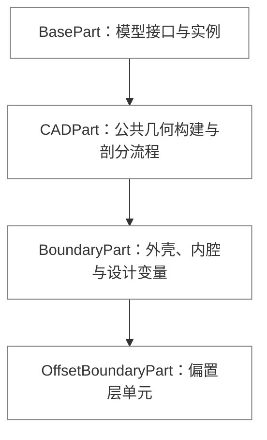

# 模型与参数集合

[代码结构导览](README.md) · [运行时](runtime.md) · [设计更新](optimization.md)

## 目录

<!-- docs:toc depth=1 -->

- [1 源码入口](#section-源码入口)
- [2 共享协议与组件层级](#protocols)
- [3 集合注册与生命周期](#section-集合注册与生命周期)
- [4 Params 的模型组装边界](#section-params-的模型组装边界)
- [5 Part、Instance 与几何缓存](#section-partinstance-与几何缓存)
- [6 FEA 接口与工况覆盖](#section-fea-接口与工况覆盖)
- [7 材料分配与参数类型](#section-材料分配与参数类型)
- [8 内核命名与 UI 命名的边界](#section-内核命名与-ui-命名的边界)

<!-- /docs:toc -->

<a id="section-源码入口"></a>

## 1 源码入口

| 路径 | 主要对象 |
|---|---|
| [`optcore/protocal.py`](../../src/morphopt/optcore/protocal.py) | 初始化、保存、可视化与可更新协议 |
| [`optcore/modelparams/base_model_component.py`](../../src/morphopt/optcore/modelparams/base_model_component.py) | 单个模型组件的共同基类 |
| [`optcore/modelparams/baseparam.py`](../../src/morphopt/optcore/modelparams/baseparam.py) | 命名接口集合 `BaseParams` |
| [`optcore/modelparams/params.py`](../../src/morphopt/optcore/modelparams/params.py) | 聚合参数与 FE 模型组装 |
| [`geometry.py`](../../src/morphopt/optcore/modelparams/geometry.py)、[`parts/`](../../src/morphopt/optcore/modelparams/parts) | 几何集合与基础 Part |
| [`feaparams.py`](../../src/morphopt/optcore/modelparams/feaparams.py)、[`fea/`](../../src/morphopt/optcore/modelparams/fea) | 载荷、边界、连接与工况 |
| [`materialsparams.py`](../../src/morphopt/optcore/modelparams/materialsparams.py)、[`materials/`](../../src/morphopt/optcore/modelparams/materials) | 材料接口、分配与本构参数类型 |

<a id="protocols"></a>

## 2 共享协议与组件层级

源码中的 `Protocal*` 是以抽象基类表达的接口契约，名称保留现有拼写。

| 协议 | 主要方法 | 实现责任 |
|---|---|---|
| `ProtocalInitializable` | `initialize()`、`reinitialize()` | 初次准备与每轮状态更新 |
| `ProtocalSavable` | `save()`、`load()`、`pathlog_required()`、`save_directory()` | 状态持久化与命名目录 |
| `ProtocalVisualizable` | `get_meshes()`、`plot()` | 网格输出与绘图钩子 |
| `ProtocalUpdatable` | `num_variables`、参数访问、`update_variables()`、灵敏度变量提取与写回 | 可设计对象的变量契约 |

`BaseModelComponent` 组合初始化、保存和可视化能力，表示单个模型接口；`BaseParams` 维护多个具名接口。可更新几何与材料额外实现 `ProtocalUpdatable`，不由集合基类为所有对象隐式增加设计变量。

`ProtocalUpdatable.get_variables()` 提供局部优化初始扰动向量，不能将其简单解释为当前几何坐标。设计参数、灵敏度输入和局部变量之间的映射见[设计更新](optimization.md)。

<a id="section-集合注册与生命周期"></a>

## 3 集合注册与生命周期

`BaseParams.interfaces` 按注册顺序保存 `name → interface`。`add_interface()` 检查空名与重名，并为未命名对象生成 `<类名>_<序号>`；`interface(name)` 提供带候选名称的查询错误。

| 方法 | 责任 |
|---|---|
| `define_interface()` | 子类声明接口 |
| `initialize()` | 集合为空时执行声明，再初始化各接口 |
| `reinitialize(iteration)` | 将本轮准备传给现有接口 |
| `design_interfaces()` | 筛选实现可更新协议的接口 |
| `obtain_design_sensitivity_vars(assembly)` | 按设计接口顺序拼接灵敏度输入 |
| `save/load()` | 将状态操作分发到各接口 |

构造参数集合后尚不能假定其声明已执行。相同对象的重复初始化不应重复注册接口；结构变化与每轮重初始化分别处理。注册顺序进入变量布局与状态文件语义，优化运行中应保持稳定。

<a id="section-params-的模型组装边界"></a>

## 4 Params 的模型组装边界

```text
Params.create_feamodel()
├── GeometryParams.generate() → torchfea.Assembly
│   └── 每个 Part 接口 add_to_assembly()
├── FEAParams.create_fea(assembly) → FEAController + 载荷/边界/求解器
├── MaterialsParams.set_materials(fe)
└── fe.initialize()
```

`Params` 同时持有 `geometry`、`feamodel` 与 `materials`，但几何、载荷和材料各自保留接口集合。`create_feamodel()` 是声明模型进入当前有限元状态的组装点；上层控制器不逐个解释 Part、载荷和本构类型。

<a id="section-partinstance-与几何缓存"></a>

## 5 Part、Instance 与几何缓存

一个 `BasePart` 接口构建一个 `torchfea.Part`，并声明该部件的一个或多个 Instance。

| 成员 | 责任 |
|---|---|
| `name` | 几何集合注册名 |
| `part_name` | 装配体 Part 名，未显式设置时取注册名 |
| `define_instance()`、`add_instance()` | 声明实例名与六维位姿 |
| `build_part(path_result, pools)` | 具体几何构建或导入 |
| `get_part()` | 按缓存策略获取 Part |
| `add_to_assembly()` | 添加 Part、外表面和已声明实例 |
| `cache_part` | 控制固定几何是否复用 `_part` |
| `is_variable` | 标识几何或网格是否可能随优化变化 |
| `workdir()` | 分配该接口的几何工作目录 |

脚本基类默认声明一个与 Part 同名的零位姿实例；显式 `define_instance()` 可使用独立名称。`initialize()` 保留已有实例声明，仅在声明为空时调用 `define_instance()`；重复初始化不清空实例名称和位姿。位姿为 `[tx, ty, tz, rx, ry, rz]`，旋转采用指数坐标。载荷引用实例，材料引用 Part，局部更新器引用集合中的接口。

UI 的 `ProblemDefinition.replace_part(source: PartNode, replacement: PartNode) -> PartNode` 在原位置替换部件，沿用原有 Instance 对象并重定向材料与更新器引用。CAD 转换通过该领域方法提交结果，控件不直接修改跨对象关联。

| 类型 | 实现位置 | 构建特点 |
|---|---|---|
| `BoxPart` | `parts/box_part.py` | 结构化长方体，单元块 `design` 及坐标面集合 |
| `CADPart` | `parts/cad_part.py` | 有序 `torchfea.cad` 操作历史及网格化 |
| `INPPart` | `parts/inp_part.py` | 从支持的 INP 内容选择并导入 Part |
| `BoundaryPart` | `shapeopt/boundary_part.py` | 参数化外边界与内腔，具体设计实现见[形状更新](optimization.md#shape) |
| `OffsetBoundaryPart` | `codesign/offset_boundary_part.py` | 在内腔边界构造偏置实体层 |

CAD 的 `define_operations()` 与有限元 `build_part()` 分离。STEP 导出直接使用 `torchfea.cad.export_step(operations, path)`，保存局部 CAD 实体，不要求生成体网格；UI 的操作解析见[应用服务](ui-application.md#cad)。

`CADPart.build_part()` 按 `prepare_geometry → assemble_geometry → mesh_geometry → define_mesh_sets → postprocess_mesh` 组织公共构建流程。各阶段通过实例方法调用，具体实现由子类重写。父类的默认几何描述来自 CAD 操作历史；`BoundaryPart` 重写几何准备、边界组装、曲面集合定义和节点后处理。两类部件共用 TorchFEA 的体网格提取、面集命名和二阶转换，`OffsetBoundaryPart._postprocess_part()` 在二阶转换前添加偏置单元。

| 构建阶段 | `CADPart` 默认实现 | `BoundaryPart` 重写内容 |
|---|---|---|
| `prepare_geometry()` | 提供已声明的 CAD 操作 | 调用各 surface 的几何准备接口，返回有序曲面 |
| `assemble_geometry()` | 从操作列表创建 `CADHistory` | 将自身边界组装方法接入同一个 `CADHistory` 执行入口 |
| `mesh_geometry()` | 调用 `CADHistory.mesh()` | 继承公共实现 |
| `define_mesh_sets()` | 定义几何面与节点集 | 调用父类定义面集，再增加 `surface_i_All` 分组 |
| `postprocess_mesh()` | 执行单元扩展及网格阶次转换 | 匹配设计曲面节点后调用父类处理 |

`BREPSurface` 将一个闭合 CAD 壳体组织为拓扑与集合的合集。TorchFEA 的 `cad/brep.py` 负责读取面、线环、共享边、顶点及指定面的 NURBS 转换；MorphOpt 曲面对象管理逻辑身份、集合注册、资产持久化和模型接口。各 surface 的 `define_mesh_sets(part, prefix)` 在体网格提取后定义局部集合，BoundaryPart 通过多态调用扩展面集和节点集。曲线节点与顶点节点来自 TorchFEA 的 OCC 网格分类，不通过坐标邻近或面节点交集推断。

启用 BREP 形状更新时，`BREPSurface` 将选定面的 NURBS 控制点汇总为部件设计变量，`NURBSFace` 使用 `bspmap` 基函数建立有限元节点 UV 到控制点的可微映射。边界相关控制点保持固定。每次重新剖分前，曲面将当前控制点写回 STEP，校验裁剪边与闭合实体，再由统一的 CADPart 剖分流程生成下一轮网格。优化归档保存控制点，显示预览和曲面导出读取当前形状。

BREP 拓扑检查和 STEP 导出使用与预览、剖分共享锁的 `torchfea.cad.occ_session()` 会话，拓扑检查不生成网格。面转换先解除原实体的所属关系，再将更新的面组装为闭合壳体。平面转换同时迁移外轮廓和孔洞。`.brep.json` 保存逻辑身份和集合，Gmsh 实体 tag 仅在当前会话中使用。接口说明见[脚本参考](../scriptreference.md#brep-topology)。

父类不根据 `BoundaryPart` 或其几何描述类型选择实现。曲面通过 `prepare_geometry()` 准备几何文件，再由 `load_geometry()` 调用 CADPart 的对应载入方法。BSP 和 `BREPSurface` 使用 STEP 载入，CPGEO 和固定 STL 使用离散网格载入。BoundaryPart 按这些方法返回的面编号组装外壳和内腔，并根据曲面的离散几何能力选择相应 Gmsh 内核。

`CADPart` 集中实现 `load_step_boundary()`、`load_mesh_boundary()`、`split_shells()` 和 `export_shell_step()`。转换时，各封闭壳体分别导出为 STEP 资产，`BREPSurface` 仅持有文件路径和面名称映射。原始面身份在组装时写入部件的 `_face_names`，BoundaryPart 的曲面分组由自身 `_surface_groups` 持有。源 CAD 操作历史只参与转换，不进入曲面对象。

`CADPart._Operation` 是内部执行适配器，将当前 Part 的构建或查询方法接入 TorchFEA 管理的 Gmsh 会话。它只在当前操作中使用，实际 CAD 声明、曲面状态与集合身份仍保存在 Part 和 Surface 中。`CADPart.to_boundary_part()` 直接创建普通 `BoundaryPart`，复制网格设置、名称和实例声明。实例声明采用深拷贝，并由公共初始化流程保留。



`fea_seed_size` 表达 BoundaryPart 的体网格尺寸，读写同一个 `mesh_size` 状态。普通 CADPart 继续使用 `mesh_size`。`face_N` 标识独立几何面，`surface_i_All` 标识 BoundaryPart 的第 i 个封闭曲面分组；一组可以包含多个 `face_N`。

`BREPSurface` 与 `MeshSurface` 分别声明精确边界表示和离散三角网格表示，定义于 `surfaces/brep_surface.py` 和 `surfaces/mesh_surface.py`。两者均继承 `BaseSurface`；当前分别采用 STEP 和 STL 作为资产文件格式。

<a id="section-公共构建接口的参数与返回值"></a>

### 5.1 公共构建接口的参数与返回值

`build_part()` 是有限元部件构建入口。其余阶段由该方法顺序调用，子类按阶段重写。

| 方法 | 参数 | 返回值与处理内容 |
|---|---|---|
| `build_part(path_result, pools)` | `path_result: str \| None` 为结果目录；`pools: Pool \| None` 为曲面导出使用的进程池 | `torchfea.Part`；执行几何准备、实体组装、剖分、集合定义和网格后处理 |
| `prepare_geometry(path_result, pools)` | 与 `build_part()` 相同 | CADPart 返回 `list[CADOperation]`；BoundaryPart 同步各曲面并准备几何输入，返回 `list[BaseSurface]` |
| `assemble_geometry(geometry)` | CADPart 接收 CAD 操作序列；BoundaryPart 接收有序曲面列表 | `CADHistory`；声明当前部件的实体构建操作，尚未生成有限元体网格 |
| `mesh_geometry(geometry)` | `geometry: CADHistory` | `torchfea.Part`；调用 TorchFEA 生成并提取有限元网格 |
| `define_mesh_sets(part)` | `part: torchfea.Part` | `None`；原位定义 `face_N` 与 `face_N_nodes`，BoundaryPart 另行定义 `surface_i_All` |
| `postprocess_mesh(part)` | `part: torchfea.Part` | `torchfea.Part`；BoundaryPart 先匹配设计曲面节点，公共实现再执行单元扩展和二阶转换 |

`path_result=None` 时，BoundaryPart 通过 `workdir()` 分配临时几何目录。`pools=None` 表示同步导出曲面；CADPart 的原生 CAD 操作不使用该进程池。

<a id="section-cad-载入与壳体转换接口"></a>

### 5.2 CAD 载入与壳体转换接口

几何载入接口在 TorchFEA 管理的 Gmsh 会话内调用。返回的面编号只在当前会话中有效，不等同于持久的 `face_N` 名称。

| 方法 | 参数 | 返回值与处理内容 |
|---|---|---|
| `load_step_boundary(path, context)` | `path: str \| Path`；`context: OCCBuilder` 为当前 CAD 执行上下文 | `list[int]`；导入 STEP，移除导入的体而保留边界面，返回新增面的 Gmsh 编号 |
| `load_mesh_boundary(path)` | `path: str \| Path` | `list[int]`；导入闭合 STL，返回新增离散面的 Gmsh 编号 |
| `get_face_signature(tag)` | `tag: int` 为当前会话中的面编号 | `list[float]`；返回面积、质心和惯性矩阵，供 STEP 面名称匹配 |
| `split_shells()` | 无参数；源 CADPart 已执行 `initialize()` | 二元组 `(operations, shells)`；复制 CAD 历史，识别外壳与内腔；当前查询使用 TorchFEA 的预览会话，显示三角网格不保留 |
| `export_shell_step(operations, face_indices, path)` | 原始 CAD 操作元组、原始面索引元组和 `path: str \| Path` | `None`；导出指定封闭壳体的 STEP 实体与同名 `.brep.json` 面名称映射 |
| `to_boundary_part(asset_directory)` | `asset_directory: str \| Path` 默认为 `morphopt_assets`；源 CADPart 已执行 `initialize()` | `BoundaryPart`；在资产目录的部件子目录中保存壳体文件，再创建BREP 曲面，保留源面的名称、网格设置和实例声明 |
| `get_face_names()` | 无参数 | `list[str]`；按预览记录顺序返回几何面名称；执行面显示剖分，不生成有限元体网格 |

上述壳体接口中的复合参数具有以下类型和含义：

| 名称 | 类型 | 含义 |
|---|---|---|
| `operations` | `tuple[CADOperation, ...]` | 转换时复制的源 CAD 操作历史，仅在壳体识别和 STEP 导出期间使用 |
| `face_indices` | `tuple[int, ...]` | 源 CAD 面排序中的零基索引；索引 `N` 对应原始 `face_N`，不表示 Gmsh 面编号 |
| `shells` | `list[tuple[int, ...]]` | 各封闭壳体包含的原始面索引；第 0 项为外壳，其余项为内腔 |
| `face_map` | `dict[str, list[float]]` | 原始 `face_N` 到面几何特征的映射，随 STEP 保存；重新导入后按几何特征匹配，不按新的面编号重命名 |

<a id="section-曲面几何接口"></a>

### 5.3 曲面几何接口

| 方法 | 参数 | 返回值与处理内容 |
|---|---|---|
| `prepare_geometry(path_output, name_output, flip, pools)` | `path_output: str \| Path` 为目录；`name_output: str` 为无扩展名文件名；`flip: bool` 为方向请求；`pools: Pool \| None` 为导出进程池 | `None`；参数曲面导出 STEP 或 STL；BREPSurface 直接使用现有资产 |
| `load_geometry(part, context)` | `part: CADPart`；`context: OCCBuilder` | `list[int]`；通过部件载入方法返回当前曲面的 Gmsh 面编号；BSP、CPGEO、固定 STL 和固定 STEP 分别重写该方法 |
| `output_data(path_output, name_output, seed_size, flip, pools)` | 前述导出参数及 `seed_size: float` | `str`；返回已导出文件的名称，包含扩展名；具体曲面实现决定采样尺寸和方向参数的处理 |
| `BREPSurface.get_mesh()` | 无参数 | `pyvista.PolyData`；从 STEP 生成显示三角网格，单元数据 `face_index` 保留面索引 |
| `BREPSurface.face_names` | 只读属性 | `tuple[str, ...]`；返回资产中保存的原始 CAD 面名称；普通 STEP 无映射时为空 |

`BREPSurface(path_step: str | Path)` 读取一个闭合壳体对应的 STEP 实体，并读取同名 `.brep.json`（若存在）。曲面对象不保存源 CAD 操作或构造阶段的预览记录。`output_data()` 复制 STEP 和面映射，不使用 `seed_size`、`flip` 或 `pools`；内腔关系由 BoundaryPart 的壳体组装顺序确定。映射按面积、质心和惯性矩阵匹配，采用 `rtol=1e-7`、`atol=1e-8` 的逐分量容差；无法唯一匹配时报告错误。

UI 的 `brep_surface` 节点在 `.morph` 内保存 Base64 STEP 数据和面映射。运行脚本只引用 `morphopt_assets` 中还原的 STEP 和 JSON 文件；资产页分别显示几何与映射文本。

<a id="section-内部辅助方法与执行回调"></a>

### 5.4 内部辅助方法与执行回调

下列方法支撑公共接口，不作为用户建模时的常规调用入口。

| 方法 | 参数与返回类型 | 职责 |
|---|---|---|
| `_complete_face_names(tags)` | `tags: Iterable[int]`；返回 `None` | 为尚未命名的 Gmsh 面分配未使用的 `face_N`，保留已有源面身份 |
| `_name_geometry_faces(part)` | `part: torchfea.Part`；返回 `None` | 将 TorchFEA 生成的 Gmsh 面集及节点集改为稳定的面名称 |
| `_single_solid(operations)` | `operations: Sequence[CADOperation]`；返回 `tuple[int, list[int]]` | 执行源 CAD 历史，检查最终仅有一个实体，返回体编号和排序后的面编号 |
| `_inspect_shells(context, *, operations, shells)` | 当前执行上下文、源操作元组及输出列表；返回 `list[tuple[int, int]]` | 查询封闭壳体，以包围体积从大到小排序，将各壳体的原始面索引写入 `shells` |
| `_build_shell(context, *, operations, face_indices, face_map)` | 当前执行上下文、源操作元组、原始面索引及面映射输出字典；返回 `list[tuple[int, int]]` | 从源 CAD 中重建指定壳体的独立实体，记录面几何特征，供 STEP 导出调用 |
| `BoundaryPart._assemble_surfaces(context, *, surfaces)` | `context: OCCBuilder`；`surfaces: list[BaseSurface]`；返回 `list[tuple[int, int]]` | 载入全部边界，以首个壳体定义外部实体，其余壳体定义内腔，同时记录曲面分组 |
| `_postprocess_part(part)` | `part: torchfea.Part`；返回 `torchfea.Part` | 在线性网格上扩展单元；默认原样返回，OffsetBoundaryPart 在此添加偏置层 |
| `_Operation.apply_occ(context)` | `context: OCCBuilder`；返回 `list[tuple[int, int]]` | 执行保存的构建回调，将生成的实体交回 TorchFEA |

回调返回项为 Gmsh 的 `(dimension, entity_tag)`，当前构建流程返回的体实体维度为 `3`。`_Operation.action` 的类型为 `Callable[[OCCBuilder], list[tuple[int, int]]]`。转换部件的配置复制统一由 `CADPart.to_boundary_part()` 完成。

<a id="section-fea-接口与工况覆盖"></a>

## 6 FEA 接口与工况覆盖

`BaseFEAComponent` 保存名称和数值参数，`num_values` 定义每个工况需要的参数数量。

| 接口阶段 | 方法 | 责任 |
|---|---|---|
| 建模 | `modify_fea(fe, name)` | 向模型添加载荷、边界或连接对象 |
| 工况应用 | `apply_fea_value(fe, name)` | 将当前数值覆盖传给已创建对象 |
| 工况配置 | `FEAParams.add_step(name)`、`set_step_params()` | 建立工况表并填写接口幅值 |
| 求解前 | `FEAParams.process_fea(fe, step_name)` | 应用指定工况 |

压力、集中力/力矩、体力、弹簧与自由度罚项具有数值列表；固定条件、RP、耦合与接触不通过相同列表接收幅值。当前 `ReferencePointBoundaryCondition.num_values` 为零，不能据外部求解器的功能推断其支持任意非零位移工况。

`FEAParams.reinitialize()` 对接口与工况键进行规范排序。集合类型共享注册机制，不表示每类对象的执行顺序与数值含义完全一致。完整构造参数和十三类接口见[脚本 FEA 参考](../scriptreference.md#section-feaparams-定义要点)。

<a id="section-材料分配与参数类型"></a>

## 7 材料分配与参数类型

`MaterialsParams.set_materials()` 按注册顺序执行各材料接口的分配。`BaseMaterial` 用 `part_name` 与可选 `elementname` 确定目标，`target_elements()` 解析 `Part.elems` 中的实际单元块。

- `elementname=""` 选择该 Part 的全部单元块。
- 具体名称是块键，不必等于单元公式名；例如 Box 的块键为 `design`。
- 多个材料覆盖同一块时，应检查分配顺序与最终材料状态。

`HomogeneousMaterial` 不提供材料设计变量；`SIMP_BSPFieldMaterials` 同时提供材料分配和可更新设计场。两者共享类型化的 `MaterialModels` 参数对象，集合通过 `MaterialsParams.models` 暴露入口。

`models.py` 定义八种本构参数 dataclass，并将其映射到 TorchFEA 材料类。接口接收 `material_parameters`，而非同时维护独立的模型名和数值数组。SIMP 的映射、占比与更新责任见[材料设计](optimization.md#simp)。

<a id="section-内核命名与-ui-命名的边界"></a>

## 8 内核命名与 UI 命名的边界

内核 Part 支持显式装配名；UI 的 Part 节点仅保留一个可编辑名称，`assembly_name` 为派生值。UI 的实例名称单独管理，Part 改名不修改已有 Instance 名。

UI 通过对象引用维护载荷、材料和更新目标，保存及生成代码时才投影为内核名称。该规则属于 [UI 领域模型](ui-model.md)，不通过修改内核默认实例工厂来实现。
