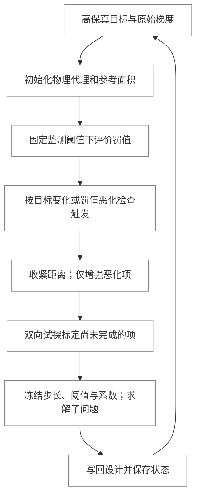

# 灵敏度与设计更新

[代码结构导览](README.md) · [模型协议](model.md#protocols) · [运行时](runtime.md)

灵敏度计算与设计更新分别承担导数计算和局部设计决策。`ObjectiveFunction` 根据有限元结果与设计映射形成分类梯度，`Updaters` 将其分派给绑定对象的局部更新器。两者通过梯度布局协作，局部更新结果通过模型接口写回。它们在整体模块划分中的位置见[内核职责与数据流](architecture.md#section-模型求解灵敏度与更新)。

## 目录

<!-- docs:toc depth=1 -->

- [1 源码入口](#section-源码入口)
- [2 目标、指标与梯度路径](#gradients)
- [3 更新器注册与目标所有权](#section-更新器注册与目标所有权)
- [4 局部子问题与写回](#section-局部子问题与写回)
- [5 边界形状设计](#shape)
- [6 SIMP 材料设计](#simp)
- [7 偏置层与协同设计](#section-偏置层与协同设计)

<!-- /docs:toc -->

<a id="section-源码入口"></a>

## 1 源码入口

| 路径 | 责任 |
|---|---|
| [`optcore/objfunc.py`](../../src/morphopt/optcore/objfunc.py) | 多工况目标及伴随/自动微分灵敏度 |
| [`optcore/updaters.py`](../../src/morphopt/optcore/updaters.py) | 更新器注册、目标解析、梯度切片、公共优化算法及 `QuadraticHistory` 曲率历史 |
| [`optcore/strategies.py`](../../src/morphopt/optcore/strategies.py) | 可组合的步长与罚项权重策略接口及默认实现 |
| [`shapeopt/strategies.py`](../../src/morphopt/shapeopt/strategies.py) | 形状优化的自适应权重与障碍逐步收紧策略 |
| [`shapeopt/barriers.py`](../../src/morphopt/shapeopt/barriers.py) | 固定幂次几何障碍与可选距离放宽 |
| [`shapeopt/boundary_part.py`](../../src/morphopt/shapeopt/boundary_part.py)、[`surfaces/`](../../src/morphopt/shapeopt/surfaces) | 边界部件与曲面设计变量 |
| [`optcore/modelparams/parts/cad_part.py`](../../src/morphopt/optcore/modelparams/parts/cad_part.py) | 公共剖分流程、几何载入、壳体查询、面身份与 CAD 转换 |
| [`shapeopt/surfaces/brep_surface.py`](../../src/morphopt/shapeopt/surfaces/brep_surface.py) | BREP 边界、STEP 资产与面名称映射 |
| [`shapeopt/surfaces/mesh_surface.py`](../../src/morphopt/shapeopt/surfaces/mesh_surface.py) | 离散三角网格边界与 STL 导入导出 |
| [`shapeopt/update_boundary_part.py`](../../src/morphopt/shapeopt/update_boundary_part.py)、[`objectivefuncs/`](../../src/morphopt/shapeopt/objectivefuncs) | 形状局部子问题 |
| [`simp/simpmaterial.py`](../../src/morphopt/simp/simpmaterial.py) | B 样条设计场、材料缩放与正则化单元 |
| [`simp/update_simpmaterial.py`](../../src/morphopt/simp/update_simpmaterial.py)、[`objectivefuncs/`](../../src/morphopt/simp/objectivefuncs) | 材料局部子问题 |
| [`codesign/`](../../src/morphopt/codesign) | 偏置部件、专用更新器与约束 |

<a id="gradients"></a>

## 2 目标、指标与梯度路径

`ObjectiveFunction.objective_function()` 返回保留计算图的标量损失，框架执行最小化。`get_metrics()` 返回独立记录的响应，不参与优化驱动。需要载荷响应雅可比的目标通过 `jacobian_needed` 声明载荷名。

```text
Params.obtain_design_sensitivity_vars(assembly)
  → {geometry, feamodel, materials}
  → 按集合顺序展平拼接
  → TorchFEA 多工况目标/伴随灵敏度
      试探设计 → Params.modify_assembly() → 目标求值
  → 按原区间拆分分类梯度
  → Updaters.update(gradients)
```

`geometry`、`feamodel`、`materials` 是梯度集合键。现有更新器管理器提供几何与材料两类注册入口，出现 `feamodel` 梯度不表示已配置载荷设计更新器。

梯度布局由集合、接口及对象内部参数的顺序共同决定。对象的 `num_variables`、参数展平、灵敏度输入和写回顺序必须一致，恢复状态也沿用该布局。

<a id="section-更新器注册与目标所有权"></a>

## 3 更新器注册与目标所有权

`Updaters` 是管理器，`BaseUpdater` 是一个设计对象的局部更新器。

| 机制 | 定义 |
|---|---|
| `add_geometry_updater()` | 绑定几何集合中的目标 |
| `add_material_updater()` | 绑定材料集合中的目标 |
| 注册 `name` | 默认目标接口名及管理器内的键 |
| `interface_name` | 可显式覆盖绑定目标 |
| `update_kind`、`target_type` | 基类声明的集合类型与目标类型约束 |
| `bind_target(target)` | 接收管理器已解析的模型对象 |

子优化器构造时只保存算法参数和目标名。注册时调用 `define_objective()`；管理器初始化时解析目标，再调用子优化器初始化。子优化器绑定后保存 `self.part` 或 `self.material`，不另持整个参数集合。

`BaseUpdater` 直接继承 `ProtocalInitializable` 的生命周期钩子，不重复声明仅抛出异常的 `initialize()` 和 `reinitialize()`。具体更新器分别实现绑定后的初始化与接收原始梯度的子问题重建。`part` 和 `material` 通过公共 `target` 属性访问目标，绑定状态仅在该公共入口检查。`closure()`、`update()` 和 `update_variables()` 是更新器专用算法接口，由 `BaseUpdater` 保留。

同一子类可创建多个独立对象，分别绑定不同 Part 或材料。注册方法、显式目标、变量切片与状态目录应共同指向同一设计接口。

<a id="section-局部子问题与写回"></a>

## 4 局部子问题与写回

`reinitialize(gradient)` 接收当前目标的梯度并准备局部基准状态、目标项和约束缓存；`update()` 求解局部 L-BFGS 子问题；`update_variables()` 将改变量写回设计对象。

| 配置或状态 | 作用 |
|---|---|
| `max_step_iter` | 单次设计更新内部迭代上限 |
| `max_step_length` | 更新步长配置 |
| 更新范围 | 几何直接读取曲面的 `is_updatable`；材料更新器使用整体开关 `if_update` |
| `step_length_strategy` | 生成当前子问题的逐控制点或逐材料变量步长上限 |
| `constraint_weight_strategy` | 选择当前子问题的具名罚项系数 |
| `save/load()` | 按目标接口保存和恢复局部状态 |

局部更新的设备上下文覆盖目标、约束及其缓存 Tensor，完成后恢复相应设备状态。几何与材料子优化器分别保存到 `geometryupdater/<接口>/` 和 `materialupdater/<接口>/`，不共享一份步长文件。

步长与罚项权重采用组合方式注入。`optcore/strategies.py` 仅定义通用接口及默认实现，不导入形状优化模块，也不解释三维控制点、曲面或材料变量的专有语义。`FixedStepLength` 直接采用配置的最大步长；`ConstantConstraintWeights` 默认系数为 1，默认系数定义在通用的 `CONSTANT.KERNEL.UPDATER_STRATEGIES` 中。步长策略在初始化和每轮外层迭代开始时求值，权重策略在该轮目标与约束完成初始化后求值。步长和权重在本轮子优化内均固定。更新器仅使用所选系数求解，不包含具体策略分支或内层策略钩子。

更新器通过类属性 `strategies` 暴露策略命名空间，与 `objectivefuncs` 的用法一致。基类提供通用策略；形状更新器重写该命名空间，引用同一批通用策略类并增加形状专用实现，不复制算法。脚本在构造方法中使用 `self.strategies.AdaptiveShapeWeights()` 等表达式创建独立策略对象，偏置形状更新器继承相同入口。

`shapeopt/strategies.py` 提供两个形状专用权重策略。`SensitivityShapeWeights` 将控制点原始梯度的模长插值到几何采样点，并通过 `BaseConstraints.set_sample_weights()` 绑定逐点因子；`AdaptiveShapeWeights` 保持采样因子为 1，只管理逐罚项整体系数和距离放宽量。通用基类不包含曲面或逐点几何权重概念。

`BaseConstraints` 分别持有参考面积 `area_weights` 与可选 `sample_weights`，通过 `integration_weights` 组合。面积在一轮外层基准上冻结，逐点策略在该轮初始化后设置；物理梯度和一阶/二阶代理始终保留原始尺度。距离项使用两侧组合权重的乘积，构成点对双重积分。

自适应策略首先在固定初始放宽量下监测非负罚值，再依据高保真目标的相对变化或显著的约束恶化决定是否收紧距离。仅对待标定项进行双向试探，已标定且未恶化的系数保持稳定，恶化项独立增强。单次子优化内不更新策略。策略继承 `ConstraintWeightStrategy → ProtocalSavable`，保存上一目标、历史目标尺度、当前距离放宽量及每项系数和参考罚值。



`PolynomialBarrier` 由每个几何罚项持有。距离、曲率、半径和包络采用固定三次幂，障碍只在接近阈值或违反条件时激活；策略不动态改变幂次。UI 策略目录声明固定权重、灵敏度采样权重和五参数自适应权重，复用参数表单、校验和代码生成。参数定义与公式见[脚本策略参考](../scriptreference.md#section-几何权重策略与障碍积分)。

<a id="shape"></a>

## 5 边界形状设计

`BoundaryPart` 与 `CADPart` 共用 `CADMeshingMixin`，并继承 `BasePart` 与可更新协议，管理有序曲面。曲面 0 为外边界，后续曲面为内腔，法向按此顺序设置，用户不输入 `flip`；`define_surfaces()` 声明曲面。子类重写 `prepare_geometry()`、`assemble_geometry()` 和 `define_mesh_sets()`，提供封闭边界、外壳与内腔组装及逐曲面集合，并在网格后处理中匹配设计曲面的节点。公共 mixin 通过模板流程调度这些方法，共用体网格生成、面集命名和阶次转换。

CAD/STEP 边界使用 OCC 表面环；包含 CPGEO/STL 的边界使用离散几何表面环。两种表示均构成带内腔的体，通过同一 `CADHistory.mesh()` 入口交给 TorchFEA 划分并提取有限元网格。原有独立的 INP 写入与回读管线已移除。曲面输出显式接收 `pools`，省略时同步输出，不访问全局控制器的进程池。

`CADPart.to_boundary_part(asset_directory="morphopt_assets")` 将一个最终 CAD 实体拆为外壳与内腔壳体，各自保存为 STEP 与面名称映射文件，并创建引用这些资产的 `BREPSurface`。转换保留 `face_N` 和 `face_N_nodes`，另建立逐壳体的 `surface_i_All` 表面集与同名节点集。显示三角网格由 STEP 按需生成，不参与体几何重建。转换不自动拟合控制点；需要形状优化时，可将指定面转换为 NURBS 并启用内部控制点更新。使用方式见[CAD 转换接口](../scriptreference.md#cad-to-boundary)。

| 层次 | 实现与职责 |
|---|---|
| `BaseSurface` | 曲面几何、采样、导出与共享行为 |
| `ControlPointSurface` | 控制点参数及预加载数据 |
| `BspSurface` | B 样条曲面与圆柱工厂 |
| `CPGEOSurface` | CPGEO 曲面、圆柱和球面工厂 |
| `MeshSurface` | 固定三角曲面，不提供可更新控制点 |
| `BREPSurface` | 精确 CAD 边界，以 STEP 资产保存；选定 NURBS 面后可提供固定裁剪边的内部控制点变量 |
| 曲面约束 | BSP/CPGEO 镜面、旋转或跨曲面关联 |
| `UpdaterBoundaryPart` | 绑定单个 BoundaryPart 的形状子问题 |

曲面专有节点集通过 `BaseSurface.get_node_sets(nodes)` 声明，默认返回空集合。`BspSurface` 定义 `Bottom` 与 `Head`，作为外边界时生成 `surface_0_Bottom` 和 `surface_0_Head`；CPGEO、BREP 和网格曲面不定义这些端部节点集。UI 的集合列表与拾取提示采用对应曲面类型的声明。

曲面约束在曲面更新与重初始化时按登记顺序执行。局部曲面约束保存在曲面内，Part 级 `apply_surface_constraints()` 提供跨曲面扩展位置。

固定曲面的几何约束采样由 `BaseSurface` 提供：缓存定向三角片，以重心作为采样点、面积作为积分权重。参数曲面重写采样接口，提供解析几何量。`BaseSurface.is_updatable` 默认为 `False`；`BspSurface` 和 `CPGEOSurface` 默认启用，可按对象手动关闭。几何更新器不保存独立开关，`BoundaryPart` 在更新和灵敏度映射时直接读取曲面属性；`ShapeDerivative` 通过统一的 `get_surface_parameters()` 读取参数。固定边界仍参与距离约束。完整混合边界验证见 [STEP 外边界与 BSP 内腔算例](../../examples/hybrid_cylinder/hybrid_cylinder.md)。

`ShapeDerivative` 将主目标结构梯度传入局部问题；`Fairness`、`Distance`、圆柱/半径边界及体积辅助项在形状子问题中求值。`Fairness` 以外部 visitor 读取各支持曲面的一、二阶几何量；曲率阈值、BSP 参数化阈值及参考补偿均属于罚项。`max_curvature` 对全部可更新 BSP/CPGEO 曲面共用，BSP 的度量变化与非正交阈值固定为 0.1。曲面只保留几何，未注册 visitor 的类型贡献零。

`ShapeDerivative` 保持原有一阶形式，`QuadraticShapeDerivative` 是独立的历史二阶目标类，两者均定义在 `shapeopt/objectivefuncs/shapederivative.py`。材料模块同样区分 `Sensitivity` 与 `QuadraticSensitivity`。具体目标通过继承复用参数读取与灵敏度映射，物理代理及曲率历史均使用原始有限元灵敏度。`QuadraticHistory` 位于 `optcore/updaters.py` 中，统一维护曲率历史、直接及逆 Hessian 乘积和历史状态序列化；具体目标仍在各自的 `objectivefuncs` 模块定义。

二阶目标和内层 `Optimizer.LBFGS` 分别持有独立的 `QuadraticHistory` 实例。外层实例在有限元灵敏度观测时更新，以 `hessian_product()` 评价物理目标的二次项；内层实例在试探步被接受后更新，以 `inverse_hessian_product()` 计算搜索方向。两者共用正曲率筛选与历史截断实现。子问题重新建立时重置内层历史，外层历史跨轮保留。

`QuadraticHistory` 继承 `ProtocalSavable`，实现统一的 `save(foldpath, iteration)` 和 `load(foldpath, iteration)`。更新器管理器分配 `objectives/<目标项名称>/` 子目录，具体目标将保存与恢复委托给其历史对象。历史类负责 `surrogate_<迭代号>.npz` 的命名与状态序列化，管理器不解释具体代理算法。保存能力由协议声明，实际保存时机由持有者决定；内层历史仍按子问题生命周期重置。

曲面 `seed_size` 控制初始控制网格和采样，Part 的 `fea_seed_size` 控制体网格。更改体网格尺寸不自动改变设计控制点数量。

<a id="simp"></a>

## 6 SIMP 材料设计

`SIMP_BSPFieldMaterials` 继承 `BaseMaterial` 与可更新协议。设计变量是 B 样条标量场控制点，有限元响应通过空间映射获得材料参数与正则化贡献。

```text
控制点 → B 样条设计场 f → sigmoid(f) 得到 ρ
       → RAMP(ρ) 与比例下限 → 材料刚度缩放
       → 正则化单元与本构 → 有限元响应
```

`SIMPScaledMaterial` 缩放基准本构的能量、应力与切线。`SIMPElementFgrad`、`SIMPElementFskew`、`SIMPElementHuHu_LuLu` 表达不同正则化实现，具体体单元通过相应组合类接入。

`initial_ratio` 是初始设计场控制值，不直接等于体积分数。`VolFrac` 对高斯点的 `ρ` 进行体积加权；`MinValue/MaxValue` 约束控制变量。`Sensitivity` 传递材料梯度，`DensityFieldMinimize` 为辅助正则化项。

`UpdaterSIMPMaterial` 绑定一个材料接口，通过其控制点构造局部问题。材料的空间投影与导数由材料接口负责；更新器不复制 B 样条映射实现。

<a id="section-偏置层与协同设计"></a>

## 7 偏置层与协同设计

`OffsetBoundaryPart` 在内腔曲面沿法向构造实体偏置层，属于同一 Part，并复用同一边界设计变量。构建过程检查偏置层网格，厚度、局部曲率与曲面间距应相容。

`UpdaterOffsetBoundaryPart` 复用形状更新流程并限定目标类型。`InwardCurvatureRadius` 与 `OffsetSurfaceMinThickness` 分别控制内凹曲率和偏置后的间距。该能力已在 UI 的 Part、更新器选择及预览中接入。

协同任务仍使用公共参数集合、FEAParams、求解器与更新器管理器。主体与偏置层按实际单元块分配材料，SIMP 材料使用公共 `UpdaterSIMPMaterial`；不建立另一套控制器或专用 FEAParams。

理论与算法推导见[形状优化理论](../theory/morphdesign.md)及[协同优化理论](../theory/codesign.md)，具体配置示例见[脚本更新器参考](../scriptreference.md#section-updater-定义)。
