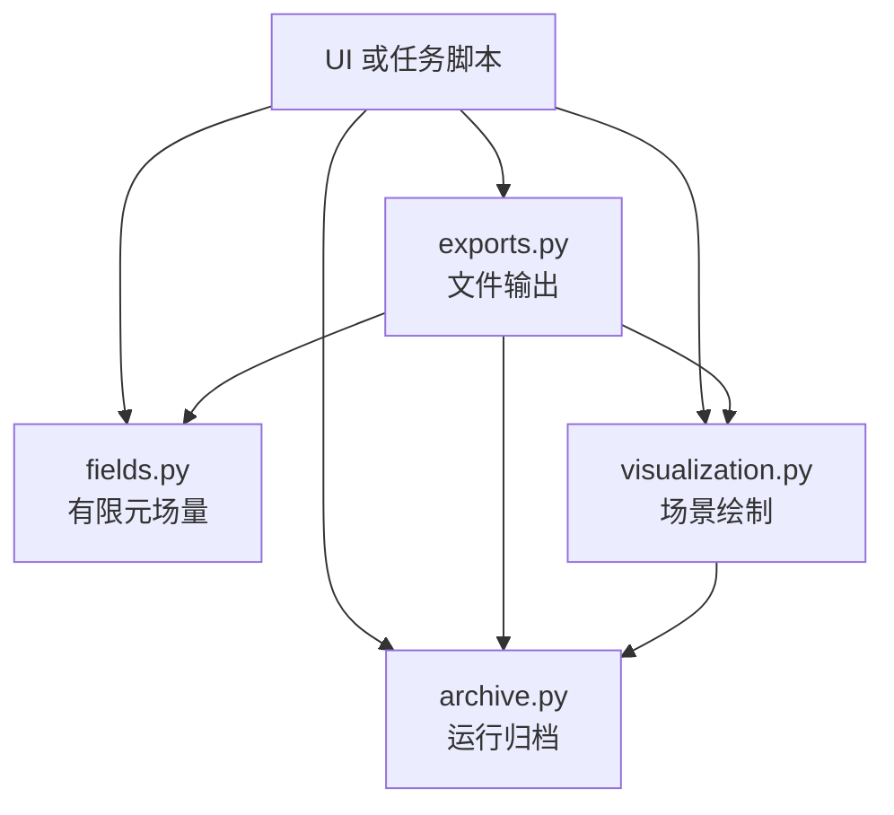

# 结果分析与导出

[代码结构导览](README.md) · [运行归档](runtime.md) · [UI 应用服务](ui-application.md) · [UI 展示](ui-presentation.md)

## 目录

<!-- docs:toc depth=1 -->

- [1 源码入口](#section-源码入口)
- [2 优化结果读取](#section-优化结果读取)
- [3 共享选择与页面生命周期](#selection)
- [4 私有模型与独立有限元](#section-私有模型与独立有限元)
- [5 分析结果快照](#section-分析结果快照)
- [6 场量计算与云图投影](#section-场量计算与云图投影)
- [7 物理量与格式注册](#section-物理量与格式注册)
- [8 CSV 与 NPZ 单文件导出](#section-csv-与-npz-单文件导出)
- [9 原生模型与全部结果导出](#section-原生模型与全部结果导出)
- [10 历史动画导出](#section-历史动画导出)

<!-- /docs:toc -->

<a id="section-源码入口"></a>

## 1 源码入口

后处理源码集中在四个业务模块中。文件名按职责命名，同一类操作在文件内连续排列。

```text
postprocess/
├── __init__.py       公共类型与导出入口
├── archive.py        运行归档、设计状态及模型路径
├── fields.py         有限元场量、记录表及节点云图
├── exports.py        CSV/NPZ、原生结果、STEP/STL、GIF 文件输出
├── visualization.py  三维场景及历史帧渲染
└── _runtime.py       内部 Torch 数值环境管理
```

| 模块 | 核心接口 | 职责边界 |
|---|---|---|
| [`archive.py`](../../src/morphopt/postprocess/archive.py) | `OptimizationArchive`、`IterationModel` | 读取控制器、设计参数、历史、模型与工况文件；维护恢复状态的缓存 |
| [`fields.py`](../../src/morphopt/postprocess/fields.py) | `FiniteElementResults`、`ResultField`、`ResultTable` | 计算节点、参考点与高斯点物理量，组合记录表，生成节点云图数值 |
| [`exports.py`](../../src/morphopt/postprocess/exports.py) | `export_fields()`、`export_saved_fields()`、`export_native_results()`、`export_boundary_surfaces()`、`export_history_gif()` | 校验导出选项、组织输出内容、写入目标文件并清理失败产物 |
| [`visualization.py`](../../src/morphopt/postprocess/visualization.py) | `configure_plotter()`、`add_design_component()`、`add_deformation_mesh()`、`history_frames()` | 以调用方给定的相机和样式构建场景、生成图像帧 |

`__init__.py` 提供业务接口。场景绘制函数从 `postprocess.visualization` 导入；CSV、NPZ 写入器等格式实现集中在 `exports.py`。`_runtime.py` 是内部支持模块，仅负责在读取与计算期间切换 Torch 默认设备和精度，并恢复调用前状态。

<a id="section-后处理服务的组合结构"></a>

### 1.1 后处理服务的组合结构



`OptimizationArchive` 持有运行目录与已恢复的设计状态。`FiniteElementResults` 持有一组有限元模型与解，字段查询、表格提取和云图投影使用同一个计算对象。导出函数组合相应的数据读取和计算接口；动画导出从可视化模块逐帧取得图像，再写入 GIF。各模块不导入 Qt 控件或 UI 会话。

<a id="section-ui-接入位置"></a>

### 1.2 UI 接入位置

| UI 路径 | 职责 |
|---|---|
| [`ui/application/results.py`](../../src/morphopt/ui/application/results.py) | 组合归档对象，维护共享迭代与历史选择 |
| [`ui/application/finite_element.py`](../../src/morphopt/ui/application/finite_element.py) | 管理独立分析的私有模型、载荷编辑和结果快照 |
| [`ui/widgets/finite_element.py`](../../src/morphopt/ui/widgets/finite_element.py) | 选择字段与导出格式，调用场量对象取得云图数值 |
| [`ui/widgets/history_export.py`](../../src/morphopt/ui/widgets/history_export.py) | 曲面与 GIF 导出表单，共用进度、完成、失败、重试和取消流程 |
| [`ui/widgets/viewport.py`](../../src/morphopt/ui/widgets/viewport.py) | 统一三维视口、视角控件、相机保留与延迟渲染 |
| [`ui/visualization/rendering.py`](../../src/morphopt/ui/visualization/rendering.py) | 将 UI 主题和全局可视化参数传给共用绘制函数 |
| [`ui/worker.py`](../../src/morphopt/ui/worker.py)、[`ui/processes.py`](../../src/morphopt/ui/processes.py) | 统一工作进程任务分派、启动环境和响应文件 |

工作进程以 `request.json` 中的 `action` 分派求解、CAD 转换、场量、原生结果、曲面或 GIF 导出任务。任务成功后写入同目录的 `response.json`，其中记录输出路径、曲面文件列表或实际帧数。标准输出保留诊断日志，界面通过退出状态和响应文件判断完成结果。

`processes.start_worker()` 统一 Python 解释器、模块入口、UTF-8 环境和诊断输出通道。历史导出窗口的公共部分管理请求临时目录、忙碌状态、失败提示、重试与取消；具体表单仅收集选项和选择输出位置。取消 GIF 导出时清理本次未完成的动画文件，已存在的目标文件保留。

<a id="section-优化结果读取"></a>

## 2 优化结果读取

`ResultSession` 绑定一个运行目录，维护页面共享的迭代与历史选择，并组合 `OptimizationArchive` 读取参数和几何。后处理初始化几何、载荷接口和材料，不执行 `FEAParams.define_steps()`；工况求解任务由优化运行阶段定义。`load_iteration()` 和 `load_parameters()` 为所选迭代准备状态，`deformation_cases()` 与 `deformation_mesh()` 提供工况和变形数据。

归档目录布局、控制器载入、参数状态恢复、历史、变形网格和可视对象读取集中在 `OptimizationArchive`。UI 的 `ResultSession` 组合该对象，仅维护页面共享的选择状态；GIF 与曲面导出也使用同一归档对象读取设计状态。

| 读取内容 | 来源 |
|---|---|
| 控制器结构 | `scripts/MAIN_SCRIPT_FOR_RESTART.py` |
| 迭代损失与指标 | `log/history_record.csv` |
| 可更新几何与材料 | 参数接口保存状态 |
| 确切有限元模型 | `log/femodel&results/femodel_<iteration>.npz` |
| 工况解 | `result_<case>_iter_<iteration>.npz` |

观察页消费会话数据，不自行扫描和解析上述文件。设计参数展示与有限元归档展示是不同读取路径；有限元分析采用该轮保存的实际网格，不以当前参数重建的网格替代。

<a id="selection"></a>

## 3 共享选择与页面生命周期

`MainWindow` 用不可变 `ResultSelection(folder, iteration)` 协调观察页和有限元页。两处选择通过信号同步，目录与迭代是展示状态，FE 模型仍分别持有。

- 进入有限元分析时固定当前迭代，停止观察页的自动跟踪。
- 有限元任务运行时锁定共享迭代选择，后台优化可继续产生新归档。
- 新归档更新可选范围，不替换正在独立求解的快照。
- 切页保留运行、载荷修改和分析选择，不重新启动进程。
- 只有存在对应轮次模型时，才能建立该轮独立有限元工作区。

观察会话每次轮询后通过 `resultsUpdated` 通知主窗口重新检查所选目录和迭代的模型可用性；迭代编号未变化时，模型文件落盘也会更新有限元入口。新优化开始时清空旧的共享选择，首次选择新任务归档后，有限元页按该目录及迭代导入模型。

原工况名称与下拉框行号分开记录；原始结果和独立分析结果由显式来源对象区分。

迭代历史的曲面导出独立于有限元模型会话。对话框固定请求中的运行目录、轮次、曲面和格式；`postprocess.exports.export_boundary_surfaces()` 恢复该轮的 BoundaryPart 参数后调用曲面原生几何输出。STEP 转 STL 时使用完整 STEP 边界三角化；文件生成完成后复制到用户指定的部件子目录。预览中的当前参数和优化进程中的模型不参与导出计算。

<a id="section-私有模型与独立有限元"></a>

## 4 私有模型与独立有限元

```text
IterationModel(folder, iteration, case)
  → FiniteElementSession.select_result()
  → 读取确切模型、恢复工况、校验模型哈希
  → 私有载荷编辑 → solve_request()
  → QProcess 执行 worker 的 solve 任务
  → accept_solution() 校验并保存独立快照
```

`FiniteElementSession` 不共享优化运行的可修改模型。`apply_loads()` 先校验全部编辑，再应用参数，并将旧解置为失效。界面保留原工况的启用状态，不额外提供一套启用开关。

`solve_request()` 将私有模型和请求写入会话工作目录；Qt 页面仅管理 QProcess 的事件、输出与状态。`worker.py` 不创建 Qt 控件，完成独立的求解或导出操作。

`load_cases.json` 列出原工况的注册顺序。归档未提供该索引时，有限元页提供模型及其已保存载荷的读取和独立重算，不枚举原工况解。

`select_result()` 恢复解的 `work_conditions` 后校验模型哈希，未收敛的解不作为有效场结果。停止或失败保留已导入模型，不发布新的成功结果。

<a id="section-分析结果快照"></a>

## 5 分析结果快照

`FiniteElementResult` 保存稳定 key、来源目录/轮次/工况、模型路径、结果路径、分析编号、时间及日志。`accept_solution()` 校验成功解与模型，复制模型、解和日志后才追加到选择列表。

同一会话中的成功分析记录与原工况共同列出，按来源目录和迭代筛选。切换条目从其快照重建私有模型，继续编辑不会修改既有记录。

独立快照由 `TemporaryDirectory` 管理，不回写原优化归档，也不属于 `.morph`。会话关闭后工作目录清理，长期保存通过显式导出完成。

<a id="section-场量计算与云图投影"></a>

## 6 场量计算与云图投影

`FiniteElementResults(controller, result)` 对一组已配对模型与解提供计算接口。`available_fields(location)` 查询可用字段，`table(location, fields)` 提取组合记录表，`contour_fields` 列出云图分量，`contour_values(field)` 返回各实例的节点标量。节点、参考点、单元块和高斯点的访问及计算均集中在该对象内。

| 物理量 | 约定 |
|---|---|
| 节点位移与坐标 | 装配体全局坐标轴 |
| RP 运动 | 解转换后的 RGC 块，六分量为平移与旋转向量 |
| RP 转角 | 全局轴角向量，单位 rad，不转换为欧拉角 |
| 应力 | Cauchy 应力，全局坐标轴 |
| 应变 | Green–Lagrange 张量应变，剪切为张量分量 |
| 应变能 | 高斯点能量密度、参考积分体积及积分能量 |

`FiniteElementResults` 按解缓存云图物理量。应力、应变和能量密度先按参考积分体积求单元平均，再对相邻单元做节点平均。该投影用于云图，不是节点应力外推；导出保留逐高斯点值。UI 按字段标识提供翻译和控件，不参与数值投影。

缺少支持数据的节点使用 NaN，无高斯点的模型只提供适用的位移等量。切换结果替换缓存，编辑载荷清除旧解与旧场量。相机、变形倍率和显示分量不改变物理结果。

<a id="section-物理量与格式注册"></a>

## 7 物理量与格式注册

| 抽象 | 责任 |
|---|---|
| `ResultLocation` | 节点、参考点或单元记录位置 |
| `ResultField`、`RESULT_FIELDS` | 量的稳定 key、描述、位置、提取器与可用性 |
| `ResultTable` | 列名与逐行记录 |
| `FiniteElementResults.table()` | 按稳定记录编号合并所选物理量 |
| `TableWriter`、`TABLE_WRITERS` | 写入指定格式的组合表 |

每次表格导出选择一种位置，多个物理量横向组合为一张表。单元位置的记录可携带积分点编号；混合单元中不支持高斯点量的记录保留空值，不能伪造积分点或零应力。

节点、单元及积分点编号从 1 开始，保留实例和单元块名称。参考点有独立编号和名称，每个 RP 一行，禁用 RP 不输出。

新增物理量注册 `ResultField`，新增文件格式实现 `TableWriter`，两条扩展路径互不复制计算逻辑。UI 从注册表取得可选项；内置字段和格式的翻译键分别按 `ui.fea.field_<字段标识>` 与 `ui.files.<格式标识>` 查找。未配置翻译的扩展字段使用其描述，扩展格式使用文件扩展名生成筛选文本。

<a id="section-csv-与-npz-单文件导出"></a>

## 8 CSV 与 NPZ 单文件导出

`export_fields()` 检查收敛状态和模型哈希，再调用 `FiniteElementResults.table()` 完成字段选择、可用性检查和记录组合。格式写入器仅接收记录表与来源信息。

`export_saved_fields()` 读取保存的 TorchFEA 模型与解，恢复解中的工况后调用场量导出。独立工作进程将路径和所选字段传给该接口。

| 格式 | 文件内容 |
|---|---|
| CSV | UTF-8 BOM，首行为列名，随后为记录 |
| NPZ | 每列一个数组，`__metadata__` 保存来源、单位、坐标系和模型哈希等信息 |

物理提取与写入先在临时文件中完成，成功后发布目标文件。未允许覆盖时不替换已有文件；求值或写入失败清理本次临时产物。覆盖确认由展示层的共用保存对话框提供，数值服务通过 `overwrite` 接收明确的写入选项。

<a id="section-原生模型与全部结果导出"></a>

## 9 原生模型与全部结果导出

`native_export_request()` 固定所选迭代的原模型、全部原工况与会话内成功分析清单，`export_native_results()` 直接复制原生 NPZ。尚未求解的载荷编辑不进入该清单。

```text
<用户前缀>/
├── <前缀>_femodel.npz
├── <前缀>_case0.npz
├── <前缀>_analysis1.npz
└── <前缀>_manifest.json
```

一份迭代模型与各结果共用，结果各自保存 `work_conditions`。载入后先恢复所选结果的工况，再检查配对。目录重名时生成新编号目录；本次导出失败只清理本次新建目录。

原生模型通过 `torchfea.load_model()` 读取，解通过 `StaticResult.load()` 读取。原生归档、单表物理量导出和 CAD STEP 几何导出分别保留各自格式与数据范围。

<a id="section-历史动画导出"></a>

## 10 历史动画导出

优化历史 GIF 的数值读取、逐帧场景生成和 GIF 文件写入属于 `postprocess`。`export_history_gif()` 接收运行目录、导出范围、目标对象或工况、相机和显示样式；`OptimizationArchive` 恢复每一轮的设计状态或读取变形网格，`visualization.history_frames()` 使用调用方提供的颜色和相机生成帧，`exports.export_history_gif()` 写入动画文件。

UI 对话框负责收集目标、迭代范围、帧率和输出文件名，并从当前视口读取相机、尺寸与颜色配置。独立工作进程调用后处理服务并将完成或失败状态返回界面。STEP/STL 曲面导出采用相同边界：UI 负责收集轮次、曲面、格式和目录，后处理服务负责恢复归档设计并写出文件。服务模块通过 `morphopt.postprocess` 公共入口访问，不导入 Qt 控件、UI 会话或界面主题管理器。
