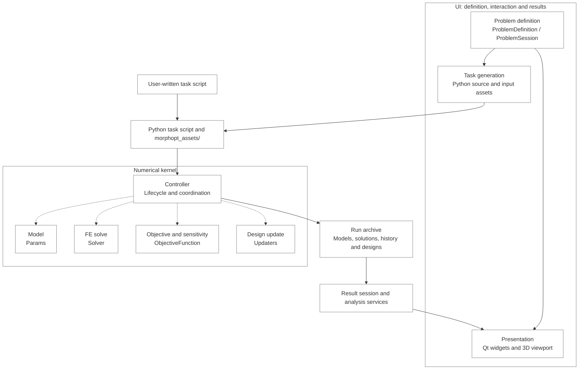
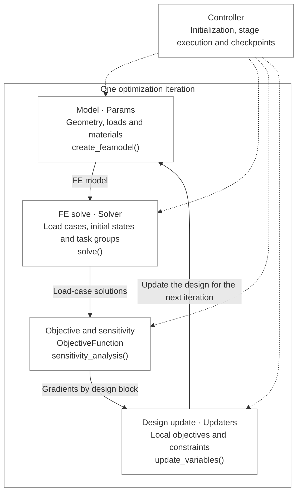
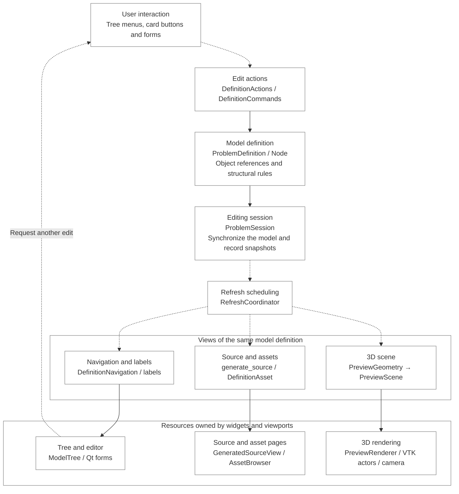

# System architecture

[简体中文](../../zh-CN/codestructure/architecture.md)

[Code structure overview](README.md)  ·  [Runtime](runtime.md)  ·  [UI domain model](ui-model.md)

## Contents

<!-- docs:toc depth=1 -->

- [1 Modular design concept](#modularity)
- [2 System boundaries](#section-系统边界)
- [3 The package directory and public entrance points](#section-包目录与公共入口)
- [4 Kernel object combination](#section-内核对象组合)
- [5 UI hierarchy and dependencies](#section-ui-层次与依赖)
- [6 Status ownership](#section-状态所有权)
- [7 Three main data streams](#section-三条主要数据流)
- [8 Module boundaries and expansion areas](#section-模块边界与扩展位置)

<!-- /docs:toc -->

<a id="modularity"></a>

## 1 Modular design concept

The code design of MorphOpt is based on the principle of separation of responsibilities and combination of objects. The modules are divided according to their business responsibilities, and they collaborate through predefined data and interfaces. The types of tasks are represented by the combination of model components and algorithm components. The boundaries of the modules also define the ownership of states, the direction of calls, and the areas where they can be extended.

This design integrates throughout the entire software, including the numerical kernel and the UI. The UI and the kernel are responsible for interaction and computation respectively. The kernel organizes processes based on models, solving methods, sensitivity, and updates. The UI organizes interactions based on business data, display projections, and display resources.

| principles | Manifestation in the code | Constraints on expansion |
|---|---|---|
| Single Responsibility Principle | `Params` build the model, `Solver` solve the problem, `ObjectiveFunction` define the objectives and organize the sensitivity, `Updaters` manage design updates. | The new algorithm is now applied to the corresponding components. The main loop remains consistent across all components. |
| Interface collaboration | Model objects, operating conditions, classification gradients, design variables, and scenario descriptions are connected at each stage. | The caller adheres to the conventions regarding types, order, and lifecycle aspects. |
| The status has a clear classification. | Definition, execution, analysis, and display are handled by respective domain objects, sessions, and viewport entities. | The same business fields should come from a single source. Caches and views should be managed according to the stage they belong to. |
| Combined expansion | A task can combine different parts, materials, targets, and local updaters. | The updatable components declare the design interface. The local updater is bound to specific targets. |

<a id="section-系统边界"></a>

## 2 System boundaries

MorphOpt combines geometry, loads, materials, solvers, objective functions, and updaters through task scripts, invoking TorchFEA to perform finite element analysis and sensitivity calculations. The UI editor defines declarative problem definitions, which are then transformed into Python tasks used during runtime. The script tasks and UI tasks share the same numerical kernel.



*Figure 1: The UI delivers computing tasks by running scripts and assets, while the kernel delivers results through archiving. The solid lines represent the main data transfer, and the dashed lines represent stage scheduling.*

The kernel source code is not imported for `morphopt.ui`. The calculation process is executed by the runner and controller. The UI integrates with the same process through code generation, running sessions, and result sessions. The script entry can directly organize the calculation, while the graphical entry is responsible for defining, editing, task delivery, and result display.

The generated script serves as an execution interface between the two entry points: the typed definitions in the UI are converted into declarations of kernel classes, and file assets are restored to the `morphopt_assets/` next to the script. The optimization and export processes use the same generation logic as the running script. Additionally, task and asset snapshots are saved in the running directory.

`.morph` can be defined and edited. Python is the entry point for task execution. The running directory stores the design state and solution archives. The three have different life cycles and cannot be replaced each other.

<a id="section-包目录与公共入口"></a>

## 3 The package directory and public entrance points

| Path | Main responsibilities |
|---|---|
| [`src/morphopt/__init__.py`](../../../src/morphopt/__init__.py) | Public classes, startup functions, logging, and tool interfaces |
| [`opt_runner.py`](../../../src/morphopt/opt_runner.py) | The process for executing script tasks is initiated, and calculations are continued in segments. |
| [`optcore/`](../../../src/morphopt/optcore) | Controllers, parameters, solving methods, objectives, update mechanisms, management of historical data and shared protocols. |
| [`shapeopt/`](../../../src/morphopt/shapeopt) | Boundary surface components, surface constraints, solid meshes, and shape updates |
| [`simp/`](../../../src/morphopt/simp) | Material design fields, scaling of materials and elements, updating density fields. |
| [`codesign/`](../../../src/morphopt/codesign) | Inner cavity-based solid layer, along with its dedicated updater and constraints |
| [`postprocess/`](../../../src/morphopt/postprocess) | No archiving capabilities for Qt data; limited access to finite element field data; unified format for exporting files and rendering scenes. |
| [`ui/`](../../../src/morphopt/ui) | Editing, task creation, task management, previewing results, and result viewing interface. |
| [`utils/`](../../../src/morphopt/utils) | Cross-module name processing, numerical integration, historical controller reading, and sensitivity checking tools. |
| [`constants.py`](../../../src/morphopt/constants.py) | Default settings, operating parameters, and numerical configurations |

`morphopt.start_optimization()` starts the script task, `morphopt.debug_optimization()` provides a debugging interface. `morphopt-ui` and `python -m morphopt.ui` enter the graphical application.

The common generic base class is derived from the top-level `morphopt`; `shapeopt`, `simp`, and `codesign` provide specific design objects and algorithm components, and do not constitute three independent controller systems. The shared protocol retains the source code spelling `Protocal*`, see [Model Protocols](model.md#protocols).

<a id="section-内核对象组合"></a>

## 4 Kernel object combination

<a id="section-模型求解灵敏度与更新"></a>

### 4.1 Modeling, solving, sensitivity analysis, and updating



*Figure 2: `Controller` organizational phase is called, with four types of components collaborating through the finite element model, load case solutions, and classification gradients. The design update is written back into the model, and the process moves on to the next round. The dashed lines represent the scheduling relationships.*

| Module | Main input | Mainly output or written | Responsibility boundaries |
|---|---|---|---|
| Model: `Params` | Geometry, instances, load conditions, materials, and current design status | `FEAController`, as well as the mapping from design variables to the assembly. | Declare and construct the current physical model. Maintain the model interfaces. |
| Solution: `Solver` | Current finite element model, operating conditions, and initial values. | For various operating conditions, `StaticResult` | Solving organizational constraints, assigning tasks, and initializing finite element coefficients. |
| Objectives and sensitivity: `ObjectiveFunction` | Finite element models, solution methods for different operating conditions, scalar objectives, and design mappings | Target values, recorded metrics, and classification thresholds | Define optimization responses, call the TorchFEA sensitivity interface, and process the gradients. |
| Design updates: `Updaters` and local `BaseUpdater` | Classification levels, designated design objects, as well as local objectives and constraints | The local changes and the updated design state | Assign gradients, solve local subproblems, and write the results back into the bound object. |
| Process coordination: `Controller` | The above-mentioned components, runtime configurations, and iteration status. | Stage invocation status, history, archiving, and continuation of computation | Unified organization of the lifecycle and execution sequence |

`Params` further divides the geometry, finite element loads, and materials into three sets of interfaces internally. The updateable objects provide design variables and their mappings to the physical model. `ObjectiveFunction` calculates the sensitivity based on this information, and the updater manager then divides the gradient according to the target interface. The order of variables and the range of gradients are data contracts that these modules must follow. For details, refer to [Model Protocols](model.md#protocols) and [Gradient path](optimization.md#gradients).

Sensitivity analysis computes derivatives of the physical objective with respect to the design variables. The updater combines those derivatives with the local objective and constraints to determine a design change. Load-case scheduling, objective expressions and local update algorithms belong to the solver, objective function and updater respectively.

<a id="section-对象组合与共享状态"></a>

### 4.2 Object combination and shared state

```text
Controller
├── Params
│   ├── GeometryParams.interfaces → BasePart → torchfea.Part + Instance
│   ├── FEAParams.interfaces      → BaseFEAComponent + Operating Conditions Table
│   └── MaterialsParams.interfaces→ BaseMaterial
├── Solver                       → Various operating conditions: StaticResult
├── ObjectiveFunction            → Scalar losses, metrics, classification gradients
├── Updaters                     → One or more local BaseUpwriters.
└── History                      → Iterative records
```

The set of parameters registers the model objects by name. Each sub-optimizer is associated with a design interface, and the optimizer manager is responsible for goal parsing and gradient slicing. The controller is responsible for determining the calling order, without having to write different main loops based on shape or material requirements.

These components are located in the same run context: `Solver` and `Updaters` share the `Params` held by the controller, while the local updater is directly bound to the design object. The current implementation also uses `morphopt.controller` to provide the run context. Some models and target interfaces include PyVista output capabilities. The aforementioned separation of responsibilities and call boundaries ensure that each module accesses the shared model and numerical backend according to the established protocols.

<a id="section-ui-层次与依赖"></a>

## 5 UI hierarchy and dependencies

<a id="section-业务数据展示投影与显示资源"></a>

### 5.1 Business data, display projections, and display resources



*Figure 3: The user operates on the definitions modified through the application and domain interface. The synchronized states are projected into navigation rows, scripts and assets, as well as 3D scenarios, and then displayed through the corresponding controls. The dashed lines indicate the operations and refresh notifications.*

The saveable definitions of the UI are represented by `ProblemDefinition`. The editing session maintains the current definitions as well as historical data. Tree nodes, cards, code views, and 3D views each read the projections of the same definition. Node selection, scrolling position, camera, and actors are managed by the display components.

| levels | Data or resources | Main responsibilities |
|---|---|---|
| Business data | `ProblemDefinition`, Typing `Node` and object references | Expressing problem definitions, maintaining references, names, and structural constraints. |
| Application processes | `ProblemSession`, `DefinitionCommands` – Running and Result Sessions | Organize editing, synchronization, history management, persistence, and task execution. |
| Display the projection | Navigation bar, title, source code generation, `DefinitionAsset`, `PreviewScene` | Converts the business status into the data required for viewing in a specific format. |
| Display resources | Qt controls, VTK actors, plotters, cameras, and selection status | Display data, process interactions, and send operation requests. |

The specific meaning of separating data flow from display is as follows: Business relationships are maintained during domain operations, and the display components are updated based on the operation results. The displayed text is generated by title projection, and dropdown menus store option meanings through object references or original values. The three-dimensional grid and surface identifiers first form a scene description, which is then passed to the renderer to create actors.

For example, when a component bound to the geometric optimizer is deleted, `DefinitionActions` is responsible for providing prompts and confirmation, while `ProblemDefinition.remove_part()` is responsible for deleting the component, associating it with the optimizer, and clearing any related references. After that, the workbench records an edit snapshot and schedules a refresh. The tree and cards are re-rendered with projected views, the geometric adapter is re-prepared for the scene, and the renderer updates the display resources. The business rules for this operation are centralized in the domain method. The tree menu and card buttons call the same entry point.

<a id="section-源码层次与调用方向"></a>

### 5.2 Source code hierarchy and call direction

| layer | Catalogue or entrance | Responsibility boundaries |
|---|---|---|
| field/domain | `ui/model/` | Nodes, fields, object references, and cross-node invariants |
| Apply | `ui/application/` | Editing, persisting, tasks, results, and verification scenarios. |
| Script generation | `ui/codegen/` | Define projection and finite metadata extraction templates for use in Python. |
| Displaying data | `ui/presentation/` | Lightweight projections of navigation trees, titles, history tables, and operation history. |
| Scene preparation | `ui/visualization/` | Adaptation of Parts/Surfaces/Loads to Scenario Data |
| Qt Display | Top-level window: `ui/widgets/`, `ui/refresh.py` | Control elements, signals, unified refreshing mechanisms, viewport management, and process event handling |
| Appearance and language | `ui/theme/`、`ui/i18n.py`、`ui/locales/` | Appearance settings, localized resources, and notification for changes |

The code for domain, application, generation, and scenario preparation does not create Qt pages. Scenarios can carry PyVista datasets, and VTK actors and plotters are managed by the viewport. The window calls application services, which operate on the domain model or manage infrastructure; the domain model does not have reverse access to the window.

Define the preview to transfer geometric and surface information through `PreviewGeometry → PreviewScene → PreviewRenderer`. The geometric asset preview uses the same scene and rendering interface; the display method for asset categories is registered in `AssetBrowser`. When adding new asset types, extend the category adaptation and preview components. File collection, script export, and business definition continue to follow their respective interfaces, as described in [Asset Preview Extension](ui-application.md#asset-previews).

The theme manager integrates Qt when applying themes and saving Qt settings; it does not belong to the problem definition. `i18n.py` provides resource querying and subscription services, while the language selector and Qt settings persistence are located in the presentation layer.

<a id="section-状态所有权"></a>

## 6 Status ownership

| status | Owner | border |
|---|---|---|
| Definable content that can be saved | `ProblemDefinition` | Node tree, auxiliary code, custom classes, and runtime configurations |
| Current definitions and editing history | `ProblemSession` | Hold the currently defined references and immutable edit snapshots. |
| Activity optimization tasks | `OptimizationRunSession` | Task source, child processes, output, and progress |
| Optimized result retrieval | `ResultSession` | Current running controller, historical data, and parameter loading status. |
| Independent finite element models and solutions | `FiniteElementSession` | Private models and analysis snapshots loaded from the specified iteration. |
| Define the file path and choose the desired outcome. | `MainWindow` | Save the path, as well as the directories containing the results of the observation/FE simulation processes and the iteration results. |
| Define preview resources. | `PreviewGeometry` | Current preview of Part, CAD, and surface query caches. |
| VTK actor and camera | The renderer or widget to which it belongs. | Display resources without showing definitions and optimization status. |
| Form focus, scrolling, and tree expansion status | Associated widget | Display states that can be restored during refreshing. |

`ProblemSession` has a defined structure, but the business content is still represented by `ProblemDefinition`. Neither of them maintains two sets of field values that can be independently modified. The running definition is separated from the editing definition through snapshots. Independent finite elements do not share the modifiable backend objects during optimization.

<a id="section-三条主要数据流"></a>

## 7 Three main data streams

| process | Path | Provide detailed explanations/descriptions. |
|---|---|---|
| Edit | Widget → application or domain action → synchronization and edit snapshot → UI refresh | [UI Application Services](ui-application.md) ,  [Displaying and refreshing](ui-presentation.md) |
| Optimization | Controller → Model Generation → Solution → Gradient → Update → Archive | [Runtime](runtime.md) ,  [Design updates](optimization.md) |
| Analysis | Archive → Result Sessions → Display or Independent FEM Models → Export of Field Data/Original Files | [Result analysis and export](results.md) |

Each topic in the main text describes the internal implementation of these processes. Operation parameters, interface fields, and the complete calculation example are provided by [Four documents containing usage instructions](../README.md).

<a id="section-模块边界与扩展位置"></a>

## 8 Module boundaries and expansion areas

| Extended content | Module Name | The way in which it connects with other modules |
|---|---|---|
| New methods for constructing geometries or importing data. | The specific implementation of `BasePart` and its geometric properties. | Output part and instances; enabling updateable protocols when design variables are available. |
| A new approach to organizing solving tasks | `Solver` | Received the current FE model. The returned results are organized according to different operating conditions. |
| New optimization responses and derivative requirements | `ObjectiveFunction` | Use the results obtained from the operating conditions as mapped from the design specifications. Maintain the conventions for scalar targets and gradient arrangements. |
| New strategies for geometric or material updates | Local `BaseUpdater` and its targets/constraints | Bind the design interface to receive the target gradient and write it back into the design variables. |
| New editable objects or cross-object rules | `ui/model/` and `ui/application/` | Maintains references in the domain, structures data, and preserves the saveable state of objects. |
| New layouts, views, or ways of displaying assets | `ui/presentation/`, `ui/visualization/` and their corresponding widgets | Consume the existing state or scenarios, and provide new displays as needed. |

The geometric construction adopts a common template method: `CADMeshingMixin` is responsible for geometric preparation, solid assembly, volume mesh division, set mapping, and mesh post-processing. These functions are shared by CADPart and BoundaryPart. `BoundaryPart` provides closed boundary assembly, surface grouping, and design variables through the rewriting phase method. `OffsetBoundaryPart` adds a bias layer in the mesh extension hook. The parent class organizes the process through method calls, while the behavior of specific types is implemented by the child classes. Precise CAD and discrete surfaces use corresponding geometric kernels during the assembly phase. The subsequent finite element mesh extraction and surface set naming are shared, as detailed in [Part: Building Boundaries](model.md#section-partinstance-与几何缓存).

During expansion, first determine the state owner, then define the inputs and outputs. Finally, connect to the caller and display the entry point. For the specific implementation of common protocols, model types, algorithm components, and interface adaptation, refer to [Expansion and maintenance](development.md).
