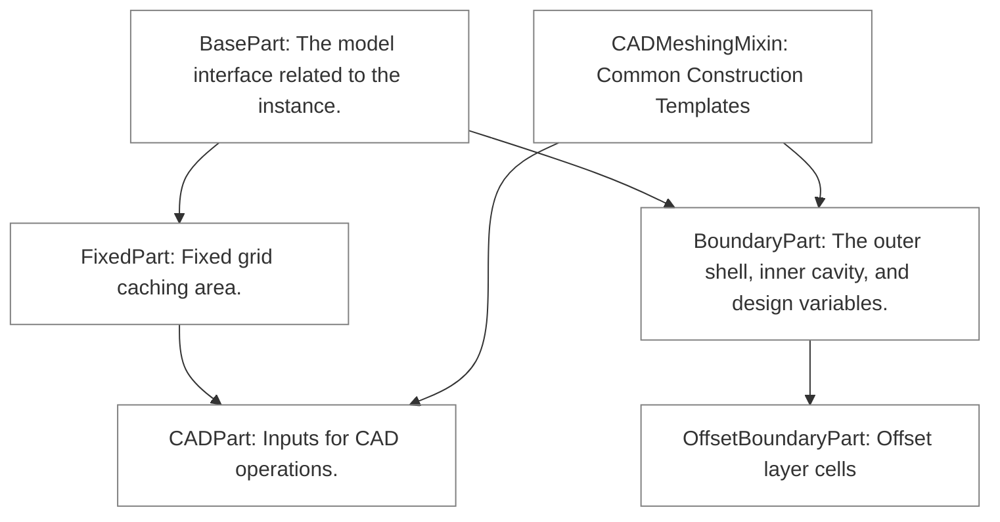

# Model and parameter set

[简体中文](../../zh-CN/codestructure/model.md)

[Code structure overview](README.md)  ·  [Runtime](runtime.md)  ·  [Design updates](optimization.md)

## Contents

<!-- docs:toc depth=1 -->

- [1 Source code entry point](#section-源码入口)
- [2 Shared protocols and component levels](#protocols)
- [3 Collective registration and lifecycle management](#section-集合注册与生命周期)
- [4 Params model assembly boundaries](#section-params-的模型组装边界)
- [5 Part, Instance, and Geometry Caching](#section-partinstance-与几何缓存)
- [6 FEA interface and operating conditions are fully covered](#section-fea-接口与工况覆盖)
- [7 Material allocation and parameter types](#section-材料分配与参数类型)
- [8 The boundary between kernel naming and UI naming](#section-内核命名与-ui-命名的边界)
- [9 BSP geometric output and differentiable constraints](#section-bsp-几何输出与可微约束)

<!-- /docs:toc -->

<a id="section-源码入口"></a>

## 1 Source code entry point

| Path | Main targets |
|---|---|
| [`optcore/protocal.py`](../../../src/morphopt/optcore/protocal.py) | Initialization, saving, visualization, and updatable protocols |
| [`optcore/modelparams/base_model_component.py`](../../../src/morphopt/optcore/modelparams/base_model_component.py) | Common base class for individual model components |
| [`optcore/modelparams/baseparam.py`](../../../src/morphopt/optcore/modelparams/baseparam.py) | Interface collection named `BaseParams` has been created. |
| [`optcore/modelparams/params.py`](../../../src/morphopt/optcore/modelparams/params.py) | Aggregate parameters and assemble with FE models |
| [`geometry.py`](../../../src/morphopt/optcore/modelparams/geometry.py)、[`parts/`](../../../src/morphopt/optcore/modelparams/parts) | Geometric Sets and Basics Part |
| [`feaparams.py`](../../../src/morphopt/optcore/modelparams/feaparams.py)、[`fea/`](../../../src/morphopt/optcore/modelparams/fea) | Loads, boundaries, connections, and operating conditions |
| [`materialsparams.py`](../../../src/morphopt/optcore/modelparams/materialsparams.py)、[`materials/`](../../../src/morphopt/optcore/modelparams/materials) | Material interfaces, distribution, and constitutive parameter types |

<a id="protocols"></a>

## 2 Shared protocols and component levels

In the source code, `Protocal*` represents an interface contract defined using an abstract base class. The name remains unchanged from its original spelling.

| agreement | Main Methods | Realizing responsibilities |
|---|---|---|
| `ProtocalInitializable` | `initialize()`、`reinitialize()` | Initial preparation and updates for each round |
| `ProtocalSavable` | `save()`、`load()`、`pathlog_required()`、`save_directory()` | State persistence and named directories |
| `ProtocalVisualizable` | `get_meshes()`、`plot()` | Grid-based output and plotting hooks |
| `ProtocalUpdatable` | `num_variables`, Parameter access; `update_variables()`, Sensitivity variable extraction and writing back; Component export. | Variables and export contracts for design objects |

Both methods for `ProtocalInitializable` have default empty hooks. `reinitialize(*args, **kwargs)` does not enforce the specification of the iteration number; model components typically receive `iteration`, while local updaters receive `gradient`. The actual types of parameters and their behaviors are declared by the specific implementations. The intermediate base class only overrides the hooks when adding shared behaviors.

`BaseModelComponent` provides combined initialization, saving, and visualization capabilities, representing a single model interface; `BaseParams` maintains multiple named interfaces. It allows for the update of additional implementations for geometry and materials `ProtocalUpdatable`, without implicitly adding design variables to all objects by the collection base class.

`ProtocalUpdatable.get_variables()` provides an initial perturbation vector for local optimization. This cannot be simply interpreted as the current geometric coordinates. The mapping between design parameters, sensitivity inputs, and local variables is shown in [Design updates](optimization.md).

<a id="section-集合注册与生命周期"></a>

## 3 Collective registration and lifecycle management

`BaseParams.interfaces` Save in the order of registration. `name → interface`. `add_interface()` Check for duplicate names and generate `<class>_<index>` for unnamed objects. `interface(name)` Provide query errors with candidate names.

| Method | Responsibility |
|---|---|
| `define_interface()` | Subclass declares an interface |
| `initialize()` | If the collection is empty, the declaration will be executed, and then each interface will be initialized. |
| `reinitialize(iteration)` | Pass the preparations for this round to the existing interfaces. |
| `design_interfaces()` | Filter out interfaces that support updatable protocols. |
| `obtain_design_sensitivity_vars(assembly)` | Connect the sensitivity inputs in the order specified by the design interface. |
| `save/load()` | Distribute the status operations to various interfaces. |

After constructing the set of construction parameters, it cannot be assumed that the declarations have been executed. Duplicate initializations of the same object should not be registered again for the same interface; structural changes should be handled separately for each re-initialization. The registration order should be consistent with the semantics of the variable layout and state files. Stability should be maintained during optimization operations.

<a id="section-params-的模型组装边界"></a>

## 4 Params model assembly boundaries

```text
Params.create_feamodel()
├── GeometryParams.generate() → torchfea.Assembly
│   └── For each Part interface, there is an add_to_assembly() method.
├── FEAParams.create_fea(assembly) → FEAController + Load/Boundary/Solver
├── MaterialsParams.set_materials(fe)
└── fe.initialize()
```

`Params` holds `geometry`, `feamodel`, and `materials` simultaneously, but each has its own set of interfaces for geometry, load, and material parameters. `create_feamodel()` is the point where the model is declared to enter the current finite element state; the upper-level controller does not need to interpret each Part, load, and constitutive type individually.

<a id="section-partinstance-与几何缓存"></a>

## 5 Part, Instance, and Geometry Caching

One `BasePart` interface constructs a `torchfea.Part`, and declares one or more instances of this component. The fixed geometry inherits from `FixedPart`, which is responsible for managing grid caching and collection access properties; the general `BasePart` is used to build the current grid each time.

| Members | Responsibility |
|---|---|
| `name` | Geometric collection registration names |
| `part_name` | Assembly part name. If not explicitly specified, the registered name will be used. |
| `define_instance()`、`add_instance()` | Declare the instance name and six-dimensional pose. |
| `build_part(path_result, pools)` | Specific geometric constructions or imports. |
| `get_part()` | BasePart constructs the current grid; FixedPart reuses the existing fixed grid. |
| `add_to_assembly()` | Add parts, outer surfaces, and declared instances. |
| `FixedPart` | It is a base class for fixed geometries, enabling unified management of `_part` and cache invalidations. |
| `FixedPart.node_sets`、`surface_sets`、`element_sets` | Directly accessing the cached internal collection of `torchfea.Part` – no data replication required. |
| `surface_set_names`、`node_set_names` | Name of the collection; describes the boundary geometry and topology of the surface. Mesh indices are not cached. |
| `clear_mesh_cache()` | Clear the cached grid data related to the fixed geometry, so that it can be re-generated during the next query. |
| `is_variable` | Determine whether the geometry or grid structure can change during optimization processes. |
| `workdir()` | Assign the geometric working directory for this interface. |

The script base class declares a zero pose instance with the same name as the Part. Explicitly, `define_instance()` can use a unique name. `initialize()` retains the existing instance declaration, and calls `define_instance()` only when the declaration is empty. Repeated initialization does not clear the instance name and pose. The pose is `[tx, ty, tz, rx, ry, rz]`, and the rotation uses exponential coordinates. The load refers to the instance, the material refers to the Part, and the local updater refers to the interfaces in the collection.

The `ProblemDefinition.replace_part(source: PartNode, replacement: PartNode) -> PartNode` in the UI is replaced with components in their original positions. The original Instance object is retained, and the references to materials and updaters are redirected accordingly. The CAD conversion results are submitted through this domain-specific method. The controls do not directly modify the cross-object associations.

BoxPart, CADPart, and INPPart all inherit from FixedPart, and only maintain one copy of the `_part` mesh. If the size of the Box, CAD operations, or INP files change, the `get_part()` will be re-generated upon input. Custom fixed geometries also inherit from `morphopt.FixedPart` and implement `build_part()`. BoundaryPart and OffsetBoundaryPart inherit from the general BasePart; they do not provide collective properties for fixed meshes. The node numbers and patch numbers generated in each round may change. The specific collective indices should be read from the `assembly.get_part(part_name)` of the current assembly. INP import retains the source node set, surface set, and element set.

| Type | Achieving location | Construction features |
|---|---|---|
| `BoxPart` | `parts/box_part.py` | Structured cuboid structure. The unit block is `C3D8`, along with a set of coordinate planes. |
| `CADPart` | `parts/cad_part.py` | Ordered. `torchfea.cad` operations are organized in a grid format. |
| `INPPart` | `parts/inp_part.py` | Select and import the Part from the supported INP contents. |
| `BoundaryPart` | `shapeopt/boundary_part.py` | The parametric design of the outer boundary and inner cavity is detailed in [Shape update](optimization.md#shape). |
| `OffsetBoundaryPart` | `codesign/offset_boundary_part.py` | A solid layer with a bias at the inner cavity boundary |

The `define_operations()` in CAD is separated from the finite element `build_part()`. For STEP export, directly use `torchfea.cad.export_step(operations, path)`. It is sufficient to save the local CAD entities without requiring the generation of a solid mesh. For details on UI operations, refer to [Application services](ui-application.md#cad).

`CADMeshingMixin.build_part()` organizes the common construction process according to `prepare_geometry → assemble_geometry → mesh_geometry → define_mesh_sets → postprocess_mesh`. CADPart and BoundaryPart share the modeling process through this mixin. The fixed grid caching is provided only by the FixedPart base class of CADPart. Each stage is invoked through instance methods, and the specific implementation is overridden by subclasses. The default geometric description comes from the CAD operation history; `BoundaryPart` overrides the geometric preparation, boundary assembly, surface collection definition, and post-processing of nodes. Both types of components share TorchFEA’s volume grid extraction, face set naming, and second-order conversion. `OffsetBoundaryPart._postprocess_part()` Offset elements are added before the second-order conversion.

| Construction phase | `CADPart` is implemented by default. | `BoundaryPart` The rewritten content |
|---|---|---|
| `prepare_geometry()` | The declared CAD operations are being performed. | Call the geometric preparation APIs of each surface, and obtain the ordered surfaces. |
| `assemble_geometry()` | Creating `CADHistory` from the operation list | Integrate the self-boundary assembly method with the execution entry point of the same `CADHistory`. |
| `mesh_geometry()` | Called `CADHistory.mesh()` | Inherit common implementations |
| `define_mesh_sets()` | Define the geometric surfaces and node sets. | Call the surface collection defined in the parent class, and then add the `surface_i_All` group. |
| `postprocess_mesh()` | Execution unit expansion and grid level conversion | After matching the design surface nodes, the parent class's processing will be invoked. |

`BREPSurface` converts a closed CAD shell into a collection of topologies and sets. The `cad/brep.py` of TorchFEA is responsible for reading NURBS conversions of surfaces, lines, loops, shared edges, vertices, and specified surfaces. MorphOpt manages surface objects, logical identities, set registration, asset persistence, and model interfaces. The `define_mesh_sets(part, prefix)` of each surface defines local sets after volume mesh extraction. BoundaryPart extends surface sets and node sets through polymorphic calls. Curve nodes and vertex nodes are derived from TorchFEA’s OCC mesh classification, without relying on coordinate proximity or intersection of surface nodes.

When the BREP shape update is enabled, `BREPSurface` summarizes the NURBS control points of the selected surface as part of the design variables. `NURBSFace` uses `bspmap` basis functions to establish a differentiable mapping between the finite element nodes and the control points. The boundary-related control points remain fixed. Before each redivision, the surface writes the current control points back to the STEP file. This process verifies the trimmed edges and the closed solids, and then the unified CADPart division process generates the next round of meshes. The optimized archive saves the control points, while the preview and surface export functions allow the current shape to be displayed and exported.

BREP topology inspection and STEP export use `torchfea.cad.occ_session()` sessions for previewing and dividing shared locks. Topology inspections do not generate meshes. Surface conversion first removes the original entity's ownership relationship, and then the updated surfaces are assembled into a closed shell. Plane conversion simultaneously moves the external contours and holes. `.brep.json` preserves logical identities and sets; Gmsh entity tags are only used in the current session. For more information on interfaces, see [Script reference](../script-reference.md#brep-topology).

The parent class does not select the implementation based on `BoundaryPart` or its geometric description type. The surface prepares the geometric files through `prepare_geometry()`, and then `load_geometry()` calls the corresponding loading method of CADPart. BSP and `BREPSurface` use STEP for loading, while CPGEO and fixed STL use discrete grids for loading. BoundaryPart assembles the shell and cavity according to the surface’s discrete geometric capabilities, and selects the appropriate Gmsh kernel based on the surface’s discrete geometric characteristics.

`CADPart` is implemented collectively for `load_step_boundary()`, `load_mesh_boundary()`, `split_shells()`, and `export_shell_step()`. During conversion, each enclosed shell is exported as a STEP asset. `BREPSurface` retains the asset reference, topological identity, and the design state of the selected surfaces. The original surface identity is written to the component's `_face_names` during assembly. The surface groups of the BoundaryPart are held by its own `_surface_groups`. The source CAD operation history is only involved in the conversion process and does not affect the surface objects.

`CADMeshingMixin._Operation` is an internal execution adapter that integrates the construction or query methods of the current Part into the Gmsh sessions managed by TorchFEA. It is used only during the current operation. The actual CAD declarations, surface states, and set identities are still stored in the Part and Surface. `CADPart.to_boundary_part()` directly creates a standard `BoundaryPart`, copying the mesh settings, name, and instance declarations. The instance declarations are deep copied and retained by the common initialization process.



`fea_seed_size` represents the volume mesh size of BoundaryPart, and can read and write data in the same `mesh_size` state. Ordinary CADPart continues to use `mesh_size`. `face_N` indicates independent geometric surfaces, while `surface_i_All` represents the i-th closed surface group of BoundaryPart; one group can contain multiple `face_N` elements.

`BREPSurface` and `MeshSurface` respectively declare precise boundary representation and discrete triangular mesh representation, defined in `surfaces/brep_surface.py` and `surfaces/mesh_surface.py`. Both inherit from `BaseSurface`; currently, STEP and STL are used as the asset file formats.

<a id="section-公共构建接口的参数与返回值"></a>

### 5.1 Parameters and return values of public construction interfaces

`build_part()` is the entrance for constructing finite element components. The remaining stages are called sequentially by this method, and the subclasses are overridden according to the stages.

| Method | Parameters | Return value and handling details |
|---|---|---|
| `build_part(path_result, pools)` | `path_result: str \| None` is the output directory. `pools: Pool \| None` supplies an optional process pool for surface export. | Returns a `torchfea.Part` after geometry preparation, solid assembly, meshing, set definition and postprocessing. |
| `prepare_geometry(path_result, pools)` | It’s the same as `build_part()`. | CADPart returns `list[CADOperation]`; BoundaryPart synchronizes all surfaces and prepares the geometric input, returning `list[BaseSurface]`. |
| `assemble_geometry(geometry)` | CADPart receives the CAD operation sequence; BoundaryPart receives the list of ordered surfaces. | `CADHistory`: Declaring that the entity construction process for this component has not yet completed, and the finite element mesh has not been generated. |
| `mesh_geometry(geometry)` | `geometry: CADHistory` | `torchfea.Part`; Use TorchFEA to generate and extract the finite element mesh. |
| `define_mesh_sets(part)` | `part: torchfea.Part` | `None`; In-situ definitions of `face_N` and `face_N_nodes`; BoundaryPart is defined separately as `surface_i_All` |
| `postprocess_mesh(part)` | `part: torchfea.Part` | `torchfea.Part`; The BoundaryPart first matches the design surface nodes, and then performs unit expansion and second-order transformation for common implementations. |

At `path_result=None`, BoundaryPart allocates temporary geometric directories through `workdir()`. `pools=None` indicates the synchronized export of surfaces; the native CAD operations of CADPart do not use this process pool.

<a id="section-cad-载入与壳体转换接口"></a>

### 5.2 CAD loading and shell conversion interface

The geometric loading interface is called within the Gmsh session managed by TorchFEA. The returned surface numbers are only valid within the current session and are not persistent, equivalent to the `face_N` name.

| Method | Parameters | Return value and handling details |
|---|---|---|
| `load_step_boundary(path, context)` | `path: str \| Load case `；`: The OCCBuilder is currently used in the CAD execution context. | `list[int]`; Import the STEP file, remove the imported solid while retaining the boundary surfaces. Return the Gmsh numbers of the newly added surfaces. |
| `load_mesh_boundary(path)` | `path: str \| Path` | `list[int]`; Import the closed STL file, and get the Gmsh numbers of the newly created surfaces. |
| `get_face_signature(tag)` | `tag: int` is the face number in the current session. | `list[float]`; returns the area, centroid, and inertia matrix, useful for matching STEP surface names. |
| `split_shells()` | No parameters required; the source CADPart has been processed successfully. `initialize()` | Tuple `(operations, shells)`; Copy the CAD history to identify the outer shell and inner cavity; Currently querying the preview session of TorchFEA, showing that the triangular mesh is not retained |
| `export_shell_step(operations, face_indices, path)` | Original CAD operation tuple, original face index tuple, and `path: str`| Path` | `None`; Export the STEP solid of the specified closed shell along with the surface name mapping of the same name `.brep.json` |
| `to_boundary_part(asset_directory)` | `asset_directory: str \| Path` defaults to `morphopt_assets`. Initialize the source CADPart first. | Returns a `BoundaryPart`. Each shell is saved as a BREP asset. Face names, mesh settings and instance declarations are preserved. |
| `get_face_names()` | No parameters | `list[str]`; Return the names of geometric surfaces in the order of the preview records; Execute surface display and subdivision without generating finite element body meshes. |

The composite parameters in the above-mentioned shell interfaces have the following types and meanings:

| Name | Type | Meaning |
|---|---|---|
| `operations` | `tuple[CADOperation, ...]` | The source CAD operation history copied during conversion is used only during shell identification and STEP export. |
| `face_indices` | `tuple[int, ...]` | The zero-based index in the CAD surface sorting; index `N` corresponds to the original `face_N`, which does not represent the Gmsh surface number. |
| `shells` | `list[tuple[int, ...]]` | Indices of the original surfaces contained within each enclosed shell; the 0th item refers to the outer shell, while the remaining items refer to the inner cavities. |
| `face_map` | `dict[str, list[float]]` | The mapping from the original `face_N` to the surface geometry features is saved in STEP format. After reimporting, the features are matched based on the geometry characteristics, and the names are not renamed according to the new surface numbers. |

<a id="section-曲面几何接口"></a>

### 5.3 Curved Geometric Interfaces

| Method | Parameters | Return value and handling details |
|---|---|---|
| `prepare_geometry(path_output, name_output, pools)` | Output directory, file name format, and optional process pool | Prepare the input file for division. Using a fixed BREP file allows direct utilization of existing STEP assets. |
| `load_geometry(part, context)` | `part: CADMeshingMixin`；`context: OCCBuilder` | `list[int]`; Returns the Gmsh surface number of the current surface through the component loading method; BSP, CPGEO, fixed STL, and fixed STEP each override this method |
| `write_surface(stem, fmt, pools=None)` | Target path without an extension, formats supported by surfaces (`"stp"` or `"stl"`), and optional process pool | `Path`, point to the output file with the extension. The surface is represented in its current geometric state. BSP only supports STEP format. The `export_formats` tuple lists the supported formats. Its first entry is used for meshing and default export. |
| `BREPSurface.get_mesh()` | No parameters | `pyvista.PolyData`; Generating a display of triangular meshes from STEP format. The cell data `face_index` retains the surface indices. |
| `BREPSurface.face_names` | Read-Only Properties | `tuple[str, ...]`; Returns the original CAD surface names stored in the asset; Empty when there is no mapping in the ordinary STEP format |

`BREPSurface(path_step: str | Path)` reads the STEP solid corresponding to a closed shell, and also reads the entity with the same name `.brep.json` (if it exists). Surface objects do not preserve the preview records from the source CAD operation or construction phase. When exporting to STEP, `write_surface()` writes the current solid and topology into the STEP and `.brep.json` files with the same names. The relationship between cavities is determined by the assembly order of the BoundaryPart shell. The mapping is performed based on area, centroid, and inertia matrix, using the tolerance values of `rtol=1e-7` and `atol=1e-8` for each component. If a unique match cannot be found, an error will be reported.

The `brep_surface` nodes in the UI are stored with Base64 STEP data and surface mappings within `.morph`. The script only references the STEP and JSON files restored from `morphopt_assets`; the asset page displays both the geometry and mapping texts.

<a id="section-内部辅助方法与执行回调"></a>

### 5.4 Internal auxiliary methods and execution of callbacks

The following methods serve as support for the public interface. They are not used as regular entry points during user modeling processes.

| Method | Parameters and return types | Responsibilities |
|---|---|---|
| `_complete_face_names(tags)` | `tags: Iterable[int]`; returning to `None` | Unused `face_N` has been allocated to unnamed Gmsh faces. Existing source faces will remain intact. |
| `_name_geometry_faces(part)` | `part: torchfea.Part`; returning to `None` | Replace the Gmsh surface and node sets generated by TorchFEA with stable names. |
| `_single_solid(operations)` | `operations: Sequence[CADOperation]`; returning to `tuple[int, list[int]]` | Executed the historical CAD operations. It was confirmed that there is only one solid element remaining. The solid’s number and the sorted order of the faces have been returned. |
| `_inspect_shells(context, *, operations, shells)` | Current execution context, source operation tuple, and output list; returned as `list[tuple[int, int]]`. | Query the closed shells, sort them in descending order based on the volume they enclose, and write the original face indices of each shell into `shells`. |
| `_build_shell(context, *, operations, face_indices, face_map)` | Current execution context, source operation tuple, original surface index, and surface mapping output dictionary; returned as `list[tuple[int, int]]`. | Reconstruct the independent entities of the specified shell from the source CAD file, record the surface geometric features, and export them in STEP format for use. |
| `BoundaryPart._assemble_surfaces(context, *, surfaces)` | `context: OCCBuilder`; `surfaces: list[BaseSurface]`; Return: `list[tuple[int, int]]` | Load case loading, defining external entities with the first shell, and defining internal cavities for the remaining shells. Also, record the surface grouping. |
| `_postprocess_part(part)` | `part: torchfea.Part`; returning to `torchfea.Part` | Expand the element on the linear grid; by default, return it as it is. OffsetBoundaryPart adds a offset layer here. |
| `_Operation.apply_occ(context)` | `context: OCCBuilder`; returning to `list[tuple[int, int]]` | Execute the saved build callback to return the generated entities to TorchFEA. |

The callback returns the `(dimension, entity_tag)` from Gmsh. The body entity dimension returned by the current build process is `3`. The type of `_Operation.action` is `Callable[[OCCBuilder], list[tuple[int, int]]]`. The configuration replication of the converted components is handled by `CADPart.to_boundary_part()`.

<a id="section-fea-接口与工况覆盖"></a>

## 6 FEA interface and operating conditions are fully covered

`BaseFEAComponent` stores the names and values of parameters; `num_values` specifies the number of parameters required for each operating condition.

| Interface phase | Method | Responsibility |
|---|---|---|
| Modeling | `modify_fea(fe, name)` | Add loads, boundaries, or connection objects to the model. |
| Application in actual operating conditions | `apply_fea_value(fe, name)` | Pass the current value to the already created object. |
| Operating conditions configuration | `FEAParams.add_step(name)`、`set_step_params()` | Create a table listing the operating conditions, and fill in the values for the interface amplitude. |
| To solve the problem before... | `FEAParams.process_fea(fe, step_name)` | Specified operating conditions for the application |

Load cases include numerical lists of pressures, concentrated forces/torques, mechanical forces, springs, and degrees of freedom penalties. Fixed conditions, RP, coupling, and contact are not represented by the same list to determine the amplitude. Currently, `ReferencePointBoundaryCondition.num_values` is zero, so it cannot be inferred based on the functionality of external solvers to support any non-zero load case.

`FEAParams.reinitialize()` sorts the interfaces and load cases according to specifications. The collection type sharing registration mechanism does not mean that the execution order of each type of object is completely consistent with their numerical meanings. For a complete set of parameters and load interfaces, please refer to [Script FEA reference](../script-reference.md#section-feaparams-定义要点).

<a id="section-材料分配与参数类型"></a>

## 7 Material allocation and parameter types

`MaterialsParams.set_materials()` Perform the allocation of interfaces for each material in the order of registration. `BaseMaterial` Use `part_name` and the optional `elementname` to determine the target. `target_elements()` Analyze the actual cell blocks in `Part.elems`.

- `elementname=""` Select all the unit blocks belonging to this part.
- The block keys are named according to the first-order element type: CADPart and BoundaryPart use `C3D4`, the additional layer of OffsetBoundaryPart uses `C3D6`, and BoxPart uses `C3D8`. After upgrading to a second-order mesh, the block keys remain unchanged; the explicit grouping names in the imported mesh files are retained.
- When multiple materials are applied to the same surface, it’s necessary to ensure that the distribution order of the materials is correct, so as to maintain the proper final state of the surface.

`HomogeneousMaterial` does not provide material design variables; `SIMP_BSPFieldMaterials` provides both material distribution and updatable design fields. Both share the typed `MaterialModels` parameter object, and the collection is exposed through the `MaterialsParams.models` interface.

`models.py` defines eight types of constitutive parameters as dataclasses, and maps them to the TorchFEA material class. The interface accepts `material_parameters`, rather than maintaining separate model names and numerical arrays. The responsibilities for mapping, proportioning, and updating in SIMP are specified in [Material design](optimization.md#simp).

<a id="section-内核命名与-ui-命名的边界"></a>

## 8 The boundary between kernel naming and UI naming

The kernel Part supports explicit assembly names; the Part node in the UI retains only one editable name, with `assembly_name` serving as the derived value. The instance names in the UI are managed separately. Changing the name of a Part does not affect the existing instance names.

The UI maintains the loads, materials, and updates related to the objects through object references. These references are only projected as kernel names during the saving and code generation process. This rule belongs to [UI domain model](ui-model.md), and cannot be implemented by modifying the default instance factory of the kernel.

<a id="section-bsp-几何输出与可微约束"></a>

## 9 BSP geometric output and differentiable constraints

BSP export initializes and ultimately releases Gmsh within each process. After stitching within the session, the actual closed body is re-queried. The body tag from before the repair is not reused. The reconstructed BREP data uses an independent temporary directory to avoid overlapping between surface export tasks. Geometric errors are explicitly reported when there are no closed entities or when the output file fails. Empty files are not considered as valid assets and will not be further processed.

`BoundaryPart.apply_surface_constraints()` can be executed within the automatic differential transformation of `torch.func`. For surface constraints, PyTorch operations should be used to maintain the computational graph; it is not allowed to call `synchronize()` within this hook, or to convert the design Tensor to NumPy. The geometric output should be synchronized with the external CAD/BSP objects.

The CADHistory of BoundaryPart multiplies the volume mesh size by a random factor within the range of `CONSTANT.KERNEL.MESH.BOUNDARY_SEED_SIZE_VARIATION`. The common segmentation entrance prioritizes reading the dimensions of this historical object. This perturbation affects the actual finite element mesh, but does not change the control mesh or surface geometry defined for previewing. The number of nodes and elements may vary between different runs.
