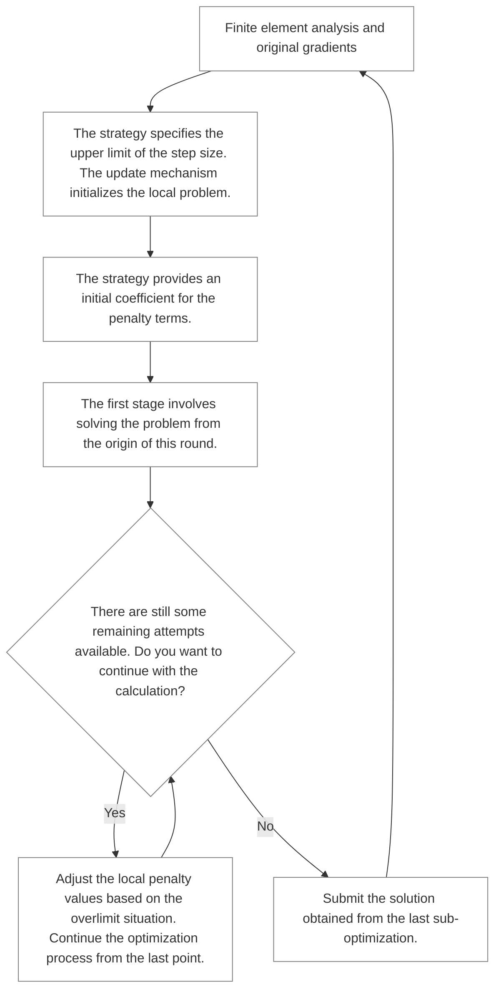

# Sensitivity and design updates

[简体中文](../../zh-CN/codestructure/optimization.md)

[Code structure overview](README.md)  ·  [Model Protocols](model.md#protocols)  ·  [Runtime](runtime.md)

The calculation of sensitivity and the design update each undertake the computation of derivatives and local design decisions, respectively. `ObjectiveFunction` forms a classification gradient based on the finite element results and the design mapping. `Updaters` assigns this gradient to the local updater of the bound object. Both processes collaborate through the gradient layout, and the results of the local update are written back through the model interface. Their positions within the overall module division are shown in [Kernel responsibilities and data flow](architecture.md#section-模型求解灵敏度与更新).

## Contents

<!-- docs:toc depth=1 -->

- [1 Source code entry point](#section-源码入口)
- [2 Objectives, metrics, and progression paths](#gradients)
- [3 Updater registration and target ownership](#section-更新器注册与目标所有权)
- [4 Local subproblems and writing back](#section-局部子问题与写回)
- [5 Design of boundary shapes](#shape)
- [6 SIMP Materials Design](#simp)
- [7 Bias layers and collaborative design](#section-偏置层与协同设计)

<!-- /docs:toc -->

<a id="section-源码入口"></a>

## 1 Source code entry point

| Path | Responsibility |
|---|---|
| [`optcore/objfunc.py`](../../../src/morphopt/optcore/objfunc.py) | Objectives under multiple operating conditions, along with sensitivities for associated/automatic derivatives |
| [`optcore/updaters.py`](../../../src/morphopt/optcore/updaters.py) | Updater registration, target analysis, gradient slicing, common optimization algorithms, and `QuadraticHistory` curvature history. |
| [`optcore/strategies.py`](../../../src/morphopt/optcore/strategies.py) | A unified update policy interface and fixed update implementation are provided. |
| [`shapeopt/strategies.py`](../../../src/morphopt/shapeopt/strategies.py) | A adaptive weighting scheme with optimized shapes, along with a strategy for gradually tightening the constraints around obstacles. |
| [`shapeopt/barriers.py`](../../../src/morphopt/shapeopt/barriers.py) | Fixed power-based geometric obstacles and optional geometric relaxations |
| [`shapeopt/boundary_part.py`](../../../src/morphopt/shapeopt/boundary_part.py)、[`surfaces/`](../../../src/morphopt/shapeopt/surfaces) | Boundary components and surface design variables |
| [`optcore/modelparams/parts/cad_part.py`](../../../src/morphopt/optcore/modelparams/parts/cad_part.py) | Public partitioning process, geometric loading, shell query, surface identification, and CAD conversion capabilities. |
| [`shapeopt/surfaces/brep_surface.py`](../../../src/morphopt/shapeopt/surfaces/brep_surface.py) | BREP boundary, STEP asset, and surface name mapping |
| [`shapeopt/surfaces/mesh_surface.py`](../../../src/morphopt/shapeopt/surfaces/mesh_surface.py) | Importing and exporting discrete triangular meshes in STL format |
| [`shapeopt/update_boundary_part.py`](../../../src/morphopt/shapeopt/update_boundary_part.py)、[`objectivefuncs/`](../../../src/morphopt/shapeopt/objectivefuncs) | Local subproblems of shape |
| [`simp/simpmaterial.py`](../../../src/morphopt/simp/simpmaterial.py) | Spline-based design fields, material scaling, and regularized elements |
| [`simp/update_simpmaterial.py`](../../../src/morphopt/simp/update_simpmaterial.py)、[`objectivefuncs/`](../../../src/morphopt/simp/objectivefuncs) | Local subproblems of the material |
| [`codesign/`](../../../src/morphopt/codesign) | Bias components, specialized updaters, and constraints |

<a id="gradients"></a>

## 2 Objectives, metrics, and progression paths

`ObjectiveFunction.objective_function()` returns the scalar loss for retaining the calculation graph, and the framework performs minimization. `get_metrics()` returns the responses recorded independently, without being part of the optimization process. The goal of obtaining load responses Jacobian requires declaring the load name through `jacobian_needed`.

```text
Params.obtain_design_sensitivity_vars(assembly)
  → {geometry, feamodel, materials}
  → Flatten and concatenate elements in collection order.
  → TorchFEA Multi-conditions target/supplemental sensitivity
      Exploratory design → Params.modify_assembly() → Target evaluation
  → Split the classification based on the original interval.
  → Updaters.update(gradients)
```

`geometry`, `feamodel`, `materials` are the keys for the gradient collection. The current updater manager provides registration interfaces for both geometry and material categories. The presence of the `feamodel` gradient indicates that the load design updater has not been configured.

The gradient layout is determined by the order of the collection, interfaces, and internal parameters of the object. The order in which the object’s `num_variables`, parameters are flattened, sensitivity inputs are provided, and they are written back must be consistent. The restoration state also follows this layout.

<a id="section-更新器注册与目标所有权"></a>

## 3 Updater registration and target ownership

`Updaters` is the manager, while `BaseUpdater` is a local updater for a specific design object.

| mechanism | Definition |
|---|---|
| `add_geometry_updater()` | Bind the target within the geometric collection |
| `add_material_updater()` | Bind the target element from the material collection. |
| Registered for `name` | Default target interface name and keys within the manager |
| `interface_name` | The target of the binding can be explicitly overridden. |
| `update_kind`、`target_type` | Collection types declared in base classes are constrained by target types. |
| `bind_target(target)` | Model objects that have been parsed by the receiver manager. |

When constructing the sub-optimizer, only the algorithm parameters and target names are saved. The sub-optimizer is called during registration using `define_objective()`; during the manager initialization, the targets are parsed, and then the sub-optimizer initialization is called. After the sub-optimizer is bound, `self.part` or `self.material` is saved, without retaining the entire set of parameters.

`BaseUpdater` directly inherits the lifecycle hooks of `ProtocalInitializable`. It does not redeclare `initialize()` and `reinitialize()`, which only throw exceptions. The specific updaters implement the initialization after binding and the reconstruction of the sub-problem that receives the original gradient. `part` and `material` access the target through a common `target` property. The binding state is only checked at this common entry point. `closure()`, `update()`, and `update_variables()` are dedicated algorithm interfaces for updaters, retained by `BaseUpdater`.

Multiple independent objects can be created within the same subclass, each associated with different parts or materials. The registration method, explicit objectives, variable slicing, and state directory should all point to the same design interface.

<a id="section-局部子问题与写回"></a>

## 4 Local subproblems and writing back

`reinitialize(gradient)` Receive the gradient of the current objective and prepare the local reference state, objective terms, and constraint cache; `update()` Solve the local L-BFGS subproblem; `update_variables()` Write the changes back to the design object.

| Configuration or status | Function/Role |
|---|---|
| `max_step_iter` | Upper limit of the number of steps per sub-solution |
| `max_step_length` | Update the step size configuration. |
| Update range | Geometric direct reading of the surface `is_updatable`; the material updater uses the global switch `if_update` |
| `update_strategy` | Generate the upper limit of step size for each variable, calculate the coefficients for named penalties, and select the candidate solutions to be submitted. |
| `save/load()` | Save and restore local state based on the target interface. |

The locally updated device context covers the target, constraints, and their cached tensors. After completion, the corresponding device state is restored. The geometry and material sub-optimizers are saved in `geometryupdater/<interface>/` and `materialupdater/<interface>/` respectively, without sharing a step-size file.

Each updater receives an update strategy through the constructor. The general interface and fixed update implementation are located at `optcore/strategies.py`, while the shape-specific algorithms are located at `shapeopt/strategies.py`. The updater is responsible for constructing the local problem, performing a single local solution through `solve_subproblem(origin)`, and submitting the candidate solutions returned by the strategy.

The updater exposes the policy namespace through the class attribute `strategies`, which is consistent with the usage of `objectivefuncs`. The base class provides a common policy; the shape updater overrides this namespace, referencing the same set of common policy classes and adding specialized implementations for shapes, without copying algorithms. The script uses expressions like `self.strategies.AdaptiveShapeUpdate()` in the constructor to create independent policy objects, and the biased shape updater inherits from the same entry point.

The strategies for handling specific shapes share the same update interface. `SensitivityShapeUpdate` interpolates the modulus of the gradient of control points to the sampling points on each surface. `AdaptiveShapeUpdate` scales the base coefficients according to the original sensitivity, and applies local penalty values to the sampling points or pairs that exceed the relaxation boundary. The second phase continues the calculation from the end point of the first phase.

`BaseConstraints` holds the reference area `area_weights` and the optional area `sample_weights`, combined through `integration_weights`. The areas are frozen on the outer reference layer, and the point-by-point strategy is set after the initialization of this round; the physical gradient and the first/second-order proxies always retain their original scale. The distance term uses the product of the combined weights on both sides, forming a double integral for points.

The call order for adaptive updates is as follows:



`PolynomialBarrier` is held by each geometric penalty term. Distances, curvatures, radii, and envelopes use a fixed third power. Obstacles are only activated when approaching thresholds or violating conditions; the strategy does not dynamically change the power level. The UI strategy directory specifies fixed weights, sensitivity sampling weights, and adaptive shape updates. It also reuses parameter forms, validations, and code generation. For parameter definitions and formulas, refer to [For more information on script strategies, please refer to…](../script-reference.md#section-几何更新策略与障碍积分).

<a id="shape"></a>

## 5 Design of boundary shapes

`BoundaryPart` shares `CADMeshingMixin` with `CADPart`, and inherits `BasePart` and updatable protocols to manage ordered surfaces. Surface 0 serves as the outer boundary, with subsequent surfaces forming the inner cavity. The normal direction is set in this order, and the user does not need to input `flip`. `define_surfaces()` declares the surface. Subclasses override `prepare_geometry()`, `assemble_geometry()`, and `define_mesh_sets()`, providing methods for assembling closed boundaries, shells, and inner cavities, as well as processing surfaces individually. These methods are matched with the nodes of the designed surface during mesh post-processing. The common mixin schedules these methods through a template process, while the shared mesh generation, surface set naming, and degree of freedom conversion are also utilized.

For CAD/STEP load cases, OCC surface loops are used as boundaries; for boundaries containing CPGEO/STL, discrete geometric surface loops are utilized. Both representations create solids with internal cavities, which are then divided and finite element meshes extracted using the same `CADHistory.mesh()` entrance point by TorchFEA. The original independent INP write and read pipelines have been removed. Surface outputs explicitly receive `pools`; when omitted, synchronization outputs are generated, without accessing the global controller's process pool.

`CADPart.to_boundary_part(asset_directory="morphopt_assets")` splits a final CAD solid into an outer shell and an inner cavity, saving each as a STEP file with a surface name mapping. Additionally, `BREPSurface` is created to reference these assets. The transformations retain `face_N` and `face_N_nodes`, while a surface set `surface_i_All` and a node set with the same name are established for each shell. The generated triangular mesh is generated from STEP files as needed, and does not participate in the solid geometry reconstruction process. The transformation does not automatically fit control points; if shape optimization is required, the specified surfaces can be converted to NURBS, and internal control point updates can be enabled. For usage details, refer to [CAD conversion interface](../script-reference.md#cad-to-boundary).

| levels | Achieving responsibilities |
|---|---|
| `BaseSurface` | Surface geometry, sampling, export, and sharing capabilities |
| `ControlPointSurface` | Control point parameters and pre-loaded data |
| `BspSurface` | Spline surfaces and cylindrical surfaces – Cylindrical Factory |
| `CPGEOSurface` | CPGEO: Surfaces, Cylinders, and Spheres Manufacturing Toolset |
| `MeshSurface` | The fixed triangular surface does not support updates to its control points. |
| `BREPSurface` | Exact CAD boundaries are saved as STEP assets; internal control points for fixed trimming edges can be provided after selecting NURBS surfaces. |
| Curved constraints | BSP/CPGEO: Mirrors, rotations, or transitions across surfaces. |
| `UpdaterBoundaryPart` | Binding the shape sub-problem for a single BoundaryPart |

Each boundary declares its own node sets. BSP surfaces and cylinders created with `CPGEOSurface.initialize_cylinder(..., fix_end_caps=True)` provide `surface_i_Bottom` and `surface_i_Head`, where `i` is the surface registration index. The initial CPGEO cylinder closes each end ring with a fan of triangles. After the first uniform reconstruction, controls on the two end disks are recorded as fixed controls for design updates and reconstruction. STL sampling uses the target spacing across the entire surface. Each finite-element end set includes nodes of that surface within the end disk footprint and less than half the CPGEO seed spacing from the end plane. For a short cylinder the band extends at most to the midplane, which belongs to neither set.

Surface constraints are executed in the order they are registered during surface updates and re-initializations. Local surface constraints are stored within the surface itself, and the Part level `apply_surface_constraints()` provides extended positions across surfaces.

The sampling of geometric constraints for fixed surfaces is provided by `BaseSurface`: caching oriented triangular slices, with the centroid serving as sampling points and area as the integration weight. The parameter surface rewriting sampling interface provides analytical geometric quantities. `BaseSurface.is_updatable` defaults to `False`; `BspSurface` and `CPGEOSurface` are enabled by default, but can be manually turned off according to the object. The geometric updater does not save independent switches; `BoundaryPart` directly reads surface properties during updates and sensitivity mapping; `ShapeDerivative` reads parameters through a unified `get_surface_parameters()`. Fixed boundaries still participate in distance constraints. For a complete validation of mixed boundaries, refer to [STEP outer boundary and BSP inner cavity example](../../../examples/hybrid_cylinder/hybrid_cylinder.md).

`ShapeDerivative` Pass the gradient of the main target structure to the local problem; `Fairness`, `Distance`, the cylindrical/radius boundaries, and the volume auxiliary terms are evaluated in the shape subproblem. `Fairness` The external visitor reads the first and second-order geometric quantities of each supported surface; the curvature threshold, BSP parameterization threshold, and reference compensation are all part of the penalty terms. `max_curvature` All BSP/CPGEO surfaces that can be updated are shared, with the metric change and non-orthogonal threshold for BSP being 0.1 and 0.2 respectively. The surface only retains its geometry, and the type contribution of the unregistered visitor is zero.

`ShapeDerivative` maintains its original first-order form, while `QuadraticShapeDerivative` represents independent historical second-order objective classes. Both are defined in `shapeopt/objectivefuncs/shapederivative.py`. The material module also distinguishes between `Sensitivity` and `QuadraticSensitivity`. The specific objectives are implemented by inheriting and reusing parameter reading and sensitivity mapping. Physical proxies and curvature history use the original finite element sensitivity. `QuadraticHistory` is located within `optcore/updaters.py`, where curvature history, direct and inverse Hessian products, and historical state serialization are uniformly managed. The specific objectives are still defined in their respective `objectivefuncs` modules.

The second-order objectives and the inner layer `Optimizer.LBFGS` each hold independent `QuadraticHistory` instances. The outer instances are updated during finite element sensitivity observations, using `hessian_product()` to evaluate the quadratic terms of the physical objectives; the inner instances are updated after being accepted in the trial steps, using `inverse_hessian_product()` to calculate the search direction. Both layers share the same positive curvature filtering and historical truncation mechanisms. When the sub-problems are re-established, the history of the inner layer is reset, while the history of the outer layer is retained across iterations.

`QuadraticHistory` inherits from `ProtocalSavable`, achieving unified `save(foldpath, iteration)` and `load(foldpath, iteration)`. The updater manager assigns `objectives/<term_name>/` as the sub-directory; specific targets will be delegated to its historical objects for saving and restoring. The historical class is responsible for the naming and state serialization of `surrogate_<iteration>.npz`; the manager does not interpret the specific proxy algorithms. The ability to save is stated in the protocol, and the actual timing of saving is determined by the holder; the inner history is still reset according to the lifecycle of sub-problems.

The surface `seed_size` controls the initial control mesh and sampling, while the Part’s `fea_seed_size` controls the body mesh. Changing the body mesh size does not automatically change the number of design control points.

<a id="simp"></a>

## 6 SIMP Materials Design

`SIMP_BSPFieldMaterials` inherits from `BaseMaterial` and is a updatable protocol. The design variable is the control points of the B-spline scalar field. The finite element responses obtain material parameters and regularization contributions through spatial mapping.

```text
control point → B Spline design field f → sigmoid(f) Obtain ρ
       → RAMP(ρ) Compared with the lower limit of the ratio → Material stiffness scaling
       → Regularization units and constitutive equations → Finite element responses
```

`SIMPScaledMaterial` The energy, stress, and tangents of the scaling reference constitutive model. `SIMPElementFgrad`, `SIMPElementFskew`, `SIMPElementHuHu_LuLu` represent different regularization implementations. The specific body elements are connected through corresponding combination classes.

`initial_ratio` is the control value of the initial design field; it does not directly equal the volume fraction. `VolFrac` applies volume weighting to the Gaussian points `ρ`; `MinValue/MaxValue` is the constraint control variable. `Sensitivity` represents the transferred material gradient, and `DensityFieldMinimize` is the auxiliary regularization term.

`UpdaterSIMPMaterial` Bind a material interface to construct local problems through its control points. The spatial projection and derivatives of the material are handled by the material interface; the updater does not replicate the B-spline mapping.

<a id="section-偏置层与协同设计"></a>

## 7 Bias layers and collaborative design

`OffsetBoundaryPart` constructs a solid offset layer along the normal direction of the inner cavity surface. This layer belongs to the same part, and the same boundary design variables are reused. During the construction process, it is necessary to check that the grid of the offset layer, its thickness, local curvature, and the distance between surfaces are compatible.

`UpdaterOffsetBoundaryPart` updates the shape reuse process and defines the target type. `InwardCurvatureRadius` and `OffsetSurfaceMinThickness` respectively control the concave curvature and the spacing after offsetting. This functionality has been integrated into the UI’s Part, updater selection, and preview functions.

The collaborative task still uses the common parameter set, FEAParams, solver, and updater manager. The main body and offset layers allocate materials based on the actual unit blocks. The SIMP material uses the common `UpdaterSIMPMaterial`. No additional controller or dedicated FEAParams are established.

For details on theories and algorithm derivations, refer to [Theory of Shape Optimization](../theory/morphdesign.md) and [Collaborative Optimization Theory](../theory/codesign.md). For example configurations, see [ScriptUpdater reference](../script-reference.md#section-updater-定义).
