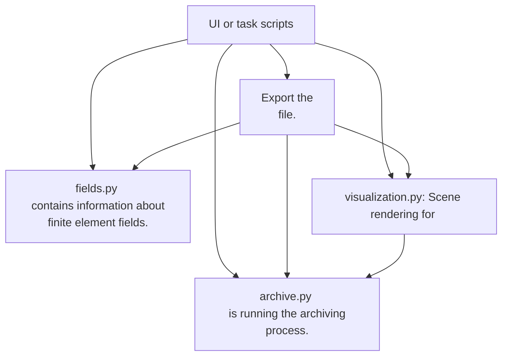

# Result analysis and export

[简体中文](../../zh-CN/codestructure/results.md)

[Code structure overview](README.md)  ·  [Running the archive](runtime.md)  ·  [UI Application Services](ui-application.md)  ·  [UI display](ui-presentation.md)

## Contents

<!-- docs:toc depth=1 -->

- [1 Source code entry point](#section-源码入口)
- [2 Optimized result retrieval](#section-优化结果读取)
- [3 Shared selection and page lifecycle](#selection)
- [4 Private models and independent finite elements](#section-私有模型与独立有限元)
- [5 Analysis result snapshot](#section-分析结果快照)
- [6 Field quantity calculation and cloud image projection](#section-场量计算与云图投影)
- [7 Registration of physical quantities and formats](#section-物理量与格式注册)
- [8 Exporting data in CSV or NPZ format from a single file](#section-csv-与-npz-单文件导出)
- [9 Export the native model along with all related results.](#section-原生模型与全部结果导出)
- [10 Export historical animations.](#section-历史动画导出)
- [11 Optimized log reading](#section-优化日志读取)

<!-- /docs:toc -->

<a id="section-源码入口"></a>

## 1 Source code entry point

Post-processing consists of four parts: archive reading, field calculation, file export, and scene rendering. The export interfaces are categorized according to the data they process into `exports/`.

```text
postprocess/
├── __init__.py       Public types and export entries
├── archive.py        Run archiving, design status, and model paths.
├── fields.py         Elemental field quantities, record tables, and node cloud diagrams
├── exports/
│   ├── __init__.py       Export interface
│   ├── tables.py         Finite Element Field Table and CSV/NPZ Writer
│   ├── finite_element.py TorchFEA Models and solutions, Abaqus INP
│   ├── components.py     Design components for specified iterations
│   └── animation.py      Historical snapshots and GIF images
├── visualization.py  3D scene and historical frame rendering
└── _runtime.py       Management of internal Torch numerical environment settings
```

| Module | Core interfaces | Responsibility boundaries |
|---|---|---|
| [`archive.py`](../../../src/morphopt/postprocess/archive.py) | `OptimizationArchive`、`IterationModel` | Reads controller information, design parameters, historical data, model details, and operating condition files; maintains cached information for recovery purposes. |
| [`fields.py`](../../../src/morphopt/postprocess/fields.py) | `FiniteElementResults`、`ResultField`、`ResultTable` | Calculate physical quantities related to nodes, reference points, and Gaussian points. Generate a combined record table, and produce numerical representations of node cloud maps. |
| [`exports/`](../../../src/morphopt/postprocess/exports) | `export_fields()`、`export_saved_fields()`、`export_native_results()`、`export_design_components()`、`export_history_gif()`、`export_history_inp()` | Failed to verify export options, organize output files, write them to the target directory, and clean up any failed files. |
| [`visualization.py`](../../../src/morphopt/postprocess/visualization.py) | `configure_plotter()`、`add_design_component()`、`add_deformation_mesh()`、`history_frames()` | Construct the scene and generate image frames using the camera and style specified by the caller. |

`__init__.py` provides business interfaces. The scenario rendering function is imported from `postprocess.visualization`; CSV and NPZ writers are registered through `TABLE_WRITERS` in `exports/tables.py`. `_runtime.py` is an internal support module that is responsible for switching the default device and precision of Torch during reading and calculation processes, and restoring the state before the call was made.

<a id="section-后处理服务的组合结构"></a>

### 1.1 The composite structure of post-processing services



`OptimizationArchive` holds the running directory and the restored design state. `FiniteElementResults` contains a set of finite element models and solutions. Field queries, table extraction, and cloud map projection use the same computational object. The export function combines corresponding data reading and calculation interfaces; animation export obtains images frame by frame from the visualization module and then writes them to GIF files. None of the modules import Qt controls or UI sessions.

<a id="section-ui-接入位置"></a>

### 1.2 UI access location

| UI path | Responsibilities |
|---|---|
| [`ui/application/results.py`](../../../src/morphopt/ui/application/results.py) | Combine archive objects together, maintaining shared iterations and historical selections. |
| [`ui/application/finite_element.py`](../../../src/morphopt/ui/application/finite_element.py) | Manage private models for independent analysis, payload editing, and result snapshots. |
| [`ui/widgets/finite_element.py`](../../../src/morphopt/ui/widgets/finite_element.py) | Select the fields and export format. Then, use the field object to obtain the cloud map values. |
| [`ui/widgets/history_export.py`](../../../src/morphopt/ui/widgets/history_export.py) | Surface, GIF, and Abaqus INP export forms, sharing progress, completion, failure, retry, and cancel processes |
| [`ui/widgets/viewport.py`](../../../src/morphopt/ui/widgets/viewport.py) | Unify 3D viewport settings, perspective controls, camera positioning, and deferred rendering techniques. |
| [`ui/visualization/rendering.py`](../../../src/morphopt/ui/visualization/rendering.py) | Pass the UI themes and global visualization parameters to the shared rendering function. |
| [`ui/worker.py`](../../../src/morphopt/ui/worker.py)、[`ui/processes.py`](../../../src/morphopt/ui/processes.py) | Unified management of task allocation, startup environments, and response files. |

The working process assigns tasks such as solving equations, CAD conversion, field calculation, native results generation, surface generation, or GIF export to `action` in `request.json`. After the tasks are successful, the results are written to `response.json` in the same directory, which records the output path, list of surface files, or actual number of frames. Standard output retains diagnostic logs, and the completion status is determined by the exit status and response files.

`processes.start_worker()` Unifies the Python interpreter, module entry points, UTF-8 environment, and diagnostic output channels. The common parts of the historical export window manage the temporary directory, busy status, failure prompts, retries, and cancellations. Specific forms only collect options and the selected output location. Cleans unfinished animation files when canceling GIF export, while existing target files are retained.

<a id="section-优化结果读取"></a>

## 2 Optimized result retrieval

`ResultSession` binds a running directory, maintains the iterations and historical selections shared by the pages, and combines `OptimizationArchive` to read parameters and geometry. Post-processing initializes the geometry, load interface, and materials, without executing `FEAParams.define_steps()`; the load case solving task is defined during the optimization running phase. `load_iteration()` and `load_parameters()` prepare the state for the selected iterations, while `deformation_cases()` and `deformation_mesh()` provide load case and deformation data.

The layout of the archive directory, controller loading, parameter state restoration, history, deformed meshes, and visual object reading are all centralized in `OptimizationArchive`. The `ResultSession` component of the UI manages these objects, maintaining only the selected state shared across pages. The export of GIFs and surfaces also uses the same archive object to read the design state.

| Reading the content | Source |
|---|---|
| Controller architecture | `scripts/MAIN_SCRIPT_FOR_RESTART.py` |
| Iterative loss and metrics | `log/history_record.csv` |
| Upgradable geometry and materials | Parameter interface storage status |
| Exact finite element model | `log/femodel&results/femodel_<iteration>.npz` |
| Operating condition solutions | `result_<case>_iter_<iteration>.npz` |

Observe the consumption session data on the page, but do not scan or analyze the above files by yourself. The display of design parameters and the display of finite element archives are different reading paths; the finite element analysis uses the actual mesh saved in this round, and does not replace it with the mesh reconstructed using current parameters.

<a id="selection"></a>

## 3 Shared selection and page lifecycle

`MainWindow` Use immutable objects `ResultSelection(folder, iteration)` Coordinate the observation page and the finite element page. Both places should select signal synchronization. The directory and iteration are used to display the status, while the FE model remains separate.

- When entering the finite element analysis mode, fix the current iteration state, and stop the automatic tracking of the page content.
- During the execution of finite element tasks, the selection of shared iterations is locked. However, background optimization can still continue to generate new archives.
- Range of new archiving updates. Snapshots that are currently being solved independently will not be replaced.
- Page splitting retains the ability to run the process, modify its load, and make analysis decisions. The process does not need to be restarted.
- Only when there exists a corresponding round model, can a separate finite element working area for that round be created.

After each polling of the session, the system notifies the main window through `resultsUpdated` to re-check the availability of the selected directory and the model for the current iteration. When the iteration number remains unchanged, the model file will also be updated in the finite element interface. At the beginning of a new optimization process, the old shared selections will be cleared. After the new task is selected for archiving for the first time, the finite element interface will import the model based on that directory and iteration.

The names of the original load cases should be recorded separately from the row numbers in the dropdown list; the original results and the results obtained from the independent analysis should be distinguished by explicit source objects.

The export of components from the iterative history is independent of the finite element model session. `postprocess.exports.export_design_components()` restores the archived state of the selected components and passes the parameters of the solution to the `export()` of the components. BoundaryPart writes all surfaces to the component sub-directory, prioritizing STEP format. SIMP can export VTI sampling fields, or export OBJ surface meshes based on voxel size and retention thresholds. Each component declares available solutions through `export_modes`.

<a id="section-私有模型与独立有限元"></a>

## 4 Private models and independent finite elements

```text
IterationModel(folder, iteration, case)
  → FiniteElementSession.select_result()
  → Read the exact model, restore the operating conditions, and verify the model’s hash value.
  → Private payload editing → solve_request()
  → QProcess Executing the solve task of the worker
  → accept_solution() Verify and save the independent snapshot.
```

`FiniteElementSession` does not share the modifiable model during optimization. `apply_loads()` It is necessary to verify all edits first, then apply the parameters, and set the old solution as invalid. The interface retains the enabled state of the original load case, without providing an additional enable/disable switch.

`solve_request()` writes the private model and requests to the session working directory; the Qt page only manages the events, output, and status of QProcess. `worker.py` does not create Qt controls, but performs independent solving or export operations.

`load_cases.json` lists the registration order of the original load cases. When this index is not provided during archiving, the finite element page allows for the reading and independent recalculation of the model and its saved loads. The solutions of the original load cases are not enumerated.

`select_result()` recovered `work_conditions` After verifying the model hash, any solutions that do not converge are not considered valid field results. The imported model will be retained, and no new successful results will be published.

<a id="section-分析结果快照"></a>

## 5 Analysis result snapshot

`FiniteElementResult` Save the stability key, source directory/round number/load case, model path, result path, analysis number, time, and log. `accept_solution()` After verification, the solution and model are confirmed to be valid. Only after copying the model, solution, and logs will they be added to the selected list.

The successful analysis records from the same session are listed together with the original load case. They are filtered by source directory and iteration. Switching between entries allows for the reconstruction of the private model from its snapshot. Continuing the editing process will not modify the existing records.

The independent snapshot is managed by `TemporaryDirectory`. It does not overwrite the original optimization archive, and it does not belong to `.morph`. The working directory is cleaned up after the session is closed. Long-term storage is achieved through explicit export.

<a id="section-场量计算与云图投影"></a>

## 6 Field quantity calculation and cloud image projection

`FiniteElementResults(controller, result)` provides a computing interface for a set of paired models and solutions. `available_fields(location)` queries available fields, `table(location, fields)` extracts combination records, `contour_fields` lists cloud component values, `contour_values(field)` returns the node scalars for each instance. Access and calculations for nodes, reference points, element blocks, and Gaussian points are all centralized within this object.

| Physical quantities | agreement |
|---|---|
| Node displacement and coordinates | Assembly global coordinate system |
| RP Movement | Convert the transformed RGC blocks into a format where the six components represent translation and rotation vectors. |
| RP angle | Global axis angle vector, in radians. Does not convert to Euler angles. |
| stress | Cauchy stress, global coordinate system |
| resilience | Green–Lagrange tensor strain; shear is a component of the tensor. |
| strain energy | Gaussian point energy density, reference volume, and integrated energy |

`FiniteElementResults` Cache the physical quantities of the solution map. Stress, strain, and energy density are first calculated as the average of the elements based on the reference integral volume, and then the neighboring elements are averaged at the nodes. This projection is used for the map, not for extrapolating nodal stresses; the results are exported with each Gaussian point value retained. The UI provides translations and controls based on field identifiers, and does not participate in the numerical projection.

For nodes lacking supporting data, NaN is used. Models without Gaussian points only provide applicable displacement amounts. The switching result replaces the cache, and the edited load clears old solutions and old field quantities. The camera, deformation magnification, and display components do not affect the physical results.

<a id="section-物理量与格式注册"></a>

## 7 Registration of physical quantities and formats

| abstraction | Responsibility |
|---|---|
| `ResultLocation` | Nodes, reference points, or unit records define the location. |
| `ResultField`、`RESULT_FIELDS` | Stable quantities, descriptions, locations, extractors, and availability metrics. |
| `ResultTable` | Listing and listing records per line |
| `FiniteElementResults.table()` | Combine the selected physical quantities based on the stable record numbers. |
| `TableWriter`、`TABLE_WRITERS` | Write the combined table in the specified format. |

Each time the table is exported, a specific location is selected, and multiple physical quantities are combined horizontally to form one table. The recording of unit positions can carry the numbers of integration points; in hybrid units, the recording of Gaussian quantities does not support retaining empty values. Integration points or zero stress cannot be fabricated.

The numbering of nodes, elements, and integration points starts from 1. The names of instances and element blocks are retained. Reference points have independent numbers and names. Each RP is represented by one line. Disabling RP prevents output.

New physical quantities have been registered for `ResultField`. New file formats have been implemented for `TableWriter`. The two extended paths do not copy each other's computational logic. The UI obtains optional items from the registry. The translation keys for built-in fields and formats are found according to `ui.fea.field_<field_id>` and `ui.files.<format_id>` respectively. Extended fields without translation are used for their descriptions, and extended formats are filtered based on file extensions.

<a id="section-csv-与-npz-单文件导出"></a>

## 8 Exporting data in CSV or NPZ format from a single file

`export_fields()` Check the convergence status and model hash, then call `FiniteElementResults.table()` to complete field selection, availability check, and record combination. The format writer only accepts record tables and source information.

`export_saved_fields()` Read the saved TorchFEA model and solution. After restoring the load case, call the export function for the field quantities. The independent working process passes the path and selected fields to this interface.

| Format | Deck contents |
|---|---|
| CSV | UTF-8 BOM: The first line contains the column names, followed by the actual data. |
| NPZ | Each column represents an array. `__metadata__` contains information such as source, unit, coordinate system, and model hash. |

The physical extraction and writing are first completed in the temporary file. After successful completion, the target file is published. If overwrite is not allowed, the existing file will not be replaced. If the evaluation or writing fails, the temporary files will be cleared. Overwriting confirmation is provided through the shared save dialog box of the display layer. The numerical services receive explicit write options through `overwrite`.

<a id="section-原生模型与全部结果导出"></a>

## 9 Export the native model along with all related results.

`native_export_request()` Fix the original model of the selected iteration, all original load cases, and the list of successfully analyzed cases within the session. `export_native_results()` Directly copy the original NPZ. Load edits that have not yet been solved will not be included in this list.

```text
<User prefix: /
├── <Prefix: _femodel.npz
├── <Prefix: _case0.npz
├── <Prefix: _analysis1.npz
└── <Prefix: _manifest.json
```

It’s a model that is shared among various iterations, with each result being stored separately. `work_conditions` After loading, first restore the load case of the selected result, then check the pairing. When the directory names are the same, a new numbered directory will be created; if the export fails this time, only the newly created directory will be cleared.

The native model was read from `torchfea.load_model()`, and the solution was read from `StaticResult.load()`. The native archive, single-table physical quantity export, and CAD STEP geometry export are each retained in their respective formats and data ranges.

<a id="section-历史动画导出"></a>

## 10 Export historical animations.

The numerical reading of the optimization history GIF, the generation of scene frames by frame, and the writing of GIF files belong to `postprocess`. `export_history_gif()` is responsible for receiving the running directory, export range, target object or load case, camera, and display style. `OptimizationArchive` is used to restore the design state of each round or read the deformed mesh. `visualization.history_frames()` generates frames using the colors and camera provided by the caller. `exports.export_history_gif()` writes the animation file.

Select the design components and their views or deformation load cases, and set the iteration range, frame rate, resolution, camera, and background color. The preview process renders static images for the completed iterations using `export_history_frame()`. The export process renders the selected range using `export_history_gif()`. Both processes share the same scene and viewing logic. The updated component page lists component-level export options for each selected component. The post-processing service restores the archived designs for the corresponding rounds and generates the corresponding files.

<a id="section-优化日志读取"></a>

## 11 Optimized log reading

`OptimizationArchive.log_files` lists the `.log` files under `log/`, without relying on historical runs or parameter initialization. `ResultSession` exposes this read-only index, while `ResultLogReader` is responsible for incremental decoding, file rotation, and rereading after truncation. The reading process does not modify the optimization log. `LogsPage` only manages file selection and reading positions, with polling coordinated by the observation session.

The optimization process uses `logger.exception()` to write tracking information during abnormal boundaries, and then transfers the abnormalities to the supervision process. If the task fails before the first full checkpoint, it will exit and report an error. Once checkpoints have been created, the supervision cycle retains the ability to continue from the archive. Results that have not been saved will not be published as new iterations.
