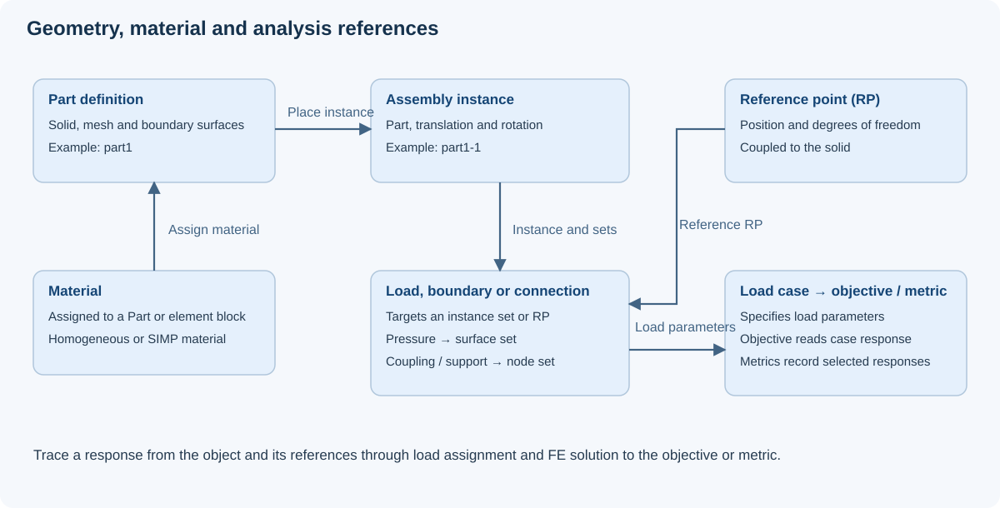

# MorphOpt script quick start

[简体中文](../zh-CN/script-quickstart.md)

[UI quick start](ui-quickstart.md)  ·  [Script module and API reference](script-reference.md)  ·  [UI module and interface reference](ui-reference.md)

Run a single-cavity bending actuator from Python, inspect the results and resume from a checkpoint. The [UI quick start](ui-quickstart.md) uses the same geometry, loads, material and objective. The [script reference](script-reference.md) describes each module and its extension points.

## Contents

<!-- docs:toc depth=1 -->

- [1 Example and prerequisites](#section-算例与运行条件)
- [2 Install and run the example](#section-安装并启动算例)
- [3 Complete task script](#section-完整任务脚本)
- [4 Inspect the output and design history](#section-查看输出与设计变化)
- [5 Stop and resume a run](#continuation)
- [6 Modify the example](#section-修改算例)

<!-- /docs:toc -->

<a id="section-算例与运行条件"></a>

## 1 Example and prerequisites

| Project | This example defines |
|---|---|
| Geometry | A cylindrical structure arranged along the Z-axis, with an outer radius of 8, length of 80; an inner cavity radius of 4, length of 74, and a bottom Z-coordinate of 3. |
| Components and Examples | `part1` and `part1-1` |
| Support | Fix the three translations at the base of the outer surface. |
| load | Cavity surface pressure `0.06`, one load case |
| Tip response | Couple `RP_1` to the top node set and record the Y component of its rotation vector, `ry`. |
| Materials | `NeoHookeanLnJ`，`mu=0.482`、`kappa=4.8` |
| Design Variables | Curved control points for outer boundaries and inner cavities |
| Objective | Match a rotation of `ry=2 rad` by minimizing `(ry - 2) ** 2`. |
| Geometric Control | xz Mirror symmetry, curvature regularization, minimum distance and cylindrical envelope |
| Compute configuration | CPU, one solver process |

Use consistent mm–N–MPa units. A pressure of `0.06 MPa` equals `60 kPa`. Enter rotation-vector components in radians. The script runs without opening the MorphOpt UI. Meshing and off-screen image capture require working Gmsh and VTK installations.



<a id="section-安装并启动算例"></a>

## 2 Install and run the example

Install MorphOpt in a Python 3.12 or later environment.

```bash
python -m pip install morphopt
```

The supplied [bending_actuator.py](../../examples/bending_actuator/bending_actuator.py) selects `cuda:0` for both the solver and the run. On a CUDA-equipped machine, run it from the repository root.

```bash
python examples/bending_actuator/bending_actuator.py
```

To run the file separately, copy it to a task directory and run `python bending_actuator.py` there. For a source checkout, install the package first with `python -m pip install -e .` from the repository root.

For a CPU-only run, use the complete script in the next section or edit a working copy of the repository script. Set the solver’s `process_devices` to `['cpu']` and the `device` argument of `start_optimization` to `'cpu'`. This configuration uses one CPU solver process. The first iteration initializes the surfaces, generates the volume mesh, solves the nonlinear FE problem, computes the sensitivities and updates the design. The history becomes available when the iteration is saved.

<a id="section-完整任务脚本"></a>

## 3 Complete task script

Save the following script as `bending_actuator.py` to run the example.

```python
import os
os.environ["MPLBACKEND"] = "Agg"
import morphopt
import torchfea
from typing import Any


class ThisController(morphopt.Controller):

    def __init__(self) -> None:
        super().__init__(
            path_result_folder='.results/', opt_label='BendingActuator'
        )

    class ObjectiveFunction(morphopt.ObjectiveFunction):

        def __init__(self) -> None:
            super().__init__()

        def objective_function(self) -> Any:
            return sum(self._objective_values())

        def _objective_values(self) -> list[Any]:
            def objective_term_0() -> Any:
                self.set_step('load_case_1')
                assembly = self.fe.assembly
                state = assembly._GC2RGC(
                    self.fe_results['load_case_1'].GC.to(assembly.device)
                )
                reference_point = assembly.get_reference_point('RP_1')
                return state[reference_point._RGC_index].reshape(-1)[4]
            return [(1.0) * (objective_term_0() - 2.0) ** 2]

        def get_metrics(self) -> Any:
            def metric_term_0() -> Any:
                self.set_step('load_case_1')
                assembly = self.fe.assembly
                state = assembly._GC2RGC(
                    self.fe_results['load_case_1'].GC.to(assembly.device)
                )
                reference_point = assembly.get_reference_point('RP_1')
                return state[reference_point._RGC_index].reshape(-1)[4]
            metrics = {}
            for name, value in [
                ('', metric_term_0()),
                ('', {f'objective_{index}': value for index, value in enumerate(self._objective_values())}),
            ]:
                if isinstance(value, dict):
                    entries = value
                elif isinstance(value, (list, tuple)):
                    entries = {
                        f'{name}_{index}' if name else str(len(metrics) + index): item
                        for index, item in enumerate(value)
                    }
                else:
                    entries = {name or str(len(metrics)): value}
                if metrics.keys() & entries.keys():
                    raise ValueError('Metric names must be unique.')
                metrics.update(entries)
            return metrics

    class Params(morphopt.Params):

        class GeometryParams(morphopt.GeometryParams):


            class BoundaryPart(morphopt.BoundaryPart):

                def define_surfaces(self) -> None:
                    surface_0 = self.BSP.initialize_cylinder(r0=8.0, length=80.0, seed_size=1.0, num_U_ratio=1, num_V_ratio=1, degree=3, init_location=[0.0, 0.0, 0.0], perturbation_L=10.0)
                    surface_0.is_updatable = True
                    self.add_surface_interface(surface_0)
                    surface_1 = self.BSP.initialize_cylinder(r0=4.0, length=74.0, seed_size=1.0, num_U_ratio=1, num_V_ratio=1, degree=3, init_location=[0.0, 0.0, 3.0], perturbation_L=10.0)
                    surface_1.is_updatable = True
                    self.add_surface_interface(surface_1)
                    surface_0.add_constraint(surface_0.mirror(plane='xz', offset=0.0))
                    surface_1.add_constraint(surface_1.mirror(plane='xz', offset=0.0))

                def define_instance(self) -> None:

                    self.add_instance('part1', 'part1-1', [0.0, 0.0, 0.0, 0.0, 0.0, 0.0])

            def define_interface(self) -> None:

                # BoundaryPart
                part_0 = self.BoundaryPart(
                    fea_seed_size=1.0,
                    mesh_order=1,
                    exterior_surface='surface_0_All',
                )
                self.add_interface(part_0, name='part1')


        class FEAParams(morphopt.FEAParams):

            def __init__(self) -> None:
                super().__init__()

            def define_interface(self) -> None:
                self.add_interface(self.Pressure(instance_name='part1-1', surface_name='surface_1_All'), name='pressure_1')
                self.add_interface(self.ReferencePoint(rp_location=[0.0, 0.0, 80.0]), name='RP_1')
                self.add_interface(self.Couple(rp_name='RP_1', instance_name='part1-1', set_nodes_name='surface_0_Head'), name='couple_1')
                self.add_interface(self.BoundaryCondition(instance_name='part1-1', set_nodes_name='surface_0_Bottom', index_dof=[0, 1, 2]), name='bc_1')

            def define_steps(self) -> None:
                self.add_step('load_case_1')
                self.set_step_params('load_case_1', 'pressure_1', [0.06])

        class MaterialsParams(morphopt.MaterialsParams):

            def __init__(self) -> None:
                super().__init__()

            def define_interface(self) -> None:

                self.add_interface(morphopt.HomogeneousMaterial(
                    material_parameters=self.models.NeoHookeanLnJParams(mu=0.482, kappa=4.8),
                    part_name='part1',
                    elementname='',
                    density=1.08e-09,
                ), name='material_1')

        def __init__(self) -> None:
            super().__init__(
                geometry=self.GeometryParams(), feamodel=self.FEAParams(), materials=self.MaterialsParams()
            )

    class Solver(morphopt.Solver):

        def __init__(self, params: Any) -> None:

            super().__init__(params=params, num_process=1, process_devices=['cpu'])

    class Updater(morphopt.Updaters):

        def define_updater(self) -> None:
            self.add_geometry_updater(self.UpdaterBoundaryPart(), name='part1')

        def __init__(self, params: Any) -> None:
            super().__init__(params=params, device='cpu')

        class UpdaterBoundaryPart(morphopt.UpdaterBoundaryPart):

            def __init__(self) -> None:
                super().__init__(
                    max_step_iter=50,
                    max_step_length=0.5,
                    update_strategy=self.strategies.AdaptiveShapeUpdate(
                        initial_tolerance=0.05,
                        final_tolerance=0.0,
                        violation_tolerance=0.1,
                        tightening_increment=0.0002,
                        weight_change_limit=10.0,
                    ),
                )

            def define_objective(self) -> None:
                self.add_objective_function(self.objectivefuncs.QuadraticShapeDerivative(memory_size=10))
                self.add_constraints(self.objectivefuncs.Fairness(max_curvature=1.0))
                self.add_constraints(self.objectivefuncs.Distance(min_distance=[[2.5, 2.5], [2.5, 2.5]]))
                self.add_constraints(self.objectivefuncs.boundarys.Cylinder(radius=10.0, height=80.0, bottom=0.0))


if __name__ == "__main__":
    morphopt.start_optimization(device='cpu', restart_per_iteration=20)
```

The runner loads the task class by the name `ThisController`. Keep the `if __name__ == "__main__":` guard so child processes can import the definitions without starting a second run.

The following table maps each part of the script to the model it defines.

| Define positions | The content of this example |
|---|---|
| `ThisController.__init__()` | Task Name and Result Root Directory |
| `ObjectiveFunction` | Read the end movement from `RP_1`, return the loss, and record the rotation angle. |
| `Params.GeometryParams` | Register `part1` and declare instances, external boundaries, and internal cavities. |
| `Params.FEAParams` | Register fixed conditions, reference points, couplings, and pressures, and then specify the amplitude of the load case. |
| `Params.MaterialsParams` | Assign the constitutive model to `part1` |
| `Params.__init__()` | Pass the three parameters into the framework. |
| `Solver` | Use one CPU solver process |
| `Updater` | Bind the geometry updater to `part1` and register the sensitivity with geometric constraints. |

Read the reference-point response by name from the assembly. The component order is `[x, y, z, rx, ry, rz]`, so index `4` selects `ry`. The script uses the same backend coordinate mappings as the UI's reference-point data template. The mapping uses `_GC2RGC` and `_RGC_index`. Keep the objective as a tensor for differentiation. Convert the value to a Python number only when recording a metric.

<a id="section-查看输出与设计变化"></a>

## 4 Inspect the output and design history

Results are saved under `.results/BendingActuator_T<timestamp>/` in the task directory. Keep the task and its relative input paths together when moving it.

| Files or directories | Content |
|---|---|
| `log/history_record.csv` | Loss per round, indicators, calculation time, and mesh statistics |
| `log/morphopt.log` | Optimization Process Log |
| `log/torchfea.log` | Finite Element Solution Log |
| `log/geometry/`、`log/materials/` | States of Design for Each Wheel |
| `log/geometryupdater/` | Geometry updater status |
| `log/femodel&results/` | Results of finite element models and load cases for each wheel. Historical deformation views and GIFs are read from here by wheel and load case. |
| `scripts/MAIN_SCRIPT_FOR_RESTART.py` | Continue with the task script snapshot used for the calculation. |

Follow the iteration, loss and stage times in the terminal. User metric `0` records the measured rotation `ry`. Automatic metric `objective_0` records the weighted squared error `(ry - 2) ** 2`, which is also the total loss in this single-objective example. A loss near zero means the rotation is near 2 rad.

To inspect the archive in the graphical interface:

1. Run `morphopt-ui`.
2. Select **File → Open optimization result** and choose the individual run directory containing `log/` and `scripts/`.
3. In the optimization history, select an iteration to view the curves, design surfaces or loaded deformation.
4. Open **Finite element** to inspect displacement, stress or strain for the selected iteration.

The UI reads the run archive directly. An arbitrary Python task does not provide an editable model tree. [UI quick start](ui-quickstart.md#optimization) · [UI results reference](ui-reference.md#results)

<a id="continuation"></a>

## 5 Stop and resume a run

Stop a terminal run with Ctrl+C. To resume, select a run directory with a fully saved model, solution and updated design. A partial iteration cannot serve as a checkpoint.

Create `resume_optimization.py` with the following code and substitute the path to your run.

```python
from pathlib import Path
import morphopt

if __name__ == "__main__":
    run_folder = Path("examples/bending_actuator/.results/BendingActuator_T<timestamp>").resolve()
    morphopt.start_optimization(
        device="cpu",
        path_result=str(run_folder),
    )
```

Run `python resume_optimization.py` to load the archived script and the latest completed checkpoint. Set `path_result` to the individual run directory. Start a new task if you change the model structure.

`restart_per_iteration=20` restarts the worker process periodically within the same run. `max_step_iter=50` limits the iterations in one inner solve. The adaptive strategy's `max_solves` limits the number of inner solves per design update.

<a id="section-修改算例"></a>

## 6 Modify the example

| Changes made | Location of modification | Concurrent verification |
|---|---|---|
| Dimensions of Cylinder and Inner Cavity | `Params.GeometryParams.BoundaryPart.define_surfaces()` | Cavity location, wall thickness, reference point location, and envelope dimensions |
| Pressure amplitude | The content in `FEAParams.define_steps()` includes `[0.06]`. | Consistent unit system and pressurized surface |
| Material parameters | `MaterialsParams.define_interface()` | Parameter Name, Constitutive Model, and Component Allocation |
| Motion objectives | Components and target values in `_objective_values()` | Indicator components, matching errors, and units |
| Mesh density | `fea_seed_size` | First-round process, solution stability, and accuracy of formal results |
| Update Control | `Updater.UpdaterBoundaryPart.define_objective()` | Minimum distance, curvature threshold, and envelope |

`seed_size` controls the surface control net. `fea_seed_size` controls the volume mesh. Increasing only the FE seed size leaves the number of surface design variables unchanged. See the [script reference](script-reference.md) for multiple load cases, SIMP materials, CAD, contact and custom updaters.
