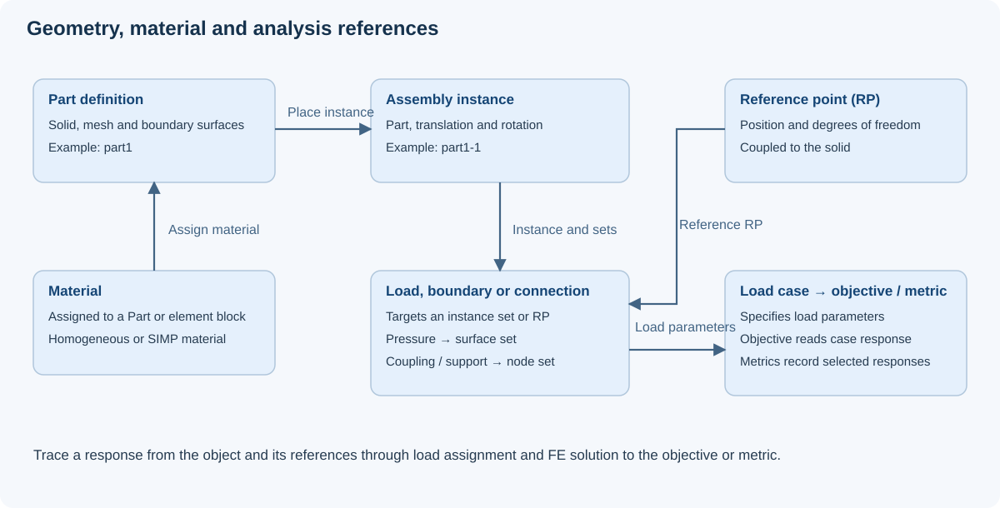
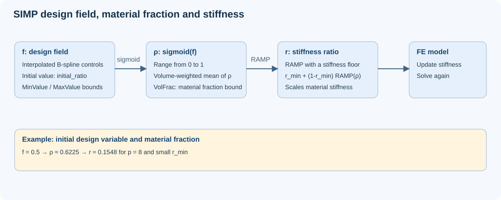
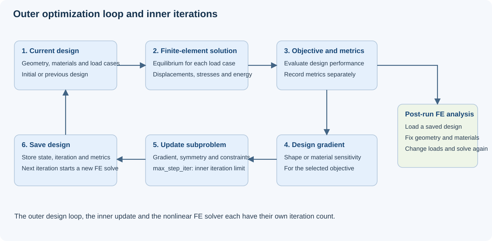

# MorphOpt script module and API reference

[简体中文](../zh-CN/script-reference.md)

[Script quick start](script-quickstart.md)  ·  [UI quick start](ui-quickstart.md)  ·  [UI module and interface reference](ui-reference.md)

This document describes the script definitions for controllers, model parameters, geometry, load cases, materials, objective functions, solvers, and updaters. Each section includes information on module responsibilities, registration locations, main interfaces, input conventions, and extended examples. The complete executable task can be found at [bending_actuator.py](../../examples/bending_actuator/bending_actuator.py); the local code in this document is used to replace or extend the corresponding modules within this task.

The script and UI use the same computational kernel. The correspondence between UI fields, the model tree, and the preview can be found in [UI module reference](ui-reference.md). The specific classes and parameters are subject to the current source code.

## Contents

<!-- docs:toc depth=2 -->

- [1 Module Organization and Execution Phase](#section-总体结构)
    - [1.1 Relationship between task class and object](#section-任务类与对象关系)
    - [1.2 Construction, Initialization, and Each Round of Reinitialization](#section-构造与初始化约定)
    - [1.3 Convention of Names, Parameters, and Units](#section-名称参数与单位约定)
- [2 Controller and run entry points](#controller)
    - [2.1 Controller Definition](#section-控制器定义)
    - [2.2 Start and continue the calculation](#section-启动与继续计算)
- [3 Params Parameter Aggregation](#section-params-定义)
- [4 GeometryParams: Components, Surfaces, and Instances](#geometry)
    - [4.1 Component Registration and Naming](#section-部件注册与命名)
    - [4.2 BoundaryPart and boundary surfaces](#section-geometryparams-定义要点一个-part-接口)
    - [4.3 Instance pose and set reference](#section-instance-位姿与集合引用)
    - [4.4 CAD History and STEP Export](#section-cad-历史与-step-导出)
    - [4.5 INP, Box, and Custom Parts](#section-inpbox-与自定义-part)
- [5 FEAParams: loads, boundaries, connections, and load cases](#section-feaparams-定义要点)
    - [5.1 Interface Definition and Load Case Magnitude](#section-接口定义与工况幅值)
    - [5.2 Order of Load Interface and Parameters](#section-载荷接口与参数顺序)
    - [5.3 Reference points, coupling, and fixation conditions](#section-参考点耦合与固定条件)
    - [5.4 Contact and Springs](#section-接触与弹簧)
- [6 MaterialsParams: Constitutive and material design fields](#section-materialsparams-定义要点)
    - [6.1 Homogeneous Material Allocation](#section-均质材料分配)
    - [6.2 Eight types of constitutive parameters](#section-八种本构参数类型)
    - [6.3 SIMP Density Field Material](#section-simp-密度场材料)
- [7 ObjectiveFunction: Loss and monitoring indicators](#section-objectivefunction-定义)
    - [7.1 Scalar Loss and Optimization Direction](#section-标量损失与优化方向)
    - [7.2 Extract reference point responses by name](#section-按名称提取参考点响应)
    - [7.3 Load Jacobian](#section-载荷雅可比)
- [8 Solver: Solving of load cases and computational resources](#section-solver-定义)
    - [8.1 CPU and Single-Process Configuration](#section-cpu-与单进程配置)
    - [8.2 Multi-loading Case Scheduling and GPU](#section-多工况调度与-gpu)
    - [8.3 Initial Solution and Geometric Changes](#section-初始解与几何变化)
- [9 Updaters: Design variable updates](#section-updater-定义)
    - [9.1 The registration method is bound to the target.](#section-注册方法与目标绑定)
    - [9.2 Geometric Updater](#section-几何更新器)
    - [9.3 Material Updater](#section-材料更新器)
    - [9.4 Custom Updateer Class](#section-自定义更新器类)
- [10 Codesign: Collaborative Update of Shape and Material](#section-codesign-模块定义)
- [11 The correspondence between custom classes and the UI](#custom-classes)
- [12 Iterations, saving, and continuing the calculation](#section-迭代与重启机制)
- [13 Output archiving and issue diagnosis](#section-输出与问题诊断)
    - [13.1 Main output](#section-主要输出)
    - [13.2 Post-processing script interface](#section-后处理脚本接口)
    - [13.3 Configuration Diagnosis](#section-配置诊断)
- [14 Source Code and Example Indexes](#section-参考实现)

<!-- /docs:toc -->

<a id="section-总体结构"></a>

## 1 Module Organization and Execution Phase

<a id="section-任务类与对象关系"></a>

### 1.1 Relationship between task class and object

The task file is organized at the module level by the `ThisController` class, and the runner creates controllers from this class. The controller creates running objects through four nested classes:

| Definition Classes | Running Object in Controller | Responsibilities |
|---|---|---|
| `ThisController.Params` | `controller.params` | Geometry, load, case conditions, and material definitions |
| `ThisController.ObjectiveFunction` | `controller.objfun` | Scalar loss, monitoring indicators, and sensitivity calculation |
| `ThisController.Solver` | `controller.solver` | Multi-load case finite element solution and task scheduling |
| `ThisController.Updater` | `controller.updater` | The set of updaters for each design object |

`Params` contains `GeometryParams`, `FEAParams`, and `MaterialsParams`. The three types of collections are registered through `add_interface(interface, name=...)` objects; the registered names of geometry and materials are updated simultaneously with the target analysis of the updater.



The material is distributed to the unit blocks of Part, while the loads act on the node sets, surface sets, or reference points of Instance. The load cases specify the magnitudes of each load interface. The geometry updater is bound to the Part interface, and the material updater is bound to the material interface.

<a id="section-构造与初始化约定"></a>

### 1.2 Construction, Initialization, and Each Round of Reinitialization

| Stage | Main Methods | Processing results |
|---|---|---|
| Construction | `__init__()` | Save the configuration, name, and values to create an empty set. |
| Register | `define_interface()` | Register for Parts, FEA, or material interfaces. |
| Geometric Declaration | `define_instance()`、`define_surfaces()`、`define_operations()` | Declare instances, boundary surfaces, or CAD operations. |
| Condition Declaration | `define_steps()` | Create a list of working conditions and fill in the amplitudes. |
| Updater Declaration | `define_updater()`、`define_objective()` | Register the sub-optimizer and its objective terms and constraint terms. |
| Initialization | `initialize()` | Execute the declaration method, parse and update the target, prepare the object for execution. |
| Each round of preparation | `reinitialize(iteration=...)` | Update the iterative status and current design data |
| Model Construction | `build_part()`、`create_feamodel()` | Generate the mesh and assembly, and set the loads and materials. |

When the collection is constructed, its `interfaces` is usually empty. Before accessing the registered interfaces, reading the surface list, or loading the saved state, the `initialize()` of the corresponding collection should be executed first. The complete task is initialized by the controller, and the declared methods are not called repeatedly at the task entry.

`define_objective()` is executed during the registration of the sub-optimizer; the target binding occurs in the subsequent initialization phase. Therefore, the constructor and `define_objective()` declare that the configurations do not read the unbound `self.part` or `self.material`. Custom runtime preparations are placed in `initialize()`, and the parent class implementation is called.

<a id="section-名称参数与单位约定"></a>

### 1.3 Convention of Names, Parameters, and Units

- The general task module inherits from the top-level `morphopt.Controller`, `Params`, `ObjectiveFunction`, `Solver`, and `Updaters`. `shapeopt`, `simp`, and `codesign` provide specific design objects, target items, and updaters.
- The interface names are case-sensitive. The registered names within the same collection must not be duplicated. Explicit names facilitate the maintenance of references between loads, materials, and updaters.
- The geometric interface registration name, assembly Part name, Instance name, and material interface name have different meanings. In regular tasks, the geometric interface registration name is consistent with the Part name; the Instance name is declared separately.
- The index for the load case, surface, and degrees of freedom starts from `0`. The pose is represented by `[tx, ty, tz, rx, ry, rz]`, and the next three terms are rotation vectors, with the unit being rad.
- Lengths, forces, stresses, and densities use the same unit system. The result directory and relative input paths are organized according to the directory where the task script is located.

<a id="controller"></a>

## 2 Controller and run entry points

<a id="section-控制器定义"></a>

### 2.1 Controller Definition

```python
class ThisController(morphopt.Controller):
    def __init__(self):
        super().__init__(
            path_result_folder="./results/",
            opt_label="BendingExample",
        )
```

The nested classes `Params`, `Solver`, `Updater`, and `ObjectiveFunction` in the controller are defined within the same `ThisController`. For the complete structure, refer to [Quick Start Task](../../examples/bending_actuator/bending_actuator.py).

| Parameters or attributes | Meaning |
|---|---|
| `path_result_folder` | Root directory of new run results |
| `opt_label` | Task tags, used to generate the  `<task_name>_T<timestamp>` directory name |
| `path_result` | The current specific running directory, which is set by the framework after startup. |
| `history` | Iterative Loss, Metrics, Time Consumption, and Mesh Statistics |
| `optdevice` | Computing device on the controller side, set by the operation entrance |

<a id="section-启动与继续计算"></a>

### 2.2 Start and continue the calculation

```python
if __name__ == "__main__":
    morphopt.start_optimization(device="cpu", restart_per_iteration=20)
```

| Entrance parameters | Definitions and Conditions of Use |
|---|---|
| `device` | Optimize side equipment, default: `"cpu"`; explicitly use CUDA tasks with `"cuda:0"` and other equipment names. |
| `restart_per_iteration` | The interval for restarting the segmented calculation process. It will continue from where it left after the restart. |
| `path_result` | There is already a specific run directory; create a new one if omitted. |
| `target_iteration` | Continue from the specified save state; skip this item for normal continuation of calculations, and read from the most recent state. |

The startup entry is placed within `if __name__ == "__main__":` to avoid repeated execution when importing task files in multiple processes. `start_optimization()` starts the background calculation process without opening the graphical interface.

For more examples of calculations, please refer to [Script quick start](script-quickstart.md#continuation). Restore the process by running `scripts/MAIN_SCRIPT_FOR_RESTART.py` within the load case running directory and save the state. Modifying the original task file will not automatically update the existing runs.

<a id="section-params-定义"></a>

## 3 Params Parameter Aggregation

`Params` receives three sets of data: geometry, FEA, and materials. The nested class names are used to organize the code, and the objects passed as parents determine the model configuration.

```python
class Params(morphopt.Params):
    def __init__(self):
        super().__init__(
            geometry=self.GeometryParams(),
            feamodel=self.FEAParams(),
            materials=self.MaterialsParams(),
        )
```

This segment is located in the `Params` class of the task. The three collection classes are defined within the same class in the subsequent chapters. The common interfaces of `Params` are as follows.

| Methods or Properties | Definition |
|---|---|
| `geometry`、`feamodel`、`materials` | Operating objects of the three types of parameter sets |
| `initialize()` | Initialize three sets. |
| `create_feamodel(path_result=None, pools=None)` | Create a FE model from the current geometry, set the materials, and initialize the model. |
| `reinitialize(iteration)` | Prepare the parameters for this round. |
| `save(foldpath, iteration)`、`load(foldpath, iteration)` | Save or read the design state of a specified iteration. |

All three types of collections provide `add_interface()`, `interfaces`, and `interface(name)`. When no registration name is specified, the collection generates a name of `<class>_<index>`. `interface(name)` reports the existence of existing candidate objects when the name is invalid.

<a id="geometry"></a>

## 4 GeometryParams: Components, Surfaces, and Instances

<a id="section-部件注册与命名"></a>

### 4.1 Component Registration and Naming

The geometric collection has been registered with the Part interface in `define_interface()`:

```python
class GeometryParams(morphopt.GeometryParams):
    def define_interface(self):
        self.add_interface(
            morphopt.BoxPart(
                length=40.0, height=16.0, depth=8.0,
                mesh_size=2.0, mesh_order=1,
            ),
            name="block",
        )
```

The geometric registration name and default Part name of the above objects are both `block`. The script base class creates an Instance with the same name and zero pose by default. The UI typically explicitly declares instance names such as `part1-1`. When using the script, the load reference should be consistent with the actually declared Instance name.

| Type of Part | Definition of Entries | Design Features |
|---|---|---|
| `BoundaryPart` | `define_surfaces()` | Parametric Closed Boundary and Shape Design Variables |
| `OffsetBoundaryPart` | `define_surfaces()`, with a bias parameter added | Inner cavity offset solid layer and shape design variables |
| `BoxPart` | Length, width, height, and mesh parameters | Structured cuboid, capable of supporting SIMP material fields |
| `CADPart` | `define_operations()` | CAD Operation History and Solid Mesh |
| `INPPart` | INP path and source Part selection | Import existing meshes and collections |
| `BasePart` subclass | `build_part()` | Custom TorchFEA Part construction logic |
| `FixedPart` subclass | `build_part()` | Custom fixed geometry, reuse mesh, and direct access to the node set, surface set, and element set within it. |

<a id="section-geometryparams-定义要点一个-part-接口"></a>

### 4.2 BoundaryPart and boundary surfaces

`BoundaryPart` uses the surface `0` as the outer boundary, and subsequent surfaces as the inner cavity boundaries. The order of surface registration also determines the set index and the order of design variables.

```python
class Actuator(morphopt.BoundaryPart):
    def define_surfaces(self):
        outer = self.BSP.initialize_cylinder(
            r0=8.0, length=80.0, seed_size=1.0,
            )
        outer.is_updatable = True
        outer.add_constraint(outer.mirror("xz"))
        self.add_surface_interface(outer)

        cavity = self.BSP.initialize_cylinder(
            r0=4.0, length=74.0, seed_size=1.0,
            init_location=[0.0, 0.0, 3.0], )
        cavity.is_updatable = True
        cavity.add_constraint(cavity.mirror("xz"))
        self.add_surface_interface(cavity)
```

After this type of definition is defined in `GeometryParams`, it is registered through `self.add_interface(self.Actuator(fea_seed_size=1.0, mesh_order=1), name="part1")`.

| Parameters | Definition |
|---|---|
| `fea_seed_size` | Target size of the Part finite element mesh |
| `mesh_order` | Mesh order, `1` or `2` |
| `exterior_surface` | Display the name of the surface collection, which is used for the default visualization of component meshes and deformation results; boundary components are set to `surface_0_All` by default. |
| Surface `seed_size` | The surface controls the grid and initial sampling scale, which are independent of the volume grid size. |
| `init_location` | Initial position of the surface |
| `perturbation_L` | Initial disturbance length parameter. Negative values indicate no disturbance is applied. |

The surface only stores geometry; the curvature threshold is defined by the `Fairness(max_curvature=...)` in the updater. The metric changes and non-orthogonal thresholds of BSP are 0.1 and 0.2 respectively. The surface orientation is automatically set by the component according to the outer boundary/inner cavity order, without the need to input `flip`. Geometric changes are also controlled by the update step size, distance, and envelope conditions.

<a id="section-曲面工厂"></a>

#### 4.2.1 Surface Factory

| surface | Script entry | Input Convention |
|---|---|---|
| BSP Cylinder | `self.BSP.initialize_cylinder(...)` | `r0`, `length`, `seed_size` - The number of settings, alignment ratio of control points, and initial position can be adjusted. |
| CPGEO Cylinder | `self.CPGEO.initialize_cylinder(...)` | Geometric parameters such as `r0`, `length`, `seed_size`, `init_location` |
| CPGEO sphere | `self.CPGEO.initialize_Sphere(...)` | `r0`、`seed_size`、`init_location` |
| Mesh surface | `self.MeshSurface(vertices, faces)` or `self.MeshSurface.initialize_from_stl_file(path_stl)` | The relationship between vertex coordinates and triangular faces; STL is used for file import; design variables are not provided. |
| BREP surface | `self.BREPSurface(path_step, control_point_spacing=None)` | The precise surface and its topological components form a closed boundary, currently saved in STEP format. The topological identity and collection are saved with the same name `.brep.json`. Specifying the face conversion to NURBS can enable the optimization of control points within the face. |

`BREPSurface` and `MeshSurface` are classified by geometric representation. The former uses precise CAD boundaries during subdivision, while the latter uses discrete triangular meshes. STEP and STL are the current asset file formats. BREP is fixed by default. Selecting NURBS surfaces and enabling update provides control points for design variables; MeshSurface remains fixed.

The name of the spherical factory is `initialize_Sphere`, and this case is retained in uppercase. The script name differs from the `cpgeo_sphere` type label in the UI. The parameter descriptions and examples for each surface can be found in [UI Surface Reference](ui-reference.md#surface_types-bsp-cylinder).

<a id="brep-topology"></a>

##### 4.2.1.1 BREP Topology, Set, and NURBS Conversion

`BREPSurface` manages an accurate collection of geometries, topologies, and names for a closed shell. The topology is read upon first access, and the reading process does not generate display triangulated meshes or finite element meshes.

| Interface | Definition |
|---|---|
| `faces` | Mapping from the surface name to `BREPFace`; records the underlying surface type, ordered boundary line loops, parameter range, and geometric features. |
| `edges` | Mapping of edge names to `BREPEdge`; records the curve type, endpoints, associated faces, and parameter range. |
| `vertices` | Mapping from vertex names to `BREPVertex`; records coordinates and associated edges. |
| `nurbs_faces` | Mapping of NURBS surface names to `NURBSFace`; records control points, fixed rational weights, degrees in each direction, and node vectors |
| `convert_faces_to_nurbs(faces)` | Convert the specified logical surfaces into NURBS, reassemble the closed shell, and retain the original surface names. |
| `select_design_faces(faces)` | Specify the surfaces involved in shape update from existing NURBS surfaces; it must be explicitly specified before enabling the update, not inferred from assets. |
| `show(plotter=None)` | Interactive viewing of surface names; click on a geometric surface to display `face_N` and highlight the entire surface. Click on the blank area to clear the selection. When using the existing PyVista Plotter, only configure the scene, and let the caller open the window. |
| `add_surface_set(name, faces)` | Register the union of one or more surfaces. |
| `add_node_set(name, entities)` | The union of the nodes contained in the registered faces, edges, or vertices |
| `evaluate_face(name, uv)` | Evaluating on the underlying surface, input shape: `(N, 2)`, returned coordinates: `(N, 3)` |
| `contains_face_parameters(name, uv)` | Determine whether the parameter points lie within the valid area after clipping, including those located inside holes. |
| `evaluate_edge(name, parameters)` | Evaluate the three-dimensional curve of the edge, and return the `(N, 3)` coordinates. |
| `edge_parameters_on_face(face, edge, parameters, which=0)` | Map edge parameters to the UV coordinates of the associated surface. Periodic seams are selected through `which` branching. |
| `export_step(path)` | Export the current geometry and the one with the same name `.brep.json`. No finite element mesh will be generated. |
| `bind_mesh(part)` | After the finite element element order processing is completed, match the UV of the final nodes by surface. Automatically called by `BoundaryPart`. |
| `map_face_nodes(name)` | Calculate the finite element node coordinates of the specified surface on the cached UV map, preserving the PyTorch computational graph of the coordinate pairs for control points. |
| `is_updatable = True` | The control points of the selected NURBS surface are incorporated into the `BoundaryPart` design variable; the initial value is `False`. |

```python
class Body(morphopt.BoundaryPart):
    def define_surfaces(self) -> None:
        boundary = self.BREPSurface("morphopt_assets/body/surface_0.stp", control_point_spacing=0.8)
        boundary.convert_faces_to_nurbs(["face_0"])
        boundary.select_design_faces(["face_0"])
        boundary.is_updatable = True
        boundary.add_surface_set("loaded", ["face_0"])
        boundary.add_node_set("rim", ["edge_0"])
        boundary.export_step("geometry_output/body.stp")
        self.add_surface_interface(boundary)
```

In the example, `face_0` and `edge_0` should be selected based on the actual topology. The `loaded` surface set on the 0th surface is named `surface_0_loaded` in the finite element model, and the corresponding node set is `surface_0_loaded_nodes`; the `rim` node set is named `surface_0_rim`. Each surface has additional aliases `surface_0_face_N` and `surface_0_face_N_nodes`, and `surface_0_edge_N` and `surface_0_vertex_N` node sets are automatically generated for each edge and vertex. The original `face_N`, `face_N_nodes`, and `surface_0_All` sets are retained as well.

The surface `evaluate_face()` includes the extended values of the underlying surface outside the cutting area. Integrals or sampling should use `contains_face_parameters()` to select the effective domain.

The NURBS conversion is performed by the OCC geometry layer in TorchFEA. Non-planar surfaces use the native `convertToNURBS`; planar surfaces are constructed as precise bilinear B-spline support surfaces, maintaining the original outer contours and holes. After conversion, the shell is reassembled, and subsequent previewing, STEP export, and solid mesh generation use this geometry. The topological identity is preserved through the mapping of geometric features; if the features cannot be uniquely identified or the topological quantity changes, a conversion error will be reported.

`.brep.json` can be uniformly saved together with `face_map`, `edge_map`, `vertex_map`, and named collections. The STEP geometry and metadata should be moved together. These definitions should be restored when the export results are read.

**Finite Element Node Parameter Matching and Differentiable Mapping**

Each `NURBSFace` reads control points, weights, and node vectors from the OCC accurate geometry. It reads dependencies on `cadquery-ocp>=8.0.1.1.0`; basis functions and their first and second derivatives are reused from `bspmap.Basis`, and then normalized in a rational form. The degrees of the two parameter directions can be different, and the UV coordinates maintain the CAD native range. The periodic support surface is represented as a non-periodic form within a cycle, while the original parameterization is retained.

`NURBSFace.match_coordinates(surf_node_idx, surf_nodes, initial_uv=None, batch_size=4096, tolerance=1e-9, max_iterations=40)` uses KD-tree initial values and batch Newton projections. These initial values can be directly used when `initial_uv` is provided. The matching results are stored in `surf_node_idx`, `surf_node_uv`, and `projection_errors`. `map(uv, derivative=(0, 0))` returns three-dimensional coordinates; `derivative` supports first- and second-order pure derivatives as well as mixed derivatives. UV and rational weights remain fixed in this mapping, and control points participate in PyTorch automatic differentiation.

`BoundaryPart` automatically binds the BREP nodes after the first or second-order mesh construction is completed. Nodes on hole boundaries, outer contours, and joints are first projected onto the corresponding CAD edges, and then converted into parameter domains for each surface. Second-order nodes are included in the matching results. The midpoints of curved edges are corrected to the CAD edges. UVs for shared nodes are saved for each surface, and the reconstruction positions of adjacent surfaces are checked for consistency. The binding results are re-generated when the number or numbering of nodes changes after re-slicing.

```python
# The body has been initialized, and at least one face has been converted to NURBS.
mesh = body.build_part("work")
boundary = body.surface_interface(0)
face = boundary.nurbs_faces["face_0"]
parameters = face.get_surface_parameters().detach().clone().requires_grad_()
face.set_surface_parameters(parameters)
coordinates = boundary.map_face_nodes("face_0")
gradient, = torch.autograd.grad(coordinates.square().sum(), parameters)
```

The node UVs and basis function models belong to runtime data and are not written into the `.morph` or geometric metadata. `BREPSurface` is fixed by default. After setting `is_updatable` to `True`, the control points of the selected NURBS surfaces are incorporated into the component design variables in the order of their names. The construction parameter `control_point_spacing=0.8` specifies the target physical spacing of the control points, with the unit being consistent with the model length. Equal-parameter curves are sampled along two directions, and the arc length of the longest sampled curve in each direction is divided by the spacing, rounded up to determine the minimum number of control points. Encryption is achieved by precisely inserting nodes. The spacing represents the average design resolution; it is not required that control points located outside the surface be equidistant from each other, nor does it constitute a local upper limit on spacing. Any existing denser control grids remain unchanged. By default, `None` retains the original grid. This configuration belongs to the task definition and is not written into asset metadata. When the grid is bound, the control points involved in the trimmed edges, hole edges, and parameter domain boundaries are fixed, while other control points can be updated by the geometric optimizer.

Before each subdivision, the current control points are written into a temporary STEP solid and loaded into Gmsh along with the current face mapping. The current control points are also used when exporting the iterative surface; `.npz` iterations are archived to save the control points of each selected face. Before writing back, check whether the original trimmed edges still fall on the updated surface, repair the solid, and verify its closure. Update reports that may move existing boundaries or render the solid invalid. This interface supports optimization of the shape within a fixed boundary; it is necessary to define additional linkage rules for boundary movements and the movement of adjacent unselected faces.

<a id="section-曲面对称与关联"></a>

#### 4.2.2 Surface Symmetry and Correlation

```python
surface.add_constraint(surface.mirror("xz"))
surface.add_constraint(surface.mirror("xy", offset=40.0))
```

The two calls above demonstrate different mirror configurations, and should be selected according to the model. BSP supports the xz plane and the xy plane with a specified offset. The BSP `surface.rotate(order=3)` registration features a triple periodic rotational symmetry around the global Z-axis: the first 1/3 of each axial control point row represents an independent sector, while the remaining two sections are generated by rotations of −120° and −240°, with the Z-coordinate remaining consistent. The number of circumferential control points must be an integer multiple of `order`; the cylindrical construction parameter `num_U_ratio=order` ensures this condition is met.

```python
surface.add_constraint(surface.rotate(order=3))
surface.add_constraint(surface.mirror("xz"))
```

This combination first applies triple rotational symmetry, and then applies xz mirror symmetry. CPGEO supports xy, xz, and yz mirror symmetries, as well as rotational symmetries with specified axes and centers, such as `surface.rotate(axis="z", order=4)`.

The BSP rotation constraint in the UI will be automatically passed to the generated script as corresponding `num_U_ratio`. The U and V scale factors are hidden in the form. When writing the script directly, these two construction parameters can still be explicitly set.

The cross-surface association is registered through `source.add_constraint(source.relate(target, pose=(tx, ty, tz, rx, ry, rz)))`. The source surface is assigned to the driven surface after pose transformation, and the surfaces on both sides should be of the same type. The six components in this expression are replaced with the actual pose values. Constraints are executed in the order of registration, and the superposition of multiple constraints should satisfy geometric compatibility conditions.

The custom surface constraint inherits from `morphopt.BaseSurfaceConstraints`, implementing `apply(surface)` and `reinitialize(surface)`. The Part-level handling across surfaces is extended by overriding `apply_surface_constraints()`. `apply()` and `apply_surface_constraints()` are involved in the automatic differentiation of sub-optimization problems. Torch tensor operations are used to update control points, without invoking `detach().numpy()` or `synchronize()`. The synchronization of external geometric states is completed during the re-initialization and mesh preparation stages.

<a id="section-instance-位姿与集合引用"></a>

### 4.3 Instance pose and set reference

```python
class Frame(morphopt.INPPart):
    def define_instance(self):
        self.add_instance(self.part_name, "frame_left", [0, 0, 0, 0, 0, 0])
        self.add_instance(self.part_name, "frame_right", [0, 40, 0, 0, 0, 1.5708])
```

`define_instance()` is defined within the corresponding Part. Each instance name should be unique within the assembly. The six-dimensional pose uses Cartesian coordinates with translations and rotations, and the last three terms cannot be interpreted as Euler angles.

| Referenced objects | Common Names | Use Interface |
|---|---|---|
| Complete surface of boundary surface | `surface_0_All`、`surface_1_All` | Pressure, Contact |
| BSP outer boundary bottom and top node sets | `surface_0_Bottom`、`surface_0_Head` | Fixed, coupled; CPGEO and BREP do not generate these node sets. |
| Box surface node set and surface set | `nodes_xmin`, `surface_xmax`, etc. | Fixed, Loads |
| CAD Final Surface Collection | `face_N`, etc. | Refer to after checking the actual geometry. |
| INP Collection | Collection names in the source file | Refer to the imported file by its effective name. |

Material reference: `part_name`, load reference: `instance_name`. The registration name of the geometry updater is bound to the geometry collection, and the registration name of the material updater is bound to the material collection. When explicitly overriding the Part name, each reference should be checked separately.

<a id="section-cad-历史与-step-导出"></a>

### 4.4 CAD History and STEP Export

```python
import torchfea

class Housing(morphopt.CADPart):
    def define_operations(self):
        self.add_operation(torchfea.cad.Box("body", dx=40, dy=16, dz=8))
        self.add_operation(torchfea.cad.Cylinder(
            "bore", x=20, y=8, z=-1, dz=10, radius=3,
        ))
        self.add_operation(torchfea.cad.Cut(
            "housing", object_id="body", tool_id="bore",
        ))
```

`self.add_interface(self.Housing(mesh_size=2.0, mesh_order=1), name="housing")` Register the nested `Housing` class to the geometric collection. CAD operations are performed in chronological order, with each operation using a valid ID; subsequent operations only reference objects that are still valid.

| Category | `torchfea.cad` Operation Category |
|---|---|
| Primitive | `Box`、`Wedge`、`Cylinder`、`Sphere`、`Cone`、`Torus` |
| File import | `StepImport` |
| Boolean | `Fuse`、`Cut`、`Intersect` |
| Geometric Transformation | `Translate`、`Rotate`、`Dilate`、`Mirror` |

For the reference of each operation parameter and its sequence, please refer to [CAD Interface Reference](ui-reference.md#cad). After Boolean operations alter the geometric topology, the renumbering of faces and the allocation of related loads should be rechecked.

<a id="section-cadpart-的-step-导出"></a>

#### 4.4.1 Export Local CAD Solid

```python
housing = Housing(part_name="housing")
housing.initialize()
torchfea.cad.export_step(housing.operations, "housing.stp")
```

The direct call of `torchfea.cad.export_step()` is allowed without the need for pre-generation of a finite element mesh. The results include the final solid from the current CAD history and the geometric transformations in the history. The coordinates are located in the local coordinate system of the component. The pose of the instance belongs to the assembly declaration. The extension can be `.stp` or `.step`. The script call is written directly to the target path. For directory selection, file naming, and overwrite confirmation in the UI, please refer to [STEP Export Process](ui-reference.md#cad-step-export).

<a id="cad-to-boundary"></a>

#### 4.4.2 Converting CADPart to BoundaryPart

`CADPart.to_boundary_part(asset_directory="morphopt_assets")` converts the initialized solid CAD component into a standard `BoundaryPart`, exports the STEP asset as a closed shell, and creates a `BREPSurface`. The shell is located at index 0, and the interior cavity is located at subsequent indices. The conversion retains the component name, instance name, and pose, as well as the mesh size and order. The instance declaration uses deep copying; the existing declarations are retained when `initialize()` is called later. The source CAD history is only used during the conversion process, and the converted surface reads the STEP file.

```python
class CavityPart(morphopt.CADPart):
    def define_operations(self):
        self.add_operation(torchfea.cad.Box("outer", dx=20, dy=20, dz=20))
        self.add_operation(torchfea.cad.Sphere(
            "cavity", x=10, y=10, z=10, radius=4,
        ))
        self.add_operation(torchfea.cad.Cut(
            "body", object_id="outer", tool_id="cavity",
        ))

cad = CavityPart(part_name="body", mesh_size=2, mesh_order=1)
cad.initialize()
boundary = cad.to_boundary_part(asset_directory="morphopt_assets")

# The two interfaces correspond to a rectangular shell and a spherical cavity respectively.
outer = boundary.surface_interface(0)
cavity = boundary.surface_interface(1)
print(outer.face_names)
print(cavity.face_names)

# Register the converted components in GeometryParams.define_interface():
# self.add_interface(boundary, name="body")
```

The above example generates the following assets. Each STEP file contains an independent solid corresponding to a closed shell; the JSON file stores a mapping of the original `face_N`’s geometric features, which is used to restore surface names upon reimport.

```text
morphopt_assets/body/
├── surface_0.stp
├── surface_0.brep.json
├── surface_1.stp
└── surface_1.brep.json
```

Existing assets can be added to `define_surfaces()` directly through `self.BREPSurface("morphopt_assets/body/surface_0.stp")`. The STEP file and the mapping file with the same name should be moved together. When the mapping is not provided in the ordinary STEP file, the geometric surfaces are uniformly assigned the `face_N` name during sectioning by components.

| Collection | The meaning after the conversion |
|---|---|
| `face_N` | The Nth geometric face in the original CAD, including its number and geometric attribution. |
| `face_N_nodes` | Finite element nodes on the corresponding geometric surface |
| `surface_0_All` | The surface set of all faces of the enclosure and the node set with the same name |
| `surface_i_All`，i > 0 | The surface set of the i-th inner cavity shell corresponds to the node set with the same name. |

The pressure can be referenced as `instance.face_N` acting on the original CAD surface, or as `instance.surface_1_All` acting on the entire cavity. The default instance name of the above example is `body`, and the corresponding references are `body.face_N` and `body.surface_1_All`.

The conversion does not generate a three-dimensional finite element mesh, and neither B-spline nor CPGEO fitting are performed. The surface interface uses `BREPSurface`. The precise geometry in the STEP file is used for subsequent subdivision. The displayed mesh is generated during preview. The conversion result is fixed by default. After performing the NURBS conversion on the desired face and setting `is_updatable = True`, the internal control points of that face can be optimized. The optimization of material properties in the fixed geometry can be configured independently.

Each conversion requires the CAD history to contain only one final solid. Multiple independent solids should be defined as separate CADParts. The walls of through-holes usually belong to the same enclosed shell as the outer surface, and therefore may belong to the same `surface_0_All`. The walls of the holes can still be selected individually using the original `face_N`. After modifying the source CAD history, re-conversion is required, and the topology surface numbers should be verified.

<a id="section-inpbox-与自定义-part"></a>

### 4.5 INP, Box, and Custom Parts

```python
# The following call is located in GeometryParams.define_interface().
self.add_interface(
    self.INPPart(mesh_file="model/frame.inp", inp_part_name="FRAME"),
    name="frame",
)
self.add_interface(
    self.BoxPart(length=40, height=16, depth=8, mesh_size=2, mesh_order=1),
    name="block",
)
```

The component in the source file for `inp_part_name` is selected in `INPPart`. `part_name` represents the component name within the current assembly, and both are defined separately. When there is only one source Part, the source selection can be omitted according to the importer's conventions. The import is limited to meshes, sets, materials, and sections supported by the current MorphOpt/TorchFEA. The complete Abaqus solution process is not performed. For the placeholder material and section formats, refer to [Mesh Example](../../scripts/docs/assets/reference-box.inp).

The default block name for `BoxPart` is `C3D8`. Select this block through `elementname="C3D8"`. For second-order meshes, C3D20 elements are used, and the block name remains `C3D8`.

Custom fixed geometry inheritance `morphopt.FixedPart` is rewritten to `build_part(path_result=None, pools=None)` and returns `torchfea.Part`; the base class is responsible for reusing the mesh and directly accessing the collections within it through properties. There is a general geometry inheritance `morphopt.BasePart` that requires mesh construction on a round-robin basis. `define_instance()` manages the assembly declaration. `is_variable=True` is set as the geometry or mesh changes with optimization; the material optimization on the fixed mesh does not require setting this flag to True.

<a id="section-feaparams-定义要点"></a>

## 5 FEAParams: loads, boundaries, connections, and load cases

<a id="section-接口定义与工况幅值"></a>

### 5.1 Interface Definition and Load Case Magnitude

`define_interface()` Create action objects, `define_steps()` configure load case parameters. The construction of pressure interfaces determines the instances and surfaces, and the pressure values are determined by the load case.

```python
class FEAParams(morphopt.FEAParams):
    def define_interface(self):
        self.add_interface(
            self.Pressure(instance_name="part1-1", surface_name="surface_1_All"),
            name="pressure_1",
        )

    def define_steps(self):
        self.add_step("load_case_1")
        self.add_step("load_case_2")
        self.set_step_params("load_case_1", "pressure_1", [0.04])
        self.set_step_params("load_case_2", "pressure_1", [0.06])
```

`add_step(name)` Define named load cases in the order of registration, and then assign them using `set_step_params(step_name, load_name, values)`. The names of the load cases must be non-empty and unique. The names of the loads must be registered. The length of the parameter list must match that of interface `num_values`. A load case represents the load conditions defined by the current interface, and it is not equivalent to any time-integrated process.

<a id="section-载荷接口与参数顺序"></a>

### 5.2 Order of Load Interface and Parameters

The types in the following table are provided by the `FEAParams` class. Construction parameters determine the topology or scope of application; the last column contains a numerical list of `set_step_params()`.

| Interface Type | Main Structural Parameters | Values for each load case |
|---|---|---|
| `Pressure` | `instance_name`、`surface_name` | `[p]` surface pressure |
| `ConcentratedForce` | `rp_name` | `[Fx, Fy, Fz]` reference point concentrated force |
| `ConcentratedMoment` | `rp_name` | `[Mx, My, Mz]` reference point concentrated moment |
| `BodyForce` | `element_name`、`instance_name` | `[fx, fy, fz]`, mechanical density |
| `SpringToGround` | `rp_name` | Axial spring between reference point and fixed point in `[k, L0, Px, Py, Pz]` |
| `SpringBetweenRPs` | `rp_name1`、`rp_name2` | `[k, L0]` axial spring between reference points |
| `SphericalJoint` | `rp_name1`、`rp_name2` | `[k, x, y, z]`, relative translation of constraint connection points, allows relative rotation |
| `SingleDoFJoint` | `rp_name1`、`rp_name2` | `[k, x, y, z, tx, ty, tz, rx, ry, rz]` allows relative movement along specified six-dimensional directions. |
| `PenaltyDoF` | `obj_name`、`s`、`obj_type` | `[k, target]`, penalty constraints for the selected degrees of freedom |
| `BoundaryCondition` | `instance_name`、`set_nodes_name`、`index_dof` | No values for different working conditions. The translation component of the selected node is fixed. |
| `ReferencePointBoundaryCondition` | `rp_name`、`index_dof` | The current interface does not contain values for the load case. The selected RP component is fixed. |
| `ReferencePoint` | `rp_location` | No values for different working conditions. Establish reference points. |
| `Couple` | `rp_name`、`instance_name`、`set_nodes_name` | There are no values for different working conditions. Establish the motion coupling between the RP and the node set. |
| `Contact` | `instance_name1/2`, `surface_name1/2`, and penalty parameters | Contact between two surfaces without load case values |
| `SelfContact` | `instance_name`, `surface_name`, and optional penalty thresholds | No values for different working conditions. Self-contact of a single surface |

The two reference points of the joint must be registered separately. The connection point `[x, y, z]` uses the initial global coordinates, and it can deviate from the two reference points. The penalty stiffness `k` must be positive. The last six terms for a single-degree-of-freedom joint represent the free direction. The translation component is measured in the model's length units, while the rotation component is measured in radians. This direction is specified in the initial global coordinate system and then rotates with the first reference point.

For example, the following definition describes the establishment of a hinge around the Z-axis at the global point `(0, 0, 10)`. By replacing the last six items with `[1, 0, 0, 0, 0, 0]`, we obtain a sliding joint along the X-axis.

```python
# FEAParams.define_interface(), after registering RP_base and RP_tip
self.add_interface(self.SingleDoFJoint("RP_base", "RP_tip"), name="hinge")

# FEAParams.define_steps()
self.add_step("bend")
self.set_step_params("bend", "hinge", [1000, 0, 0, 10, 0, 0, 0, 0, 0, 1])
```

`BodyForce` and `SelfContact` are the names of the script classes. The corresponding labels in the UI are `Bodyforce` and `ContactSelf` respectively. `ReferencePointBoundaryCondition` currently does not accept non-zero displacements through `set_step_params()`; therefore, any displacement boundary definitions from the external solver cannot be directly applied to this interface.

The UI object selection for `PenaltyDoF` is limited to reference points and instances. The `s=0…5` of reference points corresponds to `Ux, Uy, Uz, Rx, Ry, Rz`; instances use local grid node numbers and translation directions, `s=3 * node_index + direction`, where nodes start from 0, and the direction `X/Y/Z` corresponds to `0/1/2`. For example, the Z displacement of node 5 corresponds to `s=17`. The script construction parameters still use `s`, and the two input items in the UI do not generate duplicate persistent fields. The node number refers to the local order of the finite element node array, which needs to be rechecked after re-splitting, and is not equivalent to the original INP node labels.

<a id="section-参考点耦合与固定条件"></a>

### 5.3 Reference points, coupling, and fixation conditions

```python
# The following call is located in FEAParams.define_interface().
self.add_interface(self.ReferencePoint(rp_location=[0, 0, 80]), name="RP_1")
self.add_interface(
    self.Couple(rp_name="RP_1", instance_name="part1-1",
                set_nodes_name="surface_0_Head"),
    name="couple_1",
)
self.add_interface(
    self.BoundaryCondition(instance_name="part1-1",
                           set_nodes_name="surface_0_Bottom", index_dof=[0, 1, 2]),
    name="bc_1",
)
```

The coordinates of the reference points only define the position. The kinematic relationship between the solid and the RP is established separately by Couple. The six components of the RP are represented by `[x, y, z, rx, ry, rz]`; the solid node boundaries usually select `[0, 1, 2]` with three translational components.

<a id="section-接触与弹簧"></a>

### 5.4 Contact and Springs

```python
# The following call is located in FEAParams.define_interface().
self.add_interface(
    self.Contact(instance_name1="part1-1", surface_name1="surface_0_All",
                 instance_name2="frame", surface_name2="contact_face",
                 penalty_threshold_h=0.1),
    name="contact_1",
)
self.add_interface(self.SpringToGround(rp_name="RP_1"), name="spring_1")
```

The segment requires that there are already `frame` instances and their `contact_face` surfaces in the model. Springs are set in `define_steps()`, as shown in `self.set_step_params("load_case_1", "spring_1", [1.0, 10.0, 0.0, 0.0, 90.0])`. The penalty parameters, contact direction, and initial length of the springs should be consistent with the geometric dimensions and the same unit system. The complete fields of each interface are shown in [UI Load Reference](ui-reference.md#loads).

<a id="section-materialsparams-定义要点"></a>

## 6 MaterialsParams: Constitutive and material design fields

<a id="section-均质材料分配"></a>

### 6.1 Homogeneous Material Allocation

```python
class MaterialsParams(morphopt.MaterialsParams):
    def define_interface(self):
        self.add_interface(
            self.HomogeneousMaterial(
                material_parameters=self.models.NeoHookeanLnJParams(
                    mu=0.482, kappa=4.8,
                ),
                density=1.08e-9,
                part_name="part1",
                elementname="",
            ),
            name="material_1",
        )
```

The constitutive parameter type is provided by `MaterialsParams.models`, and the type of parameter object determines the TorchFEA material model. The current input is `self.models`, `self.materialmodels` is not used, and the parameter `material_model` is not passed additionally.

`part_name` is the name of the target Part in the assembly. `elementname=""` refers to all the element blocks of this Part. When specifying a specific name, select the actual key name of `Part.elems`. When multiple materials cover the same block, the allocation order may lead to overlapping. It is necessary to clearly define the material application areas.

<a id="section-八种本构参数类型"></a>

### 6.2 Eight types of constitutive parameters

| Type of parameters | Input parameters |
|---|---|
| `self.models.LinearElasticParams` | `E`、`nu` |
| `self.models.NeoHookeanParams` | `mu`、`kappa` |
| `self.models.NeoHookeanLnJParams` | `mu`、`kappa` |
| `self.models.MooneyRivlinParams` | `c10`、`c01`、`kappa` |
| `self.models.YeohParams` | `c1`、`c2`、`c3`、`kappa` |
| `self.models.GentParams` | `mu`、`Jm`、`kappa` |
| `self.models.ArrudaBoyceParams` | `mu`、`N`、`kappa` |
| `self.models.OgdenParams` | `mu`、`alpha`、`kappa` |

The stress-type parameter model uses stress units. `nu`, `Jm`, `N`, and `alpha` are dimensionless quantities. The parameter values for different constitutive models should be derived from the material calibration of the corresponding models, and cannot be simply replaced based on the number of fields.

<a id="section-simp-密度场材料"></a>

### 6.3 SIMP Density Field Material

```python
# The following call is located in MaterialsParams.define_interface().
self.add_interface(
    morphopt.SIMP_BSPFieldMaterials(
        material_parameters=self.models.NeoHookeanLnJParams(mu=0.48, kappa=4.8),
        mumax=10.0, kappamax=100.0,
        simp_ratio_min=1e-7,
        bounding_box=[0, 40, 0, 16, 0, 8],
        simp_field_resolution=2.0, degree=2,
        initial_ratio=0.5, materialpenalty=8,
        density=1.08e-9,
        part_name="block", elementname="C3D8",
    ),
    name="solid",
)
```

This segment corresponds to the aforementioned Box component `block`. The material updater is bound by the material interface name `solid`, rather than by the Part name `block`.

| Configuration | Definition |
|---|---|
| `bounding_box` | `[xmin, xmax, ymin, ymax, zmin, zmax]`, Design Field Box |
| `simp_field_resolution`、`degree` | The control resolution and order of the B-spline field |
| `initial_ratio` | Initial values of the design control field, indirect material volume fractions |
| `materialpenalty` | Current RAMP interpolation parameters |
| `simp_ratio_min` | Lower limit of stiffness ratio |
| `mumax`、`kappamax`、`material_parameters` | The stiffness scale and reference constitutive parameters should be set together according to the current material interface. |
| `voidpenalfactor` | Regularization configuration for low-density regions |



The current mapping is `ρ=sigmoid(f)`. Then, RAMP is used to convert `ρ` into a stiffness ratio. `VolFrac` is a weighted constraint volume of `ρ`, and `MinValue/MaxValue` is a constraint control variable of `f`. For example, `initial_ratio=0.5` corresponds to `ρ≈0.6225`, not a 50% material proportion. The design field space mapping is maintained within the material interface. The default configuration does not overwrite the internal interpolation function.

<a id="section-objectivefunction-定义"></a>

## 7 ObjectiveFunction: Loss and monitoring indicators

<a id="section-标量损失与优化方向"></a>

### 7.1 Scalar Loss and Optimization Direction

`objective_function()` returns the scalar value for the retained calculation graph `torch.Tensor`. The framework performs minimization, and the target definition follows the following conventions.

| Objective | Loss expression |
|---|---|
| Minimize response `q` | `q` |
| Maximize the signed response `q` | `-q` |
| Match target `q_target` | `(q - q_target) ** 2` |
| Multi-condition matching | `sum(w_i * (q_i - target_i) ** 2)` |

The objective function does not use `.item()`, NumPy conversion, or `.detach()` to cut off the gradient. The multi-objective combination should consider both units and typical magnitudes; maximizing signed angles is a different problem from maximizing absolute angles.

<a id="section-按名称提取参考点响应"></a>

### 7.2 Extract reference point responses by name

```python
class ObjectiveFunction(morphopt.ObjectiveFunction):
    def reference_point_motion(self, step_name="load_case_1"):
        morphopt.controller.params.feamodel.process_fea(self.fe, step_name=step_name)
        assembly = self.fe.assembly
        coordinates = self.fe_results[step_name].GC.to(assembly.device)
        reference_point = assembly.get_reference_point("RP_1")
        return assembly._GC2RGC(coordinates)[reference_point._RGC_index].reshape(-1)

    def objective_function(self):
        return -self.reference_point_motion()[4]

    def get_metrics(self):
        return {"tip_ry": self.reference_point_motion()[4]}
```

`fe_results[i]` corresponds to the load case `i`. `GC` is the global generalized coordinate vector. It is not advisable to assume the position of a RP using the fixed offset at the end of the vector. This assumption may become invalid after adding new nodes, RPs, or constraints. The above extraction method is consistent with the UI template. When using the current TorchFEA backend, use `_GC2RGC` and `_RGC_index`. These members starting with an underscore are part of the backend internal interface. When upgrading the backend version, they should be checked together with the data templates of the same version.

`get_metrics()` returns a list of indicators or a dictionary with "name → scalar value", without generating an optimization drive. `Controller.record_history()` converts the list `[a, b]` into `{"0": a, "1": b}`, with the dictionary retaining the specified names. The values can be Python scalars or single-element Torch tensors.

The tasks generated by the UI calculate the contributions of each objective in a defined order through `_objective_values()`. `objective_function()` returns their sum, and `get_metrics()` appends them to the user metrics with names such as `objective_0` and `objective_1`. The contribution values include weights, objective directions, and error transformations, which are consistent with the corresponding items in the overall objective. The metrics for hand-written scripts are still explicitly defined by `get_metrics()`. The UI custom metric function can also return dictionaries; when returning a list, automatic numbering is used, and the list components are named `<name>_0` and `<name>_1` after the metric names are filled in. The script generates and combines dictionaries directly, without calling additional metric registration functions.

The history is saved in `history.records`, which is a regular dictionary representing a complete iteration for each element. `History` does not predefine target, metric, or diagnostic fields, and `history.iteration` equals the number of records. Append and query operations are performed in the following format:

```python
history.append(
    objective=loss,
    metrics={"tip_ry": ry},
    diagnostics={"residual": residual},
)
last_record = history.records[-1]
```

When added, the Torch tensor is removed from the calculation graph and copied as a regular numerical value or list. The NumPy array is also converted to a list. New fields or indicators may appear in subsequent iterations. `save(foldpath, iteration=None)` will write records to `history_record.csv`. The CSV columns are the record fields, and the cells are encoded in JSON format, retaining nested dictionaries, arrays, and strings. `load(foldpath, iteration=None)` reads all records or a specified iteration prefix. The UI expands the historical table by field path, and numerical fields automatically appear in the curve selector. Missing values are displayed as empty, with spacing maintained in the curve.

<a id="section-载荷雅可比"></a>

### 7.3 Load Jacobian

The target of displacement or rotation usually does not require additional declaration `jacobian_needed`. When the target involves the derivative of the load response, declare the required load name in the constructor:

```python
class ObjectiveFunction(morphopt.ObjectiveFunction):
    def __init__(self):
        super().__init__()
        self.jacobian_needed = ["force_1", "moment_1"]
```

This section extends the construction method of the aforementioned target class. Two loads must be registered in `FEAParams`. The results are accessed through `self.fe_results[step_name].jacobian[load_name]`, with rows corresponding to the global generalized coordinates and columns corresponding to the parameter components of the selected loads. When extracting the 6×6 force/moment response matrix of a particular RP, rows should be selected according to the coordinate range of that RP, and the forces and moments should be concatenated according to the declared load conditions. It is not advisable to directly consider any global matrix as the end response.

Examples of data extraction for node displacements, energy, stress and strain, and Jacobian can be viewed and generated by [UI Finite Element Data Template](ui-reference.md#section-十二个有限元数据代码模板). When switching between load cases, quantities related to the current load, contact, or material conditions should be updated according to the new load case.

<a id="section-solver-定义"></a>

## 8 Solver: Solving of load cases and computational resources

<a id="section-cpu-与单进程配置"></a>

### 8.1 CPU and Single-Process Configuration

```python
class Solver(morphopt.Solver):
    def __init__(self, params):
        super().__init__(params=params, num_process=1, process_devices=["cpu"])
```

`process_devices` Specify the devices in the order of the processes, with each process corresponding to a device name. The optimization side `device` is set separately from the devices used in the finite element solution process. The CUDA configuration should be checked in both places.

<a id="section-多工况调度与-gpu"></a>

### 8.2 Multi-loading Case Scheduling and GPU

```python
class Solver(morphopt.Solver):
    def __init__(self, params):
        super().__init__(
            params=params,
            num_process=2,
            process_devices=["cuda:0", "cuda:1"],
            task_step_list=[["load_case_1", "load_case_2"], ["load_case_3"]],
        )
```

This example requires three defined load cases, two solving processes, and two available GPUs. The first process uses `cuda:0`, and the second process uses `cuda:1`. Each group in `task_step_list` represents a task, and the load cases within each group are solved in sequence. The process pool schedules the tasks to the available working processes, and the number of groups does not need to match the number of processes. All the load cases to be solved should be included in the configuration, and the number of concurrent GPUs should match the model's memory usage.

The arrangement of each group in the `task_step_list` list corresponds to the execution order of the respective load cases. The UI displays the process groups as rows, allowing for adjustments of the order within each group, as well as moving load cases or splitting them into independent groups. When `task_step_list` is not configured, the framework creates a task for each load case. When some load cases are already grouped, the remaining cases are created individually in the registered order. The names of the load cases must be valid and unique. A single process can still complete multiple tasks in sequence.

The load cases are represented as string names, and their order is determined by the registration order of `add_step()`. The results can be accessed through `self.fe_results["load_case_1"]`. The archiving is performed using `result_<case_name>_iter_<iteration>.npz`, and the registration order is saved using `load_cases.json`.

The workspace objective explicitly calculates the displacement and load Jacobian for each boundary Gaussian point under the load case in the task script, and sums them weighted by each item. The `samples` table records the load case name, Gaussian weight, boundary direction symbol, and tangential input number. Each iteration sets the current load case, extracts the response component of the reference point, and reads the corresponding parameter columns from `result.jacobian[load_name]`; the Jacobians of multiple load parameters in the same independent input are added together.

The single-point integral term in the two-dimensional working space is `motion[0] * tangent[1] - motion[1] * tangent[0]`, where `tangent` represents the displacement Jacobian corresponding to the current boundary tangential input. The values are accumulated according to `integral += weight * orientation * integrand`, and the area is `abs(integral) / 2`. This expression corresponds to the counterclockwise boundary orientation of the driving parameter domain; the absolute values are calculated after accumulating all Gaussian points. In the three-dimensional case, the integral term is expanded into a scalar triple product of displacement and two columns of tangential Jacobians, with a volume of `abs(integral) / 3`; the pure rotational working space retains the metric coefficients of `abs(integral) / 24`. The target value is multiplied by a negative sign, a target weight, and a normalization scale on the integral result. The two-dimensional working space is grouped according to the lower and upper bounds of the first input, the lower and upper bounds of the second input, and the boundary coefficients corresponding to the positive tangential Jacobian are `−、＋、＋、−`; when there are two Gaussian points on each side, the arrangement is `--++++--`. This coefficient defines the closed boundary orientation of the load domain, and the positive and negative directions in the response coordinates are determined by the Jacobian itself. The quick start working space indicators use the same explicit summation, returning unnormalized positive values.


<a id="section-初始解与几何变化"></a>

### 8.3 Initial Solution and Geometric Changes

When `U_guess` is not explicitly input, the solver will only attempt to read the most recent saved result as an initial value if all parts are `is_variable=False`. In the first round or for corresponding working conditions without saved results, the initial value is `None`. For SIMP material optimization with a fixed mesh, the initial value can be reused; for boundary shape design with a variable mesh, the corresponding markings should be maintained.

`U_guess` is arranged in the order of global working conditions, and then extracted by task groups. For example, task `[2, 0]` receives `[U_guess[2], U_guess[0]]`. When the initial value of a certain working condition in a task is `None`, the results of the previous working condition of the same task are used. The first working condition uses the initial coordinates of the model. Therefore, the task grouping also affects the continuity of the initial solution.

<a id="section-updater-定义"></a>

## 9 Updaters: Design variable updates

<a id="section-注册方法与目标绑定"></a>

### 9.1 The registration method is bound to the target.

`Updaters` manages multiple independent sub-optimizers. The registration method determines the set of objectives, and the name determines the design objects within the set.

| Registration Method | Target Set | Binding Objects | Gradient key |
|---|---|---|---|
| `add_geometry_updater(updater, name=...)` | `params.geometry` | BoundaryPart or its supported subclasses | `geometry` |
| `add_material_updater(updater, name=...)` | `params.materials` | SIMP Material Interface | `materials` |

```python
class Updater(morphopt.Updaters):
    def define_updater(self):
        self.add_geometry_updater(self.Shape(), name="part1")
        self.add_geometry_updater(self.Shape(), name="part2")

    class Shape(morphopt.UpdaterBoundaryPart):
        def __init__(self, interface_name=None):
            super().__init__(interface_name=interface_name, max_step_iter=50)

        def define_objective(self):
            self.add_objective_function(self.objectivefuncs.ShapeDerivative())
            self.add_constraints(self.objectivefuncs.Fairness(max_curvature=1.0))
```

The section requires that two updatable parts are defined in the model. The same updater class can be instantiated and bound to different targets, each saving gradient slices and states. When the registration name and target name are different, use `self.add_geometry_updater(self.Shape(interface_name="part1"), name="arm")`; the explicit `interface_name` takes precedence in determining the target.

When the name is not specified and the corresponding collection has only one compatible design object, initialization can be resolved to that object. Tasks involving multiple candidate objects should explicitly specify the target. `update_kind` and `target_type` are declared by the sub-optimizer base class. An error is reported when the registration method does not match the target type.

<a id="section-几何更新器"></a>

### 9.2 Geometric Updater

```python
class Shape(morphopt.UpdaterBoundaryPart):
    def __init__(self):
        super().__init__(max_step_iter=50, max_step_length=0.2)

    def define_objective(self):
        self.add_objective_function(self.objectivefuncs.ShapeDerivative())
        self.add_constraints(self.objectivefuncs.Fairness(max_curvature=1.0))
        self.add_constraints(self.objectivefuncs.Distance(
            min_distance=[[2.5, 2.5], [2.5, 2.5]],
        ))
        self.add_constraints(self.objectivefuncs.boundarys.Cylinder(
            radius=10.0, height=80.0, bottom=0.0,
        ))
```

This configuration corresponds to two surfaces. The base class `BaseSurface.is_updatable` defaults to `False`; `BspSurface` and `CPGEOSurface` default to `True`, and `surface.is_updatable = False` can be set to specify the fixed surface in `define_surfaces()`. BREP is disabled by default, but can be enabled for NURBS surfaces. Mesh surfaces do not provide design variables. The geometry updater directly reads the surface status. `max_step_iter` limits the internal iterations of a single update subproblem, and `max_step_length` configures the maximum update step size. Neither limits the number of outer rounds for the entire task.

The update strategy generates a maximum step size for control points per surface based on `max_step_length`. The built-in strategy uses the same upper limit for all control points. `BoundaryPart.update_variables(x_change, max_step_length)` uses these upper limits to map and limit actual displacements through `atan`.

| Project | Registered Location | Main Configurations and Application Scope |
|---|---|---|
| `ShapeDerivative()` | `add_objective_function()` | Original first-order shape proxy |
| `QuadraticShapeDerivative(memory_size=10)` | `add_objective_function()` | Independent second-order shape proxy based on outer gradient history |
| `Fairness(max_curvature=1.0)` | `add_constraints()` | Use a unified curvature square sum threshold for updatable BSP/CPGEO surfaces; the metric variation and non-orthogonal threshold for BSP are 1.0 and 0.2 respectively. CPGEO adds a cubic penalty for K > 2. |
| `Distance(min_distance=...)` | `add_constraints()` | Minimum distance between surfaces, matrix arranged by surface index |
| `boundarys.Cylinder(radius, height, bottom)` | `add_constraints()` | Cylindrical Envelope |
| `boundarys.MinRadius(radius)` | `add_constraints()` | Minimum radial range |
| `VolumeMaximization(surf_idx, weight=...)` | `add_constraints()` | Specify the volume auxiliary objective for the CPGEO surface. |

The main objective is defined in `ObjectiveFunction`, and `ShapeDerivative` represents the gradient term in the updated subproblem. It is not possible to form a complete shape update configuration without filling in the corresponding updater or sensitivity term.

The geometric penalty terms are discretized using surface reference area weights, which are updated at the beginning of each outer iteration and remain fixed during that iteration. The reference area weights are not multiplied by the finite element sensitivity, nor are they averaged over the number of samples. `SensitivityShapeUpdate` can independently provide optimization weights for each sample point. The surface point-to-point distance penalty retains the product of the area weights on both sides, corresponding to the double surface integral of the corresponding point pairs. The built-in geometric obstacles use a fixed cubic power, which is set to zero when conditions are met and activated when approaching the threshold.

The overall objective of the subproblem is $L=\sum_j m_j+\sum_c\lambda_c P_c$. The `constraint_weights` of the updater stores the penalty coefficients used in this solution. Each geometry or SIMP updater has an independent `update_strategy` instance. The geometry updater defaults to using `AdaptiveShapeUpdate`, and the material updater defaults to using `FixedUpdate`.

```python
class Shape(morphopt.UpdaterBoundaryPart):
    def __init__(self) -> None:
        super().__init__(
            max_step_length=0.2,
            update_strategy=self.strategies.FixedUpdate(
                value=1.0,
            ),
        )
```

The strategy namespace is provided as a property of the updater class, just like `self.objectivefuncs`. `BaseUpdater.strategies` provides a general strategy, while `UpdaterBoundaryPart.strategies` offers both a general strategy and a shape-specific strategy at the same entry. `UpdaterOffsetBoundaryPart` inherits from this entry. Therefore, updater subclasses can directly use `self.strategies.xxx()` when calling `super().__init__()`. The class property only references the namespace of the strategy class. Each time a strategy is constructed, an independent instance is generated, and there is no sharing of the running state.

The custom strategy inherits from `UpdateStrategy` and participates in one design update through three methods.

| Method | Call Time and Return Value |
|---|---|
| `step_lengths(updater, parameters, maximum, gradient)` | The gradient at initialization is `None`. The original finite element gradient is passed during outer update. Each parameter block returns a one-dimensional tensor, with each row corresponding to a maximum step size. The base class uses the maximum step size configured. |
| `constraint_weights(updater, gradient)` | After the local objectives and penalties are initialized, return a non-negative finite element dictionary with the registered penalty name as the key. |
| `solve_update(updater, origin)` | The candidate solutions to be submitted for this round are returned. The strategy specifies the starting point and iteration budget for each stage through `updater.solve_subproblem(start, iterations=n)`. The finite element sensitivity is shared across all stages. The default strategy performs a complete solution from the origin once. |

For example, when only the step size needs to be adjusted by variable, you can inherit `FixedUpdate` and rewrite `step_lengths`, maintaining fixed coefficients and single solution. The closure `updater.closure(x, return_list=True)` returns the original objective and penalty values, while the default call returns the weighted total objective. The same set of coefficients is used for each inner line search.

<a id="section-几何更新策略与障碍积分"></a>

#### 9.2.1 Geometric Update Strategy and Obstacle Integration

The geometric penalty consists of the reference area weight and the optional sampling weight:

$$
P_c=\sum_{s,q} A^0_{s,q}\,\omega_{s,q}\,\phi_c(q),\qquad
L=\sum_j m_j+\sum_c\lambda_c P_c.
$$

$A^0$ represents the integral area of the reference surface; $\omega$ represents the sampling factor provided by the strategy, which is set to 1 when omitted; $\lambda_c$ represents the integral coefficient of the named penalty term. The product of the integration weights on both sides is used for the integration of distance pairs. The area weight, sampling weight, and integral coefficient are kept separate, and the original physical objective and its sensitivity are not scaled accordingly.

| Strategies | The returned integral coefficient | Sampling weights and states |
|---|---|---|
| `FixedUpdate(value=1.0)` | All penalty terms use the same explicit coefficient. | The sampling factor is 1, with no historical states. |
| `SensitivityShapeUpdate()` | The coefficients are all equal to 1. | In each iteration, the modulus of the original gradient of the control points is interpolated to the surface sampling points using nearest neighbor interpolation; there is no history of crossing rounds. |
| `AdaptiveShapeUpdate(...)` | Calibrate the base coefficient by penalty term | Calculate the overlimit penalty point by point for the surface, and calculate the wall thickness by point pair. |

`SensitivityShapeUpdate` is applicable to the shape updater. Nearest neighbor interpolation uses coordinate axis scaling; for zero-value sampling points on the same surface, the minimum positive value of that surface is used. When the entire surface is zero, 1 is used. The strategy passes the sampling factors through the `set_sample_weights()` of the geometric penalty term, without modifying the area data or physical gradients. This strategy does not enable adaptive geometric relaxation.

```python
class Shape(morphopt.UpdaterBoundaryPart):
    def __init__(self) -> None:
        super().__init__(
            max_step_length=0.5,
            update_strategy=self.strategies.AdaptiveShapeUpdate(
                max_solves=3,
                initial_tolerance=0.05,
                final_tolerance=0.0,
                violation_tolerance=0.1,
                tightening_increment=0.0002,
                weight_change_limit=10.0,
            ),
        )
```

The default parameters for `AdaptiveShapeUpdate` are as follows.

| Parameters | Default | Meaning |
|---|---|---|
| `max_solves` | `3` | The total number of sub-solutions allowed per outer update, take a positive integer. |
| `initial_tolerance` | `0.05` | The initial geometric relaxation ratio is less than 1/3. |
| `final_tolerance` | `0.0` | The final geometry has a relaxation ratio. 0 corresponds to the original distance requirements. |
| `tightening_increment` | `0.0002` | The reduction ratio deducted each time it is tightened |
| `violation_tolerance` | `0.1` | Reference violation level measured in obstacle function transition width |
| `weight_change_limit` | `10.0` | Upper limit of the predicted safety factor gain during recalculation |

Each named penalty independently calibrates the base coefficient, which is then multiplied by the ratio of the current original gradient norm to the gradient norm during calibration. When the gradient is zero, the closest positive norm is used to maintain the geometric repair capability.

The violation degree at each sampling point is measured according to $z=[(f-f_{\mathrm{start}})/w]_+$. $w$ represents the penalty width, $z=0$ indicates that the penalty term is not yet activated, and $z=1$ signifies that the local penalty value $z^p$ has reached 1. The power $p$ determines the rate at which the penalty value increases. The surface penalty value is calculated based on area integration, while the wall thickness penalty value is calculated based on candidate point integration.

The loss of the subproblem consists of the physical proxy and the weighted integration penalty. When the geometric relaxation ratio is $\varepsilon$, the local penalty threshold is $L=1+\varepsilon/(0.05+\varepsilon)$. The threshold for each item is determined by taking the larger value of $L$ and the peak value at the starting point of this round, which is $L_c$.

Each sub-solution can be executed up to `max_step_iter` steps. Each outer update can perform up to `max_solves` sub-solutions, including supplementary solutions initiated due to overshoot conditions. Each phase continues from the end point of the previous phase and re-establishes the L-BFGS history. If a peak value exceeds $L_c$, the next phase increases the local penalty value by $c[z-a]_+^p$ in the corresponding sampling area, where $a=\max(0,L_c-\texttt{violation_tolerance})$ applies. The coefficient is calibrated based on the predicted decrease in base loss and the weighted integration of the overshoot area. When constraints exist and the number of iterations allows, the strategy first solves twice. Subsequently, solving continues only if there are still overshoot conditions and the upper limit of iterations has not been reached.

The updater directly submits the solution from the last sub-optimization. Residual violations proceed to the next round of finite element calculations as the design progresses. The actual displacement of control points is determined by the sub-problem losses, the upper limit of the step size, and the fixed or symmetric conditions of the geometry itself.

The calibration uses the physical gradient at the origin of the subproblem $g_0=\nabla_xm(0)$. Along the direction of the gradient decrease and the opposite direction of the original control points, a trial is conducted to explore the upper limit of allowable displacement by 50%. The control points with zero gradient do not move. Let $p_{c,b}=\nabla_xP_c(x_b)$, and the weights of the valid trials on both sides are

$$
\lambda_c=\max_{b\in\{+,-\}}
\max\left\{2\frac{[-g_0^Tp_{c,b}]_+}{\|p_{c,b}\|^2},
0.25\frac{\|g_0\|}{\|p_{c,b}\|}\right\}.
$$

Only the normalized geometric trial directions are considered; the physical gradients remain at their original values. When the trial gradient of the penalty term is zero, the corresponding side is skipped. Terms with no responses on either side remain uncalibrated, and the coefficient 1 is used temporarily. Further attempts will be made later. No finite element methods or adjoint solutions are invoked during the trial process.

The basic obstacle of `Distance` is

$$
\phi(d)=\left[\frac{(1.05-\varepsilon)d_{\min}-d}{(0.05+\varepsilon)d_{\min}}\right]_+^3.
$$

When the positive nominal wall thickness is taken, the width of the transition zone is $(0.05+\varepsilon)d_{\min}$. When the starting point is acceptable, the lower limit of the candidate sampling wall thickness is $(1-3\varepsilon)d_{\min}$. The terms related to zero-distance requirements follow the basic obstacle scale. The basic obstacles for fairness, cylindrical, and radius penalty terms also use a fixed cubic power; the transition zone is expanded from the original activation point, with the increment being the relaxation ratio multiplied by the limit scale of the term. Constants such as the trial ratio, balance ratio, and enhancement factor are concentrated in `CONSTANT.KERNEL.ADAPTIVE_SHAPE_UPDATE`.

| Log field | Definition |
|---|---|
| `tolerance` | Current Geometric Relaxation Ratio |
| `base_weight` | The base coefficient for sensitivity scale adjustment |
| `base_penalty` | The integral penalty value only considering the foundation obstacle at the origin |
| `peak_z` | The maximum normalized coordinates of the geometry corresponding to the current record: $z$ |
| `merit_change`、`peak_z` | The final selected candidate's change in weighted total loss relative to the origin and the peak values of each component. |
| `physical_change`、`peak_z` | Calculate the candidate physical proxy variations and the maximum sampling violations for each item. |
| `local excess coefficient` | Coefficient of the same-power local additive terms used in recalculation |

Updated the interface for implementing saving and restoration of strategies. The geometric adaptation strategy saves the geometric relaxation amount, gradient scale, and the status of each penalty term in the archiver `update_strategy/adaptive_weights_<iteration>.json`. This strategy is applicable to non-negative geometric penalties. The candidate solution check covers discrete sampling points, and the feasibility of continuous surfaces is still affected by sampling resolution.

<a id="section-fairness-与曲面几何的分离"></a>

#### 9.2.2 Separation of Fairness from Surface Geometry

`Fairness(max_curvature=1.0)` applies the same curvature square threshold to all BSP/CPGEO surfaces belonging to the Part. The parameter corresponds to $\kappa_1^2+\kappa_2^2$, with the unit being the negative square of length. BSP also calculates non-orthogonal and metric changes, with thresholds of 0.2 and 1.0, respectively. For CPGEO, Fairness also integrates the cubic excess $[\max(K-2,0)/0.5]^3$ of the local principal stretch ratio $K=\sigma_{\max}/\sigma_{\min}$ using surface area weights. Adaptive relaxation can widen the transition. The four metric changes of BSP are normalized by the square of the reference length in the parameter direction. Only when a component at a certain sampling point has an initial value of $v_0>1.0$, that component is multiplied by a fixed coefficient of $0.8/v_0$ to ensure its initial value lies within the starting point of the penalty term, which is 0.8. The other components remain unchanged. This penalty term preserves the initial compensation coefficients for the surface, and the same set of coefficients is reused in subsequent iterations and restarting from breaks. If the compensation file for the break is missing, the program reconstructs the initial BSP according to the task definition. If there is a geometric snapshot from the first finite element solution, the control points from the snapshot are used. The recalculated coefficients are saved with the next break. The surface only provides geometry and derivatives, and does not save `maxC/maxR/maxFF`.

The calculation is implemented through the type assignment of `Fairness.visit()`; unregistered surface types contribute zero, and the current BREP NURBS surfaces do not automatically obtain the Fairness of BSP. Fixed surfaces do not participate in Fairness, but they can still participate in distance constraints. A `Fairness` registration item summarizes the surfaces it supports, using an integer coefficient for this item.

<a id="section-有限元目标的历史梯度二阶代理"></a>

#### 9.2.3 Historical Gradient Second-order Proxy for Finite Element Objectives

`ShapeDerivative()` maintains the original first-order Taylor proxy form, without the proxy type switch or historical parameters. `QuadraticShapeDerivative(memory_size=10)` is an independent second-order shape objective class that inherits the shape parameters and sensitivity mapping interface, overrides the physical objective evaluation, and manages its own curvature history. `memory_size` Specifies the valid curvature logarithm to be retained, with a default value of 10, and must be a positive integer.

```python
def define_objective(self) -> None:
    self.add_objective_function(self.objectivefuncs.QuadraticShapeDerivative(
        memory_size=10,
    ))
    self.add_constraints(self.objectivefuncs.Fairness(max_curvature=1.0))
```

This objective replaces the existing `ShapeDerivative` item. Additionally, two new objectives will be added, which will be counted as a first-order term of the main objective.

The outer finite element analysis yields the main objective gradient of $g_k$ at the physical design parameter $\theta_k$. The adjacent outer observations form $s_k=\theta_k-\theta_{k-1}$ and $y_k=g_k-g_{k-1}$. The physical objective increment in the subproblem is

$$
m_k(\theta_k+d)=g_k^T d+\frac12 d^T B_kd.
$$

$B_k$ refers to the Hessian approximation, not the inverse Hessian in the inner L-BFGS search direction. In each iteration, $B_0=\gamma I$ is constructed using the most recent valid curvature pair, $\gamma=(y^Ty)/(s^Ty)$, and then the retained BFGS updates are replayed in sequence.

$$
B^+=B-\frac{(Bs)(Bs)^T}{s^TBs}+\frac{yy^T}{s^Ty}.
$$

The inner layer `Optimizer.LBFGS` reuses the history management of `QuadraticHistory` and two recursive loops of `inverse_hessian_product()`. The outer second-order objective uses `hessian_product()`. Each user holds an independent instance: the outer layer records physical parameters and finite element gradients, while the inner layer records subproblem variables and complete subproblem gradients. When there is no valid curvature, the outer layer uses the first-order model, and the inner layer uses the steepest descent direction. If the re-establishment of the subproblem or line search fails, the inner layer's history is cleared.

For updated formulas, please refer to [Implementation of BFGS in SciPy](https://github.com/scipy/scipy/blob/main/scipy/optimize/_hessian_update_strategy.py). MorphOpt implements the corresponding quadratic forms in PyTorch using vector products, while maintaining automatic differentiation of design variables for sub-problems.

The implementation only saves vectors and rank update factors. When the historical length is $m$ and the number of parameters is $n$, the overhead for storing and computing a single Hessian product is $O(mn)$. The reconstruction of the update factor is performed during outer observations, with an overhead of $O(m^2n)$.

Only curvature pairs that meet the condition $s^Ty>10^{-8}\|s\|\|y\|$ are considered. Zero step size, non-positive curvature, and gradient increments that are nearly orthogonal are not included in the history. When there are no valid curvature pairs, the second-order mode uses the first-order Taylor surrogate. When there is valid history, the Hessian approximation remains positive definite, and it cannot describe the negative curvature of the real target.

The first-order proxy, second-order proxy, and curvature history all use the original finite element sensitivity, with their numerical values retained without normalization to maximum values or norms. No sensitivity scaling is applied to the overall proxy target. The shape history only includes updatable surfaces, and the history is cleared when the number of surface parameters or the update status changes. The material history is cleared when the number of parameters changes. The second-order model remains fixed during inner iterations, without increasing the number of finite element or adjoint analysis iterations; geometric constraints and existing step size limits continue to apply.

Each optimizer, each objective item, stores its own observations and curvature history. The state files are located in the corresponding optimizer directory at `objectives/<term_name>/surrogate_<iteration>.npz`. `QuadraticHistory` inherits from `ProtocalSavable`, and the saving and restoration are achieved through `save(foldpath, iteration)` and `load(foldpath, iteration)`. These functions are called by specific objectives. After the process is restarted, the last finite element observation is restored, and a new curvature pair is constructed based on the next round of observations. When parameters change, objectives are recreated to avoid mixing gradients from different problems. When multiple parts or materials are updated simultaneously, each sub-objective independently approximates the local curvature, without constructing a Hessian coupling block across optimizers. However, the difference in gradients may still include the effects of other interface changes. Therefore, this local fitting is not equivalent to a strict block Hessian.

This objective still uses the existing step-size adjustment method, without incorporating mechanisms for accepting, rejecting, or retreating based on the ratio between the actual improvement amount and the predicted improvement amount. Therefore, it does not qualify as a complete standard trust-region method. The actual benefits should be evaluated based on the number of finite element calls and the total time under the same objective threshold.

<a id="section-材料更新器"></a>

### 9.3 Material Updater

```python
class Updater(morphopt.Updaters):
    def define_updater(self):
        self.add_material_updater(self.Density(), name="solid")

    class Density(morphopt.UpdaterSIMPMaterial):
        def __init__(self):
            super().__init__(max_step_iter=50, max_step_length=0.2)
            self.if_update = True

        def define_objective(self):
            self.add_objective_function(self.objectivefuncs.Sensitivity())
            self.add_constraints(self.objectivefuncs.VolFrac(
                volfrac_min=0.2, volfrac_max=0.5, elementname="C3D8",
            ))
```

This example binds the `solid` material on the aforementioned Box component. The `VolFrac` requires the explicit entry of the block name, and this block should be within the scope of the material.

| Project | Registered Location | Definition |
|---|---|---|
| `Sensitivity()` | `add_objective_function()` | Approximate using the reciprocal of the material sensitivity |
| `QuadraticSensitivity(memory_size=10)` | `add_objective_function()` | Use the original sensitivity and its historical differences as a second-order material proxy. |
| `DensityFieldMinimize(scale=...)` | `add_objective_function()` | Control field auxiliary regularization term |
| `VolFrac(volfrac_min, volfrac_max, elementname, penalty=...)` | `add_constraints()` | Volume-weighted material proportion range |
| `boundarys.MinValue(xmin=...)` | `add_constraints()` | Lower bound of design control variables |
| `boundarys.MaxValue(xmax=...)` | `add_constraints()` | Upper bounds of design control variables |

Replace `Sensitivity` with `QuadraticSensitivity` and use the historical second-order model; continue to use the inverse approximation for the original `Sensitivity`. The two classes are registered and saved separately, without using the parameter switching algorithm.

`DensityFieldMinimize` is a weak auxiliary term and cannot replace the volume fraction constraint. The upper and lower bounds act on the design control variables and do not directly represent the upper and lower limits of `ρ`.

<a id="section-自定义更新器类"></a>

### 9.4 Custom Updateer Class

```python
class SmoothShape(morphopt.UpdaterBoundaryPart):
    def define_objective(self):
        self.add_objective_function(self.objectivefuncs.ShapeDerivative())
        self.add_constraints(self.objectivefuncs.Fairness(max_curvature=1.0))

class Updater(morphopt.Updaters):
    def define_updater(self):
        self.add_geometry_updater(SmoothShape(max_step_iter=80), name="part1")
```

The script is implemented by instantiating specific subclasses. The same mechanism applies to `UpdaterOffsetBoundaryPart` and `UpdaterSIMPMaterial`. Custom classes retain the target type, initialization, gradient slicing, and state saving conventions of the parent class. When overriding `initialize()`, `update()`, or `update_variables()`, it is necessary to clearly maintain these interface contracts.

After the sub-optimizer is bound, the target can be accessed through `self.part` or `self.material`. The entire set of parameters is not saved. The states are stored in `log/geometryupdater/<target>/` and `log/materialupdater/<target>/` respectively.

<a id="section-codesign-模块定义"></a>

## 10 Codesign: Collaborative Update of Shape and Material

Co-design still uses the common `Controller`, `Params`, `FEAParams`, `MaterialsParams`, `ObjectiveFunction`, `Solver`, and `Updaters`. The inner cavity offset layer is processed by a dedicated Part and geometry updater.

| Configuration | Classes or interfaces |
|---|---|
| Offset components | `morphopt.OffsetBoundaryPart(shell_thickness=..., num_layers=...)` |
| Geometric Update | `morphopt.UpdaterOffsetBoundaryPart` |
| Material Updates | `morphopt.UpdaterSIMPMaterial` |
| Internal curvature control | `morphopt.codesign.InwardCurvatureRadius(...)` |
| Offset spacing control | `morphopt.codesign.OffsetSurfaceMinThickness(...)` |

`OffsetBoundaryPart` must contain at least one cavity, and a offset solid layer should be constructed along the normal direction of the cavity surface. The thickness, normal direction, and local curvature must be compatible. The direction should not be determined solely based on the color displayed in the STL file. The shell layer still belongs to the same Part, and no separate FEAParams are created.

```python
class Updater(morphopt.Updaters):
    def define_updater(self):
        self.add_geometry_updater(self.Shape(), name="part1")
        self.add_material_updater(self.Density(), name="solid")

    class Shape(morphopt.UpdaterOffsetBoundaryPart):
        def define_objective(self):
            self.add_objective_function(self.objectivefuncs.ShapeDerivative())
            self.add_constraints(self.objectivefuncs.Fairness(max_curvature=1.0))
            self.add_constraints(morphopt.codesign.InwardCurvatureRadius())
            self.add_constraints(morphopt.codesign.OffsetSurfaceMinThickness())
```

This section demonstrates the combination method. The `Density` class is implemented using the aforementioned material updater. The geometric target must be a offset component, and `solid` must be a registered SIMP material interface. The material distribution should specify the actual cell blocks for both the main body and the offset layer. Ordinary homogeneous layers cannot be used as SIMP update objects. The block names and valid cells after the mesh order change should be verified against the construction results.

The theory of collaborative design, regularization, and the complete expansion process can be found in [Collaborative Optimization Documentation](theory/codesign.md).

<a id="custom-classes"></a>

## 11 The correspondence between custom classes and the UI

The Python task is implemented through inheritance and instantiation. `ObjectiveFunction`, three sets of parameters, `Solver`, `Updaters`, as well as specific geometric or material updaters can all be implemented by custom classes. Just retain the predefined nested class entries in the controller. For example:

```python
class RotationObjective(morphopt.ObjectiveFunction):
    def objective_function(self):
        assembly = self.fe.assembly
        reference_point = assembly.get_reference_point("RP_1")
        coordinates = self.fe_results["load_case_1"].GC.to(assembly.device)
        motion = assembly._GC2RGC(coordinates)[reference_point._RGC_index]
        return -motion.reshape(-1)[4]

class ThisController(morphopt.Controller):
    class ObjectiveFunction(RotationObjective):
        pass
```

This segment demonstrates the inheritance entry point of the target class. `pass` indicates inheriting from an existing implementation and does not represent a fully independent task. Other modules of the controller still need to be defined.

The "Rewrite Class" in the UI generates class inheritance declarations, and then the class selection box determines the classes used by each module or updater. Creating a new class and selecting a class are two separate steps; simply writing the class definition without binding objects does not change the current task. For the interface entry, see [UI Custom Class Reference](ui-reference.md#custom-code).

The rewriting method should retain the construction parameters and lifecycle calls required by the parent class. Custom module-level code, helper functions, and data files should be able to be reimported by the runner along with the task script; temporary variables used in interactive sessions do not constitute part of the task definition.

<a id="section-迭代与重启机制"></a>

## 12 Iterations, saving, and continuing the calculation



A round of calculations involves the re-initialization of parameters and running objects, generation of the finite element model, multi-condition solving, target sensitivity analysis, update of geometry or materials, historical records, and archiving. The values of different working conditions, finite element models, and corresponding results should be read together for the same iteration.

| Parameters or states | Definition |
|---|---|
| `restart_per_iteration` | Interval for segmented process restart |
| Suboptimizer `max_step_iter` | Upper limit of the number of steps per sub-solution |
| `history.iteration` | Current Running Historical Status |
| `target_iteration` | Continue with the calculation of the selected save state. |

Both `restart_per_iteration` and `max_step_iter` do not represent the upper limit of the total number of outer wheels. Continue the calculation using the most recently saved complete state. When modifying the geometric topology, the number of load cases, the index structure, or the material distribution, the run should be re-established to avoid mixing incompatible definitions with the old state.

<a id="section-输出与问题诊断"></a>

## 13 Output archiving and issue diagnosis

<a id="section-主要输出"></a>

### 13.1 Main output

| Location | Content |
|---|---|
| `log/history_record.csv` | Per-round loss, metrics, time consumption, and model statistics |
| `log/geometry/`、`log/materials/` | Geometry and Material Design Status |
| `log/geometryupdater/`、`log/materialupdater/` | Updater Status Organized by Target Interface |
| `log/views/iteration_000001.vtm` | Visualization snapshot for iteration 1. The adjacent directory with the same stem contains the mesh datasets. |
| `log/femodel&results/femodel_<iteration>.npz` | The model used in this solution |
| `log/femodel&results/result_<case>_iter_<iteration>.npz` | Native finite-element solution for this load case and iteration. |
| `log/morphopt.log`、`log/torchfea.log` | Optimization and Finite Element Log |
| `cache/` | Working files such as the intermediate grid. |
| `scripts/MAIN_SCRIPT_FOR_RESTART.py` | Task script snapshot |

The results were read from **File → Open Optimization Results** of `morphopt-ui`. The independent finite element analysis is fixed to the selected design. After adjusting the load case, re-solving will not automatically update the design variables of the optimization task. For details on operation and export, please refer to [UI Results Reference](ui-reference.md#results).

<a id="section-后处理脚本接口"></a>

### 13.2 Post-processing script interface

`morphopt.postprocess` provides interfaces for archiving reading, field calculation, and export. The run directory, iteration number, load case name, and component name in the following example must be consistent with the actual archive.

```python
from morphopt.postprocess import (
    IterationModel, OptimizationArchive,
    export_design_components, export_saved_fields,
)

run = "path/to/optimization_run"
archive = OptimizationArchive(run)
iteration = archive.completed_iteration
model = IterationModel(run, iteration, "load_case_1")

# The model and solution come from the same iteration; the output is the node displacements in the global coordinate system.
export_saved_fields(
    model.model_path, model.result_path, "displacement.npz",
    location="nodes", fields=["displacement"], format="npz",
)

# Export all design boundaries for the specified component in this step.
export_design_components(
    run, iteration, "exported_surfaces",
    [{"category": "Part", "name": "part1", "mode": "all_surfaces"}],
)
```

`export_saved_fields()` Restore the load case saved in the solution, and check the convergence status and model matching. `location` Can be `nodes`, `elements`, or `reference_points`; `fields` Use the field identifiers in `RESULT_FIELDS`, with the format being `csv` or `npz`. Components are exported to files based on the type of surface. BSP and BREP are written as `stp`, while discrete surfaces are written as `stl`.

| Interface | Input and results |
|---|---|
| `OptimizationArchive(folder)` | Query completed rounds, load cases, and finite element archive paths, and restore design parameters and deformation meshes. |
| `IterationModel(folder, iteration, case)` | Locate the model file for the specified iteration and the solution file for the specified load case. |
| `export_fields(controller, result, path, ...)` | Physical quantities are derived from the loaded models that match the given conditions. |
| `FiniteElementResults(controller, result)` | Fields available for query, combined record extraction table, calculation of nodal cloud diagram values for each instance. |
| `export_design_components(folder, iteration, destination, selections, overwrite=False)` | Export the updatable components based on the selected iteration. Each selection includes `category`, `name`, `mode`, for example, `{"category": "Part", "name": "body", "mode": "all_surfaces"}`. |
| `export_native_results(...)` | Copy the model and result files according to the `NativeResultSnapshot` list. |
| `export_history_inp(folder, iteration, case, destination, nlgeom=True)` | Export Abaqus static analysis input files based on iterations and load cases. For `case=None`, only the mesh, assemblies, and surfaces in local coordinates of the component are exported. |
| `export_history_gif(...)` | Export animations based on the design component or deformation condition, iteration range, explicit camera, and style settings. |

`part.export(Path("boundaries"))` Write all the surfaces of the BoundaryPart in the registration order to the directory. The first surface is the outer boundary, and the rest are the inner cavities. Surfaces in STEP format can be written as `surface_N.stp`, while other exportable surfaces can be written as `surface_N.stl`. SIMP materials use the same directory interface, and `material.export(Path("field"))` writes `density.vti`. The point data `density` are consistent with the design view, and the values are the interpolated material stiffness ratios multiplied by `mumax`.

The voxel derivation of SIMP uses the relative density of materials before stiffness interpolation. Suppose the bounding box of the design field has a length of $L$ on a certain axis, which is divided into $\lceil L / h\rceil$ equally spaced voxels, where $h$ is the side length of the target voxel `voxel_size`. Only voxels with a central relative density strictly greater than `threshold` are retained. `voxels.obj` includes quadrilateral surfaces that are adjacent to the retained area and empty space, including the inner cavity walls.

```python
material.export(Path("shape"), mode="voxel_obj", voxel_size=0.5, threshold=0.7)
```

The custom component declares the scheme name through the class property `export_modes` and receives the required keyword parameters in `export()`. When exported via archiving, these parameters are passed in the `options` dictionary for each selected item, such as `{"category": "Material", "name": "body", "mode": "voxel_obj", "options": {"voxel_size": 0.5, "threshold": 0.7}}`.

The BSP only exports to STEP. The side surfaces and two end caps constructed from the current control points form a closed solid. The BREP can export to STEP or triangular mesh STL of each current face. MeshSurface and CPGEO only support STL. The spherical re-partitioning of CPGEO requires the control mesh to be closed; open or non-manifold edges will trigger an export error.

The fields that are loaded into the model and used for solving are managed by the same `FiniteElementResults` object. In the following example, `controller` and `result` should come from a paired finite element model and solution with the load case restored.

```python
from morphopt.postprocess import FiniteElementResults

values = FiniteElementResults(controller, result)
fields = values.available_fields("nodes")
table = values.table("nodes", ["displacement"])
for row in table.rows:
    print(row)

mises = next(field for field in values.contour_fields if field.key == "S_Mises")
nodal_mises = values.contour_values(mises)  # Array of nodes indexed by instance name
```

The record table retains physical quantities at each Gaussian point; the cloud map uses the average of the cell with reference integral weighting and the average of adjacent cell nodes. Both methods share the physical quantity calculation, and the projection does not change the derived Gaussian point values.

`export_history_gif()` the `mode` To `design` or `deformation` The former is… `target` Use `{"category": "Part", "name": "part1"}` Component identifier; the latter is used for identification purposes. `{"case": "load_case_1"}` The caller also provides… `camera` , `window_size` and `style` In the export window, specify the camera and resolution for the UI. The design layout can be determined accordingly. `target["view"]` Specify `design_view_options()` The returned view key. Frame generation is not performed for rounds where the deformed mesh is missing. The frame intervals of the GIF are recorded with the time precision allowed by the format.

```python
from morphopt.postprocess import export_history_gif

export_history_gif(
    folder=run, destination="design.gif", mode="design",
    target={"category": "Part", "name": "part1"},
    first_iteration=1, last_iteration=iteration, fps=8,
    camera={
        "position": [[30, 30, 20], [0, 0, 8], [0, 0, 1]],
        "parallel_projection": True, "parallel_scale": 12,
    },
    window_size=(800, 600),
    style={
        "background": "#101820",
        "geometry_color": "lightblue", "deformation_color": "lightblue",
        "mesh_ambient": 0.3, "mesh_diffuse": 0.7,
        "mesh_specular": 0.1, "mesh_specular_power": 10.0,
        "boundary_shell_opacity": 0.3,
    },
)
```

`camera.position` sequentially provides the camera position, focal point, and upward direction; the above coordinates and parallel projection scale should be adjusted according to the model size. The orientation axes are visible only in the UI preview. Exported frames omit the axes and iteration label. The function returns the number of rendered frames.

The newly added field quantities have been registered through the calculation interface via `ResultField`. The new table format has been implemented for `TableWriter.write()` and registered in `TABLE_WRITERS`. The interface translation belongs to the UI display layer. When the extended fields and formats are not configured for translation, the field description and extension name will be used instead.

<a id="section-配置诊断"></a>

### 13.3 Configuration Diagnosis

| phenomenon | Verification Items |
|---|---|
| Failed to parse the name. | Check the set registration name, Part name, Instance name, and material interface name respectively. |
| `interfaces` is empty. | Whether it has not been initialized yet, whether to access it in the construction phase in advance |
| The Part is defined, but there is no instance in the assembly. | Is `define_instance()` correctly declaring the instance? |
| Pressure is zero | Whether the load cases are registered with corresponding amplitudes, and whether the surface and named load cases are correctly referenced. |
| The objective cannot be differentiated | Whether to use `.item()`, NumPy, or `.detach()` to cut off the target computational graph. |
| The optimization direction does not match. | The negative sign, components, and signed responses required for maximization are defined. |
| Material parameter entry error | The current entry is `MaterialsParams.models`. |
| The object does not update. | Updater target, type, sensitivity terms, and surface `is_updatable`; material field checks its updater `if_update` |
| Finite element convergence is not achieved. | Constraint connections, load units, material parameters, mesh quality, and update range |
| Jacobi lacks load terms. | Does the `jacobian_needed` match the registered load name? |
| The material proportion does not match the initial values. | Whether to distinguish the control field `f`, proportion `ρ`, and stiffness ratio |
| The results do not match the model. | Whether to select the same model and results for the same iteration |

<a id="section-参考实现"></a>

## 14 Source Code and Example Indexes

| Content | Reference Documents |
|---|---|
| Introduction to Shape Optimization | [Complete Task](../../examples/bending_actuator/bending_actuator.py) |
| Fixing the STEP outer boundary and optimizing the BSP inner cavity | [Complete Definition and Verification Record](../../examples/hybrid_cylinder/hybrid_cylinder.md) |
| STEP Single Surface Design | [step_face.py](../../examples/step_face/step_face.py) |
| SIMP Claw Task | [simp_gripper.py](../../examples/simp_gripper/simp_gripper.py) |
| Constant Force Claw Task | [force_gripper.py](../../examples/force_gripper/force_gripper.py) |
| Controller Life Cycle | [controller.py](../../src/morphopt/optcore/controller.py) |
| Task entry point | [opt_runner.py](../../src/morphopt/opt_runner.py) |
| Parameter Set | [modelparams](../../src/morphopt/optcore/modelparams) |
| Objectives and Sensitivity | [objfunc.py](../../src/morphopt/optcore/objfunc.py) |
| Solving Scheduling | [solver.py](../../src/morphopt/optcore/solver.py) |
| Updater Registration and Binding | [updaters.py](../../src/morphopt/optcore/updaters.py) |
| Geometric Update | [update_boundary_part.py](../../src/morphopt/shapeopt/update_boundary_part.py) |
| Material Updates | [update_simpmaterial.py](../../src/morphopt/simp/update_simpmaterial.py) |
| UI Finite Element Data Template | [snippets.py](../../src/morphopt/ui/codegen/snippets.py) |

The chapter numbers and table of contents in the document were generated by `python scripts/docs/number_docs.py`. You can run `python scripts/docs/number_docs.py --watch` to automatically refresh them during editing.
