# MorphOpt UI quick start

[简体中文](../zh-CN/ui-quickstart.md)

[Script quick start](script-quickstart.md)  ·  [UI module and interface reference](ui-reference.md)  ·  [Script module and API reference](script-reference.md)

Build a pressurized bending actuator with a cylindrical cavity. You will define the geometry, loads, material and objective, run the optimization, and inspect the design and its finite-element response. The [UI definition](../../examples/bending_actuator/bending_actuator.morph) and [Python script](../../examples/bending_actuator/bending_actuator.py) describe the same problem. MorphOpt uses TorchFEA for the solve. The example runs without an Abaqus installation.

The definition and history screenshots use the same actuator. The finite-element views show the archived displacement and stress fields, followed by a separate solve with the pressure reduced from 0.06 to 0.04 MPa.

## Contents

<!-- docs:toc depth=1 -->

- [1 Run the supplied example](#start-existing)
- [2 Model and units](#section-算例定义)
- [3 Launch and navigate the UI](#section-程序启动与基本操作)
- [4 Define the part, surfaces and instance](#geometry)
- [5 Define loads, connections and the load case](#loads)
- [6 Assign the material](#materials)
- [7 Define the objective and metric](#objectives)
- [8 Configure the solver and run](#section-设置求解器和运行配置)
- [9 Configure geometry updates](#updaters)
- [10 Check and save the definition](#section-检查与保存)
- [11 Run the optimization and inspect its history](#optimization)
- [12 Run a finite-element analysis on a saved design](#finite-element)
- [13 Appearance and runtime environment](#section-外观与运行环境)

<!-- /docs:toc -->

<a id="start-existing"></a>

## 1 Run the supplied example

1. Install MorphOpt with `python -m pip install morphopt` in a Python 3.12 or later environment. Run `morphopt-ui` in that environment. For a source checkout, install from the repository root with `python -m pip install -e .`.
2. Choose **File → Open .morph…** and open `examples/bending_actuator/bending_actuator.morph`.
3. Select `load_case_1` in the preview. Check that instance `part1-1` has a fixed base, a cavity pressure of 0.06 and reference point `RP_1` at the top.
4. In the controller settings, select a writable results directory. Use the CPU for the run, solver and updater, with one solver process.
5. Use **Save as…** to save a working copy, then select **Start optimization**. When the first iteration is saved, the history table and design views become available.

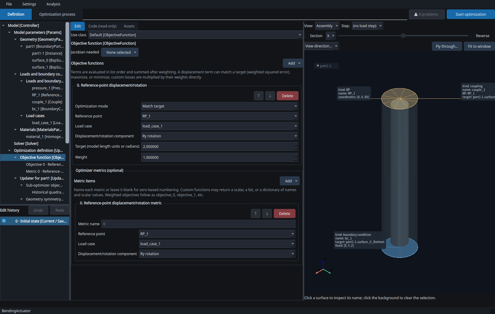

A saved iteration includes model assembly, the FE solve, sensitivity analysis and a design update. Follow the objective and constraint histories over subsequent iterations to assess convergence.

<a id="section-算例定义"></a>

## 2 Model and units

| Project | Settings |
|---|---|
| Part / instance | `part1` / `part1-1` |
| External boundary | Initial radius: 8, length: 80, starting point: `(0,0,0)` |
| cavity | Initial radius: 4, length: 74, starting point: `(0,0,3)` |
| Fixed support | Fix X, Y and Z translations on `surface_0_Bottom`. |
| Top reference point | Couple `RP_1` at `(0,0,80)` to `surface_0_Head`. |
| Load | Apply `pressure_1=0.06` to `surface_1_All` in `load_case_1`. |
| Material | `NeoHookeanLnJ`, `mu=0.482`, `kappa=4.8` |
| Objective | Minimize `(ry - 2) ** 2` to match a Y rotation of 2 rad. |
| Recorded metrics | User metric `0` records `ry`. Automatic metric `objective_0` records the objective contribution. |
| Geometry update | Update both surfaces subject to xz mirror symmetry, fairness, minimum spacing and a cylindrical envelope. |

Use a consistent mm–N–MPa system throughout. A pressure of 0.06 MPa is 60 kPa. Enter rotations in radians.

<a id="section-程序启动与基本操作"></a>

## 3 Launch and navigate the UI

Install and launch in the same Python environment:

```bash
python -m pip install morphopt
morphopt-ui
```

The module entrance is `python -m morphopt.ui`. For the installation and activation steps of the virtual environment, please refer to [README](../../README.md#run-the-ui-in-a-virtual-environment).

The model tree and edit history are on the left. Selecting a node opens its card in the central editor. The adjacent tabs show the generated code and assets. The right viewport displays the model. Use the arrows or **Delete** on a card to reorder or remove an entry. The model is validated before an optimization starts.

Coordinates and rotations have separate fields for their components. Press Enter or leave a numeric field to commit its value. A selection in a list applies immediately. The mouse wheel scrolls the page. Fields that accept expressions can refer to constants defined under **Helper code**.

In the preview, **Part** uses local coordinates and **Assembly** applies each instance pose. Click a face to see its set name, or click empty space to clear the selection. Use the section slider to see inside the model. Choose an axial or isometric view under **View direction…**. **Fit to window** keeps that direction and frames the geometry.

<a id="geometry"></a>

## 4 Define the part, surfaces and instance

<a id="section-创建边界部件"></a>

### 4.1 Create a boundary part

Select **File → New**, create `BoundaryPart` in **Geometry → Add**, with the name `part1`. The component parameters are as follows.

| Field | Value |
|---|---|
| FEA seed size | `1.0` |
| element order | Select from the dropdown list: `1`; options include `1` or `2` |
| External Surface Set | `surface_0_All` |

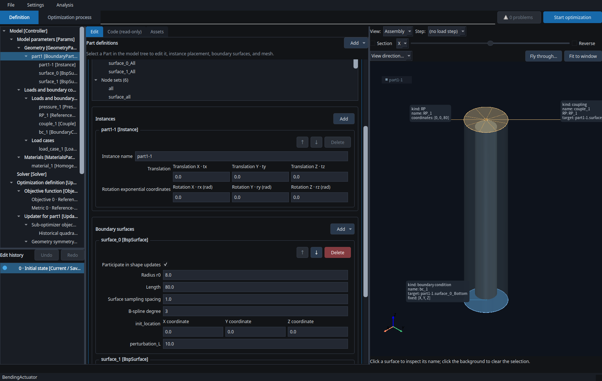

Set the part name on the part and the instance name on its instance card.

<a id="section-定义外边界与内腔"></a>

### 4.2 Define the outer boundary and cavity

On the part card, use **Boundary surfaces → Add** to add two B-spline cylinders. Create the outer boundary `surface_0` first, then the cavity `surface_1`.

| Parameters | External boundary | cavity |
|---|---|---|
| Participate in shape updates | Enable | Enable |
| Radius | `8.0` | `4.0` |
| Length | `80.0` | `74.0` |
| Surface sampling spacing | `1.0` | `1.0` |
| Circumferential/Axial Control Mesh Count Factor | `1 / 1` | `1 / 1` |
| B-spline degree | `3` | `3` |
| Initial Position X/Y/Z | `0 / 0 / 0` | `0 / 0 / 3` |
| perturbation_L | `10.0` | `10.0` |

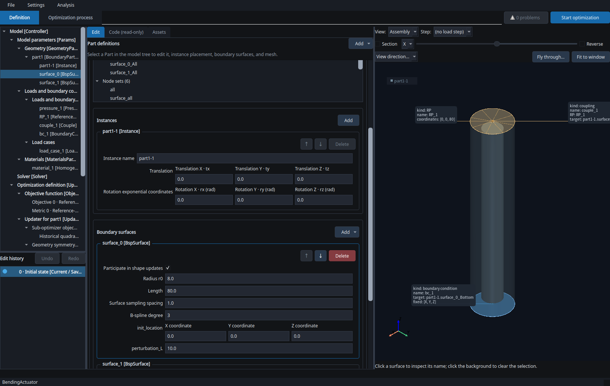

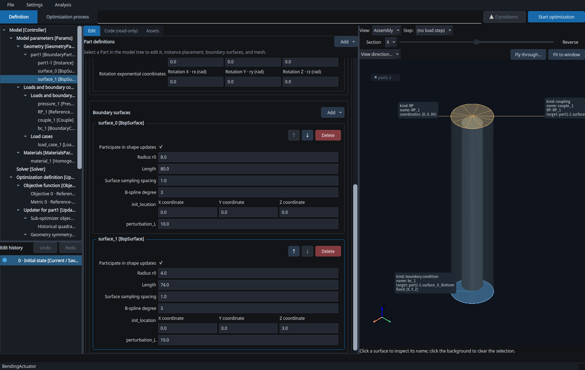

Surface 0 bounds the outer solid. Each subsequent surface defines a cavity. The part uses that order to set the normals. Surface `seed_size` controls sampling and the control net. The part's FE seed size controls the volume mesh. Set the curvature limit in the updater's `Fairness` penalty.

The nominal outer cylinder spans Z = 0 to 80. The cavity spans Z = 3 to 77, leaving 3 mm at each end. The initial perturbation controlled by `perturbation_L` slightly changes the cylindrical surfaces.

<a id="section-定义实例"></a>

### 4.3 Position the instance

Select `part1-1 [Instance]`. Set the three translations and the three rotation-vector components to zero. Rotations use exponential coordinates in radians.

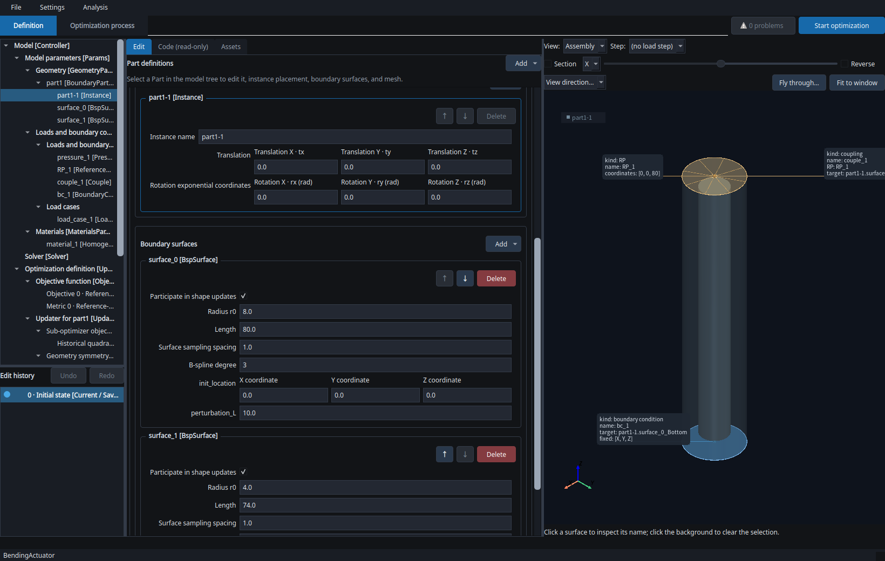

<a id="loads"></a>

## 5 Define loads, connections and the load case

Under **Loads and boundary conditions**, add the following interfaces.

| Interface | Name | Parameters |
|---|---|---|
| Pressure | `pressure_1` | Instance `part1-1`, surface `surface_1_All` |
| ReferencePoint | `RP_1` | X=0，Y=0，Z=80 |
| Couple | `couple_1` | Reference point `RP_1`, example `part1-1`, node set `surface_0_Head` |
| BoundaryCondition | `bc_1` | Select instance `part1-1`, node set `surface_0_Bottom` and all three translation directions. |

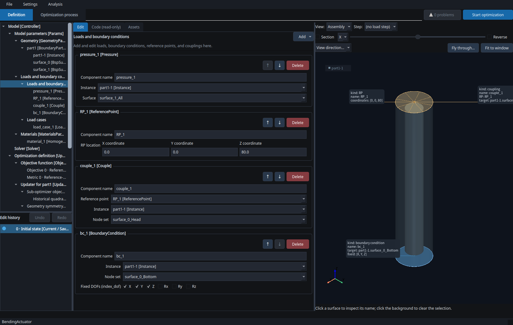

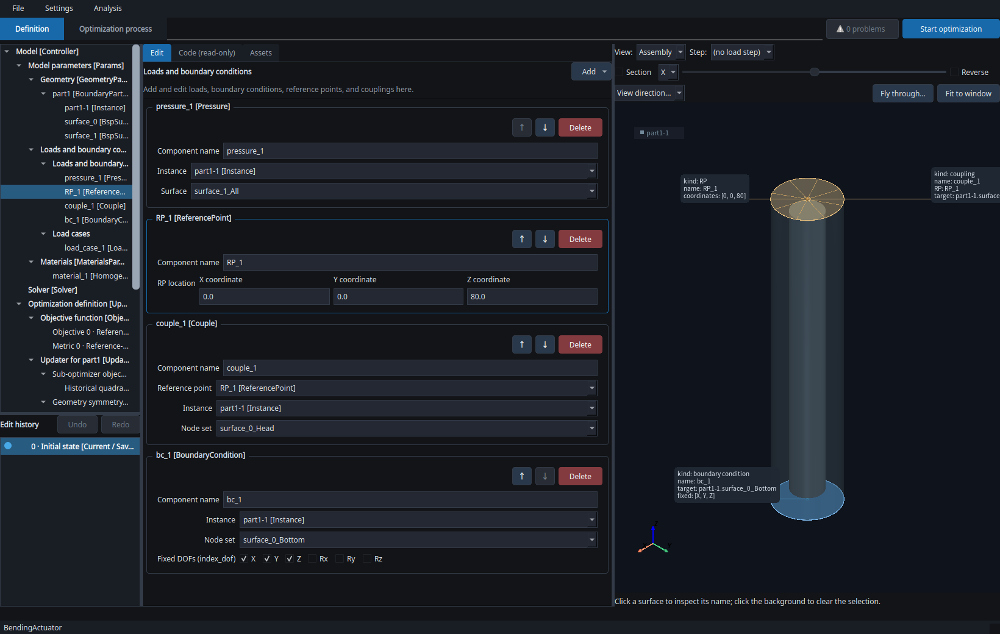

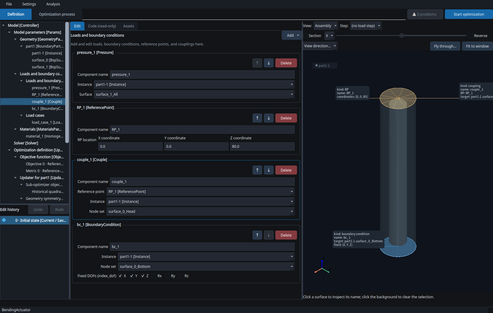

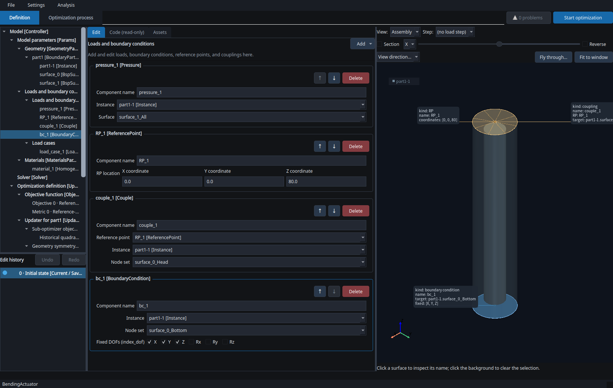

Each load interface specifies its target. The load case supplies its amplitude. The coupling transfers the motion of the top nodes to the reference point.

Under **Load cases**, add `load_case_1`. Set the pressure field for `pressure_1` to `0.06`. Each named case has a tree entry and an editor card. The arrows change the registration order.

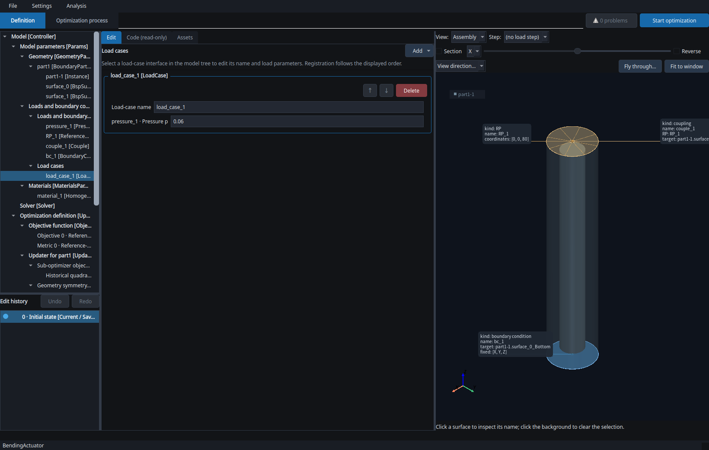

Each card lists the parameters of every applicable load. A spring, for example, has separate fields for stiffness, undeformed length and fixed-end coordinates. [Load-case reference](ui-reference.md#steps)

<a id="materials"></a>

## 6 Assign the material

Add a homogeneous material named `material_1` and assign it to `part1`. Select `NeoHookeanLnJ`. Enter `mu=0.482`, `kappa=4.8` and a mass density of `1.08e-9`.

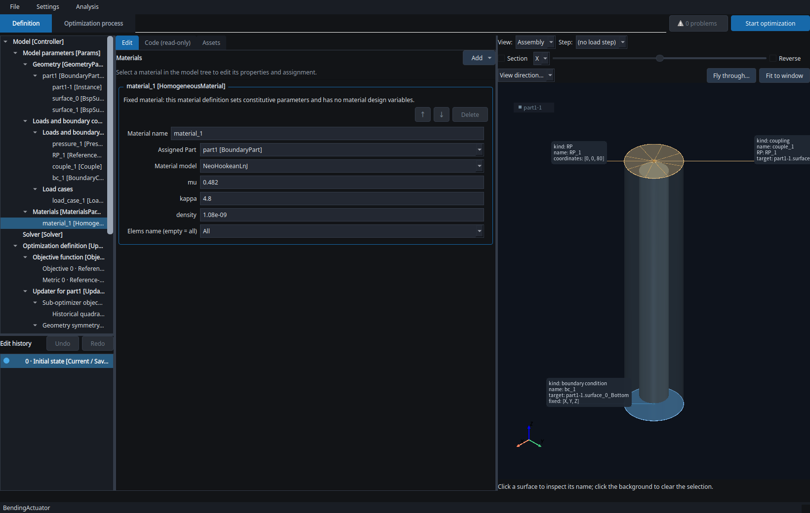

<a id="objectives"></a>

## 7 Define the objective and metric

Under **Objective function**, add a reference-point displacement/rotation objective. Select `RP_1`, `load_case_1` and rotation component **Ry**. Choose **Match target**, enter `2.0` as the target and set the weight to `1.0`.

Add a user metric for the same reference point, case and component. Leaving the name empty gives the first metric the name `0`. Objectives and metrics are numbered from zero.


The loss is `(ry - 2) ** 2`. Metric `0` records the measured angle. The automatic metric `objective_0` records the weighted squared error and appears after the user metrics.

<a id="section-设置求解器和运行配置"></a>

## 8 Configure the solver and run

Use one solver process and choose CPU in its device selector. Additional processes also default to CPU. Under the device table, each process group lists its load cases in solve order. Leave `load_case_1` in its own group.

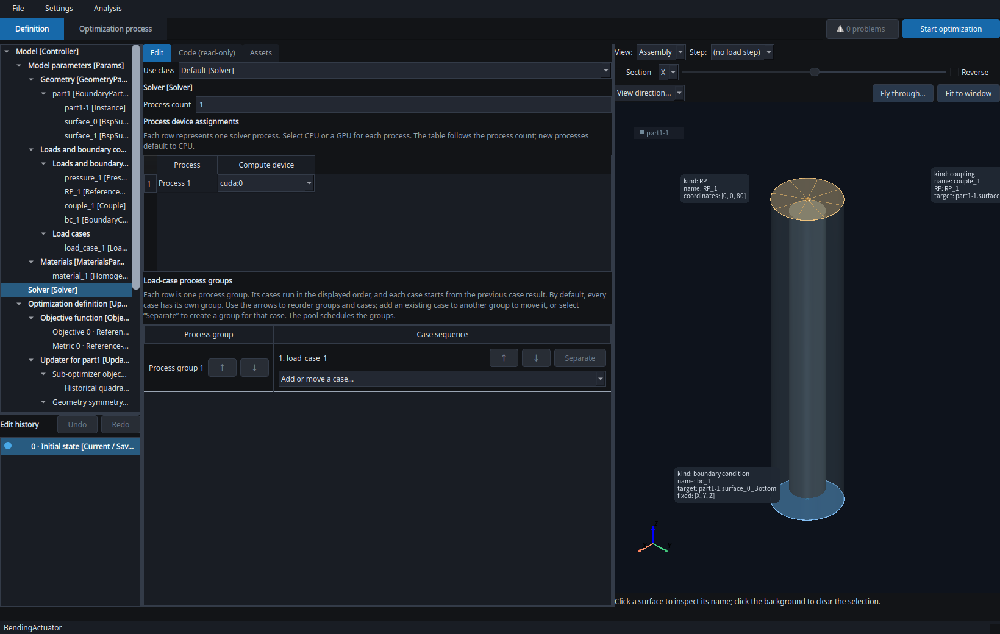

With multiple cases, each starts in its own group. Move cases between groups with the selector and adjust their order with the arrows. Within a group, the previous solution supplies the initial state for the next case. Groups are scheduled on the available worker processes.

On the controller card, set the task name to `BendingActuator`, the results directory to `.results/`, the run device to `cpu` and the restart interval to `20`. Relative result paths use the task's working directory. The restart interval counts iterations between worker restarts.

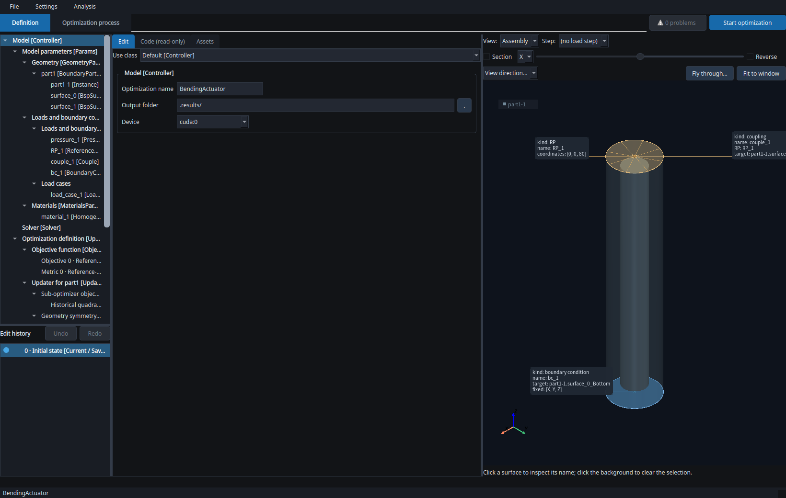

<a id="updaters"></a>

## 9 Configure geometry updates

<a id="section-更新范围与策略"></a>

### 9.1 Select the surfaces and update policy

Create an updater for `part1`. Set the inner iteration limit to `50`, the maximum step length to `0.5` and the updater device to CPU. Each surface has its own switch for participation in the update.

In "Update Strategy", select "Adaptive Shape Update [AdaptiveShapeUpdate]". The settings used in this example are as follows.

| Parameters | Value |
|---|---|
| Initial/Final Geometric Relaxation Ratio | `0.05 / 0.0` |
| Reference violation level | `0.1` |
| The geometric tightening amount each time | `0.0002` |
| Upper limit of weight change ratio | `10.0` |

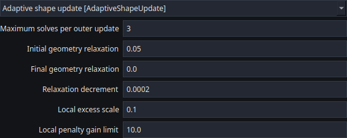

The policy uses sampled constraint violations to tighten the spacing requirement. Successive subproblem solves in the same outer iteration use the same FE sensitivities. [Update policy](script-reference.md#section-几何更新策略与障碍积分)

<a id="section-子优化目标与对称关系"></a>

### 9.2 Choose the physical surrogate and symmetry

Replace `ShapeDerivative` with `QuadraticShapeDerivative` and set the history length to `10`. This example uses one physical surrogate in the subproblem.

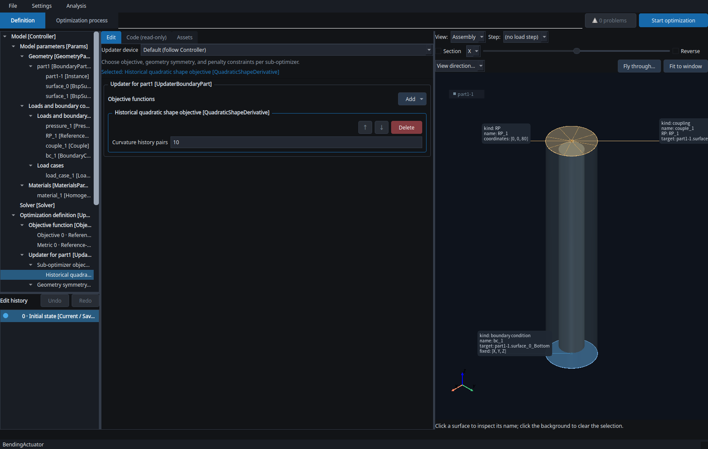

Add xz mirror symmetry separately to `surface_0` and `surface_1`. Set the offset to zero for both, so the mirror plane is Y = 0.

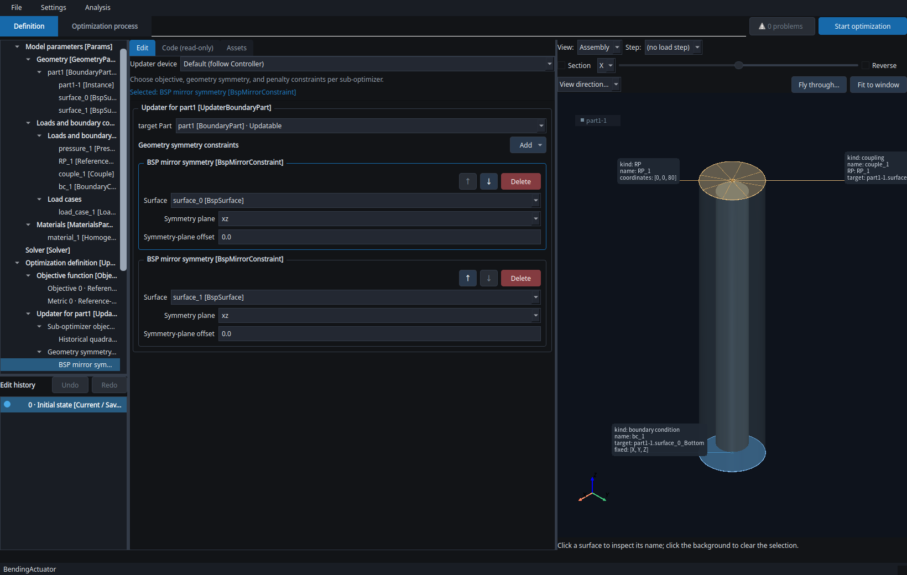

<a id="section-几何罚项"></a>

### 9.3 Set the geometric penalties

Add or modify the following penalty terms.

| penalty term | Parameters |
|---|---|
| Fairness | `max_curvature=1.0`, acting together on the updatable BSP/CPGEO surfaces |
| Distance | 2×2 minimum distance matrix, where each cell is `2.5` |
| Cylinder | Radius: `10`, Height: `80`, Bottom End: `0` |

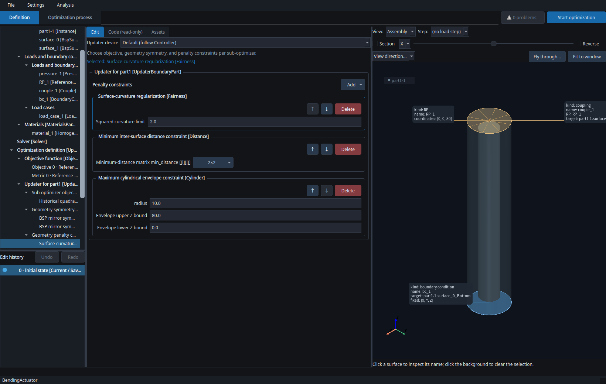

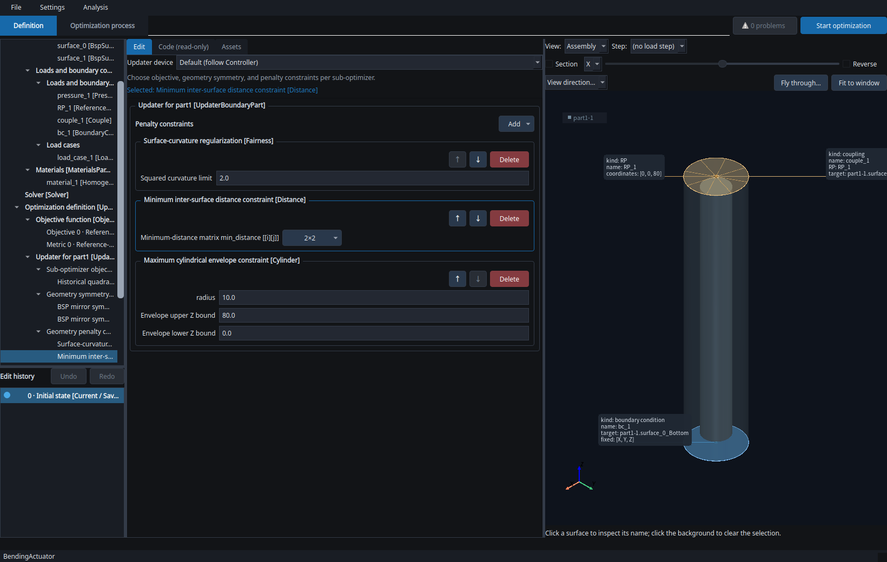

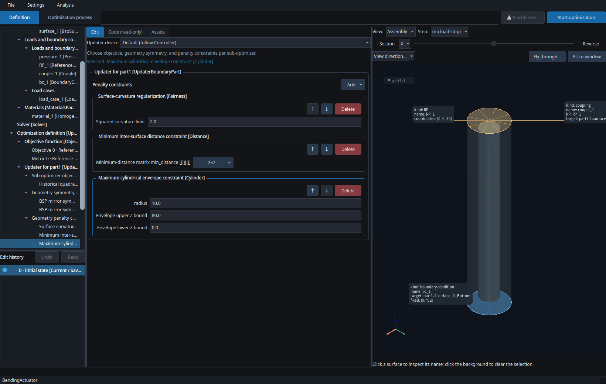

A finite penalty allows some violation. With 5% initial relaxation, a nominal minimum distance of 2.5 mm initially takes effect at 2.375 mm, with a transition region around the threshold. The policy tightens the requirement as its criteria are met.

<a id="section-检查与保存"></a>

## 10 Check and save the definition

A pale red node indicates a validation issue. Hover over it to read the reason. Check the part and instance names, referenced sets, load amplitudes, material assignments, objective, updater binding and device settings.

**Save .morph** stores the editable definition and embedded assets. **Export run script…** creates a directory with a Python script of the same name and a `morphopt_assets/` folder containing the geometry files and BREP metadata. Move the directory as a unit. Use the central **Code** and **Assets** tabs to inspect the script and its inputs.

The fields supported in the file are imported normally. Missing fields are filled in with the current default values. Additional fields or unsupported entries are ignored and a warning is generated. This prompt does not replace the geometric validity check. Please modify and verify the settings before saving a new copy.

<a id="optimization"></a>

## 11 Run the optimization and inspect its history

Select **Start optimization**. The observer lists metrics, logs, updatable components and load-case deformations on the left.

<a id="section-指标与日志"></a>

### 11.1 Read the metrics and log

The metrics table includes the objective, named metrics, stage times in seconds, and node and element counts. Scroll horizontally for further columns. Use the selector below the table to plot the objective or an individual metric.

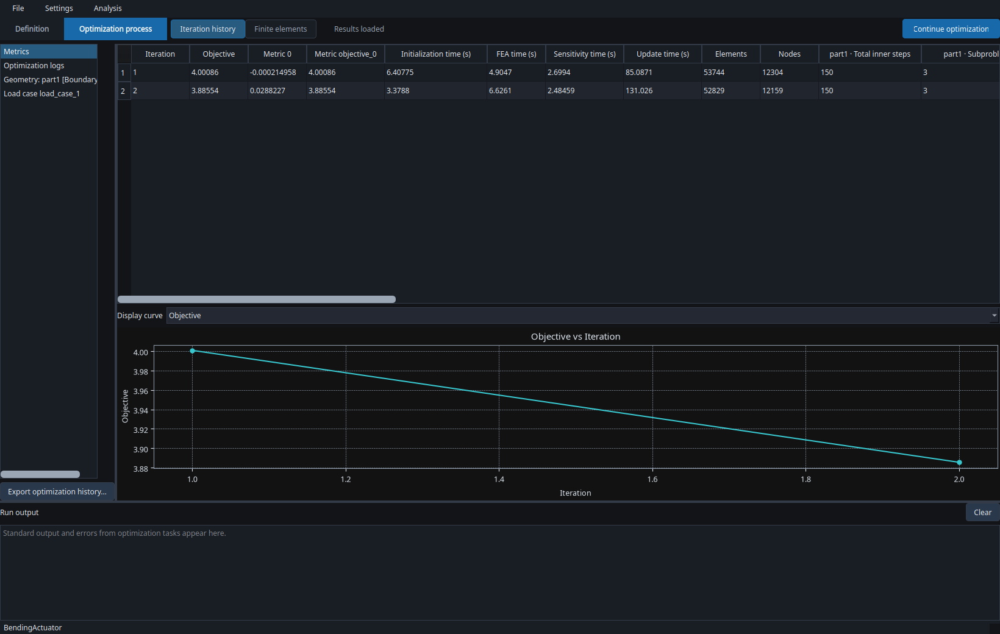

Select **Optimization log** to read the saved `.log` files. Scroll up to hold your reading position. Return to the bottom or enable follow mode to see new output.

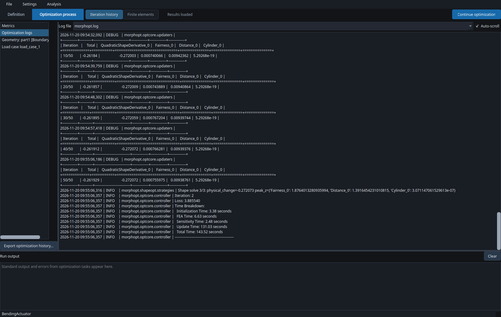

<a id="section-设计单曲面与工况变形"></a>

### 11.2 Inspect a surface or a deformed configuration

Select the geometry entry for `part1`. Show all surfaces, a single `surface_N`, or its control net. The control net is available for BSP and CPGEO surfaces. The iteration slider and follow controls appear in the 3D result views.

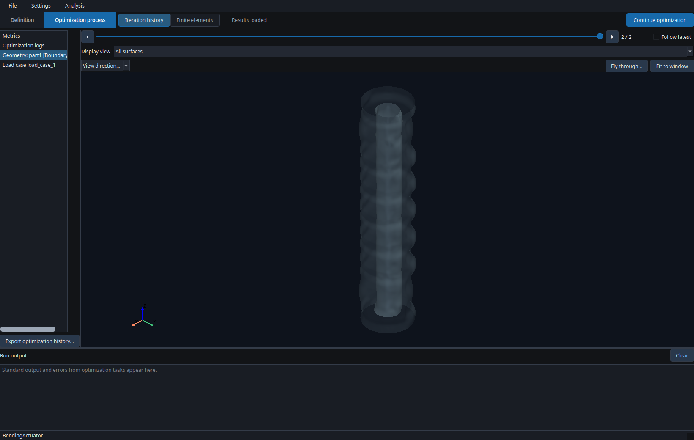

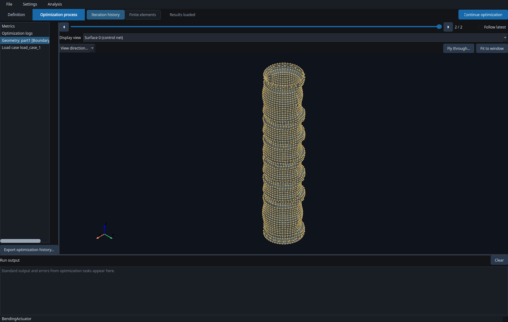

Select `load_case_1` to see the pressure-induced deformation at that iteration. Use the geometry view to inspect the design before loading.

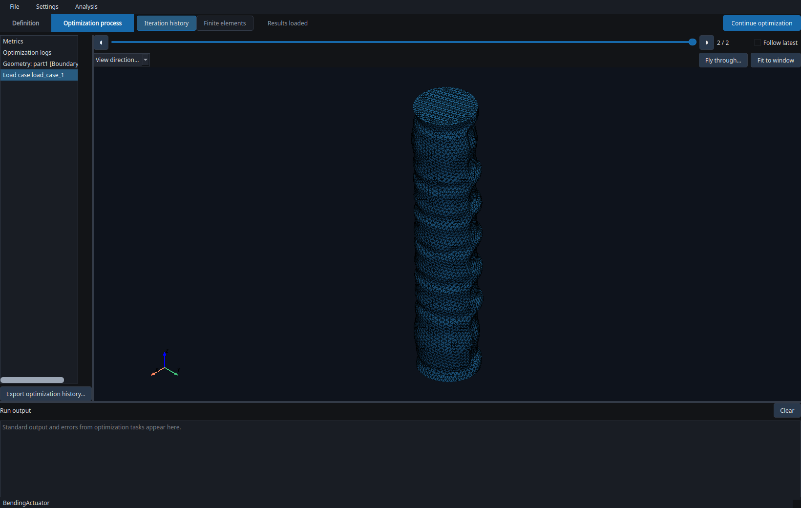

<a id="section-导出与继续计算"></a>

### 11.3 Export history and resume a run

Select **Export optimization history** below the list in the history view. Choose the output type in the export window.

- **GIF animation**. Select the design configuration or load case deformation, then choose the object, iteration range, frame rate, and resolution. Rotate, pan, or zoom in the 3D preview of the last selected iteration. The animation uses the current camera and background color for every frame. Choose **Custom** under **Resolution** to enter the width and height independently in pixels. **Fit to window** frames the model from the current direction. In parallel projection, **View height** sets the vertical span in model units. Click **Select Location and Export** to save the animation for the selected range.
- **Design components**. Select the iteration steps and components. In this example, we choose **All Surfaces**. Export the outer wall and inner cavity at once. The two BSP surfaces are saved as `surface_0.stp` and `surface_1.stp` respectively.
- **Abaqus INP**. Select the saved iteration and load cases, set up geometric nonlinearity, and export the static analysis input file for this case. Choose **Part meshes only** to import the components of this wheel into Abaqus/CAE.

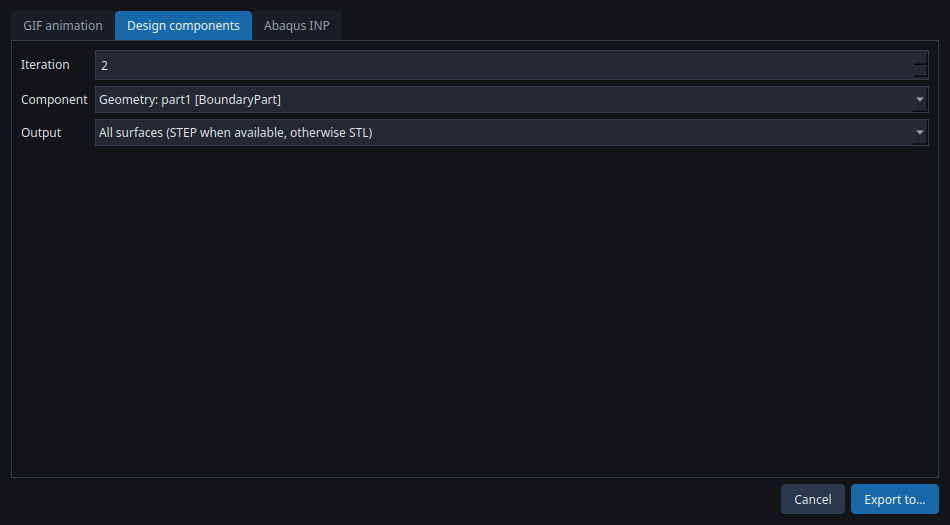

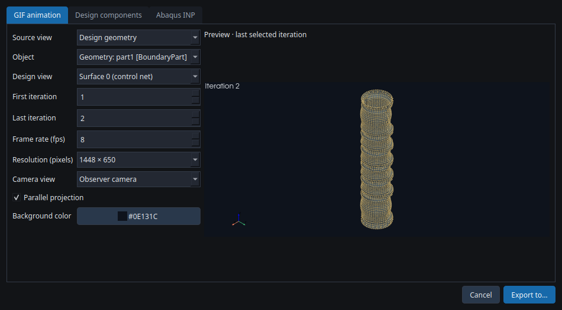

**Stop optimization** terminates the current task. If you modify the parameters and start again, a new task will be created. To continue with the original task, use **Document → Continue Optimization…** and select its result directory as well as the complete checkpoint. Tasks that fail before the first round of complete saves will exit and report an exception. If there is already a complete checkpoint, the existing recovery process will be retained. Python optimization exceptions will be recorded in the optimization log.

Each new result directory includes launchers for both platforms. To reopen it on another computer with MorphOpt installed, copy the entire directory and double-click `Open MorphOpt.desktop` on Linux or `Open MorphOpt.cmd` on Windows in the result directory. From an open UI, choose **File → Open optimization result folder…**. The launcher first looks for `morphopt-ui` on the desktop session’s `PATH`. If the command is unavailable there, it uses the first registered local Conda environment containing MorphOpt UI. For a virtual environment, you can also activate it in a terminal and run `morphopt-ui --result "/path/to/result"`. The window opens at the latest saved iteration. Switch to **Optimization definition** to inspect the submitted model and save edits as a new `.morph` file. For a script-only task, this page displays the archived Python source in read-only mode.

<a id="finite-element"></a>

## 12 Run a finite-element analysis on a saved design

Open **Optimization progress → Finite element** and select a saved iteration and load case. This analysis holds the design fixed. You can change a load amplitude, solve again and compare the responses.

| Operation/action | Results |
|---|---|
| Select Design Iteration, Original Working Conditions, and Existing Results | Read the corresponding archive model and solution. |
| Switch between field quantities such as displacement, Mises stress, and strain. | Display different physical quantities on the same model |
| Switch deformation display | Changing the grid position, the field values still come from the selected solution. |
| Modify the pressure and solve the problem | Establish independent results that can be compared with the original load case. |
| Export nodes, integration points, reference points, or the complete model. | Output data in the selected format and position. |

The first two views show the displacement and stress at 0.06 MPa. The subsequent views show the independent solve at 0.04 MPa and the export options.

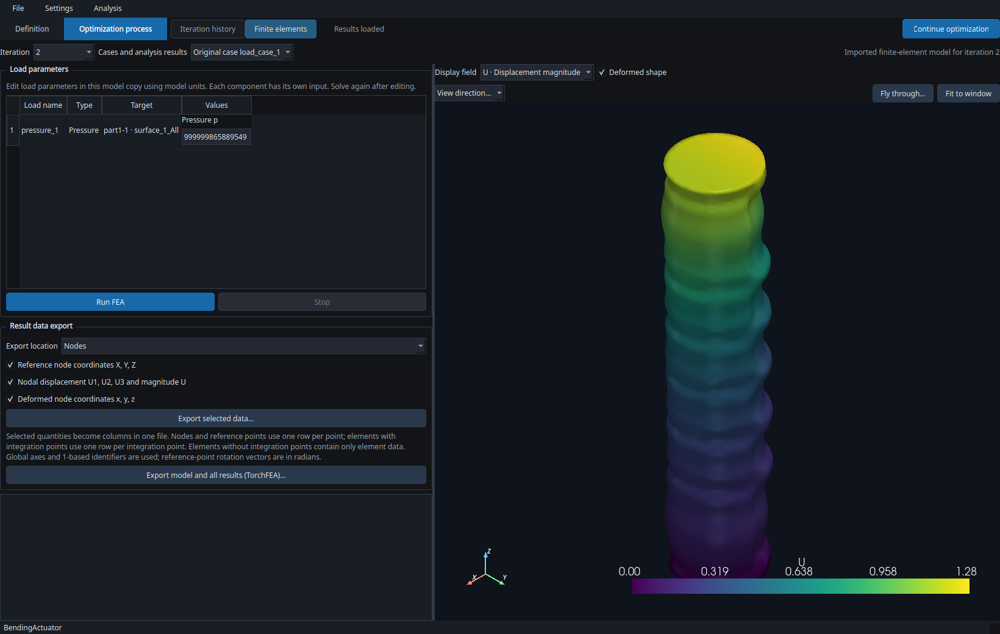

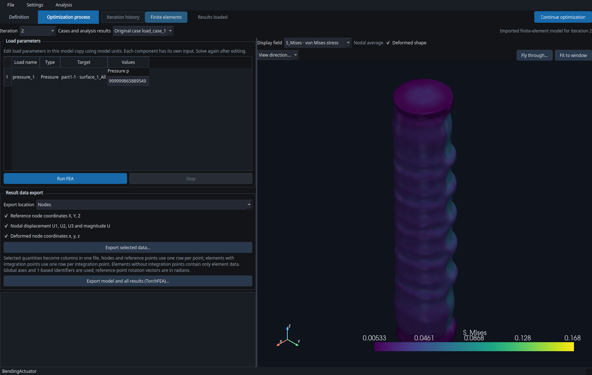

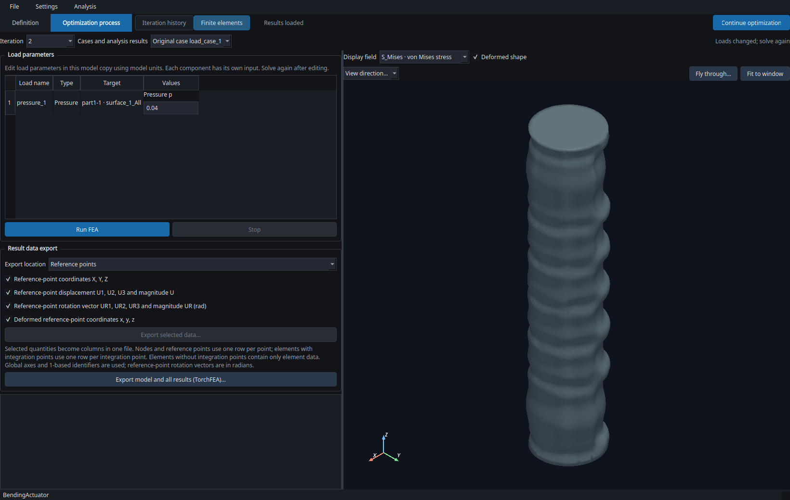

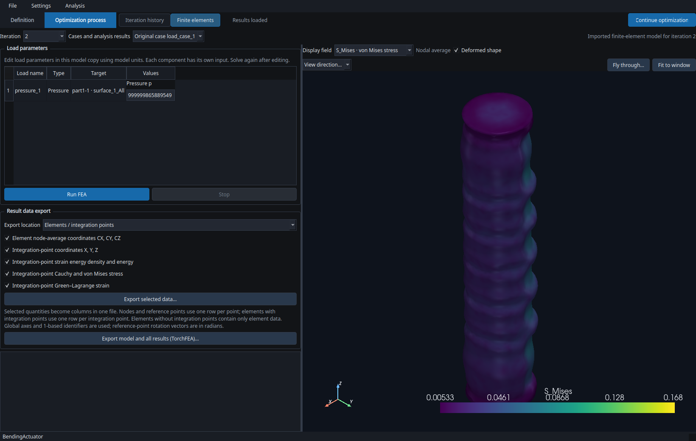

The average field at nodes differs from the sampling positions of the original integration points. During statistics, the results are corresponding to the exported positions and numbers. If the new results are not solved or fail to be solved, they should not be interpreted as the equilibrium solution of the current load. For the complete procedure, please refer to [Finite Element and Derived References](ui-reference.md#results).

<a id="section-外观与运行环境"></a>

## 13 Appearance and runtime environment

**Settings → Appearance → Font Settings…** is set according to the classification of interface text, left model tree, edit area title, code, and charts. For each category, Chinese and Western fonts are selected, with a common font size used. Before making changes, preview them in the window. **Apply** saves the changes and they take effect without closing the window. **Confirm** saves the changes and closes the window. **Cancel** abandons any unapplied changes. The system font is used by default.

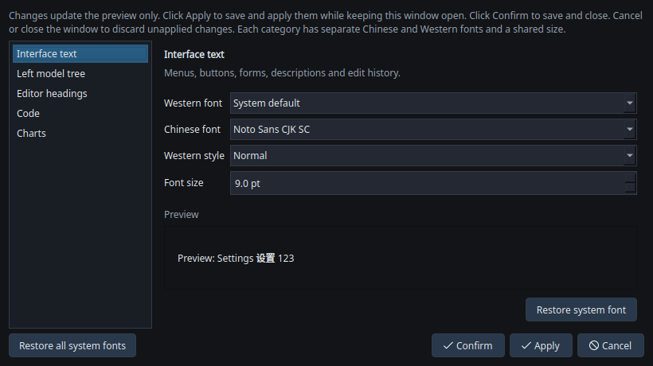

Visualization settings control projection, lighting and surface appearance. The 3D viewports share the camera controls.

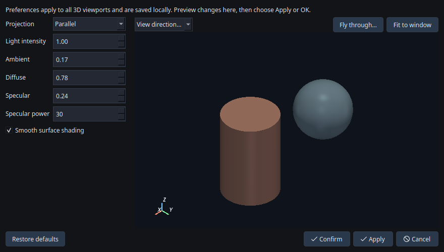

When SSH forwarding uses X11, first execute `ssh -X user@remote-host`, run `QT_QPA_PLATFORM=xcb morphopt-ui` on the remote side, and retain the settings of SSH as `DISPLAY`. Windows and Linux use the same definitions and result operations. The graphics driver and dependencies need to be installed on the target system.
