# MorphOpt UI module and interface reference

[简体中文](../zh-CN/ui-reference.md)

[UI quick start](ui-quickstart.md)  ·  [Script quick start](script-quickstart.md)  ·  [Script module and API reference](script-reference.md)

The [UI quick start](ui-quickstart.md) follows one bending-actuator example from model definition to results. This reference describes the responsibilities, parameters, prerequisites and relationships of each module.

In this article, “interface” refers to the input interfaces for adding components, surfaces, loads, materials, optimization targets, and constraint objects to the menu. It also includes the input interfaces for the target editor and custom code. This interface covers the currently registered **59 types of objects, 8 material constitutive models, and 12 templates for finite element data codes**. `BasePart` is implemented by custom classes. The two types of bias constraints are advanced interfaces hidden in the regular add menu. The usage conditions are clearly stated in the relevant sections.

This article refers to the modular organization method in Abaqus/CAE User's Guide, and explains it in terms of module responsibilities, object definitions, and parameter descriptions. The fields and behaviors of MorphOpt are implemented in accordance with the standards of this repository. [Reference: Abaqus/CAE Module Definitions](https://docs.software.vt.edu/abaqusv2025/English/SIMACAECAERefMap/simacae-c-topwhatismodule.htm)

The screenshots show the English MorphOpt interface at its original resolution. The actuator geometry and results are shared with the quick start. The Box, CAD, spring, contact and SIMP screenshots illustrate their forms and previews. Convergence must be assessed from a completed run.

## Contents

<!-- docs:toc depth=1 -->

- [1 Modules and object relationships](#modules)
- [2 Working with fields and references](#conventions)
- [3 Geometry: parts, surfaces and instances](#geometry)
- [4 CAD modeling operations](#cad)
- [5 Loads, connections, boundary conditions and contact](#loads)
- [6 Named load cases and load parameters](#steps)
- [7 Materials and constitutive models](#materials)
- [8 Objectives, metrics and finite-element data](#objectives)
- [9 Solver and run settings](#solver)
- [10 Updaters, symmetries and constraints](#updaters)
- [11 Helper code and custom classes](#custom-code)
- [12 Visualization, optimization history and finite-element postprocessing](#results)
- [13 Configuration checks and interface index](#index)

<!-- /docs:toc -->

<a id="modules"></a>

## 1 Modules and object relationships

The main definition page consists of a model tree on the left side, a “Edit/Code/Assets” tab in the center, and a 3D preview area on the right side. These sections display the object structure, parameters and file resources, as well as the geometry and assembly. The “Code” tab shows the Python script corresponding to the current definition, while the “Assets” tab lists the files referenced by the script and provides their previews. During runtime, the program creates optimization and optimization objects based on this definition.

| Module/Interface Location | Definition | Input objects and prerequisites. | Verification Items |
|---|---|---|---|
| Geometry / Part | Entity source, physical grid, design boundaries | File or geometric parameters | Dimensions, internal and external boundaries, grid order |
| Geometry / Instance | The position and orientation of component instances within the assembly. | Defined Parts | Instance name, relative position |
| Load and boundary conditions | Load-bearing areas, fixation conditions, connection relationships, and contact surfaces | Instances, collections, reference points | Referenced objects and directions |
| load case | The amplitude of each interface under different operating conditions | Defined load interfaces | Weight order and name of the operating condition |
| Materials | The relationship between stress and deformation, density, and material design factors | Parts and units | Allocation range, constitutive parameters |
| objective function | Target responses and metrics for optimization purposes, as well as indicators related to individual records. | Operating conditions and responsive objects | Direction, units, weights |
| solver | Job grouping, parallel processing strategies, and GPU allocation | List of operating conditions and computing resources | Task coverage and memory usage |
| optimizer | Design variables, update methods, and constraints | Design the Part or SIMP materials, and determine the target gradient. | Update switches and apply constraints accordingly. |
| Auxiliary codes/custom classes | Reused parameters, expressions, and extended framework behaviors | Python and framework interfaces | Whether it is actually referenced or bound to some resource. |
| Optimization progress | Select to run the program. Check historical data, design details, and deformation characteristics under various operating conditions. | Saved running results | Current round, metric trends, logs |
| Operating conditions and calculation results / Post-fault finite element analysis | The FE field for the specified iteration is displayed, along with the adjusted loads and independent solutions. | The model and results for this iteration have been archived. | Selected operating conditions, sources of results, and units used |

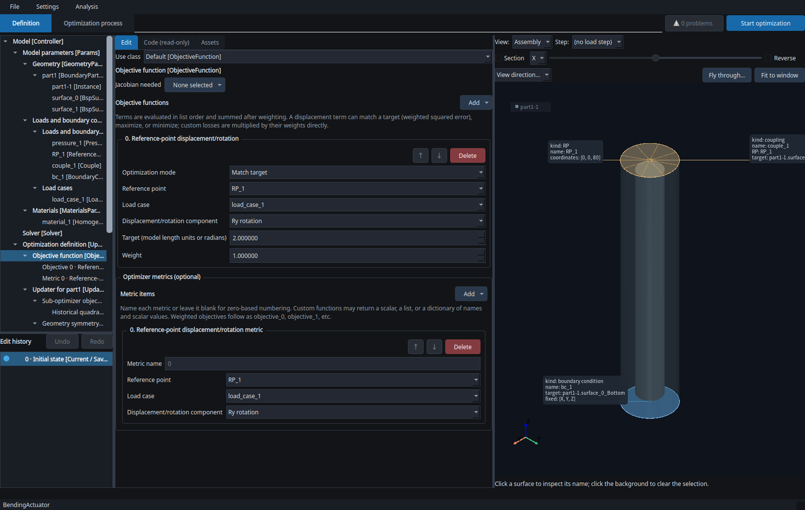

*Main Definition Page: Model tree, parameter editing area, and assembly preview.*

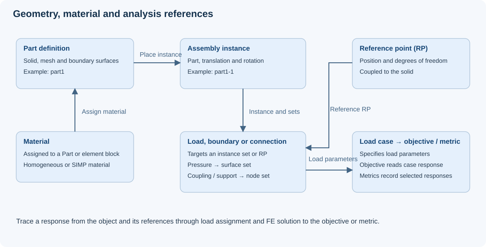

*The reference relationships between components, instances, materials, loads, and operating conditions.*

The relationship between object references follows these rules: **The material is allocated to the Part, the load acts on a collection of Instances or RP, and the load interface specifies the parameter values for the load case.** The coordinates of the reference point only define its position. The connection between the reference point and the solid is defined separately by interfaces such as Couple.

<a id="section-文件设置和分析菜单"></a>

### 1.1 Files, Settings, and Analysis Menu

| Entry point | Functions and Application Scenarios |
|---|---|
| Files → Create/Open .morph Files | Create a blank definition, or continue editing the structured definition. |
| Files → Quick Start | Use the preset process to generate the initial definitions. After generation, each module can still be edited on the main definition page. |
| File → Open Optimization Results | Select a specific execution directory to view the historical results and the current FE outcome. |
| Files → Open Python Optimization Script | Run the script directly and enter the optimization mode; no Python scripts will be converted back into editable model trees. |
| File → Save/Save As | Save the current definition. Save as a file suitable for creating practice copies. |
| Files → Export Running Script Directory | Selected directory name has been generated. Now, a script with the same name as `.py` and a resource directory named `morphopt_assets` will be created. |
| Settings → Language/Theme | The language and color scheme of the interface can be changed, but the physical parameters of the model remain unchanged. |
| Settings → Design Options → Maximum Number of Historical Nodes | Set the upper limit of operation history nodes, default is 100; includes the root node and all branches, and is saved along with the application settings. |
| Analysis completed → Ready to optimize | Start the optimization task based on the current definition. The same function as the button at the top-right corner is performed here. |
| Analysis → View current iteration's finite element results | Enter the FE analysis page for this round of results. |

The "Add", "Delete", and "↑ / ↓" functions in the card are used to manage entries and their order. The order of surfaces determines the surface index, while the sequence of CAD operations determines the construction history. Any references that have been adjusted in order should be rechecked. The left-bottom operation history records the editing process, supporting undo and redo functions. The "Optimization Process" records the design history during the optimization calculations.

When the number of historical nodes reaches the upper limit, the interface retains all nodes and a pop-up window appears. If you choose "Clear History", only the current state will be retained, and all other undo and redo branches will be deleted. The model content and the saved state remain unchanged. If you choose "Increase Limit", all historical data will be retained according to the new value input. The new limit must be greater than the current total number of nodes. If you cancel the operation, the history and the original limit will remain unchanged, and a prompt will appear again when adding new nodes next time. If the set limit is less than the current total number of nodes, the same pop-up window will appear. After confirmation, the results of clearing or expanding the limit will be applied.

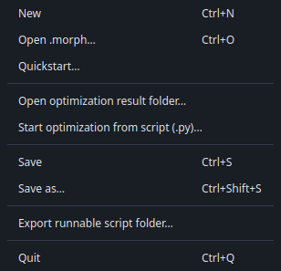

<a id="conventions"></a>

## 2 Working with fields and references

<a id="section-名称编号与集合"></a>

### 2.1 Names, IDs, and Collections

| Name or ID number | Meaning | Example/Example sentences |
|---|---|---|
| Part name | The unique name of Part. It is used for material distribution and geometric optimization calculations. | `part1` |
| Instance name | The placement of a component within the assembly | `part1-1` |
| Interface name | Unique reference names for objects such as loads, RP data, and boundary conditions. | `pressure_1`、`RP_1` |
| Curved Index | Numbering starting from 0 within a BoundaryPart | 0: Outer boundary; 1: First inner cavity |
| `step_name` | Named conditions keys used for targets, templates, and task groups | For example, `load_case_1` |
| node set | A group of nodes used for fixation, coupling, etc. | `surface_0_Bottom` |
| Surface set | A collection of surfaces and directions, used for applications involving pressure, contact, etc. | `surface_1_All` |
| Unit Block / `Part.elems` | Unit objects saved by name in Part section. | `C3D8` of BoxPart components |

The name should be unique and case-sensitive. The dropdown list provides existing sets in the model; manually entering a name will not create a new set. The built-in Part has default names based on the first-order element type, such as `C3D4`, `C3D6`, `C3D8`. When upgrading to a second-order mesh, the block name remains unchanged. It is required to fill in the field with the key `Part.elems`, using the actual name from the import information or candidate list.

The names of components and instances are defined separately in their respective cards. The program provides default instance names when creating components. If a component is renamed later, the existing instance names remain unchanged. The material and geometric optimizer follow the component's renaming through object references, and the instance loads follow the instance's renaming through object references.

The `inp_part_name` in INPPart is used to select components from the source file, and it belongs to the import parameters. The `part_name` in the material card is used to select the assignment object, and it belongs to component referencing. These fields have different functions compared to component names and instance names.

The names of components and instances are saved separately. The old fields in the imported file are processed according to the current schema. Any content that was not retained is listed in the import warnings. Re-saving ensures that no duplicate component names are generated.

<a id="section-数值列表与表达式"></a>

### 2.2 Values, lists, and expressions

- Scalar fields can take values such as `0.06`, `1e-7`, etc.
- The list of parameters in the form are broken down into independent input boxes with names: X/Y/Z position, translation and rotation components, minimum/maximum values for each axis of the bounding box, etc. The variable-length list can be added or deleted item by item; the distance matrix is edited for each grid cell according to the surface. The square brackets in the parameter table represent the data structure in the script and files, and there is no need to manually enter them in the UI.
- The numerical fields supporting expressions can accept custom constants and function references. For example, the length field can use `tube_length`, and the pressure field can use `pressure_schedule(0.8)`. The preview requires that the relevant expressions can be evaluated correctly.
- The code editing area accepts **Function body**, and the function signatures are provided by the editor. The auxiliary free code area accepts module-level code. The function body does not contain any additional outer `def` declarations.
- Submit the changes by pressing Enter or leaving the input box. Scroll the page using the mouse wheel, but do not change the content of input boxes, drop-down menus, sliders, or numerical controls. Long cards should be scrolled from the outer page, and the model tree should be selected to point to the corresponding interface.

The model tree indicates the defined errors found during static verification, marked in light red. The verification includes required definitions, numerical types and ranges, code syntax, constant references, object references, geometric assets, load cases, and optimizer configurations. Hovering over a node allows you to view the reason for the error; parent nodes summarize the errors of their child nodes. After editing, deleting objects, or restoring historical states, the color will update accordingly; corrections to errors will automatically restore normal display. When a faulty node is selected, it remains marked in light red, with a border indicating the selected state.

The verification does not execute the user code, nor does it create CAD entities or divide the mesh. The function's return value, the geometric validity of the asset, the quality of the mesh, and the convergence of the calculation are still checked during the preview or runtime stages. Nodes that are not colored indicate that the calculation has not passed the verification.

Field expressions are retained as Python expressions in the generated script. Shared parameters can be defined as custom constants, referenced by multiple fields, to maintain consistency among parameters.

<a id="section-定义文件导入提示"></a>

### 2.3 Defines prompts for importing files.

When `.morph` is opened, content retention is supported. Missing parameters will use the current default values. Additional fields and unsupported entries will be ignored. The interface will display a summary of warnings along with the reasons. Details can be viewed in detail. This rule does not execute user code, nor does it prove that the remaining model can be solved. If the JSON syntax is incorrect or the root data is not an object, a read failure will still be reported.

After importing, check the light red nodes, object references, and generated scripts. Then save the file in the current format. When the old algorithm parameters are ignored, the original algorithm semantics is not retained. It is not possible to determine the equivalence of problem definitions based solely on the successful opening of the file.

<a id="section-单位与默认值"></a>

### 2.4 Default values and unit settings

MorphOpt uses a consistent unit system and does not perform automatic unit conversion. Lengths, forces, stresses, and densities should be expressed in mutually compatible units. For example, in the mm–N–MPa unit system, an input value of 60 kPa would be represented as `0.06`, and densities are expressed in units of mass. The angles of angles and rotation vectors are measured in radians.

In the parameter table, the "initial value" refers to the default value when creating UI objects. The actual parameters should be determined based on material calibration, geometric dimensions, and load conditions. Fields such as the object name and SIMP bounding box should be filled with valid values. A bounding box with all six components equal to zero does not constitute a valid design domain.

<a id="geometry"></a>

## 3 Geometry: parts, surfaces and instances

**Entry point: Main definitions → Parameters → Geometry.** adds parts in the geometry, and instances under the parts; BoundaryPart can also add boundary surfaces, while CADPart can perform modeling operations.

<a id="section-part-类型与适用场景"></a>

### 3.1 Types of Parts and Their Applications

| Geometric origins and design approach | Corresponding Part Types |
|---|---|
| Design of external surfaces and internal cavities, constructed from cylinders, spheres, or STL boundaries. | BoundaryPart |
| Generate a thick offset layer near the design boundary. | OffsetBoundaryPart |
| Cuboid modeling or SIMP material distribution design | BoxPart |
| Basic entities, Boolean operations, or STEP entities | CADPart |
| There is already a Abaqus mesh file available. | INPPart |
| Create entities using custom modeling logic. | BasePart + Custom Classes |

Box, CAD, and imported components support finite element analysis and material design field definitions. The standard UI does not automatically create BSP/CPGEO boundary shape variables for these components.

<a id="part_types-boundarypart"></a>

#### 3.1.1 BoundaryPart: Components related to the boundary surfaces.

`BoundaryPart` generates solid mesh based on several closed boundaries, and uses parametric boundaries as the object of shape design. The defined contents include outer boundaries, inner cavity boundaries, mesh parameters, and component instances.

The surface 0 defines the outer boundary, while subsequent surfaces define the inner cavity. The normal direction is automatically determined according to the order of the surfaces: the first surface serves as the outer boundary direction, and subsequent surfaces serve as the inner cavity direction. `fea_seed_size` controls the finite element mesh of the body, while the `seed_size` of the surface controls the surface control mesh. Both parameters can be set independently.

| UI field / stored key | Default | Meaning and input format |
|---|---|---|
| FEA seed size / `fea_seed_size` | `2.5` | Gmsh volume-mesh seed size. |
| Mesh order / `mesh_order` | `1` | Element order. Options: `1`, `2`. |
| Display surface set / `exterior_surface` | `"surface_0_All"` | Name of the surface set drawn by default when visualizing the Part mesh and deformation results. |

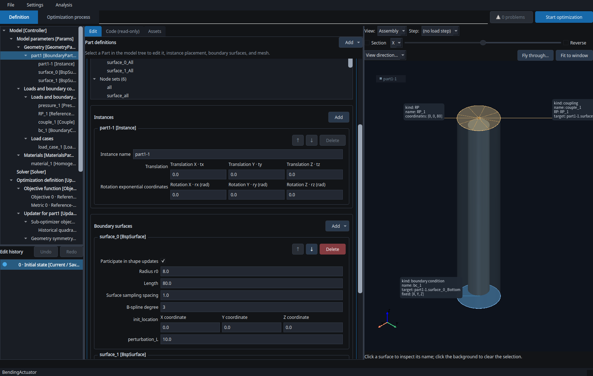

*Component parameters and solid mesh settings for BoundaryPart.*

The "Collection" list on each component card lists the surface collections and node sets associated with that component. When a collection is clicked, the corresponding component view is automatically displayed on the right side. The surfaces or actual grid nodes of the node set are highlighted using local coordinates. The highlighted collections are only visible in the component view and are cleared when switching to the assembly view. The required finite element meshes are generated upon first selection and are updated as the geometry changes. Any definitions that are not yet completed will be indicated with an explanation below the view.

<a id="part_types-offsetboundarypart"></a>

#### 3.1.2 OffsetBoundaryPart: The component responsible for adjusting the internal cavity's boundaries.

`OffsetBoundaryPart` creates a solid offset layer with a specified thickness along the normal direction at the inner cavity boundary (starting from surface 1). It inherits the boundary and solid mesh parameters from BoundaryPart, and adds an offset thickness and number of layers.

The effectiveness of the offset layer is affected by the boundary normal, local curvature, and the distance between cavity walls. When the offset thickness exceeds the available local space, intersections may occur. For related advanced constraints, refer to [Geometric constraints and auxiliary targets](#section-几何约束与辅助目标). The program generates C3D6 wedge-shaped layers along the normal direction of the inner cavity surface. Therefore, each component must contain at least one inner cavity. The offset direction is determined by the boundary normal. The color displayed in the STL file is not used as a criterion for determining the direction.

| UI field / stored key | Default | Meaning and input format |
|---|---|---|
| FEA seed size / `fea_seed_size` | `2.5` | Gmsh volume-mesh seed size. |
| Mesh order / `mesh_order` | `1` | Element order. Options: `1`, `2`. |
| Display surface set / `exterior_surface` | `"surface_0_All"` | Name of the surface set drawn by default when visualizing the Part mesh and deformation results. |
| Offset thickness / `shell_thickness` | `0.5` | The thickness of the offset layer generated from the design boundary towards the material side, expressed in the unit of the model length. |
| Offset layers / `num_layers` | `1` | The number of discrete layers in the thickness direction of the offset layer; increasing the number of layers does not result in a corresponding increase in overall thickness. |

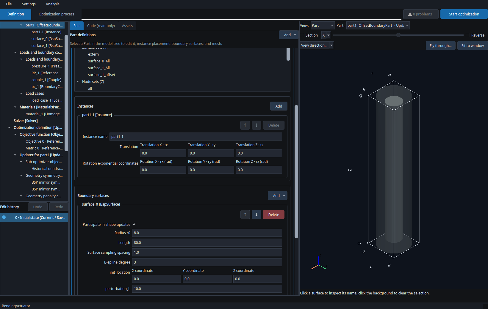

*The thickness, number of layers, and boundary details of the biasing component.*

<a id="part_types-boxpart"></a>

#### 3.1.3 BoxPart: Structured rectangular prism components.

`BoxPart` creates an axis-aligned rectangular solid. The dimensions in the X, Y, and Z directions are defined by length, height, and depth respectively. The initial rectangular solid extends from the origin in the positive directions of the three coordinate axes, and its assembly position is set by the Instance parameter.

The built-in block name is `C3D8`; the commonly used fixed surface node set is `nodes_xmin`, and the commonly used stressed surfaces are `surface_xmax`, etc. This component is suitable for foundation FE modeling and material distribution optimization.

| UI field / stored key | Default | Meaning and input format |
|---|---|---|
| Length / `length` | `40.0` | Box extent along X (length). |
| Height / `height` | `16.0` | Box extent along Y (height). |
| Depth / `depth` | `8.0` | Box extent along Z (depth). |
| Mesh size / `mesh_size` | `2.0` | The target size of the finite element mesh; generally, the smaller the size, the more cells are required. |
| Mesh order / `mesh_order` | `2` | Element order. Options: `1`, `2`. |
| Display surface set / `exterior_surface` | `"extern"` | Name of the surface set drawn by default when visualizing the Part mesh and deformation results. |

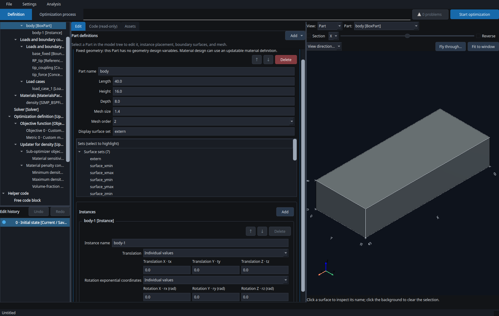

*The physical dimensions of BoxPart, along with the preview of the assembled model.*

<a id="part_types-cadpart"></a>

#### 3.1.4 CADPart: CAD components.

`CADPart` constructs the entity based on the CAD operation history and generates a finite element mesh. The defined content includes component mesh parameters, as well as operations such as basic body creation, import, Boolean operations, and geometric transformation. Each operation establishes a sequential reference relationship through valid IDs.

The UI allows direct editing of the CAD operation list. There are fourteen operations available, as shown in [CAD modeling operations](#cad). The Boolean history modifications may change the surface numbers. The pressures and contacts originally assigned to `face_N` need to be rechecked.

| UI field / stored key | Default | Meaning and input format |
|---|---|---|
| Mesh size / `mesh_size` | `2.0` | The target size of the finite element mesh; generally, the smaller the size, the more cells are required. |
| Mesh order / `mesh_order` | `1` | Element order. Options: `1`, `2`. |
| Display surface set / `exterior_surface` | `"extern"` | Name of the surface set drawn by default when visualizing the Part mesh and deformation results. |

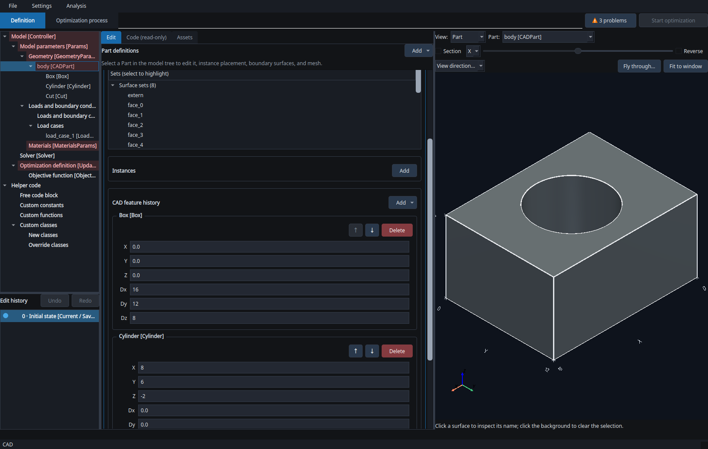

*CADPart: Preview of the solid object obtained by subtracting a cylinder from a cuboid.*

<a id="cad-step-export"></a>

##### 3.1.4.1 Export STEP geometry.

**Enter the command: Geometry → CADPart Component Card → Export to STEP…** When the component already contains CAD features, the final solid of the operation history can be exported directly, without the need to pre-divide the finite element mesh or perform optimization.

1. In the model tree, select the CADPart that needs to be exported. Click “Export to STEP…” at the top of the component card.
2. Enter the target folder in the save dialog box and fill in the file name. The default name is the part name, for example, `design.stp`.
3. Select `STEP geometry (*.stp)` or `STEP geometry (*.step)` from the "File Type" option. The file list will include folders, and files with the selected extension will be displayed; the output extension will be determined based on the file type.
4. Click "Save". When the target file already exists, confirm the overwrite before proceeding with the export; if the overwrite is canceled, the original file will be retained. After the export is successful, a prompt window will display the complete save path.

| Project | Export rules |
|---|---|
| Geometric range | The final entities that are still valid in the current CADPart operation history, including the results of Boolean operations and CAD transformations. |
| coordinate system | Component's local coordinate system; the translation and rotation of instances are still managed by the assembly. |
| Grid settings | Export data directly using CAD history data, independently of the finite element mesh size and order of complexity. |
| Define the save operation. | Continue to use `.morph` for editing and optimizing tasks; STEP is used for saving and exchanging CAD geometry. |

<a id="section-cadpart-转换为-boundarypart"></a>

##### 3.1.4.2 Converting CADPart to BoundaryPart

**Entry point: Top of the CADPart component card → Convert to BoundaryPart; or right-click on the CADPart in the model tree → Convert to BoundaryPart.**

Convert and read the CAD component generated from the current definition, including auxiliary constants, functions, and the selected custom CAD classes. The final geometry should be a solid entity. The conversion generates BREP surfaces for the enclosed shell. The first item is the outer shell, and the subsequent items are the inner cavities. The component name, instance name, pose, material associations, and existing `face_N` load references are retained. The mesh size and order are saved as the settings obtained from the current evaluation.

The conversion is performed in a separate process, and the progress window allows for cancellation. After successful completion, the current CADPart will be replaced at its original location with a BoundaryPart, with the surface type being `brep_surface`. The STEP data and surface mapping definitions for each surface can be viewed on the asset page. The conversion creates a single edit history, and the CAD operation history can be restored if it fails or is canceled. If the conversion fails or is canceled, the original component will not be replaced.

The BREP surface is initially fixed in geometry. After converting the required surfaces into NURBS and enabling "Participate in Shape Updates", the control points within the surface become design variables. The trimmed boundary and shared edges remain fixed. When saving `.morph`, the asset is preserved in the defined state. When exporting and running the script, it is restored to `morphopt_assets`.

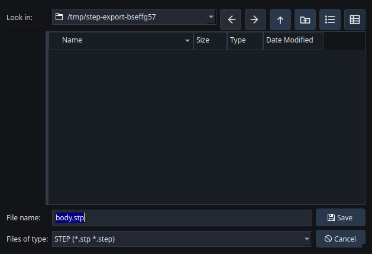

*The save dialog box allows users to select a directory, modify the file name, and switch between STP/STEP filtering options. A confirmation prompt is displayed when overwriting existing files.*

<a id="part_types-inppart"></a>

#### 3.1.5 INPPart: INP grid components

`INPPart` reads the component meshes and sets from the `.inp` file. The imported parameters include the file path and the name of the source Part; when the file contains only one Part, the name of the source Part can be left blank. The imported node sets, element blocks, and surface sets are used for subsequent load and material definitions. When running `.py`, the INP file is copied to the `morphopt_assets` directory next to the script, and the generated code reads the copies from the script’s location.

During the current import process, the materials and cross-sections present in the source file are also generated. The source file should contain material definitions and effective assignments supported by the importer. The document examples use explicit Elset, cross-sections marked with `** Section:`, and Neo-Hookean placeholder materials. Whether other Abaqus constitutive models or files that only contain nodes and elements can be imported depends on the supported range of the current importer.

INPPart only processes input data supported by MorphOpt/TorchFEA. It does not perform the entire Abaqus analysis process, solver options, or all relevant keywords. Formal analysis uses the materials, connections, and load cases defined in the current settings.

| UI field / stored key | Default | Meaning and input format |
|---|---|---|
| INP file / `mesh_file` | *empty* | Abaqus .inp mesh file holding the Part. |
| Part in file / `inp_part_name` | *empty* | Select a Part from the INP file; a file with only one Part can be selected automatically. |
| Display surface set / `exterior_surface` | *empty* | Select the surface set to draw when visualizing the selected Part; the default uses the imported model's display surface. |

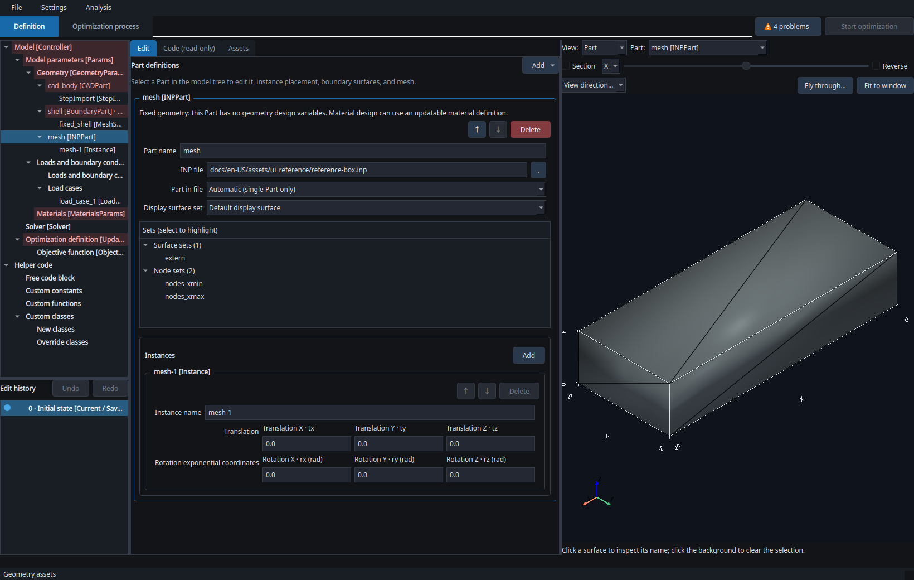

*In the example of the INPPart import warehouse, [Grid files](../../scripts/docs/assets/reference-box.inp) includes geometry, sets, and placeholder hyperelastic materials used for import. The formal materials and loads are reviewed in the main definition settings.*

<a id="part_types-basepart"></a>

#### 3.1.6 BasePart: Custom components.

`BasePart` provides the basic interface for custom components. BasePart is used for programming extensions and does not belong to the ready-made modeling types in the regular Part menu. Its modeling logic is implemented by the custom classes that have been bound to it.

The custom class implements the construction logic for nodes, elements, and collections based on the framework method signature. The base class and override methods are provided by the custom class directory, and the generated code indicates their registration locations. The component name and the displayed surface collection only define object identification and collection references; they do not contain the actual construction logic.

| UI field / stored key | Default | Meaning and input format |
|---|---|---|
| Display surface set / `exterior_surface` | *empty* | Name of the surface set drawn by default when visualizing the Part mesh and deformation results. |

<a id="section-五种边界曲面"></a>

### 3.2 Five types of boundary surfaces

The local parameters of the **Load case: BoundaryPart / OffsetBoundaryPart → Boundary surface → Add.** surface define the initial boundary, and then the body mesh is generated by the corresponding Part.

The surface direction is set according to the component it belongs to: the first surface uses the outer boundary direction, while subsequent surfaces use the inner cavity direction. `flip` is not used as an input or construction parameter. The surface names are generated in order as `surface_0`, `surface_1`, etc. Changing the order also changes the boundary direction.

In the surface editing page, the object attribute corresponding to "Participate in Shape Update" is `is_updatable`. BSP and CPGEO surfaces are enabled by default and can be disabled manually; BREP surfaces are disabled by default, but can be enabled manually after selecting a NURBS surface. Mesh surfaces do not have design variables, and this option is read-only. The state of the surface object is preserved, copied, and sorted during operations. Deleting the geometric optimizer does not change the surface state. The geometric optimizer is responsible for algorithms, objectives, and constraints, and does not save the per-surface settings.

<a id="surface_types-bsp-cylinder"></a>

#### 3.2.1 bsp_cylinder: B-spline cylindrical surface

`bsp_cylinder` Establish a cylindrical closed boundary continuously described by B-spline control points. The initial geometry is defined by the radius, Z-direction length, and starting point. The discrete parameters are used to set surface sampling and control the mesh. `degree=3` represents the cubic B-spline, which is defined separately from the finite element mesh order.

In the optimization process, the surface can deviate from the initial cylindrical shape. The smoothness is controlled by `Fairness(max_curvature=...)`, and the radial envelope is defined by `Cylinder`; both are registered in the optimizer.

The control grid count factors in the U and V directions are not displayed in the UI form. After registering `BspRotation`, the script generator automatically sets the circumferential divisibility factors based on the symmetry order. When the rotation constraints are modified or deleted, the next script generated will be updated accordingly.

| UI field / stored key | Default | Meaning and input format |
|---|---|---|
| Radius r0 / `r0` | `4.0` | Initial radius. |
| Length / `length` | `74.0` | Cylinder length along z. |
| Surface sampling spacing / `seed_size` | `1.0` | Spacing for the initial control mesh and surface presampling (seed_size / init_size). The Part fea_seed_size separately controls the volume FE mesh. |
| B-spline degree / `degree` | `3` | Polynomial degree of the B-spline basis; degree=3 means cubic. |
| init_location / `init_location` | `[0.0, 0.0, 0.0]` | Offset of the surface. |
| perturbation_L / `perturbation_L` | `-1.0` | Wavelength of initial imperfection (<=0 none). |

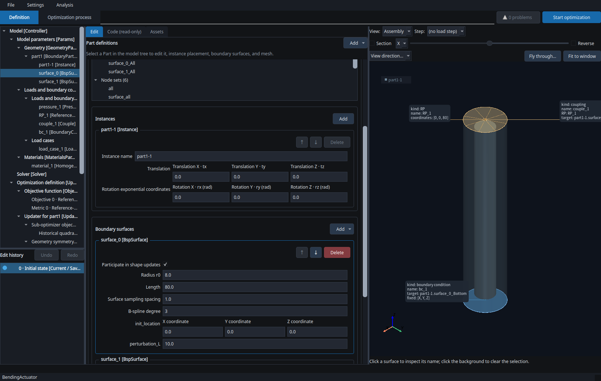

*The initial shape of the BSP cylindrical boundary, along with the parameters governing its design.*

<a id="surface_types-cpgeo-cylinder"></a>

#### 3.2.2 cpgeo_cylinder: CPGEO cylindrical surface

`cpgeo_cylinder` By using CPGEO to control the mesh, a updatable cylindrical boundary can be established. The radius, length, and initial position define the initial geometry, while the sampling parameters determine the control mesh. The CPGEO surface utilizes corresponding mirror images, rotational symmetry, and associated interfaces. BspMirror is only applicable to BSP surfaces.

This interface does not have a BSP iteration parameter; the curvature threshold is uniformly set in the optimizer’s `Fairness(max_curvature=...)`. The surface card only stores the geometry.

| UI field / stored key | Default | Meaning and input format |
|---|---|---|
| Radius r0 / `r0` | `4.0` | Initial radius. |
| Length / `length` | `74.0` | Cylinder length along z. |
| Surface sampling spacing / `seed_size` | `1.0` | Spacing for the initial control mesh and surface presampling (seed_size / init_size). The Part fea_seed_size separately controls the volume FE mesh. |
| Circumferential count alignment factor / `num_U_ratio` | `1` | num_U_ratio: align the circumferential control-mesh count to multiples of lcm(12, num_U_ratio). |
| Axial count rounding factor / `num_V_ratio` | `1` | num_V_ratio: round the axial control-mesh count by this factor, then adjust parity for symmetry. BSP uses an odd number of control-point rows; CPGEO uses an even number of axial segments. |
| init_location / `init_location` | `[0.0, 0.0, 0.0]` | Offset of the surface. |
| perturbation_L / `perturbation_L` | `-1.0` | Wavelength of initial imperfection (<=0 none). |

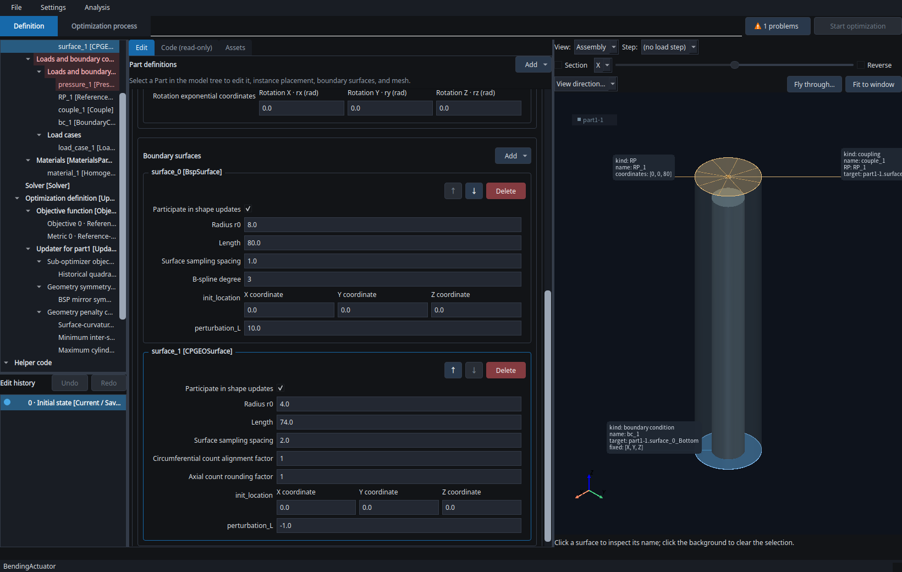

*CPGEO: Parameters related to the cylindrical boundary and its underlying control grid.*

<a id="surface_types-cpgeo-sphere"></a>

#### 3.2.3 cpgeo_sphere: CPGEO Sphere

`cpgeo_sphere` Establish a spherical initial boundary, such as a spherical cavity. `init_location` Define the center of the sphere, `r0` define the initial radius. The seed size controls the surface control mesh and sampling; the size of the solid finite element mesh is set separately based on the component parameters.

Spherical cards only store geometric parameters; the maximum curvature value is uniformly set using the same value `Fairness(max_curvature=...)`.

| UI field / stored key | Default | Meaning and input format |
|---|---|---|
| Radius r0 / `r0` | `7.0` | Initial radius. |
| Surface sampling spacing / `seed_size` | `1.5` | Spacing for the initial control mesh and surface presampling (seed_size / init_size). The Part fea_seed_size separately controls the volume FE mesh. |
| init_location / `init_location` | `[0.0, 0.0, 0.0]` | Sphere center coordinates (init_location). |

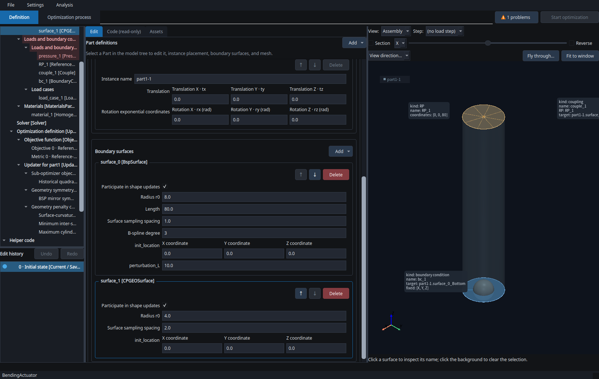

*CPGEO Spherical Boundary: Radius, center point, and sampling points.*

<a id="surface_types-mesh-surface"></a>

#### 3.2.4 MeshSurface: Mesh surfaces.

`mesh_surface` corresponds to the `MeshSurface` in the kernel. The boundaries are represented by the connection between vertices and triangular faces. The UI currently imports this mesh using STL. The input should be a closed surface. This interface does not generate updatable control points. When exporting and running `.py`, the STL file is copied to the `morphopt_assets` directory next to the script. The generated code reads the copy from the location specified in the script.

The STL file does not contain any declarations of physical units. The imported dimensions should be consistent with the model’s unit system. The deformed surface in the STL file can be used as a display object or as a fixed geometry input. The content of this file does not include the material, loads, or set definitions of the original model.

| UI field / stored key | Default | Meaning and input format |
|---|---|---|
| STL file / `path_stl` | *empty* | Path to an STL surface. |

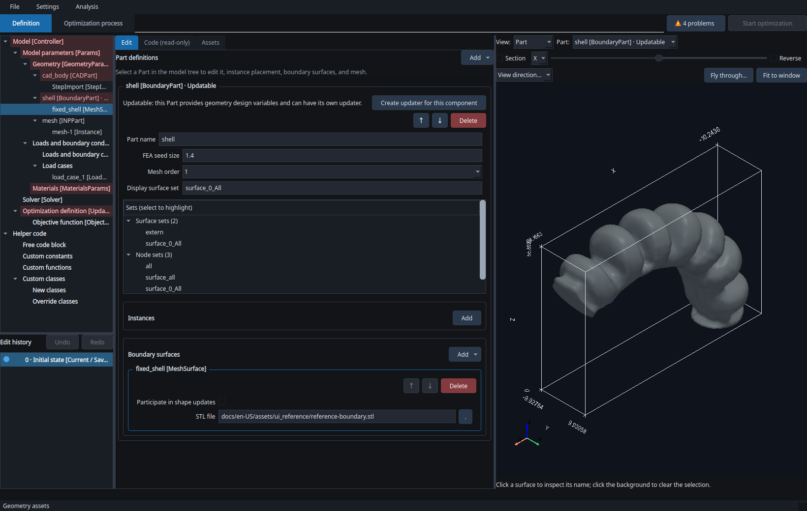

*Fixing the STL boundary: file path and surface preview. The illustration uses the [STL file](../../scripts/docs/assets/reference-boundary.stl) from the example in the repository.*

<a id="surface_types-brep-surface"></a>

#### 3.2.5 BREP Surface: BREP-shaped surfaces

`brep_surface` corresponds to the kernel's `BREPSurface`. The closed boundary is represented by precise surfaces and their topological relationships. Currently, the data is saved in STEP format. When adding a surface, select the `.stp` or `.step` file. If there is an existing `.brep.json` with the same name in the same directory, the face names, topological identities, and naming collections will be imported accordingly. The exterior and interior assets generated by the CADPart conversion can be used as surfaces for the BoundaryPart. The exterior part is placed in the 0th position.

The STEP content is saved in `.morph` using Base64 encoding. The surface mapping is saved along with the definitions. When generating or exporting the run script, the geometry is restored to the STEP file in `morphopt_assets`. The surface mapping and topological data are saved together in the same name as `.brep.json`. The script uses `self.BREPSurface(...)` to read the assets. BREP surfaces with shape update functionality generate STEP files at the current control points before each subdivision. The control points involved in cutting and sharing edges remain fixed.

The surface with a face mapping will display the original `face_N` and its associated `surface_i_All` when clicked. The load can be applied to either a specific geometric face or to the entire shell. The asset page provides a STEP geometric preview and metadata text preview. The named collections contained in the imported asset will appear in the options for load and boundary conditions. The kernel supports specifying the NURBS conversion and geometric evaluation for a specific face. For the scripting interface, see [BREP Topology, Set, and NURBS Conversion](script-reference.md#brep-topology). The UI currently retains these settings by importing defined STEP and metadata.

| Field / Save Key | Definition |
|---|---|
| STEP file / `filename` | Name of the asset to be imported. It is a read-only field. |
| `data` | `.morph` embedded STEP data. The form is hidden. |
| `brep_metadata` | Face, edge, and vertex properties, as well as their names, are stored in a collection. Forms are hidden during this process. |
| `design_faces` | List of NURBS surfaces involved in the update; saved as task definitions, explicitly called when generating scripts `select_design_faces(...)` |
| `control_point_spacing` | The physical spacing between control points is consistent with the model length; the smaller the value, the denser the design grid. The data is not written into the asset metadata. |

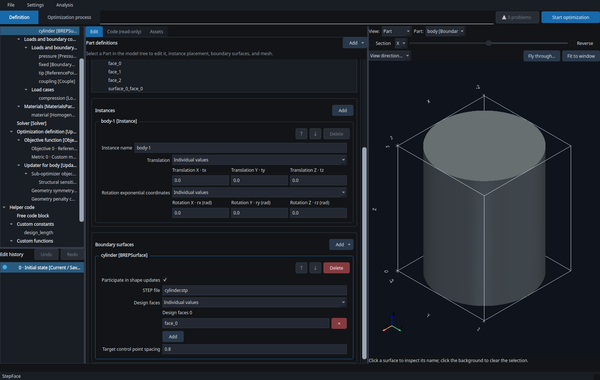

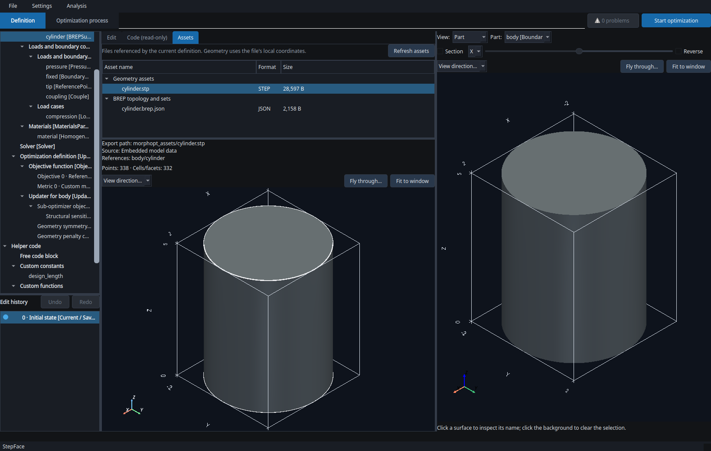

<a id="section-instance装配位置接口"></a>

### 3.3 Instance: Interface for specifying the assembly location.

`Instance` defines the instances of the Part within the assembly and their poses. The same Part can have multiple instances, and the material can be reused for different Parts. Each instance can have independent loads and contact relationships.

| Field | Definition | Fill in the examples. |
|---|---|---|
| Name | The name of the instance referenced by the load; must be unique. | `part1-1` |
| `translation` | Three-dimensional translation vector | `[0,0,0]` |
| `rotation` | Three-dimensional rotation vector. The direction corresponds to the axis of rotation, while the modulus represents the angle of rotation, measured in radians. | `[0,0,1.57079632679]` rotate 90° around the Z-axis |

The three rotational components are represented using rotation vectors, rather than Euler angles that are applied sequentially. The component view displays the original geometry, while the assembly preview shows the instance pose; the loads are referenced to the instances within the assembly.

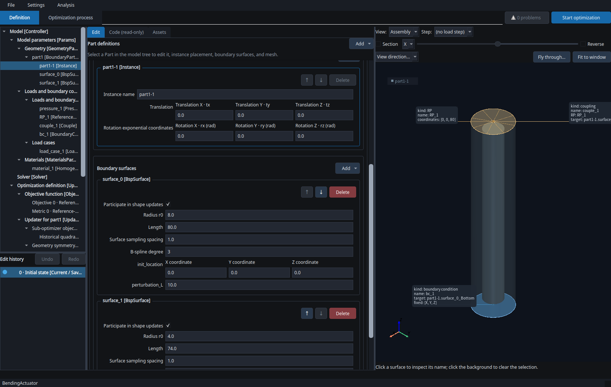

*The translation and rotation vectors of the instance, along with its assembly position.*

<a id="section-常用自动集合"></a>

### 3.4 Commonly used automatic collection methods

| part | node set | Surface set | Usage instructions |
|---|---|---|---|
| BoundaryPart | `surface_i_All`; The outer boundary of BSP has `surface_0_Bottom` / `surface_0_Head` additional elements; BREP has `face_N_nodes` additional elements | `surface_i_All`; BREP also includes `face_N` | CPGEO does not define Head/Bottom; the set of nodes corresponds to different interface parameters, while the set of surfaces corresponds to different interface parameters. |
| OffsetBoundaryPart | There are also additional sets related to the bias, outside of the boundary set. | Including `surface_i_offset` (related to internal cavities). | Subject to the actual candidate list available. |
| BoxPart | `all`、`nodes_xmin/xmax/ymin/ymax/zmin/zmax` | `extern`、`surface_xmin/xmax/ymin/ymax/zmin/zmax` | Unit block `C3D8` |
| CADPart | `all`、`surface_all`、`face_N_nodes` | `extern`、`face_N` | After modifying the CAD history, it's necessary to re-check the surface numbers. |
| INPPart | From the imported model | From the imported model | The name of the collection is determined based on the source file or import information. |

<a id="cad"></a>

## 4 CAD modeling operations

**Enter: CADPart → CAD Operations → Add.** Each operation has a unique `operation_id`, such as body, bore, housing. The list of operations is executed from top to bottom. Boolean operations and geometric transformations reference entity IDs that are still valid from previous operations; inputs that have been consumed are no longer considered as independent entities in subsequent operations.

Example order: `Box(body)` → `Cylinder(bore)` → `Cut(housing, object_id=body, tool_id=bore)`. The operation list records the construction history, and the final entity is used for volume mesh generation.

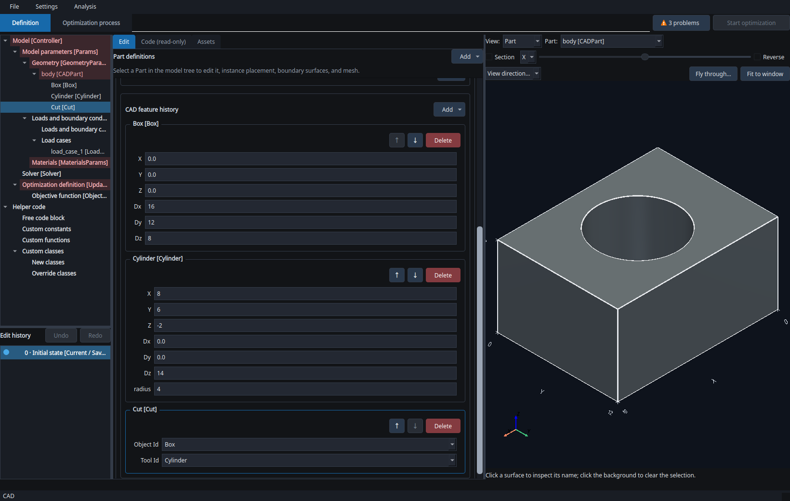

*CAD Cut: Removes the tool entity from the existing body.*

<a id="cad_operation_types-box"></a>

### 4.1 Box: Cuboid shape

`Box` Create a cuboid. `x,y,z` is a corner point; `dx,dy,dz` represent the lengths of three sides. The general field labels for the Box operation are displayed as “Translation X/Y/Z”, which actually refer to the physical dimensions of the entity.

| UI field / stored key | Default | Meaning and input format |
|---|---|---|
| X / `x` | `0.0` | The global X coordinate of the reference point. |
| Y / `y` | `0.0` | The global Y coordinate of the reference point. |
| Z / `z` | `0.0` | The global Z coordinate of the reference point. |
| Dx / `dx` | `20.0` | The length of side X in a cuboid. |
| Dy / `dy` | `10.0` | The length of side Y in a cuboid. |
| Dz / `dz` | `5.0` | The length of side Z in a cuboid. |

<a id="cad_operation_types-wedge"></a>

### 4.2 Wedge: A wedge-shaped object/structure

`Wedge` Establish a wedge-shaped solid. The reference points and three spans are similar to those of a Box. `ltx` Controls the X-direction dimension of the wedge-shaped top edge. Suitable for surfaces, wedges, and other initial geometries.

| UI field / stored key | Default | Meaning and input format |
|---|---|---|
| X / `x` | `0.0` | The global X coordinate of the reference point. |
| Y / `y` | `0.0` | The global Y coordinate of the reference point. |
| Z / `z` | `0.0` | The global Z coordinate of the reference point. |
| Dx / `dx` | `20.0` | Cylindrical shape, X-direction span. |
| Dy / `dy` | `10.0` | Cylindrical shape, Y-direction span. |
| Dz / `dz` | `5.0` | Cylindrical shape; Z-direction span. |
| Ltx / `ltx` | `0.0` | The top edge length in the X-direction, ltx, specified by the Gmsh addWedge interface. |

<a id="cad_operation_types-cylinder"></a>

### 4.3 Cylinder: cylindrical shape

`Cylinder` Establish a cylindrical solid. The starting point is `(x,y,z)`, the axis vector is `(dx,dy,dz)`, and the length of the cylinder is equal to the magnitude of this vector; the axis does not necessarily have to lie along the Z-axis.

| UI field / stored key | Default | Meaning and input format |
|---|---|---|
| X / `x` | `0.0` | The global X coordinate of the reference point. |
| Y / `y` | `0.0` | The global Y coordinate of the reference point. |
| Z / `z` | `0.0` | The global Z coordinate of the reference point. |
| Dx / `dx` | `0.0` | The X-component of the axis vector. |
| Dy / `dy` | `0.0` | The Y-component of the axis vector. |
| Dz / `dz` | `20.0` | The Z-component of the axis vector; none of the three components can be zero. |
| radius / `radius` | `5.0` | Radius of the geometry or radius constraint. |

<a id="cad_operation_types-sphere"></a>

### 4.4 Sphere: Sphere/ball

`Sphere` Create a spherical solid. `x,y,z` represents the center of the sphere, and `radius` represents the radius. This operation generates a CAD solid, but does not create the CPGEO shape variables provided by the cpgeo_sphere interface.

| UI field / stored key | Default | Meaning and input format |
|---|---|---|
| X / `x` | `0.0` | The global X coordinate of the reference point. |
| Y / `y` | `0.0` | The global Y coordinate of the reference point. |
| Z / `z` | `0.0` | The global Z coordinate of the reference point. |
| radius / `radius` | `5.0` | Radius of the geometry or radius constraint. |

<a id="cad_operation_types-cone"></a>

### 4.5 Cone: Cone-shaped object

`Cone` Establish a cone or frustum of a cone. The starting point and axis vector are the same as those of Cylinder. The two radii correspond to the ends of the axis respectively.

| UI field / stored key | Default | Meaning and input format |
|---|---|---|
| X / `x` | `0.0` | The global X coordinate of the reference point. |
| Y / `y` | `0.0` | The global Y coordinate of the reference point. |
| Z / `z` | `0.0` | The global Z coordinate of the reference point. |
| Dx / `dx` | `0.0` | The X-component of the axis vector. |
| Dy / `dy` | `0.0` | The Y-component of the axis vector. |
| Dz / `dz` | `20.0` | The Z-component of the axis vector. |
| Radius1 / `radius1` | `5.0` | The radius at the starting point of the axis. |
| Radius2 / `radius2` | `1.0` | The radius at the end of the axis; setting it to 0 creates a pointed cone. |

<a id="cad_operation_types-torus"></a>

### 4.6 Torus: a circular shape

`Torus` Create a circular ring entity. The center is located at `(x,y,z)`. By default, the axis of the ring is along the Z-axis; the other axes are defined through subsequent Rotate operations. The major radius defines the center line of the ring, while the minor radius defines the cross-section.

| UI field / stored key | Default | Meaning and input format |
|---|---|---|
| X / `x` | `0.0` | The global X coordinate of the reference point. |
| Y / `y` | `0.0` | The global Y coordinate of the reference point. |
| Z / `z` | `0.0` | The global Z coordinate of the reference point. |
| Major Radius / `major_radius` | `8.0` | The distance from the center of the ring to the center of the pipe cross-section. |
| Minor Radius / `minor_radius` | `2.0` | Radius of the pipe cross-section. |

<a id="cad_operation_types-stepimport"></a>

### 4.7 StepImport: Import STEP files.

`StepImport` imports the STEP solid as a step in the CAD history. The file selector embeds the imported content in Base64 format within the definition of `.morph`. The imported solid supports subsequent boolean operations and geometric transformations. When exporting and running `.py`, the encoded data is restored to a STEP file and copied to the `morphopt_assets` directory next to the script. The verification items for the imported results include units, the number of solids, and geometric validity.

| UI field / stored key | Default | Meaning and input format |
|---|---|---|
| STEP file / `filename` | *empty* | The STEP geometry is embedded in the model. |
| STEP data / `data` | *empty* | The encoding method used for the STEP file content after import; the file is generated automatically using the file selector, without the need for manual entry. |

<a id="cad_operation_types-fuse"></a>

### 4.8 Fuse: Integration

`Fuse` takes the union of two input entities, used to merge entities that are connected or overlapping. The input parameters are the main body ID and tool ID. The preview shows the merged entity.

| UI field / stored key | Default | Meaning and input format |
|---|---|---|
| Object Id / `object_id` | *empty* | Select the subject operation ID that remains valid today. |
| Tool Id / `tool_id` | *empty* | Select the tool operation ID that remains valid after the previous operations. |

<a id="cad_operation_types-cut"></a>

### 4.9 Cut: To remove part of something.

`Cut` represents the difference between the main body and the tools. For example, it refers to the process of cutting out holes or air cavities within the solid body. The order of the main body and the tools determines the final result.

| UI field / stored key | Default | Meaning and input format |
|---|---|---|
| Object Id / `object_id` | *empty* | Select the subject operation ID that remains valid today. |
| Tool Id / `tool_id` | *empty* | Select the tool operation ID that remains valid after the previous operations. |

<a id="cad_operation_types-intersect"></a>

### 4.10 Intersect: To intersect with each other

`Intersect` only retains the common volume of the two input entities. When there is no volume intersection between the two entities, the expected entity cannot be obtained.

| UI field / stored key | Default | Meaning and input format |
|---|---|---|
| Object Id / `object_id` | *empty* | Select the subject operation ID that remains valid today. |
| Tool Id / `tool_id` | *empty* | Select the tool operation ID that remains valid after the previous operations. |

<a id="cad_operation_types-translate"></a>

### 4.11 Translation: Translation/Shift

`Translate` translates the input entity. `dx,dy,dz` defines the translation vector. In CAD, translation changes the coordinates of the Part itself; in Instance, translation changes its position within the assembly.

| UI field / stored key | Default | Meaning and input format |
|---|---|---|
| Input Id / `input_id` | *empty* | Select the input entity ID that remains valid until now. |
| Dx / `dx` | `5.0` | X component of the translation vector. |
| Dy / `dy` | `0.0` | Y-component of the translation vector. |
| Dz / `dz` | `0.0` | Z-component of the translation vector. |

<a id="cad_operation_types-rotate"></a>

### 4.12 Rotate: Rotation

`Rotate` rotates the solid around the axis passing through `(x,y,z)`, with the direction being `(ax,ay,az)`. The angle is measured in radians.

| UI field / stored key | Default | Meaning and input format |
|---|---|---|
| Input Id / `input_id` | *empty* | Select the input entity ID that remains valid until now. |
| X / `x` | `0.0` | The global X coordinate of the reference point. |
| Y / `y` | `0.0` | The global Y coordinate of the reference point. |
| Z / `z` | `0.0` | The global Z coordinate of the reference point. |
| Ax / `ax` | `0.0` | The X-component of the rotation axis direction vector. |
| Ay / `ay` | `0.0` | The Y-component of the rotation axis direction vector. |
| Az / `az` | `1.0` | The Z component of the rotation axis vector; the axis vector cannot be zero. |
| Angle / `angle` | `1.5707963267948966` | The amount of rotation around a given axis, measured in radians. 90° corresponds to `1.57079632679`. |

<a id="cad_operation_types-dilate"></a>

### 4.13 Dilate: Scaling/Resizing

`Dilate` scales the input entity in the direction centered at `(x,y,z)`. The proportions of the three directions define the geometric scaling amounts. This operation does not change the isotropic or anisotropic properties of the material.

| UI field / stored key | Default | Meaning and input format |
|---|---|---|
| Input Id / `input_id` | *empty* | Select the input entity ID that remains valid until now. |
| X / `x` | `0.0` | The global X coordinate of the reference point. |
| Y / `y` | `0.0` | The global Y coordinate of the reference point. |
| Z / `z` | `0.0` | The global Z coordinate of the reference point. |
| Sx / `sx` | `1.0` | X proportion relative to the zoom center. 1 indicates no change. |
| Sy / `sy` | `1.0` | The Y-axis proportion relative to the center of zooming. |
| Sz / `sz` | `1.0` | The Z-proportion relative to the center of zooming. |

<a id="cad_operation_types-mirror"></a>

### 4.14 Mirror: Image/Reflection

`Mirror` The input entity regarding the plane `a*x+b*y+c*z+d=0` Images. For example: `[a,b,c,d]=[0,1,0,0]` It relates to the mirror image in the xz plane. This operation changes the CAD solid, and does not establish the surface symmetry constraints that are continuously applied during the optimization process.

| UI field / stored key | Default | Meaning and input format |
|---|---|---|
| Input Id / `input_id` | *empty* | Select the input entity ID that remains valid until now. |
| A / `a` | `1.0` | In the mirror equation ax + by + cz + d = 0, the value of a is… |
| B / `b` | `0.0` | The value of b in the mirror equation. |
| C / `c` | `0.0` | In the mirror equation, c, a, b, and c cannot be zero at the same time. |
| D / `d` | `0.0` | In the mirror equation, “d” does not necessarily represent the distance from the mirror to the origin. |

**CAD verification project:** includes operation preview, historical reference relationships, and the final surface set. The `face_N` after the Boolean historical changes should be rechecked. The grid size and order should be uniformly set by the CADPart card.

<a id="loads"></a>

## 5 Loads, connections, boundary conditions and contact

**Entry point: Main definitions → Loads and boundary conditions → Add load interface.** This module defines the objects, locations, and connection relationships of the interfaces. Interfaces with load case parameters are assigned values separately in the named load case cards.

| Functions/Features | Corresponding interfaces | Operating condition components |
|---|---|---|
| Surface pressure loading | Pressure | `[p]` |
| Apply force/torque at the reference point. | ConcentratedForce / ConcentratedMoment | `[Fx,Fy,Fz]` / `[Mx,My,Mz]` |
| Force distribution by volume | Bodyforce | `[fx,fy,fz]` |
| Axial springs between RP and fixed ground points | SpringToGround | `[k,L0,Px,Py,Pz]` |
| Axial springs between the two RPs | SpringBetweenRPs | `[k,L0]` |
| Restrictions apply to relative translation at the connection points, but relative rotation is allowed. | SphericalJoint | `[k,x,y,z]` |
| The connection point allows for a certain direction of relative movement. | SingleDoFJoint | `[k,x,y,z,tx,ty,tz,rx,ry,rz]` |
| Target value penalty constraints for generalized degrees of freedom | PenaltyDoF | `[k,target]` |
| Fixed entity nodes / RP degrees of freedom | BoundaryCondition / BoundaryConditionRP | Nothing/None |
| Connect a group of nodes to the RP. | Couple | Nothing/None |
| Create a reference position for the movement or load. | ReferencePoint | Nothing/None |
| Contact between instances / Contact with a single instance | Contact / ContactSelf | Nothing/None |

“None” means that the interface has no load-case parameters. Its position, set or connection still participates in the model. A zero load leaves reference points, couplings and fixed supports active.

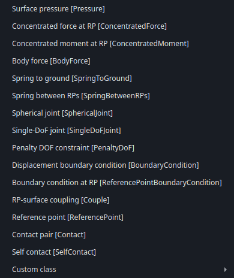

*Add a menu for the payload interface.*

<a id="load_types-joints"></a>

**Ball joints and single-degree-of-freedom joints**

Add two reference points in the "Load and Boundary Conditions" section. Then, add a "ball joint" or "single-degree-of-freedom joint". Select the two reference points in the joint card. Set a positive penalty stiffness and the initial global coordinates of the connection points in the "Load Cases" section. By default, each new load case uses a stiffness of 1 and the origin of the coordinate system. The actual stiffness should be set according to the model units and the stiffness of the connections.

The spherical joint allows free rotation around the connection point. The single-degree-of-freedom joint has six additional free direction components, with the initial direction determined by the rotation of the first reference point. By default, only the Z-axis rotation component is set to 1, indicating a joint that rotates around the Z-axis. When only the X-axis translation component is set to 1, it indicates a sliding joint along the X-axis. After selecting a load case, the assembly preview will display the name of the joint and the two reference points at the connection points.

<a id="load_types-pressure"></a>

### 5.1 Pressure: The pressure exerted on the surface

`Pressure` Apply axial pressure to the surface area of the instance. The areas where the instance and surfaces collide will be under pressure. The operating parameters are as follows: `[p]` Format. For example: `part1-1 / surface_1_All` , `p=0.06` .

The direction of pressure is determined jointly by the surface direction and the solver’s conventions. When applying loads to the inner cavity, it is necessary to verify the order of the outer boundary/inner cavity, the normal direction of the surface, and the direction of deformation. The preview arrows indicate the normal direction of pressure. This interface only accepts pressure parameters with a single component.

| UI field / stored key | Default | Meaning and input format |
|---|---|---|
| Instance / `instance_name` | *empty* | Name of the corresponding TorchFEA Instance. |
| Surface / `surface_name` | *empty* | Surface set on the instance (auto: surface_0_All, surface_1_All, ...). |

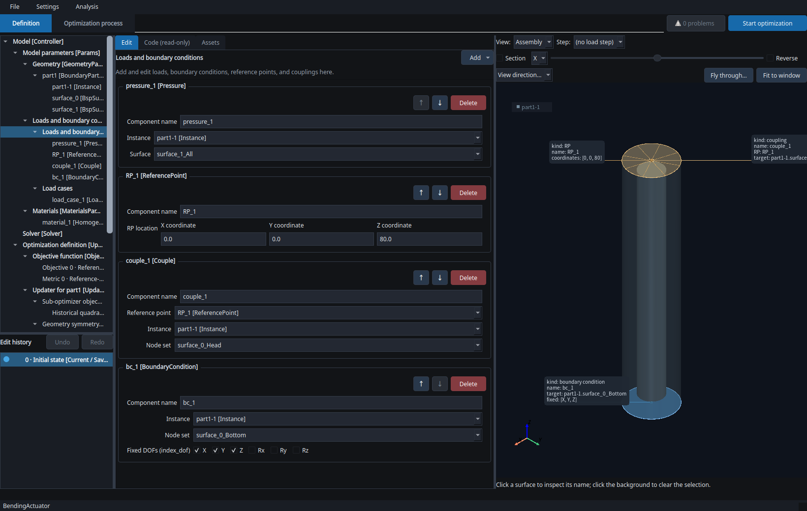

*Settings for the object and its scope of influence.*

<a id="load_types-concentratedforce"></a>

### 5.2 ConcentratedForce: The force exerted by the concentrated point of reference.

`ConcentratedForce` Apply a global three-component concentrated force on the RP. The ReferencePoint defines the loading reference point, and the Couple establishes the connection between the RP and the set of solid target nodes. The load case parameters are... `[Fx,Fy,Fz]` The unit of measurement is force.

Example: `[0,-1,0]` represents the global −Y direction force. RP that is not connected to a solid does not transfer load to nearby solids.

| UI field / stored key | Default | Meaning and input format |
|---|---|---|
| Reference point / `rp_name` | *empty* | The name of the defined ReferencePoint. |

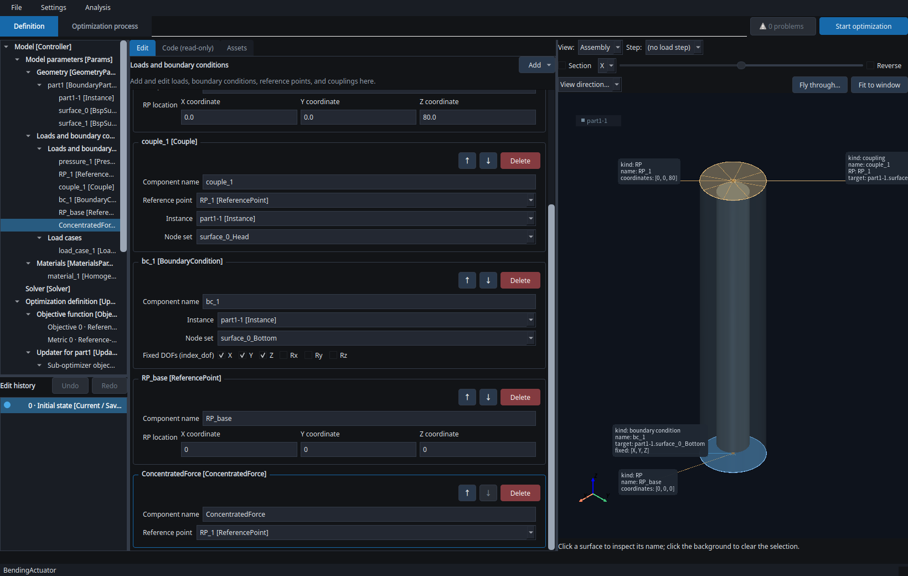

*Settings for the ConcentratedForce object and its effective range.*

<a id="load_types-concentratedmoment"></a>

### 5.3 ConcentratedMoment: The moment of force concentrated at the reference point.

`ConcentratedMoment` A three-component concentrated moment is applied to the RP. The parameters of this condition are as follows: `[Mx,My,Mz]` The unit of measurement is force × length. Torque is transmitted through the connection between the RP and the entity.

Torque and angle are two different quantities: torque is the input, while `rx/ry/rz` represents the motion response.

| UI field / stored key | Default | Meaning and input format |
|---|---|---|
| Reference point / `rp_name` | *empty* | The name of the defined ReferencePoint. |

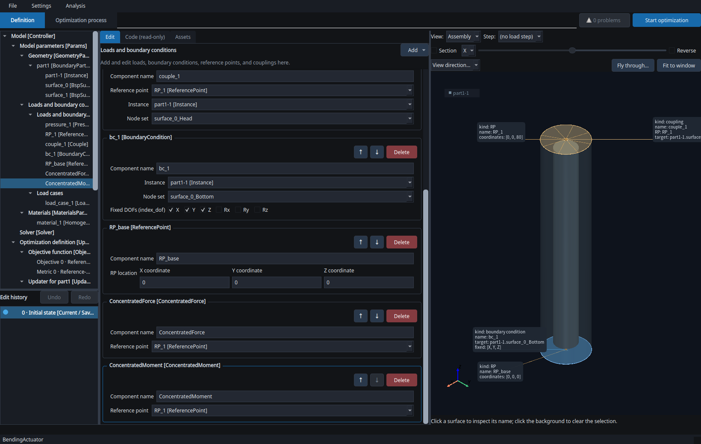

*Settings for the ConcentratedMoment object and its scope of influence.*

<a id="load_types-bodyforce"></a>

### 5.4 Bodyforce: Physical strength

`Bodyforce` Apply a unit volume force to the unit block of the specified instance. The instance name and unit block name determine the area of application, and the load case parameters are `[fx,fy,fz]` The dimension is force per volume.

The gravitational volume force is calculated using the `density × acceleration` system of units. This interface directly uses the input force density, without performing acceleration interpretation or additional density multiplication. The UI type is saved as `Bodyforce`, and the backend class name is `BodyForce`.

| UI field / stored key | Default | Meaning and input format |
|---|---|---|
| Element / `element_name` | *empty* | The names of the element blocks that bear volume forces in the example; based on the actual names of Part.elems. |
| Instance / `instance_name` | *empty* | Name of the corresponding TorchFEA Instance. |

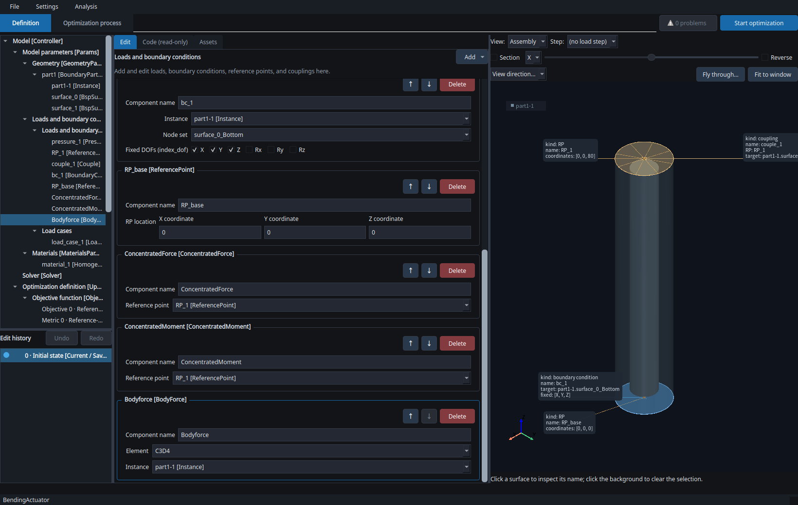

*Settings for Bodyforce's objects and their scope of action.*

<a id="load_types-springtoground"></a>

### 5.5 SpringToGround: Spring that connects to the ground

`SpringToGround` connects RP to a fixed spatial point using an axial spring. The object definition specifies RP, and the sequence of load case parameters is **`[k,L0,Px,Py,Pz]`**: stiffness, natural length, and global coordinates at the ground end.

Example: RP is located at `[40,8,4]`, fixed end at `[40,28,4]`, natural length of 20, stiffness of 1, corresponding parameters are `[1,20,40,28,4]`. The spring acts along the line connecting both ends, providing only axial stiffness; the pre-tension is determined by the difference between the actual length and L0.

| UI field / stored key | Default | Meaning and input format |
|---|---|---|
| Reference point / `rp_name` | *empty* | The name of the defined ReferencePoint. |

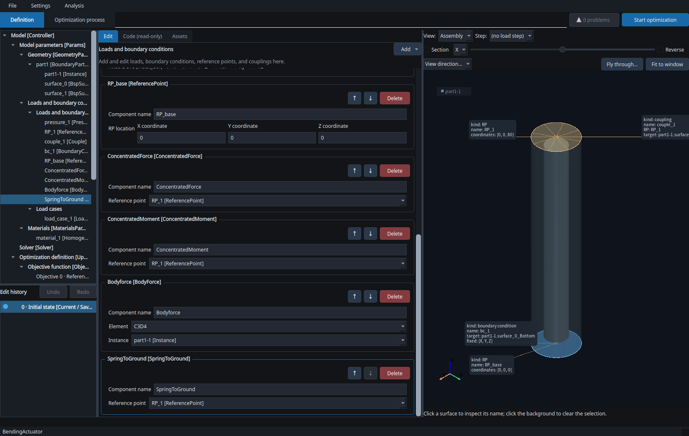

*Settings for the SpringToGround object and its scope of action.*

<a id="load_types-springbetweenrps"></a>

### 5.6 SpringBetweenRPs: The amount of spring between the reference points.

`SpringBetweenRPs` connects axial springs between two RPs. The two RPs define the endpoints of the springs, and their structures are associated through the connection interface. The load case parameters are `[k,L0]`.

The direction of this interface changes with the positions of both ends; it does not have an independent rotational stiffness component. The fixation conditions of the spring endpoints are defined by the BoundaryConditionRP corresponding to the RP.

| UI field / stored key | Default | Meaning and input format |
|---|---|---|
| RP 1 / `rp_name1` | *empty* | Name of the first reference point. |
| RP 2 / `rp_name2` | *empty* | Name of the second reference point. |

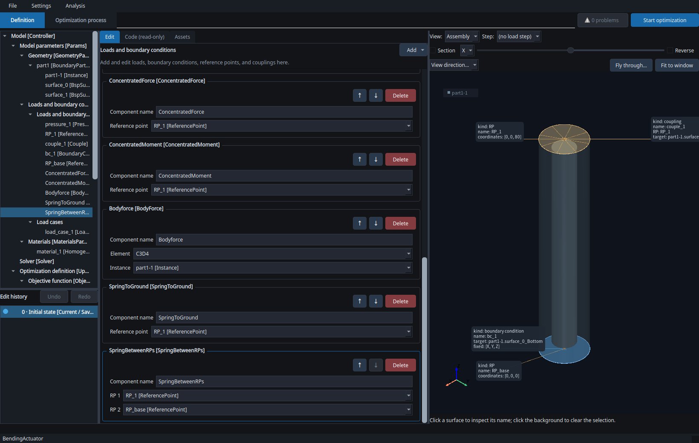

*Settings for the SpringBetweenRPs object and its scope of influence.*

<a id="load_types-penaltydof"></a>

### 5.7 PenaltyDoF: Degree of freedom penalty constraints

`PenaltyDoF` uses finite penalty stiffness to make the selected degrees of freedom close to the target value. The object type can be selected as “Automatic / Reference Point / Instance”. The drop-down list only provides defined reference points and instances. The Automatic mode allows selection between these two options. After switching the type, the invalid object selections are set to empty.

| Object | UI input | Save and script representation |
|---|---|---|
| Reference point | Object name; one of the six components: Ux/Uy/Uz/Rx/Ry/Rz. | `obj_name`、`obj_type`、`s=0…5` |
| instance | Object name; node number (starting from 0); X/Y/Z direction of displacement | `s=3*node_index+direction`: The X/Y/Z direction corresponds to 0/1/2. |

The node number refers to the local number in the current finite element node array, not the original INP label. The Z displacement of node 5 corresponds to `s=17`; it is necessary to recheck the node identities after the redivision. The UI derives two input items from the same `s`, and no additional set of node data is saved.

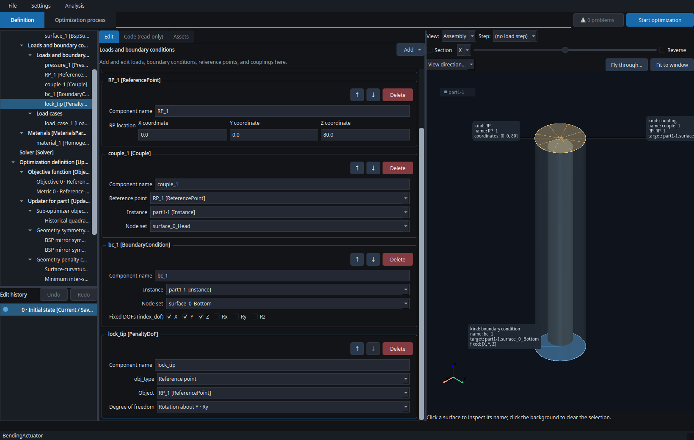

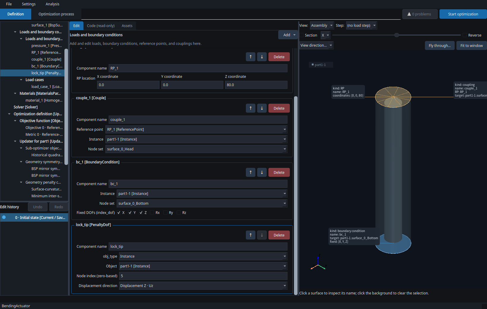

The stiffness and target values are filled in the load case card respectively. The order of script parameters is `[k, target]`. Finite penalty stiffness allows for a certain deviation from the target value; strict zero-displacement fixation uses the corresponding BoundaryCondition interface.

<a id="load_types-boundarycondition"></a>

### 5.8 BoundaryCondition: Displacement boundary conditions

`BoundaryCondition` Fix the selected degrees of freedom for the specified instance node set. For ordinary three-dimensional solid nodes, typically X, Y, and Z are selected, i.e. `[0,1,2]`; ordinary three-dimensional solid nodes do not have independent rotation degrees of freedom. The rotation option in the UI does not change the definition of the unit degrees of freedom.

Example: `part1-1 / surface_0_Bottom / [0,1,2]` – fixed bottom-level translation. This interface does not include a column for entering non-zero displacement values.

| UI field / stored key | Default | Meaning and input format |
|---|---|---|
| Instance / `instance_name` | *empty* | Name of the corresponding TorchFEA Instance. |
| Node set / `set_nodes_name` | *empty* | Name of a node set on the instance. |
| Fixed DOFs (index_dof) / `index_dof` | `[0, 1, 2]` | List of indices for fixed degrees of freedom; 0…5 correspond to X, Y, Z, Rx, Ry, Rz. The actual available components are determined by the degrees of freedom of the target object. |

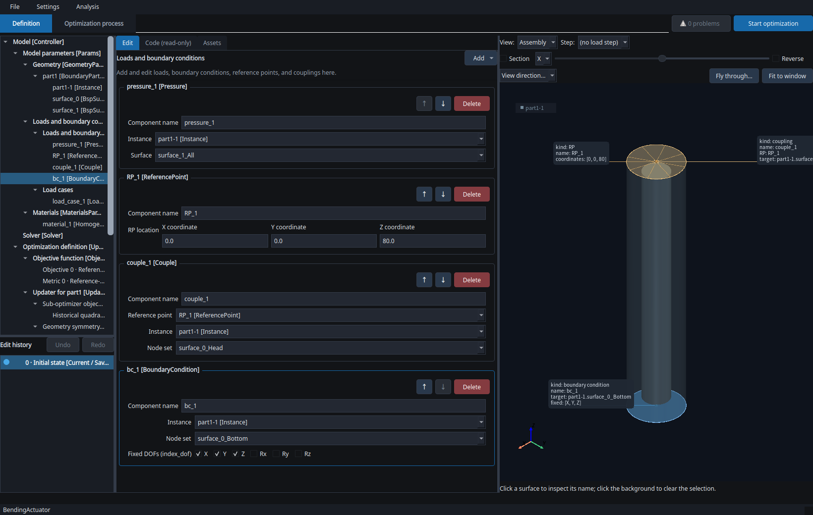

*Settings for the BoundaryCondition object and its scope of action.*

<a id="load_types-boundaryconditionrp"></a>

### 5.9 BoundaryConditionRP: Boundary conditions for reference points

`BoundaryConditionRP` Fix the selected translational or rotational degrees of freedom for the RP. Numbers `[0,1,2,3,4,5]` correspond to X, Y, Z, Rx, Ry, Rz.

For example, after fixing the component `[0,2,3,4,5]`, the reference point only retains the Y-axis degree of freedom. This motion relationship is transmitted to the solid through the Couple of RP.

| UI field / stored key | Default | Meaning and input format |
|---|---|---|
| Reference point / `rp_name` | *empty* | The name of the defined ReferencePoint. |
| Fixed DOFs (index_dof) / `index_dof` | `[0, 1, 2]` | List of indices for fixed degrees of freedom; 0…5 correspond to X, Y, Z, Rx, Ry, Rz. The actual available components are determined by the degrees of freedom of the target object. |

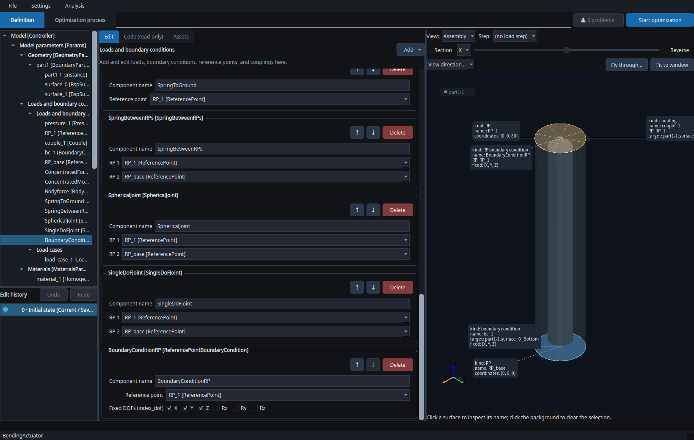

*Settings for the BoundaryConditionRP object and its scope of action.*

<a id="load_types-couple"></a>

### 5.10 Couple: Reference points – Surface coupling

`Couple` establishes kinematic coupling between the node set of an instance and RP. The movement of the node group is controlled by the translation and rotation of RP, and can be used for end face loading, fixation, or monitoring of the overall movement of the end.

A couple of node groups is applied with a rigid motion relationship. The area where this effect is applied is usually the end faces or connection areas that need to maintain rigidity. Applying coupling to the entire flexible component will change its ability to deform. This interface does not set the load case amplitude.

| UI field / stored key | Default | Meaning and input format |
|---|---|---|
| Reference point / `rp_name` | *empty* | The name of the defined ReferencePoint. |
| Instance / `instance_name` | *empty* | Name of the corresponding TorchFEA Instance. |
| Node set / `set_nodes_name` | *empty* | Name of a node set on the instance. |

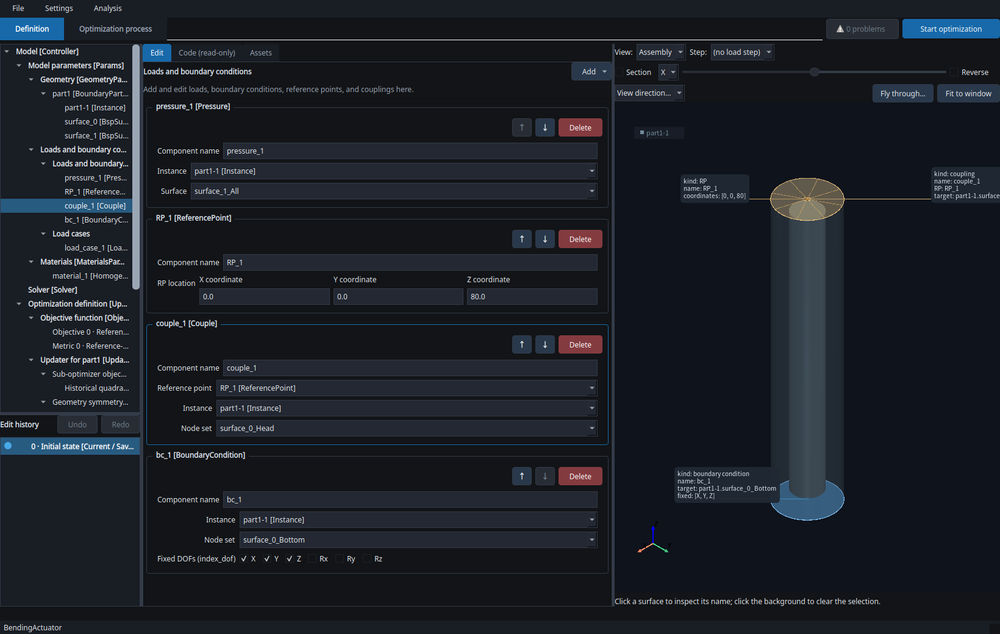

*Settings for the scope of application of the couple object.*

<a id="load_types-referencepoint"></a>

### 5.11 ReferencePoint: Reference point.

`ReferencePoint` Establish a reference point with position, translation, and rotation responses. The global coordinate `[x,y,z]` defines the position of the reference point. Concentrated forces, moments, springs, couplings, RP boundaries, and objective functions are referenced through the name of this object.

RP only defines the reference position and its degrees of freedom of motion. It does not create solid materials or automatically connect adjacent nodes. Requirements for loading and response extraction related to solids require the establishment of corresponding connections such as Couple.

| UI field / stored key | Default | Meaning and input format |
|---|---|---|
| RP location / `rp_location` | `[0.0, 0.0, 0.0]` | Reference point position. |

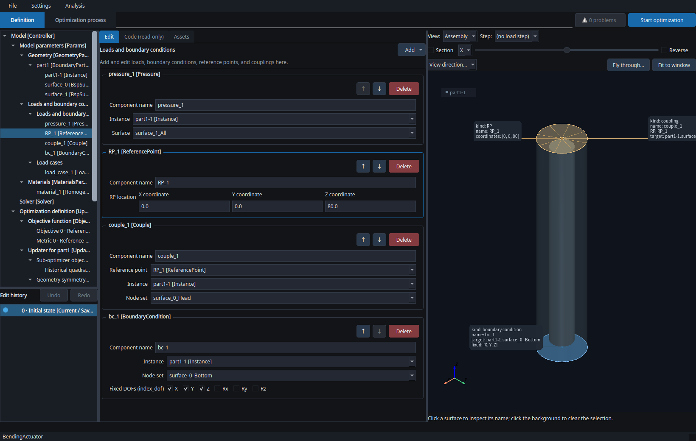

*Settings for ReferencePoint's objects and scope of action.*

<a id="load_types-contact"></a>

### 5.12 Contact: The pairs of contacts.

`Contact` Establish a penalty function contact between the surfaces of the two sets of instances. Define the contact region for the instances and surface sets on both sides. The normal direction and initial spacing are the main items to be verified. `penalty_threshold_h` It represents the threshold for contact distance, measured in units of length. This value determines the range within which contact effects will be applied.

The current interface does not provide fields for friction coefficients and friction laws. The contact relationship is explicitly defined by Contact, and the geometric proximity of surfaces does not inherently establish contact effects.

| UI field / stored key | Default | Meaning and input format |
|---|---|---|
| Instance 1 / `instance_name1` | *empty* | Name of the first instance. |
| Surface 1 / `surface_name1` | *empty* | Select or type a surface set of another part. |
| Instance 2 / `instance_name2` | *empty* | Name of the second instance. |
| Surface 2 / `surface_name2` | *empty* | Select or type a surface set. |
| penalty_threshold_h / `penalty_threshold_h` | `3.0` | Penalty threshold. |

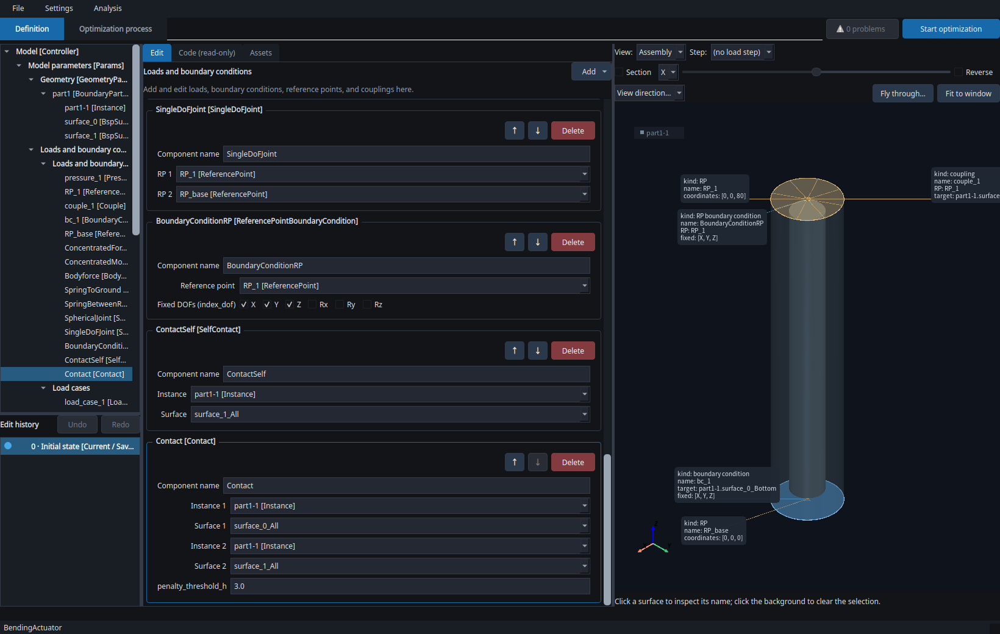

*Settings for the contact's object and scope of action.*

<a id="load_types-contactself"></a>

### 5.13 ContactSelf: Self-Contact

`ContactSelf` establishes self-contact on a specified surface of an instance, addressing the situation where different regions of the same structure are close to each other. The instance and the set of surfaces determine the areas where self-contact occurs; the current UI does not provide independent contact thresholds, friction parameters, or amplitude values per load case.

The definitions of self-contact and contact between different instances are separate. The surface discretization density affects the computational cost, and the range of self-contact should match the actual contact area. The backend class name is `SelfContact`.

| UI field / stored key | Default | Meaning and input format |
|---|---|---|
| Instance / `instance_name` | *empty* | Name of the corresponding TorchFEA Instance. |
| Surface / `surface_name` | *empty* | Select or type a surface set. |

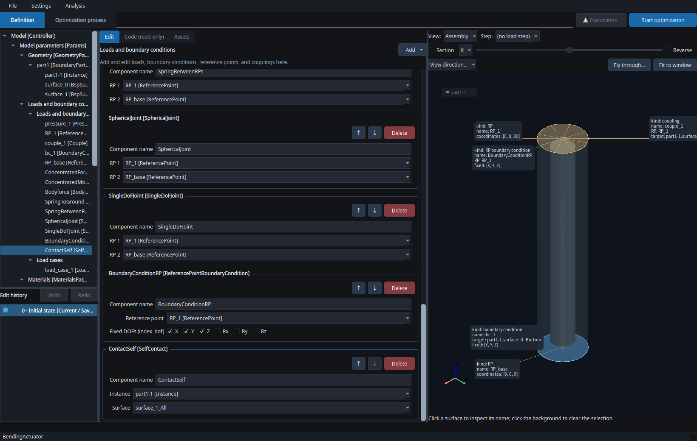

*Settings for the ContactSelf object and its scope of action.*

<a id="steps"></a>

## 6 Named load cases and load parameters

The load case **Entrance: Loads and boundary conditions → Load conditions.** appears in the model tree at `name [LoadCase]`. The interface cards used are the same as those used for components and loads. The load cases can be added to the collection page. Each card can be renamed, moved up, moved down, or deleted. The load case can be directly located by selecting the corresponding tree node. The name is a unique string, and the registration order is determined by the order of the cards.

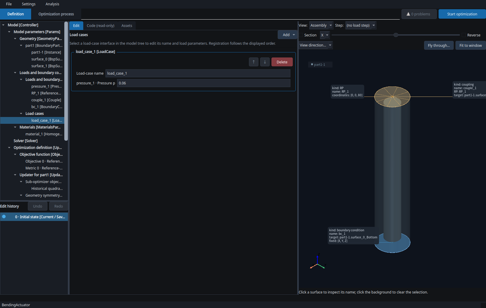

Each card lists all the parametric loads row by row, with labels indicating the load name and parameter name. Values that are not configured separately are displayed as the default values of the interface; reference points, coupling, and fixed boundaries do not occupy any rows for values.

| load | Parameters to be filled in separately | Script list order |
|---|---|---|
| Pressure | pressure | `[p]` |
| ConcentratedForce | X/Y/Z – Concentrated Force | `[Fx,Fy,Fz]` |
| ConcentratedMoment | X/Y/Z concentrated torque | `[Mx,My,Mz]` |
| Bodyforce | X/Y/Z Physical Density | `[fx,fy,fz]` |
| SpringToGround | Stiffness, original length, fixed-end X/Y/Z | `[k,L0,Px,Py,Pz]` |
| SpringBetweenRPs | Stiffness, original length | `[k,L0]` |
| SphericalJoint | Penalty stiffness, initial connection point coordinates | `[k,x,y,z]` |
| SingleDoFJoint | Penalty stiffness, initial connection point coordinates, free direction | `[k,x,y,z,tx,ty,tz,rx,ry,rz]` |
| PenaltyDoF | Penalty stiffness, target value | `[k,target]` |

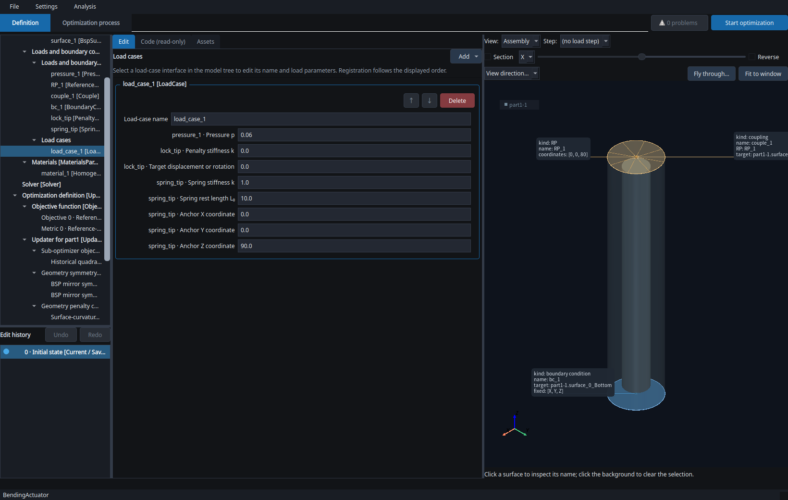

Each load case can be filled with numerical values or supported constant references. The name of a load case is synchronized with its target, indicators, and solver task group; the order of load cases and the order within the solver group are managed separately. When a load case is deleted, the interface asks whether to delete the target it references. When the target is retained, the corresponding load case is set to empty, and the confirmation is provided by the model tree.

When the load case, upper limit, reference points, and integration configuration are complete, the Gaussian point load case is automatically registered. The load case page displays the generation status and the link to the target; existing load definitions are always retained. When deleting a load case or metric, a prompt is displayed to decide whether to clean up the generated load cases that are no longer referenced. Load cases that are still referenced by other targets, metrics, or explicit solver task groups will remain. If you choose not to clean them up, the load cases will continue to exist as ordinary load cases.

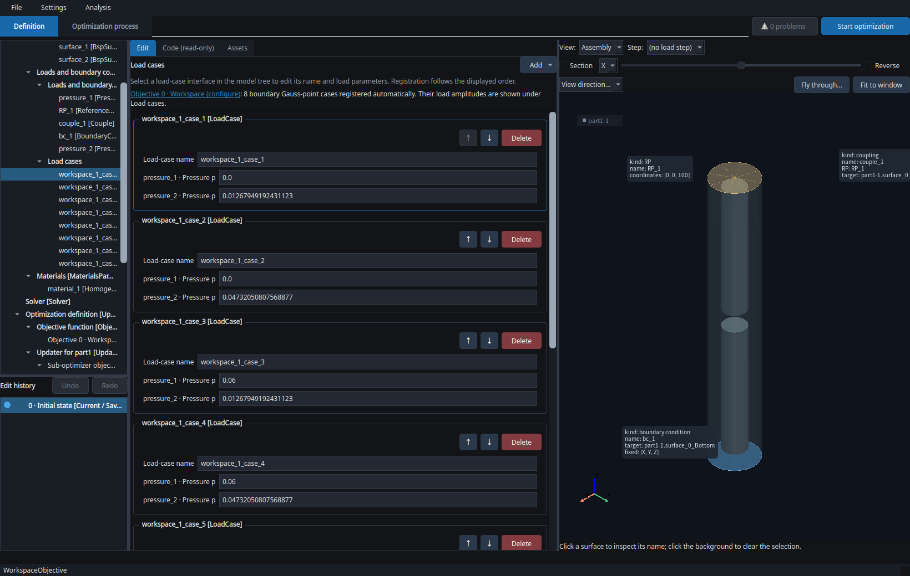

The load case interface reads the same `StepsNode.step_values`, with no independent copies of the amplitude. The file and script still follow the structure of "load case name → load name → parameter list".

<a id="materials"></a>

## 7 Materials and constitutive models

**Entering the system: Select "Main Definitions" → "Materials" → "Add".** The material definition includes the target Part, element blocks, constitutive model, and material parameters. The material is assigned to the Part, and instances of that Part use the corresponding material definition.

<a id="section-均匀材料与空间设计材料"></a>

### 7.1 Uniform materials and spatial design materials

<a id="material_types-homogeneousmaterial"></a>

#### 7.1.1 HomogeneousMaterial: Homogeneous materials.

`HomogeneousMaterial` Allocate uniform material across the target cell range. `part_name` Specify the target component, `material_model` specify the constitutive model; the material constants and density defined by the model determine the material properties.

`elementname` Leaves blank to indicate selecting all element blocks of that part. If the same component has multiple material regions, it is necessary to clarify the allocation of each block to avoid overlaps. The following table lists all the constitutive parameters that can be saved, but the UI **Only the parameters required by the current constitutive model are displayed.** is not included. The parameter relationships for the eight models are described in 7.2.

| UI field / stored key | Default | Meaning and input format |
|---|---|---|
| Assigned Part / `part_name` | *empty* | Part assigned to this material; select an existing Part. |
| Material model / `material_model` | `"NeoHookeanLnJ"` | Corresponding to the constitutive parameter classes in MaterialModels and the TorchFEA material models. Options: `LinearElastic`, `NeoHookean`, `NeoHookeanLnJ`, `MooneyRivlin`, `Yeoh`, `Gent`, `ArrudaBoyce`, `Ogden`. |
| E / `E` | `1.0` | Young’s modulus, expressed in model stress units. |
| nu / `nu` | `0.45` | The Poisson ratio is a dimensionless quantity. The range of linear elastic isotropic stability is −1 < ν < 0.5. |
| mu / `mu` | `0.482` | Shear modulus. |
| kappa / `kappa` | `4.8` | Bulk modulus. |
| c10 / `c10` | `0.241` | Mooney-Rivlin’s first coefficient is calculated using stress units. |
| c01 / `c01` | `0.241` | The second coefficient of Mooney-Rivlin, expressed in stress units. |
| c1 / `c1` | `0.482` | Yeoh's first-order coefficient, expressed in stress units. |
| c2 / `c2` | `0.0` | Yeoh's second-order coefficients, expressed in stress units. |
| c3 / `c3` | `0.0` | Yeoh's third-order coefficients, expressed in stress units. |
| Jm / `Jm` | `100.0` | The finite chain elongation parameter for Gent is a dimensionless quantity, and it must be a positive value. |
| N / `N` | `10.0` | Arruda–Boyce segment parameters, dimensionless values; must be positive. |
| alpha / `alpha` | `[2.0]` | The Ogden index is a dimensionless quantity and cannot be equal to 0. The input boxes for UI parameters are provided separately for each list item. The number of constitutive parameters should be consistent with the requirements of the backend model. |
| density / `density` | `1.08e-09` | Mass density. |
| Elems name / `elementname` | *empty* | Name under Part.elems; empty assigns all elems. |

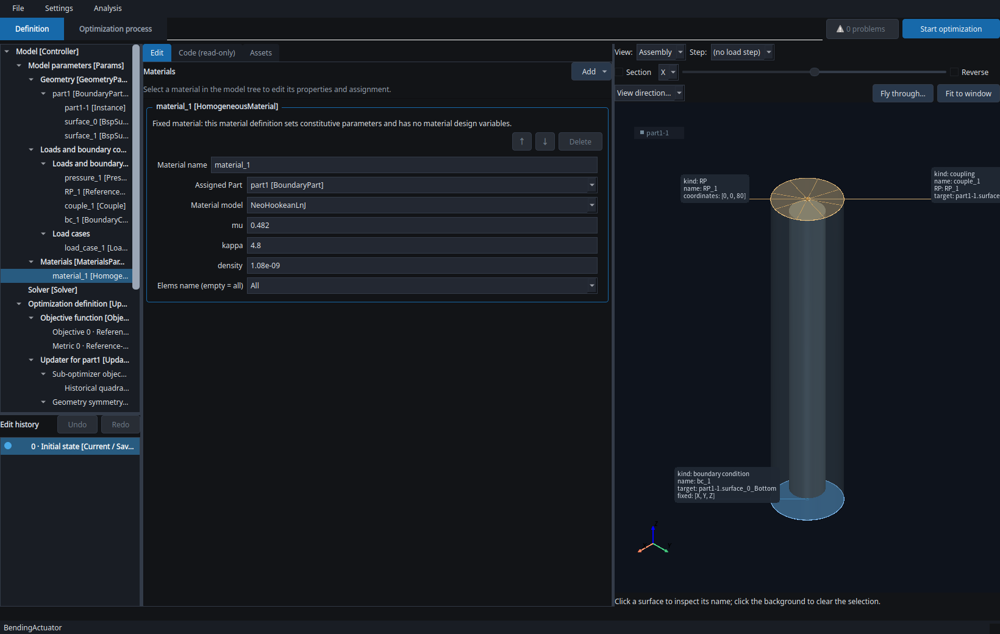

*Uniform distribution of NeoHookean LnJ materials.*

<a id="material_types-simp-bspfieldmaterials"></a>

#### 7.1.2 SIMP_BSPFieldMaterials: Simp B spline density field material

`SIMP_BSPFieldMaterials` Establish an optimizable B-spline material design field within a finite element component. The material design variables describe the spatial stiffness ratio, while the solid mesh remains fixed. The material optimizer, targeting this material, performs updates to the design field.

The target Part and cell determine the material distribution range. `bounding_box` defines the bounding box that covers the design area, and its three directions should all have positive spans. For example, a BoxPart with a design area of 40×16×8 can use `[0,40,0,16,0,8]`, and the target cell is `C3D8`. A lower resolution usually corresponds to more design variables.

When selecting or switching to the target Part, the interface automatically fills in the local coordinate range for the complete preview of the geometry of that Part. `bounding_box` In order: `[xmin, xmax, ymin, ymax, zmin, zmax]` This range is consistent with the bounding box of the component view, and does not include translations and rotations of the instance. It can be manually modified after being automatically filled in; re-select the Part when switching back. When the target component does not have a valid preview geometry, the range is set to zero. You need to complete the geometry definition before re-selecting the Part or filling in the range manually.

NeoHookean and NeoHookeanLnJ use `mumax/kappamax` to represent the modulus of the solid material. Other constitutive models use their corresponding ordinary parameter fields. Material calculations only utilize the valid parameters corresponding to the current constitutive model. Hidden fields of other constitutive models will only take effect when they are different.

| UI field / stored key | Default | Meaning and input format |
|---|---|---|
| Design Part / `part_name` | *empty* | Part carrying the SIMP design field; select an existing Part. |
| Material model / `material_model` | `"NeoHookeanLnJ"` | Corresponding to the constitutive parameter classes in MaterialModels and the TorchFEA material models. Options: `LinearElastic`, `NeoHookean`, `NeoHookeanLnJ`, `MooneyRivlin`, `Yeoh`, `Gent`, `ArrudaBoyce`, `Ogden`. |
| mu max / `mumax` | `10.0` | Maximum shear modulus. |
| kappa max / `kappamax` | `100.0` | Maximum bulk modulus. |
| E / `E` | `1.0` | Young’s modulus, expressed in model stress units. |
| nu / `nu` | `0.45` | The Poisson ratio is a dimensionless quantity. The range of linear elastic isotropic stability is −1 < ν < 0.5. |
| mu / `mu` | `0.482` | Shear modulus. |
| kappa / `kappa` | `4.8` | Bulk modulus. |
| c10 / `c10` | `0.241` | Mooney-Rivlin’s first coefficient is calculated using stress units. |
| c01 / `c01` | `0.241` | The second coefficient of Mooney-Rivlin, expressed in stress units. |
| c1 / `c1` | `0.482` | Yeoh's first-order coefficient, expressed in stress units. |
| c2 / `c2` | `0.0` | Yeoh's second-order coefficients, expressed in stress units. |
| c3 / `c3` | `0.0` | Yeoh's third-order coefficients, expressed in stress units. |
| Jm / `Jm` | `100.0` | The finite chain elongation parameter for Gent is a dimensionless quantity, and it must be a positive value. |
| N / `N` | `10.0` | Arruda–Boyce segment parameters, dimensionless values; must be positive. |
| alpha / `alpha` | `[2.0]` | The Ogden index is a dimensionless quantity and cannot be equal to 0. The input boxes for UI parameters are provided separately for each list item. The number of constitutive parameters should be consistent with the requirements of the backend model. |
| Minimum material stiffness ratio / `simp_ratio_min` | `1e-07` | Lower stiffness ratio simp_ratio_min. The actual ratio is simp_ratio_min + (1 − simp_ratio_min) × RAMP(sigmoid(design field)). |
| bounding_box / `bounding_box` | `[0.0, 0.0, 0.0, 0.0, 0.0, 0.0]` | Field bounding box [xmin,xmax,ymin,ymax,zmin,zmax]. |
| field resolution / `simp_field_resolution` | `0.5` | Density-field resolution. |
| B-spline degree / `degree` | `2` | Polynomial degree of the B-spline basis for the density design field. |
| density / `density` | `1.08e-09` | Mass density. |
| Initial design field value / `initial_ratio` | `0.5` | initial_ratio initializes design-field control values directly. Sigmoid and RAMP interpolation then determine the initial material ratio. |
| void penal / `voidpenalfactor` | `0.01` | Void penalty factor. |
| RAMP interpolation penalty / `materialpenalty` | `8` | Integer materialpenalty = p in ρ / (1 + p(1 − ρ)), where ρ = sigmoid(design field). |
| Elems name / `elementname` | *empty* | Name under Part.elems; empty assigns all elems. |

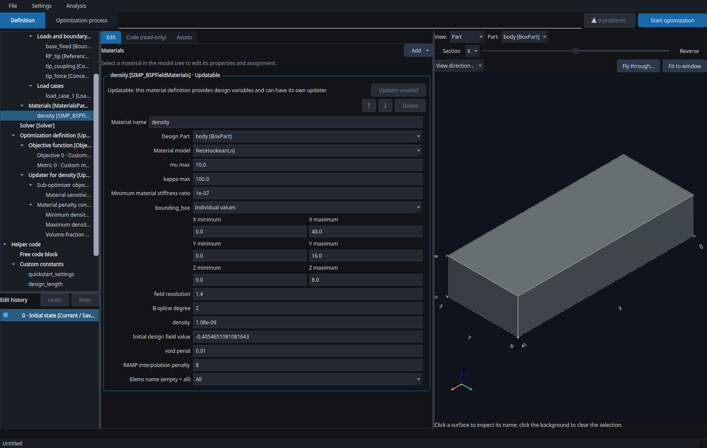

*The objectives of SIMP materials, along with their constitutive parameters.*

<a id="section-材料模型及参数对应关系"></a>

### 7.2 Material models and their parameter relationships

The following table lists the parameter definitions for each material model in the UI. The specific values are determined through experimental fitting or material calibration. Parameters with the same name or similar names in different constitutive models should be defined separately according to each model.

| Model | Actual parameters | Definitions and functions |
|---|---|---|
| `LinearElastic` | `E, nu` | Isotropic linear elasticity; used for analyzing material relationships under linear approximations. To describe the large strain response of rubber, it is necessary to choose an appropriate hyperelastic model and calibrate it. |
| `NeoHookean` | `mu, kappa` | Compressible Neo-Hookean; the isochoric term is μ/2·(J^(-2/3)I₁−3), and the volume term is κ/2·(J−1)² |
| `NeoHookeanLnJ` | `mu, kappa` | The isochoric terms are the same as above. For the volume term, κ/2·(ln J)² is used. The results under finite volume deformation are different from those of the previous model. |
| `MooneyRivlin` | `c10, c01, kappa` | The superelasticity is described using two parameters related to partial strains. The volume response is controlled by the parameter κ. |
| `Yeoh` | `c1, c2, c3, kappa` | Describe nonlinear behaviors using polynomials that preserve the first order of partial strain invariants. The coefficients should be determined through fitting to the material data. |
| `Gent` | `mu, Jm, kappa` | Superelasticity with limited chain elongation; the response is controlled by Jm, which determines the maximum elongation limit. |
| `ArrudaBoyce` | `mu, N, kappa` | Superelasticity in a chain-based network structure; N controls the behavior related to chain elongation. |
| `Ogden` | `mu, alpha, kappa` | Describing hyperelasticity using the power of the principal elongation; in current ordinary UI, μ is a scalar, and alpha should be represented by a non-zero exponent, for example, `[2.0]`. |

E, μ, κ, c10, c01, c1, c2, c3 use stress units; ν, Jm, N, alpha are dimensionless units. The backend Ogden supports editing multiple μ/alpha pairs, but the current standard UI does not provide an option to edit μ lists paired with multiple alpha values. Therefore, the number of alpha values in the standard UI should correspond to the scalar μ.

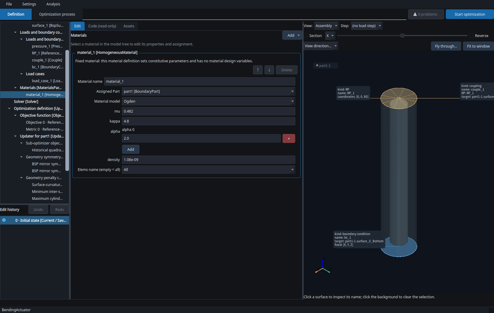

*After switching to Ogden, values for μ, κ, and alpha are displayed.*

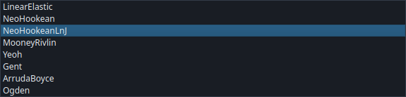

*Material model selection interface; parameter tables update accordingly as the selection changes.*

<a id="section-simp-控制变量材料占比与刚度比例"></a>

### 7.3 SIMP control variables, material proportions, and stiffness ratios

Currently, the implementation involves applying a sigmoid mapping followed by RAMP interpolation to the control fields.

```text
f = B The design field obtained through spline interpolation
ρ = sigmoid(f) = 1 / (1 + exp(-f))
RAMP(ρ) = ρ / (1 + p * (1 - ρ))
r = r_min + (1 - r_min) * RAMP(ρ)
```

- `initial_ratio` Directly assign the initial values to the control points. **f** It isn’t the volume fraction of the initial material.
- `materialpenalty` represents the value of p mentioned above, while `simp_ratio_min` represents the lower limit of the stiffness ratio, r_min.
- `VolFrac` Check the volume-weighted **ρ**, which is not equal to the stiffness ratio r after RAMP.
- `MinValue/MaxValue` restricts the design control variables **f**.

For example, when initial_ratio=0.5 and p=8, the initial value of ρ is approximately 0.6225, while r is approximately 0.1548 (when r_min is small). The material proportion corresponding to this initial control value is approximately 62.25%, not 50%.

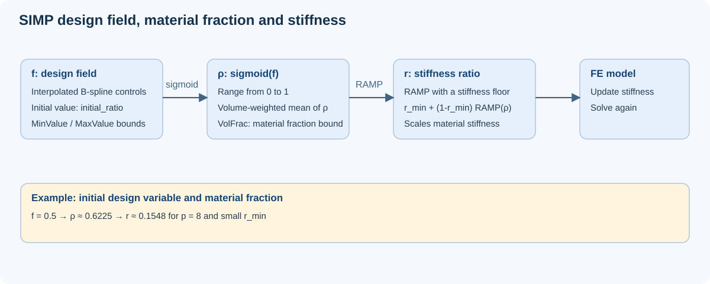

*In SIMP, it describes the relationship between control variables, material volume fractions, and stiffness ratios.*

<a id="objectives"></a>

## 8 Objectives, metrics and finite-element data

**Entrance: Main Definitions → Objective Function.** The objective function defines the evaluation criteria for design updates, while the indicators define the responses that are recorded independently. Both support the reading of the same responses, and setting the indicators does not drive optimization.

<a id="section-工作空间目标"></a>

### 8.1 Workspace objective

In the add menu of the target item, select “Workplace Target”. Configure the reference points, position, or attitude of the workplace type. Check the existing load parameters to be included in the calculation. Enter the upper limit and the number of Gaussian points in each direction. The lower limit of the load is zero, and the upper limit is based on the model units. The parameters within the same input group should change synchronously. A two-dimensional workplace requires two independent inputs, while a three-dimensional workplace requires three independent inputs.

In a two-dimensional load case, n Gaussian points are used for each of the four edges, resulting in 4n named load cases. In a three-dimensional load case, n×n points are used for each of the six surfaces, resulting in 6n² load cases. When the effective configuration is initially completed, or when the load parameters, upper limits, or the number of Gaussian points change, the load cases are automatically registered, and the Jacobian for the selected load is automatically requested. Each Gaussian point on the boundary corresponds to a new load case, and the load magnitude is determined by the coordinates of the load domain at that point. The load magnitudes that do not participate in the working space are set to zero. The card displays the actual number of registered cases, and the list of load cases and the preview of case selection are updated simultaneously. In the generated task script, the displacement of reference points and the load Jacobian are extracted for each load case. The integral terms are accumulated according to the Gaussian weights and the direction signs of the boundaries. The area or volume of the working space is calculated. The script directly lists the load cases and the calculation expressions. The integration results are used for minimization with negative values; the normalized scale is positive, and the weights are uniformly set based on the target terms.

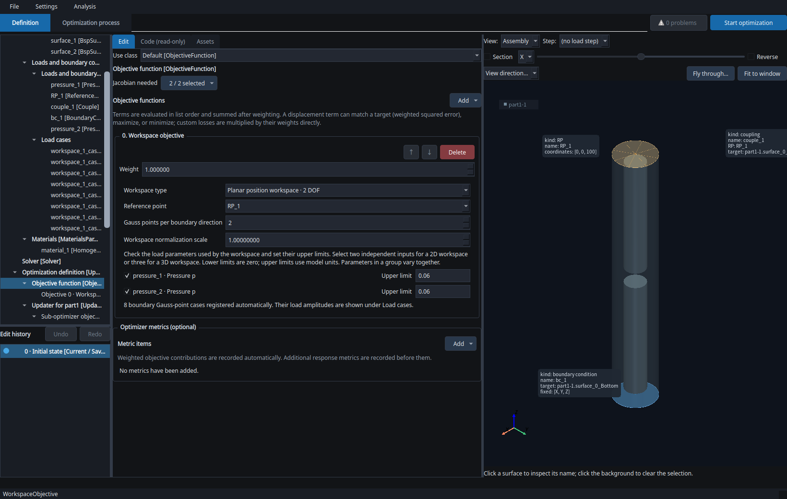

When deleting a target, the load case is cleared through confirmation dialogs. Other targets, indicators, explicit string references in custom codes, and solver task groups are all included in the reference relationship. When generating a new load case, only the load case generated for that target and not referenced by other targets will be replaced. The load definitions remain intact.

When deleting a referenced load case, the interface provides options such as "delete the target simultaneously", "keep the objective and clear its load case", and "cancel". When retaining displacement targets or indicators, the load case field returns to unselected state; when retaining workspace targets, the entire list of load cases is cleared, and any string references to the load case names in the custom code are replaced with `None`. After clearing, the load case will not be recreated during normal synchronization, saving, or script export. Workspace targets will automatically re-register load cases after modifying load inputs, upper limits, or the number of Gaussian points. The workspace target cannot be exported or run until all load case references are complete.

<a id="section-参考点位移--转角目标"></a>

### 8.2 Reference point displacement / Rotation target

| Field | Definition and Function |
|---|---|
| Type: `type` | Please select the reference point displacement item `displacement`, or define a custom target `custom_loss`. |
| weight / `weight` | Proportion of contributions from each target item. This value should be determined based on the dimension of the items involved and the typical range of their responses. At least one of the items must have a positive contribution. |
| RP / `reference_point_name` | The movement of choosing which reference point |
| Operating conditions / `step_name` | Select the load conditions based on the name. |
| Weight: `component` | x/y/z represent translations, while rx/ry/rz represent components of the rotation vector. The rotation angle is denoted in radians. |
| Direction: `direction` | Maximize, minimize, approach the target value. |
| Target value / `target` | Used only in the target direction, and corresponds to the unit of the selected component. |

The program calculates the weighted sum of all target items, resulting in a scalar loss L. This value is then minimized.

```text
minimize： L_i = weight * response
maximize： L_i = -weight * response
target：   L_i = weight * (response - target)^2
Total loss: L = sum of all L_i values
```

For example, maximizing `RP_1.ry` and making `RP_1.x` close to 0 can be defined as two different objective functions. The units and magnitudes of displacement and rotation are different, and the weights of each item should be scaled accordingly. A decrease in the total loss indicates an improvement in the weighted objectives, and it is not required that all responses decrease simultaneously.


*Displacement/rotation targets and independent metrics for recording.*

<a id="section-指标接口"></a>

### 8.3 Metric API

- For **Reference point indicator `displacement`:**, fill in RP, load case, and components, and directly record the response. There are no target directions, target values, or optimization weights.
- **Custom metrics `custom_metric`:** The code body returns a scalar or a set of scalars that need to be recorded. Multiple return values correspond to multiple metric components.

Physical indicators such as ry at the end are used to explain changes in actual responses, while the loss curve is used to evaluate changes in weighted targets. Combining these two types of records allows for the analysis of the interactions between multiple targets.

For each indicator card, an input box for the “indicator name” is provided. When left empty, it will automatically be numbered starting from 0. When the custom indicator function returns a dictionary, the keys of the dictionary will directly serve as the indicator names. When it returns a list, each component will be recorded separately. The lists with already filled names will be named `<name>_0`, `<name>_1`, and so on. The names must be unique within the same task.

The tasks generated by the UI will first record the metrics defined by the user, and then proceed with the execution of the tasks. `objective_0` , `objective_1` Add the weighted contributions of each target to the total name. $L_i$ The additional items include the maximization of negative signs, target error transformation, and normalization scale. The sum of these items equals the total target value. The historical table and the "Display Curve" control below display the names of the indicators. Each time, either the total target or any individual indicator can be displayed separately.

<a id="section-自定义目标--指标代码"></a>

### 8.4 Custom targets/metrics codes

`body` defines a custom objective function body, with the return value being a differentiable Torch scalar. The editor provides a function signature. `self` refers to ObjectiveFunction, while `self.fe` and `self.fe_results` provide information about the current finite element model and load case responses.

For example, to read the value of RP_1.ry for the first operating condition and maximize it, the code can be written as follows:

```python
self.set_step(0)
assembly = self.fe.assembly
state = assembly._GC2RGC(self.fe_results[0].GC.to(assembly.device))
rp = assembly.get_reference_point('RP_1')
return -state[rp._RGC_index].reshape(-1)[4]
```

The example achieves maximization by returning negative values for the response. The outer layer only performs the multiplication of the weights of the target items; repeated negation should be avoided. The data interfaces starting with underscores may change with version updates. The editor’s "Insert Template" feature provides data access code that matches the current version. After the template is inserted, the target function body still needs to include the response combination and the `return` statement.

**For intermediate calculations involving differentiable targets, it’s necessary to retain the Torch representation of the computations.** calls the response function `.item()`, converts it to NumPy format, or reconstructs tensors that are separate from the calculation graph. These operations will interrupt the corresponding gradient propagation. Such operations are suitable for final numerical output.

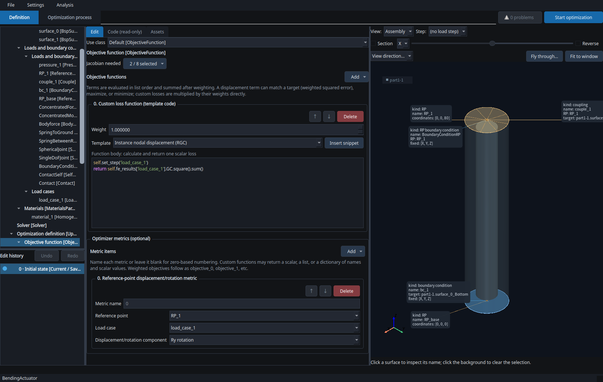

*Custom target function bodies, along with the entries into the finite element templates.*

<a id="section-十二个有限元数据代码模板"></a>

### 8.5 Twelve finite metadata code templates

**Enter the code editing area for the custom targets or metrics you want to use → click “Insert Template”.** The template parameters include load case, instance, reference point, unit block, and load name. The array shapes in the following table represent the data structures returned by the template; there is no need to manually construct these arrays.

| Template save key / Data | Enter the object. | Returning data and its meanings |
|---|---|---|
| `instance_displacement` / Instance Movement | Operating conditions, instances | `node_displacement[nnode,3]` – Three-dimensional displacement of the node |
| `reference_point_motion` / RP Movement | Operating conditions, RP | Six components: `[Ux,Uy,Uz,Rx,Ry,Rz]` |
| `end_effector_translation` / End-to-End Translation | Operating conditions, RP, axes 0/1/2 | A translational component, which can serve as a target or benchmark. |
| `end_effector_rotation` / End Angle | Operating conditions, RP, shaft 3/4/5 | One angular component, measured in radians. |
| `instance_force` / Generalized force segments for instances | Operating conditions, instances, axes | Node force array `[nnode,3]` is still available for assembly. Please refer to the constraints and symbols for further explanation. |
| `reference_point_force` / RP Generalized Force Segment | Operating conditions, RP, components | The six-component generalized residual `[Fx,Fy,Fz,Mx,My,Mz]`; its physical meaning should be determined in conjunction with the object’s constraints and symbolic conventions. |
| `gaussian_energy_density` / Points per unit energy density | Operating conditions, instances, and units | `[ngauss,nelem]` is suitable for metrics related to energy consumption or losses. |
| `gaussian_deformation_gradient` / Deformation gradient F | Operating conditions, instances, and units | `[ngauss,nelem,3,3]` can also be used to calculate deformation quantities such as J. |
| `jacobian_6d_matrix` / Six-dimensional Jacobian matrix for responses | Operating conditions, RP values, names of forces applied, names of moments applied | The 6×6 motion model includes derivatives matrices for forces/torques parameters. |
| `jacobian_translation_response` / Translation Response Norm | Same as above. | Translation – 3×3 subblock norm of forces |
| `jacobian_rotation_response` / Rotation Response Norm | Same as above. | 3×3 subblock norm for rotation and torque |
| `jacobian_6d_response` / Six-dimensional response norm | Same as above. | Complete 6×6 matrix norm |

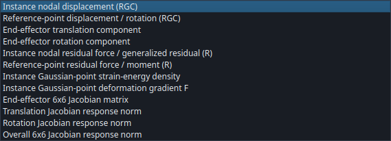

*Definition of limited metadata templates and return values.*

<a id="section-jacobian-载荷选择"></a>

### 8.6 Selection of Jacobian loads

`jacobian_needed` specifies the load parameters used in the calculation of the response derivative. The steps for configuring the six-dimensional template are as follows:

1. First, create the target RP, and then create the ConcentratedForce and ConcentratedMoment that act on the same RP.
2. Fill in the complete force and moment components for the corresponding operating conditions.
3. In the selection of Jacobian loads for the target page, please check both of these interfaces.
4. Insert the six-dimensional template, select the same RP and these loads, then define the desired responses.

The Jacobian describes the derivative of the motion response with respect to the load parameters. The geometric optimization gradient describes the derivative of the main objective with respect to the geometric control points. The objects of derivation and their uses are different for both. The physical interpretation of the Jacobian is based on the effective configuration of stiffness, connections, and load objects.

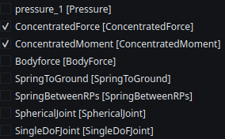

*Interfaces for managing the forces and moments involved in Jacobian calculations.*

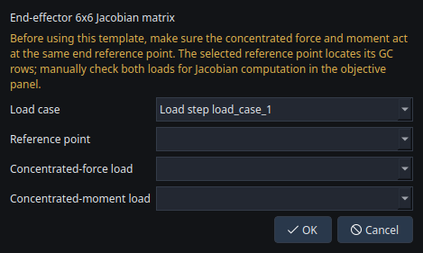

*The template parameter window specifies load case, RP, concentrated force, and concentrated moment respectively. It is not advisable to select based solely on similar names.*

<a id="solver"></a>

## 9 Solver and run settings

<a id="section-根节点任务结果目录与计算设备"></a>

### 9.1 Root nodes: tasks, results, and computing devices.

**Entry Point: The root node of the model tree structure.**

| Field | Definition and Function |
|---|---|
| `label` | Task name, used for identification purposes. |
| `result_folder` | The result is stored in the root directory. Each time the program runs, a new directory is created for storing the results. |
| `device` | The main computing device, such as cpu or cuda:0, must match the actual environment available. |
| `updater_device` | The device of the updater; when “Default (Follow Controller)” is selected, it will be saved as `null`. The script generated will be sent to `device=None`, and will follow the Controller during runtime. Alternatively, you can explicitly choose to use CPU or GPU. |
| `restart_per_iteration` | The interval between periodic restarts of the running process is used for managing the process’s lifecycle. It doesn’t relate to the total number of optimization iterations. |

`.morph` Save the explicit definitions of various components, materials, loads, solvers, and updaters. Do not save the global optimization scheme classification. A task can include both geometric and material design variables. The run archive also retains the frozen definitions, models, states, and history at that time; modify the current settings. `.morph` It will not re-write the data from existing rounds.

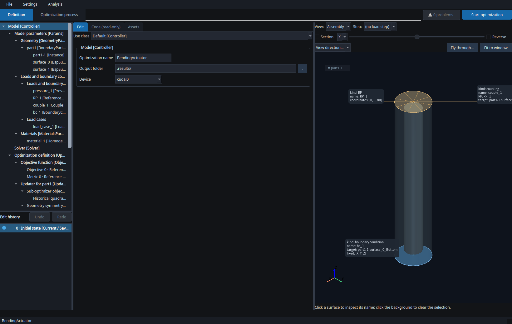

*Task name, result directory, devices involved, and restart cycle for execution.*

<a id="section-solver工况任务的组织"></a>

### 9.2 Solver: Organizes tasks according to specific operating conditions.

**Entry Point: Model Tree → Solver.**

| Field | Parameter definitions and input formats |
|---|---|
| `num_process` | The number of worker processes used by FE tasks. The default value is 1. This parameter does not affect the number of optimization iterations or the grid partitioning scheme. |
| `process_devices` | Specify the device in order of execution, for example, `['cpu', 'cuda:0']`. The length of the list should be equal to `num_process`. |
| `task_step_list` | An ordered task group with named load cases, for example `[["load_case_1", "load_case_2"], ["load_case_3"]]`; the UI displays the process groups as rows and the sequence of load cases as lists within each group. It is possible to adjust the order of groups and the order of load cases within each group separately. When empty, each load case forms a separate group. |

`num_process` represents the size of the finite element work process pool; each group in `task_step_list` corresponds to a task submitted to the process pool, and does not bind to a fixed process number. The process pool schedules each group using available working processes. The load cases within each group are solved in sequence according to the list order. Subsequent load cases can use the previous state as an initial value. Unallocated load cases are assigned tasks according to the registration order. The final results can be accessed by the name of the load case, while maintaining the registration order. Whether to reuse the initial values across optimization rounds also depends on conditions such as whether the geometry is fixed.

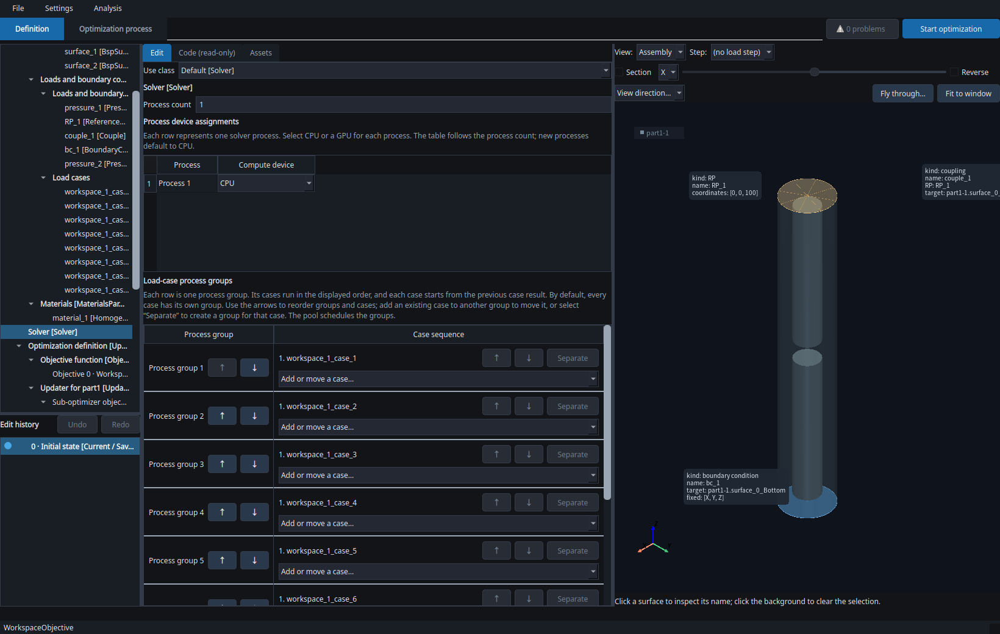

The optimization of main devices, the finite element solution process devices, and the updater devices are controlled separately for different processes. The process device table assigns a specific CPU or GPU to each process; the same GPU can be allocated to multiple processes. Having too many processes does not guarantee faster performance; multiple tasks share memory and graphics memory resources. The current standard UI does not provide all of the Newton tolerance, step size, and line search parameters. These settings can be extended through the custom class methods of the corresponding solvers.

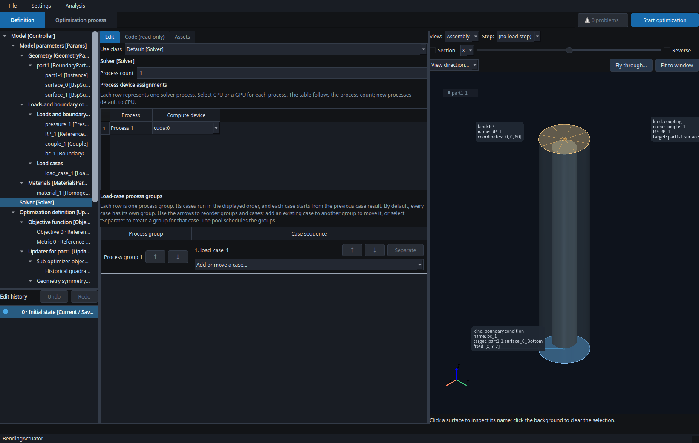

*Solver process count, device allocation per process, and task grouping based on operating conditions.*

<a id="updaters"></a>

## 10 Updaters, symmetries and constraints

**Entry Point: Model Tree → Optimizer.** Each finite element configuration corresponds to a updatable geometric Part or SIMP material. The configuration includes target items, constraints, and surface relationships. A model supports multiple update objects and their corresponding configurations.

Components, materials, instances, surfaces, load cases, and a list of target items can all be deleted to an empty state. When saving and reopening the project, an empty list will be retained. The script generated will create default instances for those instances that have been deleted. Integrity requirements must be checked before optimization begins. During the editing phase, incomplete definitions can be retained.

When deleting components or materials that are already bound to an optimizer, the interface will list the associated optimizer and require confirmation. After confirmation, both the component and its associated optimizer will be deleted. The target items, constraints, and surface relationships within the optimizer will also be removed along with the configuration. If the operation is canceled, the definitions remain unchanged. Subsequent dependencies of CAD features, symmetric constraints bound to surfaces, and derived classes of custom classes follow the same cascade deletion rules after confirmation.

Weak references become empty after the target is deleted. For example, after deleting a component, the Part and cell selection for the material become empty; after deleting an instance, the instances and their collections in the loads and boundary conditions become empty; after deleting a reference point, the reference points in the objective function, indicators, and loads become empty. When a surface is deleted, the references to the surface become empty, but the reference synchronization number for `surface_N_*` of the surface remains unchanged. Modifications to the CAD topology may reassign the full load case numbers. Therefore, after deleting a CAD feature or a boundary surface, the related `face_N` collection references become empty, and they need to be re-selected.

<a id="section-优化计算流程与更新配置"></a>

### 10.1 Optimizing the computing process and updating configurations.

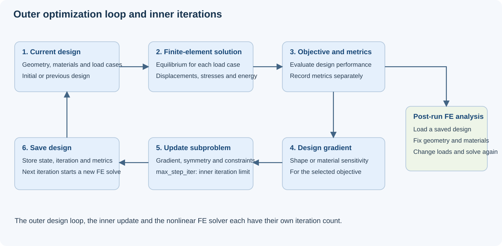

*Loop iteration between finite element solution calculations, determining the primary objective, updating the design based on gradients.*

| Configuration fields | Geometric Updater | Material Updater |
|---|---|---|
| Objective | `part_name`: Updates are possible for boundary parts. | `material_name`: SIMP design materials |
| `custom_class` | By default, the boundary or offset boundary updater is used. However, compatible rewriting methods can also be selected if desired. | By default, SIMP updater is used. You can also choose compatible rewriting tools as an alternative. |
| `max_step_iter` | Maximum number of steps per sub-solving operation | Maximum number of steps per sub-solving operation |
| `max_step_length` | Maximum update step size. Default value: `0.5` | Maximum update step size. Default value: `1.0` |
| `update_strategy` | By default, the shape is updated automatically. You can also choose to update it periodically or update it point by point. | Fixed updates |
| Update switch | On the surface editing page, set `is_updatable`, with BSP and CPGEO enabled by default; the geometry updater does not save the switch list. | `if_update` Determines whether the material field should be updated. |
| `objective_functions` | Either ShapeDerivative or QuadraticShapeDerivative, choose one | Usually, the requirement is Sensitivity. |
| `constraints` | Geometric terms such as distance, envelope, and smoothing | Volume fraction and upper/lower limits of control quantities, etc. |
| `symmetry_constraints` | Create mirroring, rotation, association, or custom relationships for the specified surface. | Not used in the material updater. |

The “maximum update step size” can be a positive number or a custom constant name. The built-in strategy uses this value as the upper limit for each control point or material variable. The actual change is limited by the `atan` mapping.

After selecting the geometric or material optimizer in the model tree, you can choose a strategy from the "Update Strategy" dropdown list, and then fill in the parameters for that strategy below.

The geometric optimizer offers three different updating strategies.

| Strategies | Input and behavior |
|---|---|
| Fixed updates for `FixedUpdate` | All registered penalties use the same coefficient. The default value is 1. Sub-problems can be solved at once. |
| Point-by-point sensitivity updates for `SensitivityShapeUpdate` | Interpolates the original gradient magnitude of control points into the surface sampling points. The sub-problem is solved in one operation. |
| Adaptive shape update: `AdaptiveShapeUpdate` | Determine the base coefficients for each penalty item. Calculate the penalty values based on the sampling points or wall thicknesses. |

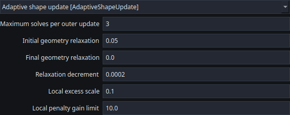

The initial and final geometric relaxation ratios of the adaptive strategy are 0.05 and 0 respectively. The tightening amount is 0.0002 each time. The default reference value for local overshoot is 0.1, and the transition zone narrows as the relaxation ratio decreases. The "maximum number of sub-optimizations per round" includes the initial optimization and all subsequent optimizations, with a default of 3 times. When there are constraints and upper limits are allowed, the strategy first performs two consecutive optimizations. Starting from the second iteration, optimization continues only if there are still local overshoot issues and remaining optimization attempts. Each iteration continues from the end point of the previous iteration, and the penalty values for the overshoot areas are adjusted between two optimizations. The solution obtained from the last sub-optimization directly enters the next round, and it is allowed to retain any local violations.

The distance, curvature, radius, and envelope are all based on a fixed cubic obstacle, and the strategy does not adjust the power. During a single sub-optimization, the coefficients, sampling factors, step size, and distance requirements remain fixed. The physical proxy always uses the original finite element sensitivity, without any scaling of maximum values, norms, or SIMP sensitivity.

Each optimizer holds an independent strategy instance, which is saved along with `.morph`, and its state is restored upon the optimization result. Details about the algorithm, log fields, and extension methods can be found in [For more information on script strategies, please refer to…](script-reference.md#section-几何更新策略与障碍积分). The adaptive strategy requires a non-negative penalty term; therefore, it cannot be directly used for volume-assisted objectives that may take negative values.

When the maximum number of sub-solutions per time step is set to 50, and the maximum number of sub-solutions per round is set to 3, a single round of design updates will perform up to 150 sub-iterations. If the system converges early, the actual number of iterations will be recorded in the history. The `max_step_iter` explicitly specified in the old task will be used as the maximum number of iterations per round. For example, if the original configuration divided 100 iterations into two sets of 50 iterations, now each round will consist of 50 iterations. The outer layer performs finite element solution and objective gradient calculation for each round, while the inner layer updates sub-problems based on gradients and constraints. This parameter does not define the total number of outer optimization rounds; instead, the number of inner iterations, outer rounds, and finite element solution iterations are recorded separately.

The newly created geometric update configuration defaults to including ShapeDerivative, Fairness, Distance, and Cylinder. Any configuration modifications should be based on existing entries. The newly created material update configuration defaults to including Sensitivity, upper and lower limits of the control variable, and volume fraction constraints. Actual entries will be determined according to the optimization task settings. Uniform materials do not include material design variables, therefore they do not belong to the SIMP update targets.


*Geometric optimizer objectives, surface update options, and internal iteration settings.*

**Selection of classes for the optimizer:** Select an optimizer corresponding to a component or material in the model tree. The "Use Class" option at the top of the editing page provides default classes and compatible override classes. Override classes inherit from each other. `morphopt.UpdaterBoundaryPart` , `morphopt.UpdaterOffsetBoundaryPart` or `morphopt.UpdaterSIMPMaterial` It is defined in “Auxiliary Code → Custom Classes → Overridden Classes”.

Each sub-optimizer stores the selected class independently. Multiple sub-optimizers of the same type can choose different implementations. Selecting the default class allows the implementation generated by the interface to be restored. Methods that have not been overridden retain the interface configuration; when explicitly overridden in `define_objective`, these methods replace the target and constraint declarations generated by the interface. The sub-optimizer is not yet bound to a target during the construction phase, and target data should be accessed during the initialization or update phases specified by the framework.


*For the BoundaryPart, the sub-optimizer selected is MyBoundaryUpdater.*


*The sub-optimizer corresponding to OffsetBoundaryPart selects a compatible offset boundary updater.*


*The sub-optimizer for SIMP materials allows independent selection of material updaters.*

<a id="section-更新目标项"></a>

### 10.2 Update target items.

**Main Objectives** reads the FE responses and evaluates the design performance; the **Update target items.** in this section receives this gradient or adds a regularization term in the sub-optimization problem. Both are located in different places on the UI.

<a id="updater_objectives-shapederivative"></a>

#### 10.2.1 ShapeDerivative: Structural sensitivity

`ShapeDerivative` uses the shape derivative of the main objective in the geometric subproblem. It is added to the geometric optimizer → objective term. Whether to update a certain surface is controlled by the `is_updatable` of that surface object.

This item uses the original finite element sensitivity to construct a first-order Taylor surrogate, retaining the numerical magnitude of the gradient. There are no independent parameters. Historical second-order surrogates are added as separate target classes.

The constraints such as envelope and distance in the geometric optimizer only control geometric conditions. The FE responses corresponding to the main objective are improved by the objective gradient term.


*ShapeDerivative introduces the concept of principal objective gradients during geometric updates.*

<a id="updater_objectives-quadraticshapederivative"></a>

#### 10.2.2 QuadraticShapeDerivative: Historical second-order shape proxy values.

When switching to the second-order proxy, **Entry point: Geometric Optimizer → Objective Items → Add → Historical Second-Order Shape Representatives.** will replace `ShapeDerivative`; additionally, the added terms will also be counted as first-order terms of the main objective.

| UI field / stored key | Default | Meaning and input format |
|---|---|---|
| Curvature history pairs / `memory_size` | `10` | The incremental value of the retained outer design, as well as the logarithmic gradient increment, must be a positive integer. |


This objective uses the finite element gradient construction to approximate the finite memory BFGS Hessian. In the first round, when there is no history of valid positive curvatures, the first-order Taylor approximation is used. The inner iteration does not involve additional finite element analysis; the historical state is saved with the optimization results and restored upon process restart. The existing step size constraints remain in effect; for a complete definition and applicable restrictions, please refer to [Script module and API reference](script-reference.md#section-有限元目标的历史梯度二阶代理).

<a id="updater_objectives-sensitivity"></a>

#### 10.2.3 Sensitivity: The sensitivity of the material

`Sensitivity` uses the primary objective to evaluate the sensitivity of the designed material field in the material sub-problem. Add it to the material optimizer → objective terms.

This method uses the sensitivity of the original materials to construct a reciprocal approximation, retaining the magnitude of the gradient without any independent parameters. The derivative of the proxy objective with respect to the material design variables at the reference design equals the input finite element sensitivity.


*Sensitivity target item in the SIMP material optimizer.*

<a id="updater_objectives-quadraticsensitivity"></a>

#### 10.2.4 QuadraticSensitivity: Historical second-order material properties

**Entry Point: Material Optimizer → Target Items → Add → Historical Second-Order Material Proxy.** This item replaces the existing `Sensitivity` material target. It manages the second-order curvature history independently.

| UI field / stored key | Default | Meaning and input format |
|---|---|---|
| Curvature history pairs / `memory_size` | `10` | The effective curvature history length must be a positive integer. |

The calculation of curvature is achieved by sharing the second-order proxy of the material with the second-order proxy of the shape. Both the proxy objectives and the curvature history use the original finite element sensitivity, maintaining their numerical values.

<a id="updater_objectives-densityfieldminimize"></a>

#### 10.2.5 DensityFieldMinimize: Regularization of density fields

`DensityFieldMinimize` Add a weak regular term that accounts for the total amount of design controls. The current implementation uses the following precise form: `scale * (sum(cps) + 1)^2` Here, cps is the control variable for the material field.

This item acts on the total control variables, does not calculate the smooth energy of the design field's spatial gradient, and does not constrain the density to be zero at each point. The scale defines its weight relative to the sensitivity term and the volume fraction term.

| UI field / stored key | Default | Meaning and input format |
|---|---|---|
| scale / `scale` | `1e-07` | Scale factor of the objective term. |

<a id="section-六类曲面对称与关联"></a>

### 10.3 Seven types of curved surface symmetries and their relationships

**Enter: Geometric Optimizer → Surface Symmetry Constraints → Add.** The built-in relationships must all specify a valid `surface_index`; the index is only meaningful within the current Part. The associated interface also requires the specification of `related_surface_index`.

Surface symmetry and CAD mirroring have different purposes: the former continuously maintains the relationship between control points during design updates, while the latter only constructs the initial CAD entity.

<a id="surface_symmetry_constraints-bspmirror"></a>

#### 10.3.1 BspMirror: BSP mirror symmetry.

`BspMirror` Maintain the mirror symmetry of the BSP surface during the update process. Select the BSP surface index within the current part. xz indicates y=0, with the requirement that offset=0; xy indicates z=offset.

For example, in bending_actuator.morph, BspMirror(xz,0) is added to surfaces 0 and 1 respectively. Each entry only applies to the specified surface, and the symmetry relationships between the surfaces are defined separately.

| UI field / stored key | Default | Meaning and input format |
|---|---|---|
| Symmetry plane / `plane` | `"xz"` | Supported load cases are xz (y=0) and xy (z=offset). Options: `xz`, `xy`. |
| Symmetry-plane offset / `offset` | `0.0` | Used only for the xy plane; the xz plane requires zero offset. |

<a id="surface_symmetry_constraints-bsprotation"></a>

#### 10.3.2 BspRotation: Periodic rotational symmetry around the Z-axis in BSP format.

`BspRotation` maintains the periodic rotational symmetry of the specified BSP surface around the global Z-axis. Select the BSP surface within the current Part, and set the symmetry order to `order`. Each axial control point is divided into independent sectors, with the first sector being in the circumferential direction. The remaining sectors are generated by rotating by −2π/order, while the Z coordinates remain corresponding. This constraint is involved in the automatic differentiation of the suboptimal problem.

The triple rotation relationship between `order=3` and the outer surface `UI.morph` needs to be maintained. When it is necessary to maintain xz mirror symmetry, register `BspMirror` for the same surface after this item. The UI will automatically adjust the number of circumferential control points according to `order`, ensuring that the periodic division meets the divisibility condition. There is no need to fill in the counting factors for the U and V directions.

| UI field / stored key | Default | Meaning and input format |
|---|---|---|
| Symmetry order / `order` | `2` | The number of sectors that are repeated over the course of a week; it must be an integer greater than or equal to 2. The rotation axis is fixed at the global Z-axis. |

<a id="surface_symmetry_constraints-cpgeomirror"></a>

#### 10.3.3 CPGEOMirror: CPGEO mirror symmetry

`CPGEOMirror` maintains the mirror symmetry of the CPGEO surface. Supports xy, xz, yz, with the offset being the normal coordinates of the plane: corresponding to z, y, x respectively.

The initial control mesh should satisfy the target symmetric layout. The constraints specific to CPGEO are only applicable to CPGEO surfaces.

| UI field / stored key | Default | Meaning and input format |
|---|---|---|
| Symmetry plane / `plane` | `"xz"` | The coordinates of the mirror plane along the normal direction are offset. Options: `xy`, `xz`, `yz`. |
| Symmetry-plane offset / `offset` | `0.0` | The normal coordinates of a symmetric plane; for example, the z-coordinate of the xy-plane. |

<a id="surface_symmetry_constraints-cpgeorotation"></a>

#### 10.3.4 CPGEORotation: CPGEO is rotationally symmetric.

`CPGEORotation` Maintain the n-fold rotational symmetry of the CPGEO surface. Select the surface index, axis direction, center, and order. For example, z, center=[0,0,0], order=3 indicates repetition every 120°.

The control mesh should be compatible with the symmetry order. Rotational symmetry constraints only affect the surface design variables, and no additional entity instances or load copies are created.

| UI field / stored key | Default | Meaning and input format |
|---|---|---|
| Rotation axis / `axis` | `"z"` | Axis of symmetry. Options: `x`, `y`, `z`. |
| Symmetry order / `order` | `2` | The number of repetitions per week is n; the difference between adjacent sectors is 2π/n. |
| Rotation center / `center` | `[0.0, 0.0, 0.0]` | The global coordinates of a point on the axis, `[x,y,z]`. |

<a id="surface_symmetry_constraints-bsprelation"></a>

#### 10.3.5 BspRelation: Relations between BSP surfaces.

`BspRelation` uses the rigid body pose to associate the control meshes of two BSP surfaces. surface_index specifies the source surface, related_surface_index specifies the following surface, and the six-component pose defines the rigid body mapping. This interface is used to maintain the shape association of repeated air cavities.

The current implementation starts from the control point of surface_index, undergoes pose transformation, and writes the data to related_surface_index. During reconstruction, the related topological data is synchronized. For example, if surface 1 is located at x=−5, and surface 2 follows it at x=5, the pose can be set to [10,0,0,0,0,0]. The associated surfaces should use compatible mesh parameters, and the initial positions after mapping should be verified.

| UI field / stored key | Default | Meaning and input format |
|---|---|---|
| Pose [tx, ty, tz, rx, ry, rz] / `pose` | `[0.0, 0.0, 0.0, 0.0, 0.0, 0.0]` | The rigid body relationship pose is `[tx,ty,tz,rx,ry,rz]`. The first three terms represent translation, and the last three terms represent rotation vectors, all in radians. |

<a id="surface_symmetry_constraints-cpgeorelation"></a>

#### 10.3.6 CPGEORelation: The surface relationships between CPGEO objects.

`CPGEORelation` uses a six-component rigid body pose to associate two CPGEO surfaces. The field and mapping direction are consistent with the BSP association: the source surface_index is transformed by the pose, and the resulting surface is written to follow the related_surface_index; both ends should be CPGEO surfaces.

These associated constraints refer to the geometric design shape. They do not automatically couple finite element nodes together, nor do they replace Couple or solid connections.

| UI field / stored key | Default | Meaning and input format |
|---|---|---|
| Pose [tx, ty, tz, rx, ry, rz] / `pose` | `[0.0, 0.0, 0.0, 0.0, 0.0, 0.0]` | The rigid body relationship pose is `[tx,ty,tz,rx,ry,rz]`. The first three terms represent translation, and the last three terms represent rotation vectors, all in radians. |

<a id="surface_symmetry_constraints-custom"></a>

#### 10.3.7 Custom: Custom-defined constraints.

Use `Custom` for constraints that cannot be expressed in the form. The code becomes part of `apply_surface_constraints(self)`, where `self` refers to the enclosing part.

The function body registers constraints through the surface object interface of the corresponding Part. At this execution stage, there is still no FE solution result. The objectives based on FE responses are defined in the objective function editor. Multiple custom code blocks are combined into the corresponding methods within the same Part.

| UI field / stored key | Default | Meaning and input format |
|---|---|---|
| Constraint function body / `code` | *empty* | Custom code executed by apply_surface_constraints. |


*BSP Mirror Symmetry: Specify the surface indices separately.*


*CPGEO Rotational Symmetry: axes, center, and repetition order.*


*The surface 1 is translated 10 units in the X direction and mapped to follow the surface 2; their shapes remain associated during the update process.*

<a id="section-几何约束与辅助目标"></a>

### 10.4 Geometric constraints and auxiliary targets

**Entry point: Geometric Optimizer → Constraints → Add.** Most geometric constraints involve penalty terms in the design update process. The input threshold defines the constraint objective, and the actual satisfaction of the update results should be verified by saving the geometric and finite element states.


*The differences between envelope control, radial limit control, surface spacing control, and curvature control.*

<a id="updater_constraints-fairness"></a>

#### 10.4.1 Fairness: Surface curvature regularization

`Fairness(max_curvature=1.0)` applies a unified curvature square sum limit to all updatable BSP/CPGEO surfaces belonging to the Part. The parameter corresponds to κ₁²+κ₂², with the unit being length⁻². A third obstacle is activated after 80% of the thresholds are exceeded.

For BSP, the calculation also includes the change in non-orthogonal parameters and the metric values, with thresholds of 0.2 and 0.1 respectively. For CPGEO, only curvature is calculated. The calculations and reference compensations are located within the penalty terms for visitors. Each surface only retains its geometry. A single Fairness entry summarizes the penalty values for all supported surfaces, using a single exponential coefficient. The settings for maxC/maxR/maxFF are no longer specified in the surface cards. Fixed surfaces are skipped in this calculation. For surfaces that do not implement the visitor mechanism, the contribution is set to zero. Currently, BREP NURBS surfaces do not automatically adopt BSP Fairness.

| Field | Default | Meaning |
|---|---|---|
| `max_curvature` | `1.0` | Upper limit for the sum of squares of positive curvatures across all points |


<a id="updater_constraints-distance"></a>

#### 10.4.2 Distance: The minimum distance between surfaces.

`Distance` Apply distance control between boundary surfaces and in non-neighboring parts of the same surface. Input a N×N matrix of min_distance values, where N is equal to the number of surfaces in the current Part. The i-th row and j-th column correspond to surfaces i and j.

For example, when both surfaces require a distance of 2.5, the value `[[2.5,2.5],[2.5,2.5]]` should be filled in. The diagonal terms control the non-neighboring parts of the same surface, playing an actual constraint role. The matrix dimensions, index correspondence, and actual wall thickness after the addition or removal of surfaces should be rechecked.

| UI field / stored key | Default | Meaning and input format |
|---|---|---|
| min_distance / `min_distance` | `[[2.5, 2.5], [2.5, 2.5]]` | Matrix of pairwise minimum surface distances. |


*The setting of “Distance” and the corresponding geometry.*

<a id="updater_constraints-cylinder"></a>

#### 10.4.3 Cylinder: Maximum cylindrical envelope constraint

`Cylinder` The restricted design is located within the cylindrical envelope centered around the global Z-axis. The radius controls the maximum radial extent towards the Z-axis, while the bottom and height represent the global lower and upper Z-boundaries, respectively.

For example, bottom=10 and height=80 define a z value within the range of [10,80], with an axial span of 70. The height represents the Z coordinate of the top surface, not the length measured from the bottom. When the instance undergoes translation, the parameters should still be determined based on the coordinates of the Part to which the constraints apply.

| UI field / stored key | Default | Meaning and input format |
|---|---|---|
| radius / `radius` | `10.0` | Radius of the geometry or radius constraint. |
| Envelope upper Z bound / `height` | `80.0` | Cylinder.height: global Z coordinate of the envelope top; penalizes z > height. |
| Envelope lower Z bound / `bottom` | `0.0` | Cylinder.bottom: global Z coordinate of the envelope bottom; penalizes z < bottom. |


*Settings for the cylinders and their corresponding geometries.*

<a id="updater_constraints-minradius"></a>

#### 10.4.4 MinRadius: Minimum radius constraint

`MinRadius` restricts the minimum radial distance of points on the surface from the global Z-axis. The radius serves as a radial limit to prevent the boundary from approaching or passing through the central axis.

MinRadius restricts the radial distance, but does not restrict the local curvature radius. Fairness controls the smoothness of the surface; InwardCurvatureRadius controls the inward curvature related to the offset layer.

| UI field / stored key | Default | Meaning and input format |
|---|---|---|
| radius / `radius` | `2.0` | Radius of the geometry or radius constraint. |


*The setting of MinRadius is related to the corresponding geometry.*

<a id="updater_constraints-volumemaximization"></a>

#### 10.4.5 Volume Maximization: Maximizing the volume of the cavity.

`VolumeMaximization` adds a volume preference for a certain CPGEO surface in the geometric subproblem. Currently, `-weight * signed_volume` is included, so the direction is related to the orientation of the surface. surf_idx represents the index of the surface within the current Part.

**Currently, only CPGEOSurface is supported for rendering; BSP surfaces cannot be used.** This interface is located in the constraint list and actually participates in the calculation as a volume auxiliary target. No hard constraints for a specific volume are defined.

| UI field / stored key | Default | Meaning and input format |
|---|---|---|
| surf_idx / `surf_idx` | `1` | Indices of the surfaces included in the objective or constraint. |
| weight / `weight` | `0.01` | Objective-term weight. |


*The settings for VolumeMaximization are related to the corresponding geometry.*

<a id="updater_constraints-inwardcurvatureradius"></a>

#### 10.4.6 InwardCurvatureRadius: Inner curvature radius constraint

`InwardCurvatureRadius` imposes constraints on the normal principal curvatures of OffsetBoundaryPart, to prevent curvatures that may lead to intersections of offset layers. This interface is hidden in the regular menu and can be configured through advanced definitions or scripts. This constraint is not automatically registered when creating offset parts.

By using the offset thickness t and the margin-based curvature threshold `margin_abs=max(margin_ratio*t+margin, ε)`, `k_limit=1/(t+margin_abs)`, only inward curvature is penalized. The following parameters are registered in the regular UI; for more detailed surface selection and barrier parameters, please refer to the source code and configure according to the actual backend interface.

| UI field / stored key | Default | Meaning and input format |
|---|---|---|
| margin / `margin` | `0.4` | Boundary margin for the curvature constraint. |
| margin_ratio / `margin_ratio` | `0.45` | Boundary-margin ratio for the curvature constraint. |
| p / `p` | `8` | Penalty exponent. |
| penalty_scale / `penalty_scale` | `1000.0` | Scale factor of the penalty term. |

<a id="updater_constraints-offsetsurfaceminthickness"></a>

#### 10.4.7 OffsetSurfaceMinThickness: Minimum thickness constraint for the surface after offsetting

`OffsetSurfaceMinThickness` refers to the minimum distance between the surfaces after offsetting, as well as the available thickness. This parameter is hidden in the regular menu and can be configured through advanced definitions or scripts. This constraint is not automatically registered when creating offset components.

The `min_distance` in this interface is a scalar representing length. The corresponding parameters of the ordinary Distance type are N×N matrices. The current field label uses the term “distance matrix” for reference. The actual definition shall follow the following table.

| UI field / stored key | Default | Meaning and input format |
|---|---|---|
| min_distance / `min_distance` | `2.0` | The minimum distance between the offset surfaces, represented as a scalar value; it is not a N×N distance matrix. |

<a id="section-材料约束"></a>

### 10.5 Material constraints

**Entry Point: Material Optimizer → Constraints → Add.** The material optimizer specifies SIMP material targets and sets volume fractions and control quantity boundaries for them. Material constraints act on the material design field and do not directly limit the geometric volume of the boundary surface.

The newly created material optimizer defaults to including `Sensitivity` objectives, as well as `MinValue`, `MaxValue`, and `VolFrac` constraints. The initial limits for the variables are -15 and 15, and the allowable range for the volume fraction is 0 to 0.6. The volume fraction constraint prioritizes the cell blocks specified by the material; if no cell block is specified for the material and the Part contains only one cell block, that block will be automatically selected. If multiple candidate blocks exist, an explicit selection is required. The editing process allows for leaving fields blank temporarily, but it is still necessary to fill in valid cell block names when exporting and running scripts.

<a id="updater_constraints-volfrac"></a>

#### 10.5.1 VolFrac: Volume fraction constraints

`VolFrac` specifies the allowable range for the proportion of SIMP material within the specified unit block. elementname indicates the target unit block; for BoxPart, C3D8 is commonly used.

The current proportion is the volume-weighted average of the integral points `sigmoid(f)`, not the stiffness ratio after RAMP. A penalty of the square of the amount is applied when exceeding `[volfrac_min,volfrac_max]`. The elementname must be clearly specified and consistent with the target cell block of the current material.

| UI field / stored key | Default | Meaning and input format |
|---|---|---|
| volfrac_min / `volfrac_min` | `0.0` | Minimum allowed volume fraction. |
| volfrac_max / `volfrac_max` | `0.6` | Maximum allowed volume fraction. |
| penalty / `penalty` | `10000.0` | Penalty coefficient for volume-fraction deviations. |
| Elems name / `elementname` | *empty* | Explicitly select the target Part.elems name. |

<a id="updater_constraints-minvalue"></a>

#### 10.5.2 MinValue: Minimum density constraint

Set the lower bound for the control variable of the material field as `MinValue`. Apply a penalty when the variable is less than `xmin+threshold`. The power of the penalty controlled by p can be adjusted.

What is restricted is the B-spline control variable, not the material volume fraction ranging from 0 to 1. xmin=-15 represents the sigmoid output that can approach zero, not the allowed negative material proportion.

| UI field / stored key | Default | Meaning and input format |
|---|---|---|
| Design variable lower bound / `xmin` | `-15.0` | Lower-bound penalty on design-field control variables, before sigmoid and RAMP interpolation to the material ratio. |
| Bound inset / `threshold` | `0.0` | MinValue penalizes variables below xmin + threshold; MaxValue penalizes variables above xmax − threshold. |
| p / `p` | `2` | Penalty exponent. |

<a id="updater_constraints-maxvalue"></a>

#### 10.5.3 MaxValue: Maximum density constraint

`MaxValue` Set an upper limit for the control variables in the material field. The variables must be greater than this limit. `xmax-threshold` Penalties can be imposed at certain times. The exponent of the penalty is controlled by p.

MinValue and MaxValue can be used together to prevent the control values from entering the sigmoid saturation region too deeply. The effective range after shifting the thresholds should remain reasonable.

| UI field / stored key | Default | Meaning and input format |
|---|---|---|
| Design variable upper bound / `xmax` | `15.0` | Upper-bound penalty on design-field control variables, before sigmoid and RAMP interpolation to the material ratio. |
| Bound inset / `threshold` | `0.0` | MinValue penalizes variables below xmin + threshold; MaxValue penalizes variables above xmax − threshold. |
| p / `p` | `2` | Penalty exponent. |


*Material volume fraction constraints: range, penalty coefficient, and target cell size.*


*Boundary settings for the control variables in material design.*

<a id="custom-code"></a>

## 11 Helper code and custom classes

<a id="section-代码入口与作用范围"></a>

### 11.1 Code entry point and scope of action

| Entry point | Definition | Applicable scenarios | Generate locations |
|---|---|---|---|
| Custom constants | Constant name, value expression | Share parameters such as length, pressure, and ratio. | Generating module-level constant definitions |
| Auxiliary functions | Name, parameters, body | Numerical relationships that are reused multiple times | Functions of the generation module |
| Auxiliary free code | helper_code | Import, common constants, general auxiliary code | Generate module-level code |
| Custom class | Class name, base class, method body, binding | Constructing, solving, and updating the logic related to framework objects. | Module-level class definitions and their usage points |

The value of **Example of custom constants:** `tube_length` is `80.0`. The length field of the surface references this value through `tube_length`. During the execution of the script, MorphOpt will not modify this defined value.

The parameters of **Example of auxiliary function:** `pressure_schedule` are `scale=1.0`, and the body is `return pressure_value * scale`. Under the conditions defined by the custom constant `pressure_value=0.06`, the load case expression `pressure_schedule(0.8)` returns the scaled pressure value.

The body field of the auxiliary function contains the function body, and the parameters field contains the list of parameters. Neither field contains any additional def declarations. Variable references and function calls follow the Python naming conventions and execution order. The auxiliary code is executed as Python module code.


*Custom constants and functions: names, parameter lists, and code bodies.*

<a id="section-新建类与重写框架类"></a>

### 11.2 Creating new classes and overriding framework classes

| Project | Definition and Function |
|---|---|
| Class name: `name` | Valid Python identifiers; must not conflict with framework names or other custom classes |
| Category: `class_type` | `new` defines independent classes, while `override` defines extensions to the framework classes. |
| Base class / `base_class` | Selected from the current directory. Keep compatibility with base classes. Example: `morphopt.FEAParams.Pressure` |
| Override method | Select from the base class method directory. The framework provides the actual signature; users can edit the body section. |
| New functions added | Define the function name, parameters, and body; instance methods usually include self. |
| Application / Binding | The choice of object-level custom classes or the binding of framework paths determine the actual location where these classes will be used. |

The custom class configuration includes the selection of the base class, the definition of overridden methods, and the use of point binding. The overridden methods retain the signature of the base class, and super() is called according to the extended logic. The list of base class methods is generated from the actual interface of the current version. The generated code is used to verify the method signatures and the binding results.


*Custom framework classes and methods for overriding entry points.*


*The signature of apply_fea_value(self, fe, name) is provided by the base class, and the function body retains the corresponding super call.*

**Selection of the ObjectiveFunction class:** Create an inheritance in "Auxiliary Code → Custom Classes → Override Classes". `morphopt.ObjectiveFunction` Add classes and add methods that need to be overridden. After selecting “ObjectiveFunction” in the model tree, the “Use Classes” option at the top of the editing page will list the default classes and compatible overridden classes. This selection follows `.morph` Save. Selecting the default class will restore the implemented interface definitions.

The explicit reimplementation of `objective_function` or `get_metrics` replaces the corresponding interface generation method; the methods that are not reimplemented retain their original interface generation implementation. In the generated code, `ObjectiveFunction(MyObjectiveFunction)` indicates that the reimplementation class is enabled.


*The objective function uses the same class selector controls as other top-level components. Only those compatible override classes are listed here.*

<a id="section-对象生命周期与方法执行阶段"></a>

### 11.3 Object lifecycle and method execution phases

| Lifecycle position | Main operations | Typical scenarios |
|---|---|---|
| The define phase of construction/definition process. | Declared parameters and components | Add additional geometries, interfaces, materials, or conditions/updates to the model. |
| initialize | Once all required objects are available, the references will be resolved and the data will be prepared. | Search for instances, RPs, and units, and establish caches. |
| Build hooks like build_part | Generate nodes, elements, and collections for finite element components. | Custom Parts |
| FE solves the problem | Calculate the equilibrium state based on geometric principles, material properties, and operating conditions. | The extended solving strategy must comply with the requirements of the solver interface. |
| objective / metrics | Fetching responses from FE status database | Customizable objectives and record quantities |
| updater | Changing the design using gradients and constraints | Custom shapes or materials update items |
| Save / Export | Recording status and data | Save additional diagnostic or visual information. |

During the object construction phase, it is not guaranteed that the geometry, materials, and solution results will be fully available. Data access should comply with the method signature and execution phase. The objective function, custom Part, and self in the update objective each point to their respective objects.

<a id="section-生成代码与持久化接口"></a>

### 11.4 Generate code and persist the interface data.

- **`.morph`：** saves the structured definitions, load cases, updaters, custom codes, and bindings. It is the main file for further editing.
- **Generate code page:** View the Python code defined currently, including the construction and registration locations of Part, FEAParams, MaterialsParams, ObjectiveFunction, Solver, and Updater.
- **Exporting Python:** should be used when the script needs to be executed or further programmed. If the subsequent work mainly involves UI editing, it is necessary to save `.morph` and regenerate the script to ensure that the UI definitions are consistent with the script version.

The registration locations for the main interfaces are as follows. For the complete script, please refer to the generated code page:

```text
Geometric Parts → Register Instance / Boundary Surfaces / CAD Operations
FEAParams.define_interface → Register payloads, boundaries, RPs, connections, and contacts based on their names.
FEAParams.define_steps → Set interface values for various operating conditions.
MaterialsParams → Assign materials based on part/unit size.
ObjectiveFunction → Calculate the main target, record metrics, and determine the Jacobian load.
Updater → Register update items based on targets, as well as constraints and relationships between surfaces.
```


*The generated code page is used for verifying parameters, registering locations, and determining the actual usage of custom classes.*

<a id="definition-assets"></a>

### 11.5 Asset list and preview

The central "Assets" page displays a list of files shared during the script execution. The list is organized by asset type, showing the file name, format, and byte count. After selecting an item, the relative export path, original source, reference locations, and corresponding previews are displayed below. Resources with the same name but different content are displayed together, along with all reference locations. Resources with the same name but different content are exported with different names.

| Geometry assets | Preview content |
|---|---|
| STEP / STP | Import the original CAD geometry and topological edges from the file; no subsequent CAD features or instance transformations are applied |
| STL | Original triangular surfaces are rendered using continuous surface shading techniques. |
| INP | Refers to the first INPPart in this file, which defines the grid of the selected component. This grid serves as the basis for displaying the boundaries of the component. |

Geometric assets use local file coordinates, supporting rotation, scaling, preset viewing angles, and adaptation to windows. Preview is a read-only operation. Parametric components continue to be displayed in the right-side model view. After modifying the external file, click "Refresh Assets" to re-read the inventory and preview. If the file is inaccessible or the format is not supported, an error message will be displayed on the page.


Asset records include categories and formats. Other categories are extended through independent preview components. For the interface definitions, please refer to [Code structure: Resources and preview components](codestructure/ui-application.md#asset-previews).

<a id="results"></a>

## 12 Visualization, optimization history and finite-element postprocessing

<a id="section-定义预览检查输入模型"></a>

### 12.1 Define preview: Check the input model.

On the right side of the main definition page, a 3D preview of the current definition is displayed. The "Component" view shows the initial geometry of the selected Part, while the "Assembly" view displays the pose and relative positions of the components. The load case can be selected to switch between preview states for the loads and boundaries. The view supports mouse dragging for rotation and wheel zooming. All 3D windows share a perspective bar, providing ±X, ±Y, ±Z, orthographic projection, and "Window Adaptation" options. The axial perspective views are taken from the positive or negative direction of the corresponding axis. The "Window Adaptation" option retains the current viewing direction and adjusts the model display range accordingly. Switching between states preserves the camera direction and zoom level during iterative processing.

**Settings → Appearance → Visualization Settings** provides application-level 3D display parameters, with parallel projection being the default method. The draft can be independently previewed within the window. When the "Apply" button is clicked, all viewports are updated and saved locally. Clicking the "Confirm" button applies the changes and closes the window. Clicking the "Cancel" button discards any unapplied modifications. The color scheme is still controlled by the dark or light theme.

| Parameters | Display effects |
|---|---|
| Projection | Parallel projection maintains the relationship between parallel lines; perspective projection creates an effect where objects appear larger closer to the viewer and smaller as they move further away. |
| Light intensity | Adjust the main light and auxiliary light in the same proportion, with a range of 0–3. |
| Ambient | Base brightness, independent of the surface direction. Value ranges from 0 to 1. |
| Diffuse | Brightness that changes with the direction of the surface; range: 0–1 |
| Specular | Mirror reflection brightness, ranging from 0 to 1 |
| Specular power | The concentration of highlights, ranging from 1 to 128. |
| Smooth surface shading | Switch between smooth shading and per-face shading without modifying the geometry or finite element mesh. |

The above parameters are used to define preview, geometric assets, historical designs, load case deformations, and finite element results. Color mapping, transparency, sectional views, and surface selection retain their original meanings. The historical GIF export records the current camera, lighting, and shading parameters.

The surface names can be queried by clicking with the mouse. The display number is not permanently shown. After clicking on a surface, it will be highlighted, and the component name, surface name, and assembly instance name will be displayed below the viewport. Clicking on the blank area will clear the selection. In CAD, `face_N` is displayed, while in Box, `surface_xmin` is displayed for directional surfaces. BoundaryPart and OffsetBoundaryPart display `surface_N_All` and the names of the outer surface ends. INPPart displays the surface collection names from the original file. When the same display triangle belongs to multiple collections, the corresponding names will be listed simultaneously. The prompt text can be selected and copied. Dragging and rotating do not trigger surface selection.

The component view depicts the cuboid bounding box of the current Part in a 3D diagram, with the minimum and maximum coordinates marked along the X, Y, and Z axes. The coordinates are based on the local coordinates of the component and the model units. The geometry is calculated based on the complete preview, and it updates as the geometry changes, without being affected by section clipping.

After selecting "Section View" above the viewport, you can choose the X, Y, or Z axis, and drag the slider to move the cutting plane. With "Reverse" mode, the side to be retained is displayed on the right side, along with the current cutting coordinates. The assembly view uses the global coordinates of the assembly, while the component view uses the local coordinates of the component. The section view only shows the geometry that is cut out, while the original surface names remain unchanged; the geometry that is cut out does not participate in the selection process. After moving the cutting plane, the current selection is cleared. Clicking on the surface to be retained allows for further querying. Turn off "Section View" to restore the full geometry display.

The preview is not a nonlinear FE solution. The load arrows or reference point icons are used to check the input, but they cannot be used to determine convergence, stress, or optimization results. Some imported models require the source files to be accessible in order to complete the preview.

<a id="section-字体设置与应用范围"></a>

### 12.2 Font settings and applicable scenarios

**Settings → Appearance → Font Settings…** can complete the selection of roles, font, and preview within the same window, eliminating the need to pop up a separate font dialog box for the next step.

| Classification | Application content |
|---|---|
| Interface text | Menus, buttons, forms, instructions, and operation history |
| Left model tree | Define the characters for Chinese names and class names within the tree structure. |
| Editor headings | Chapters, cards, and wizard titles in the middle editing area |
| Code | Source code and code editing area |
| Charts | Title, axes, ticks, and legend text in Matplotlib charts |

For each load case, different Chinese fonts, Western fonts, and Western character styles are selected, with a common font size used. By default, all use the system font. After Chinese is explicitly selected, even if the default Western font contains Chinese characters, the selected font will be used to display Chinese characters.

To modify the settings, first update the preview in the window. **Apply** saves all the drafts and takes effect immediately, with the window remaining unchanged. **Confirm** saves the changes and closes the window. **Cancel** or close the window to discard any unapplied modifications, while applied settings will remain intact. "Restore system fonts" and "Restore all system fonts" require modifying the drafts before they can be applied or confirmed. Preferences are only saved locally and not written to `.morph`.


<a id="section-优化过程历史记录与设计演化"></a>

### 12.3 Optimization process: history and design evolution

**Entry point: “Optimization Process” at the top.** “File → Open Optimization Results…” is used to load the saved history from the specified running directory. The selection of outer rounds and load cases is used to locate the results. This page is also accessed when a new optimization task is initiated.

| Controls / Content | Functions/Features | Key points for verification |
|---|---|---|
| Select the operation to execute. | Switch between multiple task records. | Definitions with the same name may refer to operations occurring at different times. |
| Round list / Select | Switch to the designed solution that has been saved. | Only the actual rounds that have been completed are displayed. This does not indicate that convergence has been achieved. |
| Target and indicator curves | Display target trends and physical responses | The loss values include both symbols and weights. The physical direction of the indicators can still be retained. |
| Initial/Current Geometry | Compare changes in boundary design | Use a consistent perspective. Check the dimensions and wall thickness when necessary. |
| Load-case deformation | Displays the FE response of the selected design under the specified operating conditions. | It’s necessary to distinguish between the geometric changes caused by the design, and the actual deformations that occur after the object is loaded. |
| Exported history | Export the BoundaryPart surface for the specified iteration, or export the GIF image showing the deformation due to the design and load case | Adopting the current components, surfaces, and rounds automatically selects supported formats; for GIFs, choose components or load cases, round ranges, and frame rates, using the current camera and materials. |
| Logs and status information | Determine whether the current operation is solving, updating, saving, or encountering an error. | The valid results after the process stops will be based on the last complete save operation performed. |
| Continue with the existing operations. | Continue to optimize the system from the saved state. | Please verify the definitions of “freezing”, devices, and the resulting directories. Do not overwrite the original records arbitrarily. |


*Optimized records: saves iteration details, metric curves, and results for further review.*


*Save the geometric visualization of the designed structure.*


*Preview the deformation of the selected design under the specified operating conditions.*


*Logs and error reports from the actual operation phase.*

On the left side, the optimization indicators, optimization logs, various geometric/material components, and different load cases are displayed in a tabular format. After selecting a geometric component, the view can be switched to show all boundaries, individual surfaces, or the BSP/CPGEO control point grids. SIMP uses its material field view. The indicator page and log page do not display iteration sliders. Sliders and automatic tracking are located on the 3D result page. The **Export optimization history** below the left list opens an independent export window.


Select column widths for historical tables based on titles and content, maintaining the minimum width while supporting horizontal scrolling; records are distinguished by alternating background colors. Initialization, finite element, sensitivity, and update times are all displayed in seconds. The curve selector below allows for the separate display of overall targets, each named indicator, and other historical values. Target items and user indicator numbers start from 0; the UI automatically appends target contributions such as `objective_0` to the user indicators.

Read the `.log` file located in the optimization log result directory. You can choose to read the optimization log or the finite element log. Even if there is no complete iteration yet, the output logs can still be viewed. The follow-up option is independent of the geometric history follow-up: keep the reading position when selecting text or dragging the scroll bar, and resume the follow-up after returning to the bottom. Python calculation errors and tracking information are written into the optimization log.


The historical surface displays the geometry during the finite element calculations for the selected iteration. The new results are saved as the surface during this round of calculations; the earlier results are restored according to the breakpoints updated in the previous round, and the first round is restored according to the definitions defined in the archiving task.

**Design components** lists the components in the task where export items have been declared. After selecting the iteration step and components, the window will display the export options provided by those components. One complete component is exported at a time.

| Component | Output |
| --- | --- |
| BoundaryPart | Derive all surfaces using the local coordinates of the components. BSP and BREP are written in STEP format, while CPGEO and MeshSurface are written in STL format. |
| SIMP materials | Export a complete sample field for the design view of **Material density field (VTI)**. Export quadrilateral mesh with threshold filtering for **Voxel surface (OBJ)**. |
| Customizable updateable components | The optional scheme is specified through `export_modes`, and will be implemented by component `export()`. |

After selecting **Voxel surface (OBJ)**, **Voxel size** specifies the desired voxel size. The default value is 1, with units consistent with the model length. All axes are evenly divided, and the actual voxel size is less than or equal to the set value. **Retention threshold** represents the relative density of the material at the center of the voxel. The default value is 0.5. For example, if the model is measured in millimeters, entering 0.5 means the desired voxel size is 0.5 mm. A threshold of 0.7 means only those voxels with a relative density greater than 0.7 will be retained. The sampling covers the bounding box of the material's design field; the output file `voxels.obj` contains the outer surfaces of the retained areas and the inner cavity surfaces.


**GIF animation** provides two sources of data: design configurations and load case deformations. BoundaryPart can choose between complete configurations, single surfaces, or control grid views that support these configurations. The camera can use the perspective of the observation window, select an axial or isometric preset, or input the camera position, observation point, and upward direction based on the model coordinates. The right side automatically displays the static image of the completed iteration step. The preset perspective is used for framing at that step, and the entire animation remains with the camera fixed. **Background color** Initially, the current viewport background is used, and the selected color is used for both the preview and all exported frames. Iterations without deformation data will be skipped.


**Abaqus INP** lists the iterations with archived finite element models and the corresponding saved load cases. The exporter reads the undeformed mesh for that round, restores the load parameters for the selected load cases, and generates input files for the static analysis in Abaqus/Standard using TorchFEA. **Geometric nonlinearity** controls the NLGEOM option for the analysis steps. During export, `NeoHookeanLnJ` uses Abaqus’ standard Neo-Hookean material, with parameters `C10 = μ/2` and `D1 = 2/κ`. This mapping retains the initial shear modulus and bulk modulus; when finite volume deformation occurs, there are differences in the volume responses of the two materials. For models lacking Abaqus material mappings, **Part meshes only** can be selected to retain nodes, elements, sets, and surfaces, and to define materials and analysis steps in Abaqus/CAE.

The GIF frame intervals are recorded with the specified time precision. The number of archiving operations indicates the progress made so far. The convergence and geometric feasibility need to be verified separately.

<a id="section-事后有限元固定设计的工况分析"></a>

### 12.4 Post-event finite element analysis: Conditioning analysis for fixed designs

**Entering Point: Conditions of Use and Calculation Results / Finite Element Results Page.** The selected saving iteration and operating conditions have been determined, along with the analysis model and result sources.

| Controls/Operations | Definitions and functions |
|---|---|
| Iteration | Specify which round of design and FE models should be used. |
| Operating conditions / Calculation results | Choose between the original optimized result and the recalculated result to avoid confusion regarding the source of the data. |
| Undeformed / Deformed displayed | Check the original grid and the grid after the transformation. |
| Field variables and components | View the fields supported by the displacement, stress, or existing results; the meaning of scalar/vector components is determined by the interface fields. |
| Equivalent stress | The bias stress intensity is represented using a scalar value. It does not directly equal the material failure criterion. |
| Optimizing the iterative selection list | Expand and select the saved outer optimization iteration; the FE solver’s internal iterations are read from the calculation logs. |
| Modify the payload parameters. | Adjust the operating parameters in the independently designed analysis copies. |
| Start calculating / Output results | Re-solving the fixed design, checking the process and whether it converges. |
| Result selection | Return to the original results, or choose to view the independent calculation results separately. |

**Content of the current field variable selector:**

| data | Optional components | Meaning and units |
|---|---|---|
| displacement | U、U1、U2、U3 | U represents the displacement modulus. 1/2/3 correspond to global X/Y/Z coordinates. The unit of length is also indicated here. |
| Cauchy stress | S_Mises、S11、S22、S33、S12、S13、S23 | Stress unit; Shear component is read according to tensor conventions. |
| Green–Lagrange strain | E11、E22、E33、E12、E13、E23 | Dimensionless; shear is considered a tensor component, not an engineering-defined shear strain. |
| Strain energy density | strain_energy_density | The energy per unit reference volume, with dimensions consistent with stress. |

The list of field variables only includes the physical quantities supported by the current model and results. Disabling "deformation display" only changes the grid drawing position; the field values still come from the selected solution results. There is no separate input box for the deformation magnification factor on the current finite element page.

Afterwards, the finite element method is used to calculate the structural response after adjusting the load, under the conditions of fixed geometry and material. This process is independent of design optimization, and does not update the original `.morph` definitions. When multiple pressure conditions are involved in the optimization, the corresponding load cases and target items should be set on the main definition page.


*The finite element displacement field of the saved design has been saved.*


*Equilibrium stress field: Can be determined by referring to the legend, units, and the selected operating conditions.*


*After the process, select the saved optimization iterations in the finite element analysis.*


*Modify the pressure parameters based on the fixed design, in order to conduct post-analysis.*


*Results of independent calculations for pressure of 0.04 MPa.*

In this case, within the same design iteration, the pressure was adjusted from 0.06 MPa to 0.04 MPa, and then the solution was re-evaluated. The responses under different pressure conditions should be compared while maintaining consistency in geometry, units, and observation perspectives. The corresponding results should also be recorded with appropriate names.

<a id="section-导出接口"></a>

### 12.5 Export interface

| Output | Location and content of data | Information retained during use |
|---|---|---|
| BoundaryPart – Designed Surfaces | Export all surfaces for the selected round. | Round number, component name, surface number, local coordinates, model unit |
| Historical design and deformation animations | Use the same components, conditions, and perspectives as before. Export the GIF file based on the iteration range and frame rate. | Source, object, round range, and perspective |
| Node data | Node positions, displacements, and the set of nodes supported by the interface | Instance and node IDs, coordinate system |
| Points data | The location of unit integration points corresponds to various measurable quantities such as energy, strain, and stress. | Unit blocks, unit/integration point indices, and component conventions |
| Reference point data | Coordinates, translations, rotation vectors, and transformed coordinates | RP name, operating conditions, rotation unit: rad |
| Archiving of models and results | Used for reloading and continuing the analysis process. | The model file and result files should be used together. |

The cloud maps of stress, strain, and energy are first averaged over the element based on the reference integral volume, and then the neighboring elements are averaged at the node level. The sampling positions of the node values are different from those of the integral points; the cloud map obtained from node averaging does not equal the extreme values at the original integral points. Subsequent statistics should establish a correspondence between the actual derived positions and numbers. The node array and the integral point array should not be directly matched by row numbers.


*Finite element results export interface.*


*Exporting points data and selecting locations.*


*The position, displacement, and rotation vectors of the reference point are calculated accordingly.*

<a id="index"></a>

## 13 Configuration checks and interface index

<a id="section-常见现象与配置核查"></a>

### 13.1 Common phenomena and configuration verification

| Phenomena or configuration requirements | Objects of verification |
|---|---|
| The reference point load was not transferred to the entity. | References between RP, instances, and node sets in a couple. Also includes the connection status between points of reference and entities. |
| There is unexpected movement in certain areas, or the model appears to be undergoing rigid body movements. | The set of nodes of BoundaryCondition, fixed translation components, and model connection conditions |
| The direction of pressure application in the cavity does not meet expectations. | External boundary/inner cavity order, pressure distribution along the normal direction, and notation for different operating conditions. |
| The object responsible for material distribution is not clear. | The part_name and elementname of the material; the target is the name of the part. |
| Initial_ratio is set to 0.5, which does not match the expected material proportion. | Compare Sigmoid and RAMP, and distinguish between f, ρ, and r. |
| The boundary is locally sharp, or the parametric quality of the surface is poor. | Max_curvature of Fairness, supported surface types, and control mesh settings |
| Local minimum curvature radius control | The applicable range of Fairness, InwardCurvatureRadius, and MinRadius in terms of radial limits |
| The load surface has changed after the CAD settings were modified. | Ultimately, there is a reference relationship between face_N and the corresponding node set. |
| The optimization of materials did not result in the desired improvements. | SIMP updates objectives, switches, sensitivity levels, and determines whether the main objective is differentiable. |
| The metric has been recorded, but the design has not been updated yet. | Main objective, gradient terms, update switches, and constraints; the metrics are used solely for recording purposes. |
| When max_step_iter is set to 50, the outer optimization process will exceed 50 iterations. | This field specifies the number of internal iterations for updating the sub-problem. The overall execution control is set separately. |
| Comparison of different pressure responses under fixed designs | Post-event finite element analysis; when multiple pressure conditions need to be considered during optimization, multiple operating conditions from the main definition set can be used. |
| Custom classes are not enabled during runtime. | Compatibility between applications and their binding states, resulting in actual class references in the generated code. |

<a id="section-全部注册对象索引"></a>

### 13.2 Index of All Registered Objects

The table includes ordinary add-in components, basic classes that require custom implementation, as well as advanced constraints that are hidden from the menu. The complete list of fields is stored in [interface-catalog.json](images/ui-reference/interface-catalog.json) for easy comparison between versions.

| Group/Teams | quantity | This article's interface |
|---|---:|---|
| part | 6 | [BoundaryPart](#part_types-boundarypart), [INPPart](#part_types-inppart), [BasePart](#part_types-basepart) (customized), [BoxPart](#part_types-boxpart), [CADPart](#part_types-cadpart), [OffsetBoundaryPart](#part_types-offsetboundarypart) |
| Boundary surfaces | 5 | [bsp_cylinder](#surface_types-bsp-cylinder)、[cpgeo_cylinder](#surface_types-cpgeo-cylinder)、[cpgeo_sphere](#surface_types-cpgeo-sphere)、[mesh_surface](#surface_types-mesh-surface)、[brep_surface](#surface_types-brep-surface) |
| CAD operation | 14 | [Box](#cad_operation_types-box)、[Wedge](#cad_operation_types-wedge)、[Cylinder](#cad_operation_types-cylinder)、[Sphere](#cad_operation_types-sphere)、[Cone](#cad_operation_types-cone)、[Torus](#cad_operation_types-torus)、[StepImport](#cad_operation_types-stepimport)、[Fuse](#cad_operation_types-fuse)、[Cut](#cad_operation_types-cut)、[Intersect](#cad_operation_types-intersect)、[Translate](#cad_operation_types-translate)、[Rotate](#cad_operation_types-rotate)、[Dilate](#cad_operation_types-dilate)、[Mirror](#cad_operation_types-mirror) |
| Loads / Boundaries / Connections / Contacts | 15 | [Pressure](#load_types-pressure)、[ConcentratedForce](#load_types-concentratedforce)、[ConcentratedMoment](#load_types-concentratedmoment)、[Bodyforce](#load_types-bodyforce)、[SpringToGround](#load_types-springtoground)、[SpringBetweenRPs](#load_types-springbetweenrps)、[SphericalJoint / SingleDoFJoint](#load_types-joints)、[PenaltyDoF](#load_types-penaltydof)、[BoundaryCondition](#load_types-boundarycondition)、[BoundaryConditionRP](#load_types-boundaryconditionrp)、[Couple](#load_types-couple)、[ReferencePoint](#load_types-referencepoint)、[Contact](#load_types-contact)、[ContactSelf](#load_types-contactself) |
| Material interfaces | 2 | [HomogeneousMaterial](#material_types-homogeneousmaterial)、[SIMP_BSPFieldMaterials](#material_types-simp-bspfieldmaterials) |
| Update targets | 5 | [ShapeDerivative](#updater_objectives-shapederivative)、[QuadraticShapeDerivative](#updater_objectives-quadraticshapederivative)、[Sensitivity](#updater_objectives-sensitivity)、[QuadraticSensitivity](#updater_objectives-quadraticsensitivity)、[DensityFieldMinimize](#updater_objectives-densityfieldminimize) |
| Surface Symmetry and Correlation | 7 | [BspMirror](#surface_symmetry_constraints-bspmirror)、[BspRotation](#surface_symmetry_constraints-bsprotation)、[CPGEOMirror](#surface_symmetry_constraints-cpgeomirror)、[CPGEORotation](#surface_symmetry_constraints-cpgeorotation)、[BspRelation](#surface_symmetry_constraints-bsprelation)、[CPGEORelation](#surface_symmetry_constraints-cpgeorelation)、[Custom](#surface_symmetry_constraints-custom) |
| Geometric and material constraints | 10 | [Fairness](#updater_constraints-fairness), [Distance](#updater_constraints-distance), [Cylinder](#updater_constraints-cylinder), [MinRadius](#updater_constraints-minradius), [VolumeMaximization](#updater_constraints-volumemaximization), [InwardCurvatureRadius](#updater_constraints-inwardcurvatureradius) (hidden), [OffsetSurfaceMinThickness](#updater_constraints-offsetsurfaceminthickness) (hidden), [VolFrac](#updater_constraints-volfrac), [MinValue](#updater_constraints-minvalue), [MaxValue](#updater_constraints-maxvalue) |

<a id="section-实现对照与截图来源"></a>

### 13.3 Completed the process of identifying comparisons and sources of screenshots.

The following table lists the fields and their implementation locations in the registration interface. The interface definitions after the software version update shall be based on the corresponding source files and the current UI-generated code.

| Reference content | Source file |
|---|---|
| Registered objects and the range of entries | [registry.py](../../src/morphopt/ui/model/registry.py) |
| Default values for various interface fields | [node_types](../../src/morphopt/ui/model/node_types) |
| Constitutive parameter relationships | [material_models.py](../../src/morphopt/ui/model/material_models.py)、[models.py](../../src/morphopt/optcore/modelparams/materials/models.py) |
| Filter displayed fields based on current constitutive properties. | [fields.py](../../src/morphopt/ui/application/fields.py) |
| Generation of code for operating conditions, objectives, geometry, and update mechanisms. | [generator.py](../../src/morphopt/ui/codegen/generator.py) |
| Collection and naming of STL, INP, and STEP resources | [assets.py](../../src/morphopt/ui/codegen/assets.py) |
| Twelve FE data templates | [snippets.py](../../src/morphopt/ui/codegen/snippets.py) |
| Custom class signatures and bindings | [custom_classes.py](../../src/morphopt/ui/codegen/custom_classes.py) |
| SIMP interpolation and volume fraction | [simpmaterial.py](../../src/morphopt/simp/simpmaterial.py)、[volfrac.py](../../src/morphopt/simp/objectivefuncs/volfrac.py) |
| Advanced constraints for bias geometry | [constraints.py](../../src/morphopt/codesign/constraints.py) |

Browse the [English screenshot gallery](images/gallery.md) or the [Chinese gallery](../zh-CN/images/gallery.md). The [capture manifest](images/current-capture-manifest.json) records definitions, font settings and image dimensions.
